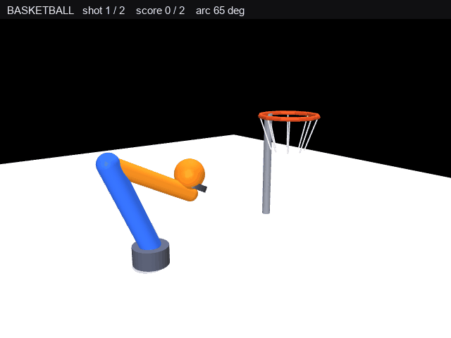

# 机械臂投篮入筐 —— 设计与验证

功能包源码位于仓库的 `src/chap8/mujoco_arm_ball` 目录。



## 1. 任务

三自由度空间机械臂末端托球，连续投 2 球：每球先举到预备点蓄力，
释放前快速上摆到出手点，把球按 65° 仰角抛向篮筐入筐计分。
完整演示"取球蓄力 → 上摆出手 → 球沿抛物线入筐 → 回位取第二球"。

## 2. 机械臂与场景模型

| 部件 | 说明 |
|---|---|
| 肩方位 yaw | hinge 轴 (0 0 1)，范围 ±180°（`range="-3.14159 3.14159"` rad） |
| 肩俯仰 pitch1 | hinge 轴 (0 -1 0)，范围 ±120°（`range="-2.0944 2.0944"` rad） |
| 肘俯仰 pitch2 | hinge 轴 (0 -1 0)，范围 ±150°（`range="-2.6180 2.6180"` rad），**建在 `l2` body 内** |
| 杆长 | L1 = L2 = 0.30 m，肩俯仰中心高 0.06 m |
| 末端 | 红球 tip（半径 0.023 m）+ 手掌圆盘（半径 0.045 m，向上开口） |
| 筐 | 筐心 (0.60, 0, 0.42)，内半径 0.110 m，12 段胶囊拼圆 + 8 根白网 + 立柱 |
| 球 | 半径 0.050 m，两球各带 freejoint，位置由脚本逐帧写入 |
| 地面 | plane 尺寸 1.8 m，directional 平行光 |

## 3. 建模坑：肘关节放错 body

`pitch2` 若写在 `l1` body 内并配 `pos="0.30 0 0"`，关节会绕该偏移点
**旋转大臂本身**——画面表现为大臂躺平、与基座之间留一道缝像断开，
而末端 `tip` 的世界坐标依然精确命中 IK 目标（误差 0.00 mm），
命中计数也正常，**纯看数值无法发现**。

正确写法是把 `pitch2` 放进 `l2` body：

```xml
<body name="l1" pos="0 0 0">
  <geom 大臂 fromto="0 0 0 0.30 0 0"/>
  <body name="l2" pos="0.30 0 0">
    <joint name="pitch2" .../>          <!-- 在这里 -->
    <geom 小臂 fromto="0 0 0 0.30 0 0"/>
    <body name="tip" pos="0.30 0 0"> ... </body>
  </body>
</body>
```

改后实测肘点 (0.0071, 0, 0.3599)、肩 (0, 0, 0.06)，间距 0.30 m = L1，画面正常。

## 4. IK

对目标点 (x, y, z)：

```
r    = hypot(x, y)
d    = hypot(r, z − BASE_Z)
yaw  = atan2(y, x)                              # 带跨 ±π 解缠
q2   = −acos((d² − L1² − L2²) / (2 L1 L2))      # 负解：肘在肩上方
q1   = atan2(z, r) − atan2(L2 sin q2, L1 + L2 cos q2)
```

取负解的原因：目标贴近底座时二连杆需大幅折叠，正解会把肘沉到地面以下
（z ≈ −0.15 m），杆件被地面遮住。本项目的待机点、蓄力点都贴近底座，
必须用负解。5 个目标点逆解→正解误差 0.00 mm。

## 5. 抛射参数反解

仰角固定 **65°**，方向由出手点指向筐心。由竖直位移关系解出出手速度：

```
v = sqrt( g d² / ( 2 cos²α (d tanα − h) ) )
```

| 球 | 出手点（球心） | 水平距离 d | 高度差 h | 出手速度 |
|---|---|---|---|---|
| 1 | (0.30, 0, 0.36) | 0.30 m | +0.06 m | 2.06 m/s |
| 2 | (0.29, 0, 0.34) | 0.31 m | +0.08 m | 2.12 m/s |

这两个速度是 **`ball_pos()` 解析弹道的构造参数**：由上式反解，保证抛物线在 65° 仰角下穿过筐心。
球不进物理引擎（见 §8），所以它们不对应任何 `qvel`、也不参与重力积分——
它们决定的是"这条抛物线长什么样"，不是"球被谁以多大速度踢出去"。

每帧推进的仿真时间步 `DT_SIM = 0.004 s`（相对 30 fps 的 33.3 ms 慢放约 8.3 倍），
它只是 `ball_pos()` 的弹道时间线步长，**不是物理积分步长**：球没有进入动力学积分，
改它只会改抛物线的推进快慢，不会改弹道形状。

## 6. 时间线（450 个时间片）

下表帧号是代码里的**时间片序号**（0–449），不是 GIF 文件里的帧序号（368 个，见 §9）。

| 段 | 帧 | 动作 |
|---|---|---|
| APPROACH | 0–45 | HOME (0.15, 0, 0.20) → 第 1 球蓄力点 |
| LOAD | 45–88 | 托球停在蓄力点蓄力 |
| SWING | 88–100 | **快速上摆 12 帧**到出手点，手把球送出去 |
| SHOT | 100–170 | 球沿抛物线飞向筐；臂停在出手点 |
| RETURN | 170–240 | 回 HOME |
| APPROACH2 | 240–288 | HOME → 第 2 球蓄力点（球 2 于第 300 帧登场） |
| LOAD2 | 288–328 | 托球蓄力 |
| SWING2 | 328–340 | 快速上摆 12 帧 |
| SHOT2 | 340–410 | 第 2 球飞行 |
| RETURN2 | 410–450 | 回 HOME，停留展示 |

## 7. 上摆动作（本项目的核心视觉修正）

**问题**：球用解析抛物线驱动，若出手瞬间手臂静止在出手点，
球会在不动的球/手位置突然获得 65° 初速度，看起来"球自己往上飞"。

**做法**：给每球加预备点 `PRE_BALL`（球心比出手点低 150 mm），
托球到位后先停住蓄力，再在释放前 12 帧线性上摆到出手点：

| 项 | 数值 |
|---|---|
| 蓄力点（球心） | 第 1 球 (0.27, 0, 0.21)　第 2 球 (0.26, 0, 0.19) |
| 出手点（球心） | 第 1 球 (0.30, 0, 0.36)　第 2 球 (0.29, 0, 0.34) |
| 上摆帧数 | 12 帧（0.40 s 名义） |
| 手 tip 抬升 | 0.145 → 0.295 m，共 **150.0 mm**，逐帧单调 |
| 手平均抬升速度 | **12.5 mm/帧** |
| 球首帧上升速度 | 7.5 mm/帧（第 1 球）/ 7.7 mm/帧（第 2 球） |
| 释放瞬间手托球心 vs 起飞点 | 偏差 **0.0 mm** |

手上抬速度约为球首发速度的 1.7 倍，视觉上就是"手把球向上抛出去"，
且释放帧球心恰好落在手托位置，不会出现位置跳变。

## 8. 控制方案

臂采用**运动学插值驱动**：每帧 qpos 向 IK 目标角逼近（最大步长
0.09 rad/帧），随后 `mj_forward` 更新运动学并渲染，不积分动力学。
原因：臂杆质量轻，重力角加速度极大，手写 PD / position 执行器均无法
收敛（同类项目实测动态末端误差达 353 mm）。

球则完全由解析抛物线驱动（`ball_pos`）：球 body 带 freejoint，但 `qpos`
每帧由脚本直接写入，**不调用 `mj_step`、不参与动力学积分**，与渲染共享同一条时间线，
从而时间可控、弹道稳定。这也是 §5 里两个"出手速度"只是构造参数的原因。

## 9. 渲染与视觉

- 相机：lookat (0.32, 0.03, 0.25)、distance 1.44、azimuth 52°、elevation −14°
- 顶部状态条：`BASKETBALL   shot n / 2    score n / 2    arc 65 deg`
- 橙色线：球心抛物线轨迹（用与渲染一致的手算 lookAt 透视投影叠加）
- 投影叉积方向：`right = cross(up, fwd)`、`upv = cross(fwd, right)`；
  写成 `cross(fwd, up)` 会让轨迹线整体镜像到物体反方向
- 球落地后停在真实落点，不再追加轨迹点（避免折线）
- 第 2 球在 `show_from = 300` 之前藏到地面以下（z = −2.0），避免两球重叠
- 光照用平行光（`directional="true"`），解决地面放大后中心亮、四周暗的光斑
- 输出 GIF 时用 Pillow `quantize(colors=96)`，2.64 MB

**GIF 规格**（三个数字口径不同，逐个说明）：

| 项 | 值 |
|---|---|
| 尺寸 | 640×480 |
| 采样时间片 | 450 个，每片 30 ms（30 fps） |
| 文件内帧数 | **368** —— Pillow 写多帧 GIF 时会把"与前一帧像素完全相同"的画面合并，延迟累加到前一帧；本片里 82 个静止段画面被合并 |
| 单帧延迟 | 30 ms（占 365 帧）；另有 3 帧是合并结果的累加值（360 / 870 / 1320 ms） |
| 总播放时长 | **13.50 s** = 450 × 30 ms；名义 15.0 s，差值是 GIF 时间轴 10 ms 精度把 33.3 ms 记成 30 ms |
| 体积 | 2.64 MB（< 3 MB 图片上限、< 5 MB GIF 上限） |

只播放了一轮完整流程：第 0 帧 `shot 1/2 score 0/2`，第 200 帧 `shot 1/2 score 1/2`，
末帧 `shot 2/2 score 2/2`，比分单调递增，没有循环回退。

## 10. 运行与环境

实测环境：Windows 11 + Python 3.11 + MuJoCo 3.17.0 + numpy 2.4.6 + Pillow 13.0.0。
另外在 MuJoCo 3.2.3（Ubuntu / Python 3.12）上复跑三种模式同样全部 PASS，因此 `requirements.txt` 按 3.2–4.0 放宽，不再锁死单一小版本。

**以下命令都在本仓库根目录（clone 下来的 `ros2/`）下执行**，不是自己的工作空间 `~/catkin_ws`。
`src/chap8/...` 是仓库内部路径，不是 catkin 工作空间的 `src/`。

```bash
pip install mujoco pillow numpy        # 0) 装依赖（只需一次；不需要显卡）
cd src/chap8/mujoco_arm_ball           # 1) 进入本功能包目录
python3 main.py                        # 2) 渲染并写出 GIF
python3 test/verify_armball.py ik           # IK 精度
python3 test/verify_armball.py swing        # 上摆动作
python3 test/verify_armball.py clear        # 全流程命中
```

GIF 输出位置不写死，启动时先打印 `输出位置：...`：`--out` > 仓库内 `docs/img/` > 当前工作目录。

无显示器的虚拟机推荐 EGL：

```bash
MUJOCO_GL=egl python3 main.py                  # 推荐
DISPLAY=:99 MUJOCO_GL=glfw python3 main.py     # egl 不可用时（Xvfb）
```

`osmesa` 在部分 VMware 上会崩（`AttributeError: 'NoneType' object has no attribute 'glGetError'`），
不作为默认后端。

ROS 侧：`package.xml` / `CMakeLists.txt` / `launch/mujoco_arm_ball.launch` 只把脚本装进
`lib/mujoco_arm_ball` 并用 `roslaunch` 拉起来，模块本身不发布话题、不订阅任何消息。

## 11. 验证结果（本机，MuJoCo 3.17 / Windows glfw）

| 检查项 | 结果 | 判定 |
|---|---|---|
| IK 逆解→正解（5 个目标点） | 0.00 mm | PASS |
| 每球上摆抬升（12 帧） | 150.0 mm，逐帧单调 | PASS |
| 释放瞬间手托球心 vs 起飞点 | 0.0 mm | PASS |
| 球 1 / 球 2 穿筐平面水平偏差 | 0.003 m / 0.002 m（容差 0.060 m） | PASS |
| 命中数 | 2 / 2 | PASS |
| 单次完整渲染耗时 | 6.9 s（450 时间片） | — |

运行 `python3 test/verify_armball.py ik`、`... swing`、`... clear` 可复现。

## 12. 效果图

动图见**页首那张主图**（`docs/img/mujoco_arm_ball_demo.gif`，同一份文件，这里不重复贴）：
臂先压到低位托球蓄力，
随后快速上摆把球送出，球沿 65° 橙色抛物线飞入筐中，
顶部状态条实时显示投篮序号与命中数。
