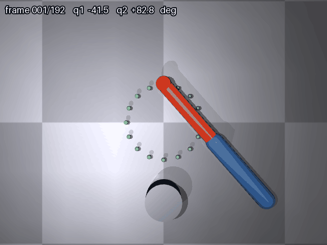

# MuJoCo 二连杆机械臂 IK 画圆

功能包源码位于仓库的 src/chap8/mujoco_arm_ik 目录。



## 1. 问题描述

给定一个二连杆平面机械臂（肩关节 shoulder + 肘关节 elbow，均在水平面内绕 Z 轴旋转，
连杆长度 L1 = L2 = 0.30 m），要求机械臂末端（末端红球）在水平面上沿
圆心 (0.30, 0)、半径 0.15 m 的圆形轨迹匀速运动，并能可视化地看到末端画出的轨迹。

这是一个典型的**机械臂逆运动学（IK）+ 轨迹跟踪**问题：

- 已知末端目标位置 (x, y)，求两个关节角 (q1, q2)（逆运动学）；
- 关节由 PD 位置控制器驱动，跟踪随时间变化的轨迹点；
- 把末端**实际位置**逐帧记录下来画成轨迹线，再与地面 16 个绿色参考点对照，
  用两者之间的偏差量化真实跟踪效果。

## 2. 算法

### 2.1 二连杆解析逆运动学（ik2）

对平面二连杆机械臂，末端位置与关节角的关系为：

```
x = L1·cos(q1) + L2·cos(q1+q2)
y = L1·sin(q1) + L2·sin(q1+q2)
```

逆解分两步：

- **肘关节角**（余弦定理）：

```
cos(q2) = (x² + y² - L1² - L2²) / (2·L1·L2)
q2 = acos(clamp(cos(q2), -1, 1))        # 取肘下姿势（q2 > 0）
```

- **肩关节角**（atan2 几何），并归一化到 (-π, π]：

```
q1 = atan2(y, x) - atan2(L2·sin(q2), L1 + L2·cos(q2))
q1 = (q1 + π) mod 2π - π
```

归一化是为了让关节角保持在与模型 `range` 相同的区间内，绕圈时不会持续累加、
多圈后超出限位造成连杆自穿。

当目标超出工作空间（`d > L1 + L2` 或 `d < |L1 - L2|`）时返回 None，程序跳过该帧。

### 2.2 PD 位置控制

每个物理子步计算关节力矩：

```
τ = KP·(q_target - q) - KD·q̇
```

参数：肩关节 KP = 600、KD = 15；肘关节 KP2 = 1400、KD2 = 18（肘关节惯量约为肩的一半，
需要更高增益）；力矩上限 ±80。

时间对齐：模型 timestep = 0.002 s，帧率 24 fps，因此每帧跑
`round((1/24) / 0.002) = 21` 个物理子步，让物理时间与轨迹推进一致。
**必须在每个子步都按当前关节状态重算力矩**——若每帧只算一次并保持 21 步，
等效控制周期变成 42 ms，末端会大幅滞后并震荡。

### 2.3 渲染与轨迹投影

- 相机：自由相机正上方俯视（elevation = -90°，distance = 1.15 m，fovy = 45°）；
  保持正俯视是有原因的：16 个标定参考点都铺在地面上，相机一旦倾斜，它们在画面里
  就投影成彼此挤叠的椭圆，质心检测偏差会让重投影残差从 0.2 px 涨到 10 px 量级，
  轨迹线随之脱离末端；
- HUD：画面左上角逐帧显示帧号与两个关节角（`frame 097/192  q1 -94.5  q2 +128.7  deg`），
  用于直观确认机械臂本身在运动：两个关节摆幅各约 68°，任取两帧读数都不相同；
- 渲染：`mujoco.Renderer` 离屏渲染，后端按平台自动选择（见第 4 节）；
- 轨迹：每帧从引擎读 `data.site_xpos[tip_site]` 得到末端**实际位置**，
  经标定后的投影矩阵换算成像素坐标，用 PIL 在渲染帧上叠加黄色轨迹线；
- 投影标定：启动时渲染一帧，把画面里的 16 个绿色参考点分离出来（按面积与位置过滤掉背景杂色），
  与它们已知的世界坐标做最小二乘拟合，得到「世界 (x, y) → 像素 (u, v)」的仿射矩阵，
  并打印重投影残差（实测 0.18~0.21 px）。这样轨迹线坐标不依赖手写相机公式，
  与画面严格对齐。

### 2.4 跟踪误差（与 IK 解算精度分开）

程序运行时打印两组数，口径不同、不能互相替代：

- **IK 解算精度**（`verify_ik.py ik`）：解析逆解算得对不对。把逆解出的 (q1, q2) 写进引擎，
  用 MuJoCo **自己的前向运动学**读末端位置再和目标比，不涉及控制与物理。实测 8 个等分点最大 **0.0000 mm**。
- **仿真侧跟踪误差**（`main.py` 运行时打印）：末端实际位置与目标点的偏差，含 PD 控制、
  有限增益与物理步进。实测全帧平均 **2.785 mm**、最大 **17.748 mm**（圆上 8 个等分点：
  0° 0.794 / 45° 0.324 / 90° 6.735 / 135° 15.635 / 180° 0.947 / 225° 0.205 / 270° 0.871 / 315° 1.404 mm）。

90°~135° 段误差偏大，是因为该段肩关节角速度最高（约 1 rad/s），
PD 的稳态速度误差约为 `角速度 × KD / KP`。这是控制带宽的真实限度。

## 3. 模型参数（arm_2link.xml）

| 部件 | 参数 |
|---|---|
| 底座 | 圆柱，半径 0.07 m，高 0.05 m |
| 第一段杆 link1 | 胶囊体，半径 0.035 m，长 0.30 m，蓝色 |
| 第二段杆 link2 | 胶囊体，半径 0.028 m，长 0.30 m，橙色 |
| 末端红球 tip | 球，半径 0.03 m |
| 末端 site | `tip_site`，与红球同位，供 `data.site_xpos` 读取真实末端 |
| 关节 | 两个 hinge（Z 轴），`range="-180 180"`（度），各配一个 motor，ctrlrange ±80 |
| 参考圆 | 16 个绿点，半径 0.009 m，绕圆心 (0.3, 0) 半径 0.15 m |
| 物理 | gravity 9.81 m/s²，timestep 0.002 s |

> 注意：MuJoCo 的 `<compiler>` 默认 `angle="degree"`，关节 `range` 与角度类参数都按度解析。
> 若按弧度写成 `-3.14 3.14`，会被当成 ±3.14 **度**（实际 ±0.0548 rad），关节几乎锁死。

## 4. 运行

```bash
pip3 install --user mujoco pillow numpy
sudo apt install -y libosmesa6-dev       # 无显卡环境
python3 main.py                          # 自动选后端
MUJOCO_GL=osmesa python3 main.py         # 无显示器时显式指定软渲染
python3 main.py --out ./demo.gif         # 指定输出路径
```

渲染后端默认值：Windows 或存在 `DISPLAY` → `glfw`；无 `DISPLAY` → `osmesa`；
显式设置 `MUJOCO_GL` 时以环境变量为准。

输出为 640×480、24 fps、192 帧的 GIF（每帧 40 ms，播放 7.68 s，4.57 MB），
含机械臂运动动画与黄色轨迹线。仓库内运行时默认写到 `docs/img/mujoco_arm_ik_demo.gif`，
仓库外运行退到当前目录。

> 4.57 MB 是在 Pillow ≥ 9.0 下的实测值。GIF 体积对 Pillow 版本很敏感——同一套帧在
> Pillow 7.0 下会编出 33 MB 量级。脚本落盘后会读回体积，超过 5 MB 直接打印警告并提示升级 Pillow。

## 5. 验证

```bash
python3 verify_ik.py ik    # IK 解算精度：逆解 -> 引擎前向运动学回代
python3 verify_ik.py gui   # 实时渲染：glfw 查看器播放完整画圆并叠加轨迹
```

本机实测：

- **IK 解算精度**：圆上 8 个等分点，逆解 → 引擎前向运动学回代，最大误差 **0.0000 mm**；
- **仿真侧跟踪误差**：`main.py` 运行时打印，全帧平均 **2.785 mm** / 最大 **17.748 mm**；
- **投影标定**：16/16 个参考点有效，平均重投影误差 **0.18~0.21 px**（多次实跑波动）；
- **离屏渲染**：`python3 main.py` 生成 192 帧 GIF，无报错。

## 6. 效果说明

- 黄色轨迹线从起点开始逐帧画出，第 6 秒闭合为一整圈；它记录的是末端**实际位置**，
  因此与绿色参考圆之间存在毫米级偏差，偏差大小即第 2.4 节给出的跟踪误差；
- 单看黄线与绿点是否贴合**不能**证明全链路正确：IK 解算精度由 `verify_ik.py ik` 单独核对，
  跟踪效果由 `main.py` 打印的误差单独给出；
- 机械臂全程无奇异姿态，两段杆始终在水平面内运动。

## 7. 运行方式与目录对照

包内提供 `package.xml`、`CMakeLists.txt`、`launch/mujoco_arm_ik.launch` 与 `requirements.txt`，可直接用 roslaunch 启动：

```bash
catkin_make && source devel/setup.bash
roslaunch mujoco_arm_ik mujoco_arm_ik.launch            # 默认 osmesa 软渲染
roslaunch mujoco_arm_ik mujoco_arm_ik.launch gl:=glfw   # 有显卡时窗口渲染
```

| 内容 | 位置 |
|---|---|
| 源码 | `src/chap8/mujoco_arm_ik/` |
| 文档 | `docs/chapter/mujoco_arm_ik.md` |
| 配图 | `docs/img/mujoco_arm_ik_demo.gif` |
| 导航 | `mkdocs.yml` 机器人分组下 + `docs/index.md` 第 8 章列表 |

机械臂类模块在仓库中沿用 `src/chap8/` + `docs/chapter/`：已合并的 `src/chap8/ros_mujoco_arm_pickplace`（UR5e 抓放）与
`src/chap8/moveit_arm_planning` 均位于这一层；`src/ground/` 存放的是 CARLA / MuJoCo 小车、激光雷达等地面载具模块。

## AI 辅助声明

本文档与对应代码在编写过程中使用了大模型（豆包）辅助。作者已逐行核对全部提交内容，并对内容的正确性与可复现性负责。
