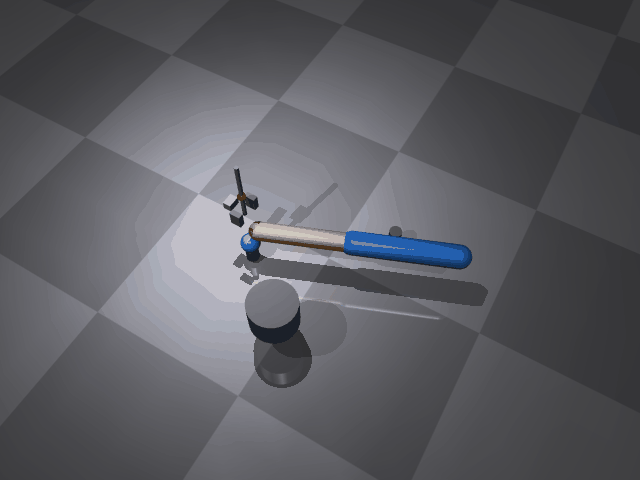

# 基于 MuJoCo 的机械臂抓取搬运（Pick & Place）

功能包源码位于仓库的 src/chap8/mujoco_arm_pick 目录。



## 1. 问题描述

给定一个带末端工具的平面机械臂：两连杆臂（肩关节 shoulder + 肘关节 elbow，
水平面内绕 Z 轴旋转，L1 = L2 = 0.30 m），末端带**垂直升降关节（lift）** 与
**旋转夹爪（grip）**。地面上 A、B 两处各有一个托盘柱（柱顶高度 0.05 m），
蓝色小球（球心 z = 0.08 m）初始在 A 点柱顶。

要求机械臂自动完成：**从 A 点夹起小球，搬运到 B 点并放下**，全程可视化。

这是一个典型的**机械臂逆运动学（IK）+ 轨迹规划 + 抓取控制**问题：

- 水平面内已知末端目标 (x, y)，用解析 2 连杆 IK 求 (q1, q2)；
- 垂直方向用升降关节控制夹爪高度（抓取时降到球心高度，搬运时抬起）；
- 小球用**逻辑吸附**跟随夹爪（不做物理夹持，避免接触反弹），释放后落在 B 点；
- 末端走过的路径投影到像素，用黄色轨迹线画出。

## 2. 算法

### 2.1 二连杆解析逆运动学（ik2）

与平面二连杆机械臂相同：

```
x = L1·cos(q1) + L2·cos(q1+q2)
y = L1·sin(q1) + L2·sin(q1+q2)
```

逆解：`cos(q2) = (x²+y²-L1²-L2²)/(2·L1·L2)`，`q2 = acos(clamp(...))`（肘下姿势），
`q1 = atan2(y,x) - atan2(L2·sin(q2), L1+L2·cos(q2))`；超出工作空间返回 None。

### 2.2 关节驱动方式

肩、肘、升降、夹爪四个关节都按「每帧逼近目标一个固定比例」的一阶插值驱动：

```
q        += (q目标 - q) * ALPHA_H      # ALPHA_H = 0.10，肩/肘
lift     += (lift目标 - lift) * ALPHA_L  # ALPHA_L = 0.25
grip     += (grip目标 - grip) * ALPHA_G  # ALPHA_G = 0.25
```

每帧插值后 `mj_forward` 更新一次正向运动学，**不做物理积分**。

之所以不用 PD：出图帧率是 24 fps（每帧 41.7 ms），而本模型的杆件惯量很小，
在这么低的采样率下 PD 要么欠采样震荡（实测肘关节在 ±1.5 rad 间来回甩），
要么必须把增益压低到 0.5 s 以上才稳定。本项目要演示的是 IK 解算、九段时间轴调度
和「夹起 — 搬运 — 放下」的流程，不是力矩控制；用确定性插值反而让「什么时候到球心、
什么时候到 B 点」可复现、可核对，也让下面 §5 的三项检查有确定的时间基准。

### 2.3 分段任务调度

9 段时间轴（秒），每段给出目标 (x, y, lift, grip, 是否允许吸附)：

| 段 | 时间 | 动作 |
|---|---|---|
| 1 | 0 → 0.5 | 保持高位在 A 上方就位 |
| 2 | 0.5 → 1.0 | 下降到球心高度（lift = -0.09） |
| 3 | 1.0 → 1.5 | 夹爪闭合，接近球时吸附 |
| 4 | 1.5 → 2.2 | 抬升（lift = 0.08） |
| 5 | 2.2 → 5.4 | 水平移动到 B 上方 |
| 6 | 5.4 → 7.0 | 下降到 B（留足时间） |
| 7 | 7.0 → 7.2 | 张开夹爪释放 |
| 8 | 7.2 → 7.8 | 保持低位让球落稳 |
| 9 | 7.8 → 8.4 | 收回高位 |

### 2.4 抓取与球的位置控制（逻辑吸附）

- 球 geom 设了 `contype="0" conaffinity="0"`，**全程不参与碰撞**，夹爪不会把它撞飞，
  也不会像接触夹持那样把升降关节顶住；
- 吸附判据是两个确定性条件同时成立：`lift ≤ lift_low + 0.02`（升降已降到球心附近）
  且 `grip ≥ grip_close - 0.10`（夹爪已闭合），并且只在「允许吸附」的时间段内判定；
- 吸附后每帧把球 qpos 设到夹爪中心、qvel 清零，球完全跟随夹爪；
- 未吸附时球钉在 A，释放后钉在 B；球全程无碰撞反弹、无滑走；
- 最终球精确停在 B 点 `(0.45, -0.15, 0.08)`。

### 2.5 渲染与轨迹投影（DLT 相机标定）

- 相机：离屏自由相机（lookat (0.28, 0.02, 0.10)、distance 1.70、
  azimuth 30°、elevation -58°、fovy 45°），整机与 A/B 两个托盘都在画面内；
- 渲染：`mujoco.Renderer` 离屏渲染，默认 `MUJOCO_GL=glfw`；
  无显卡的服务器/虚拟机推荐 `MUJOCO_GL=egl`（osmesa 在部分 VMware 上取不到
  GL 上下文，会报 `AttributeError: 'NoneType' object has no attribute 'glGetError'`）；
- 标定：渲染 10 组工作区内的机械臂姿态，提取末端红色小球的像素质心，
  用最小二乘反解 3×4 投影矩阵（实测平均重投影误差 0.11 px）；
- 轨迹：每帧把末端 3D 位置经投影矩阵映射到像素，用 PIL 画黄色轨迹线。

## 3. 模型参数（arm_gripper.xml）

| 部件 | 参数 |
|---|---|
| 底座 | 圆柱 `size="0.07 0.05"`（半径 0.07 m、半高 0.05 m），中心在 z = 0.15 m |
| 第一段杆 link1 | 胶囊体，半径 0.035 m，`fromto="0 0 0 0.3 0 0"`（长 0.30 m），蓝色 |
| 第二段杆 link2 | 胶囊体，半径 0.028 m，`fromto="0 0 0 0.27 0 0"`（长 0.27 m），橙黄色 |
| 升降连接杆 lift_conn | 细圆柱，半径 0.006 m、半高 0.10 m（视觉用） |
| 夹爪 | 基座盒 0.024×0.036×0.024 m + 两片手指盒 0.032×0.016×0.044 m，对称夹在球两侧 |
| 末端红球 tip | 球，半径 0.012 m（相机标定/轨迹用，`contype="0"` 纯视觉） |
| 小球 | 球，半径 0.03 m，蓝色，密度 177（约 0.02 kg），`condim=4`，不参与碰撞 |
| A/B 托盘柱 | 圆柱，半径 0.02 m、半高 0.025 m（柱顶 z = 0.05，球心 z = 0.08） |
| 关节 | shoulder / elbow 为 hinge（绕 Z 轴），lift 为 slide（`range="-0.20 0.15"`），grip 为 hinge（`range="-0.55 0"`） |
| 执行器 | 3 个 `motor`：shoulder / elbow（`ctrlrange="-30 30"`）、lift（`ctrlrange="-50 50"`）；**夹爪没有执行器，由代码直接写关节角** |
| 物理 | gravity 9.81 m/s²，timestep 0.002 s |

本项目的关节由 §2.2 的插值直接写 `qpos`，上表的 3 个 `motor` 是为复用模型
（例如以后要接力矩控制）保留的，正式演示路径不读 `data.ctrl`。

## 4. 运行

```bash
pip3 install --user mujoco pillow numpy

# 有显卡 / 本地桌面：默认后端即可
python3 main.py

# 无显卡的服务器或虚拟机
MUJOCO_GL=egl python3 main.py

# 指定输出路径（默认写到仓库的 docs/img 下；不在仓库内时退到系统临时目录）
python3 main.py --out ./demo_pick.gif
```

启动时会先打印一行 `输出位置：...`（`--out` 指定的目录不可写会立刻报错退出，
不用等渲染完），再打印标定误差与进度。

输出 640×480 的 GIF：渲染 201 帧（每帧 40 ms），Pillow 会把完全静止的相邻帧合并，
实际写进文件的帧数约 190 帧、**总时长恒为 8.04 秒**。

## 5. 效果说明

动图见**页首那张主图**（同一张 GIF 在本页只引用一次，不重复渲染）。

- 0.5 s 开始下降，约 1.2 s 夹爪中心到达球心高度，夹爪闭合后小球被吸附跟随夹爪；
- 2.2 s 抬升后水平移动，5.4 s 到达 B 上方，7.0 s 下降到 B 并张开夹爪释放；
- 小球落在 B 点托盘柱顶，最终位置 (0.45, -0.15, 0.08)，全程无反弹、无滑走；
- 黄色轨迹线全程跟随末端，直观展示「夹起 → 搬运 → 放下」的路径。

程序结束前会打印三项可核对的搬运结果：吸附触发次数（应为 1 次）、
释放瞬间夹爪中心到 B 点的距离（应 < 0.05 m）、吸附期间球从 A 到 B 的位移
（应 > 0.30 m），三项都过才输出 PASS。
