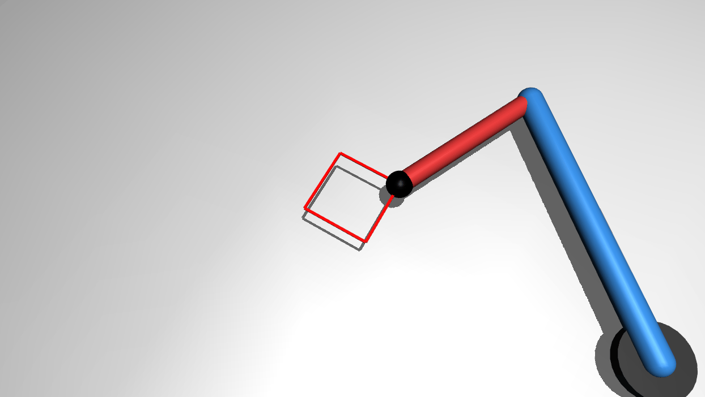

# MuJoCo 双自由度机械臂画正方形作业

功能包源码位于仓库的 `src/chap8/two_dof_arm_square` 目录。

## 1. 问题描述

平面 2R（双自由度）机械臂在 MuJoCo 中沿红色正方形边框做轮廓跟踪：大臂长 `L1=0.40 m`、
小臂长 `L2=0.25 m`，末端黑色小球依次经过四个顶点
`(0.40,-0.05) → (0.40,0.05) → (0.50,0.05) → (0.50,-0.05)` m，
每条边 50 个笛卡尔直线插值点，沿正方形四条直线边循环运动。

> **实现性质：运动学回放，非动力学仿真。** 每个目标点先用解析 IK 算出两个关节角，
> 直接写入 `data.qpos`，再调用 `mj_forward` 重算正运动学后渲染；全程**不调用 `mj_step`**、
> 不做动力学积分，也不经过 position 执行器的力矩闭环。XML 里写的位置伺服 `kp=100`、
> 关节阻尼 `1.0` 只是模型定义，本脚本不使用它们——这样做是为了让末端轨迹几何精度
> 完全由解析 IK 保证，避免 PD 控制在短杆低惯量下的收敛误差。
> 这是本作业的刻意简化假设：验证的是 2R 臂 IK 与正方形轨迹的几何正确性，不是控制器设计。

## 2. 运行环境（实际验证）

| 项 | 版本 / 说明 |
|---|---|
| 操作系统 | Windows 11（本机）；Ubuntu 22.04（云主机，无独立显卡） |
| Python | 3.10+（实测 Ubuntu 3.12.11 / Windows 3.13） |
| 模拟器 | MuJoCo `>=3.2,<4.0`（本机实测 3.17.0；numpy 实测 Ubuntu 1.26.4 / Windows 2.5.4） |
| ROS | ROS 1 Noetic（catkin 包结构）。本包纯 Python + MuJoCo，不依赖任何 ROS 话题，`launch` 仅用于一键启动脚本；ROS 侧 `roslaunch` 未在本机端到端复跑，独立 Python 运行已实测通过 |
| 渲染后端 | `MUJOCO_GL=glfw`；无显卡的虚拟机可配 Xvfb |

## 3. 算法

### 3.1 二连杆解析逆运动学

正运动学：

```
x = L1·cos(q1) + L2·cos(q1+q2)
y = L1·sin(q1) + L2·sin(q1+q2)
```

逆解（肘向上构型 `q2>0`）：

```
cos(q2) = (x²+y²-L1²-L2²)/(2·L1·L2)   # clamp 到 [-1,1]
q2 = atan2(+√(1-cos²q2), cosq2)
q1 = atan2(y,x) - atan2(L2·sinq2, L1+L2·cosq2)
```

### 3.2 正方形轨迹插值

四个顶点按运动顺序排列，相邻两顶点之间用 `linspace` 做直线插值（每条边 50 个点），
末端逐点 IK → 写 qpos → mj_forward → viewer.sync。

## 4. 模型参数（two_dof_arm_square.xml）

| 部件 | 参数 |
|---|---|
| 底座 | 圆柱，半径 0.05 m，半高 0.01 m（全高 0.02 m），顶面 z=0.06 |
| 大臂 link1 | 胶囊体，半径 0.02 m，长 0.40 m，蓝色 |
| 小臂 link2 | 胶囊体，半径 0.015 m，长 0.25 m，红色 |
| 末端 end_effector | 黑色小球，半径 0.02 m（位置读数用） |
| 红色轨迹 | 4 条细红线（半厚 0.002 m），在 z=0.06 m 平面组成边长 0.1 m 边框，无碰撞 |
| 关节 | j1/j2 hinge 绕 z 轴，damping=1.0，armature=0.01；未设关节限位（hinge 默认无限位） |
| 物理 | timestep=0.002 s（本实现不 mj_step，仅作模型定义） |

## 5. 运行

在**包目录**下执行。先进入本包目录（按摆放二选一，进入后命令相同）：

```bash
# 仓库内 checkout：  cd src/chap8/two_dof_arm_square
# catkin 工作空间：  cd ~/ws/src/two_dof_arm_square
pip install -r requirements.txt
python3 main.py              # 打开 MuJoCo 窗口，关闭窗口即退出
python3 main.py --headless   # 无头模式，跑 1 圈后打印误差并退出
```

作为 ROS 1 包运行：把本包放进 catkin 工作空间 `src/`，在工作空间根目录执行
`catkin_make && source devel/setup.bash`，再 `roslaunch two_dof_arm_square two_dof_arm_square.launch`。

## 6. 效果说明



`docs/img/two_dof_arm_square_demo.gif` 由本包 `test/record_demo_gif.py` 离屏渲染生成，不是另外录屏：

- 一圈 4 条边 × 51 点 = 204 个插值点；脚本复用 `main.py` 的 `TARGET_CORNERS` / `linspace` / `ik`，隔帧抽稀（`STEP=2`）后写入 GIF
- 实测：1244×702、102 帧、每帧 30 ms、循环播放，文件 2,585,863 B（2.47 MB）
- 复现：在包目录执行 `python3 test/record_demo_gif.py`（录帧需 Pillow；离屏后端 `MUJOCO_GL=egl`）
- 换机器重跑帧数、尺寸、时长不变，文件字节数可能因 Pillow 版本与调色板量化有 2%~3% 差别

- 机械臂从目标点 (0.40,-0.05) 出发，沿四条直线边平滑循环运动（斜俯视投影下其画面方位会随相机角度变化）
- 末端黑色小球紧贴红色正方形边框，无弧线偏离
- 终端逐圈打印末端最大位置误差与四个顶点实测坐标

## 7. 量化验证结果（本机 mujoco 3.17.0 实测）

| 目标顶点 (m) | 末端实测 (m) | 位置偏差 |
|---|---|---|
| (0.40, -0.05) | (0.4000, -0.0500) | 0.000 mm |
| (0.40,  0.05) | (0.4000,  0.0500) | 0.000 mm |
| (0.50,  0.05) | (0.5000,  0.0500) | 0.000 mm |
| (0.50, -0.05) | (0.5000, -0.0500) | 0.000 mm |

一圈全流程最大位置误差 **0.000 mm**。

**误差定义**：末端 `end_effector` 黑色小球球心的世界坐标 `(x, y)` 与当前目标插值点的欧氏距离
`√((x_ee-x_t)²+(y_ee-y_t)²)`，单位 mm。

**口径说明**：本实现是解析 IK 解直接写入 qpos 后 `mj_forward`，MuJoCo 正运动学与手写 IK
共用同一套杆长几何（`L1=0.40` / `L2=0.25` 与 XML capsule fromto 一致），故该偏差在浮点精度内为 0，
这是 **IK ↔ FK 互逆的自洽恒等式**；它只证明 IK 与正运动学自洽，**不代表**带 PD 控制器 /
执行器闭环的真实动态跟踪误差。

## 8. 证明范围

- **本演示证明**：2R 臂解析 IK 解算正确，正方形四顶点与各边轨迹的几何位置与模型一致。
- **本演示未证明**：动力学跟踪精度、带摩擦 / 负载 / 重力补偿下的表现、控制器收敛性能；
  这些需要接入执行器闭环并做 `mj_step` 积分后另行验证。

## 9. 验证脚本

在**包目录**下执行（仓库内为 `src/chap8/two_dof_arm_square/`，catkin 工作空间为 `~/ws/src/two_dof_arm_square/`）：

```bash
# 先进入本包目录，再执行：
python3 test/verify_two_dof_arm_square.py ik     # 四顶点 IK 互查
python3 test/verify_two_dof_arm_square.py clear  # 无头跑一圈并打印偏差
python3 test/verify_two_dof_arm_square.py gui    # 实时渲染播放
```

## 10. 已知简化与未验证项

- 本实现未做动力学积分与执行器闭环，未验证带摩擦、负载、重力补偿下的动态跟踪
- 仅验证肘向上构型；肘向下（q2<0）构型未测试
- 仅在 mujoco 3.17.0（`>=3.2,<4.0` 区间内）上验证，区间内其他版本与更早版本未做回归
- ROS 侧 `roslaunch` 未在本机端到端复跑，独立 Python 路径已实测通过

## 说明

本作业的代码与文档在编写过程中使用了**豆包（Doubao）** AI 大模型辅助，本人已核对并确认提交内容，对提交内容负责。
