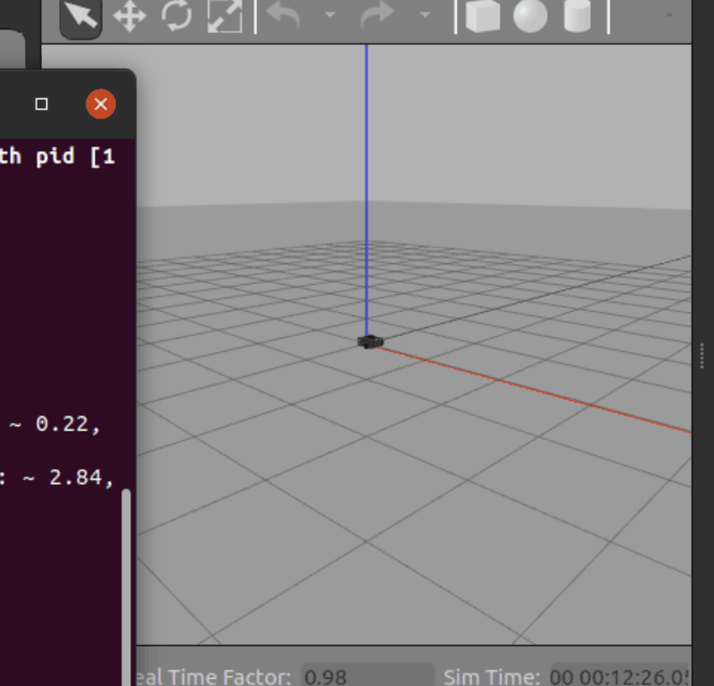

# Turtlebot3 机器人 Gazebo 仿真与键盘控制实验

## 一、实验目的与环境说明

### 1.1 实验目的
1. 掌握在 Gazebo 物理仿真环境中加载机器人模型的方法。通过编写 `launch` 文件调用 Gazebo 并生成 Turtlebot3 机器人实体。
2. 掌握 ROS 话题通信机制。节点作为发布者发布 `/cmd_vel` 话题，发送 `geometry_msgs/Twist` 消息控制机器人移动。
3. 学会编写键盘控制节点，将按键映射为线速度和角速度，实现在物理仿真环境下的开环速度控制与移动。

### 1.2 实验环境
| 配置项 | 版本/说明 |
| :--- | :--- |
| 操作系统 | Ubuntu 20.04 (VMware虚拟机) |
| ROS 版本 | ROS Noetic |
| 仿真器 | Gazebo  |
| 编程语言 | Python 3.8 |
| 功能包 | turtlebot3_gazebo_control |

**功能包目录结构如下：**
```text
turtlebot3_gazebo_control/
├── launch/
│   ├── gazebo_simulation.launch  # 启动 Gazebo 空世界并加载机器人模型
│   └── main.launch               # 统一入口，启动仿真和键盘交互终端
├── scripts/
│   └── main.py                   # 键盘控制 Python 脚本
├── package.xml                   # ROS 包清单
├── CMakeLists.txt                # 构建文件
└── README.md                     # 运行说明文档
```
##   二、实验原理

1. Gazebo 仿真原理： Gazebo 提供物理引擎，可以模拟重力、摩擦力等物理特性。通过加载机器人的 URDF 模型，可以将机器人实体化并放入仿真世界中。
2. 运动控制原理： Turtlebot3 属于两轮差速移动机器人。通过向其订阅的 /cmd_vel（Twist 消息类型）话题发布线速度（linear.x）和角速度（angular.z），底盘控制器会将这些速度解算为左右轮的转速。
3. 键盘控制逻辑： 编写 Python 脚本监听键盘输入，将 W、S、A、D 等按键映射为不同的速度数值，通过 ROS 节点持续发送速度指令。

##  三、实验步骤

### 3.1 环境准备与依赖安装

在终端执行以下命令，安装 Turtlebot3 相关的仿真包和键盘控制依赖：

```bash
sudo apt install ros-noetic-turtlebot3 ros-noetic-turtlebot3-simulations ros-noetic-turtlebot3-teleop
```

安装完成后，配置环境变量，指定机器人型号为 waffle：

```bash
export TURTLEBOT3_MODEL=waffle
```

### 3.2 配置启动文件
在功能包 `launch` 目录下新建 `gazebo_simulation.launch`，核心是调用 Gazebo 的空世界，并将 Turtlebot3 模型加载到参数服务器并在仿真环境中生成。

```xml
<launch>
    <!-- 设置 Turtlebot3 模型为 waffle -->
    <arg name="model" default="waffle"/>
    
    <!-- 启动 Gazebo 空世界 -->
    <include file="$(find gazebo_ros)/launch/empty_world.launch">
        <arg name="paused" value="false"/>
        <arg name="use_sim_time" value="true"/>
        <arg name="gui" value="true"/>
    </include>

    <!-- 加载 Turtlebot3 的 URDF 模型到参数服务器 -->
    <param name="robot_description" command="$(find xacro)/xacro $(find turtlebot3_description)/urdf/turtlebot3_$(arg model).urdf.xacro" />

    <!-- 在 Gazebo 中生成 Turtlebot3 机器人 -->
    <node name="spawn_urdf" pkg="gazebo_ros" type="spawn_model" 
          args="-urdf -model turtlebot3_$(arg model) -param robot_description" output="screen"/>
</launch>
```
注：如果下载好仓库后，找不到gazebo_simulation.launch,只是因为名字出现了问题，只要在文件管理器里右键这个 gazebo_simulation.launch 文件 -> 选择“用其他程序打开” -> 选择“终端”，就在你当前这个终端（路径末尾是 launch$），直接复制粘贴这行：

```bash
roslaunch ./gazebo_simulation.launch
```


### 3.3 编写键盘控制节点

在 scripts 目录下新建 main.py。核心逻辑是监听键盘输入，将其映射为线速度和角速度，并通过 /cmd_vel 话题持续发送。以下是核心代码段（完整源码请见 src/ 目录）：

```python
#!/usr/bin/env python3
import rospy
from geometry_msgs.msg import Twist

# 按键与速度映射表 (按键: [线速度系数, 角速度系数])
moveBindings = {
    'w': (1, 0), 'x': (-1, 0),
    'a': (0, 1), 'd': (0, -1),
    's': (0, 0), ' ': (0, 0)
}

if __name__ == "__main__":
    rospy.init_node('turtlebot3_control')
    pub = rospy.Publisher('/cmd_vel', Twist, queue_size=1)
    speed, turn = 0.2, 1.0
    
    # 循环监听键盘并发布指令 (省略了部分底层终端设置代码)
    while not rospy.is_shutdown():
        key = getKey() # 获取按键的辅助函数
        if key in moveBindings.keys():
            x = moveBindings[key][0]
            th = moveBindings[key][1]
        else:
            x, th = 0, 0 # 默认停止
            
        twist = Twist()
        twist.linear.x = x * speed    # 线速度
        twist.angular.z = th * turn   # 角速度
        pub.publish(twist)
```


### 3.4 运行与测试

1. 赋予脚本执行权限：
   ```bash
   chmod +x scripts/main.py
   ```
2. 启动 Gazebo 仿真环境（如果在虚拟机中遇到闪退，需提前执行 export LIBGL_ALWAYS_SOFTWARE=1）：
   ```bash
   roslaunch turtlebot3_gazebo_control gazebo_simulation.launch
   ```
   注：Gazebo需要强大的3D渲染功能，但虚拟机显卡资源太弱或者没开3D加速，就会导致它崩溃。
解决办法：
在终端里按 Ctrl + C 终止当前的卡死状态。如果没反应，就重新开一个终端（Ctrl + Alt + T），输入：
   ```bash
    killall gzserver gzclient
     ```
     再按照第2步解决闪退的方法进行下去就可以了

1. 另开一个终端，运行键盘控制节点：
   ```bash
   rosrun turtlebot3_gazebo_control main.py
   ```
2. 将光标聚焦在终端窗口，按下 W、A、S、D 即可控制小车运动。


## 四、运行效果展示

注:开始会有点延迟很正常，但不要疯狂连按，不然小车会直接冲出去甚至穿模翻车。

## 五、实验总结


本次实验成功在 Gazebo 仿真环境中加载了 Turtlebot3 机器人，并编写了 Python 键盘控制节点。通过发布 /cmd_vel 话题实现了对机器人的实时运动控制，验证了物理引擎和机器人运动学模型的有效性，达到了预期的实验目的。