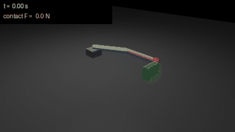
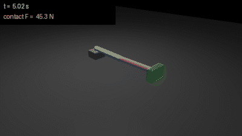
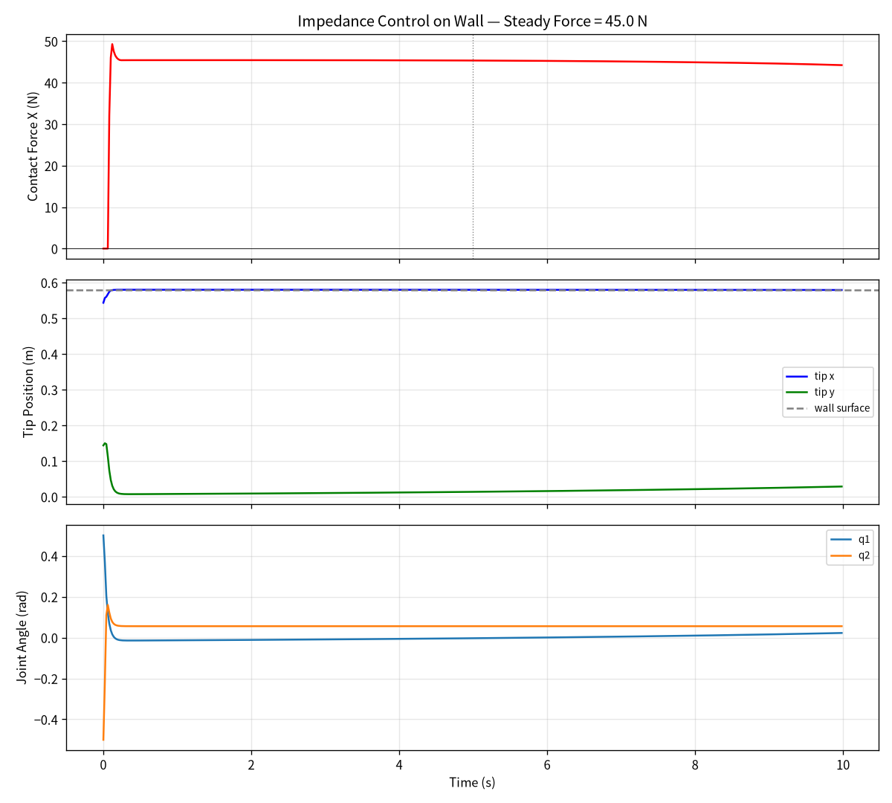

# MuJoCo 二连杆笛卡尔阻抗力控

本模块在 MuJoCo 物理仿真中实现一个二连杆平面机械臂的笛卡尔空间阻抗控制：机械臂从弯曲姿态伸直，末端顶到墙面后维持稳定接触力。区别于常规位置伺服，本模块展示**柔顺力控**——末端像弹簧一样贴合墙面，接触力由刚度矩阵 Kp 和目标位置决定。

代码位置：src/chap8/mujoco_2link_impedance_control/。

## 1. 效果演示

下图是 `scripts/main.py` 无头跑出的 10 s 仿真回放（400×225，16 fps，160 帧，每帧左上角实时显示仿真时间与末端 x 向接触力）：手臂从 keyframe 弯曲姿态 q = (0.5, -0.5) 起弯，在阻抗控制下伸直，末端压到绿色墙面后接触力稳定在 45 N 左右，全程无振荡、无穿透。



接触稳态时的一帧（末端红色球压入绿色墙面，左上角标注当帧接触力）：



同一次运行记录的三联曲线——接触力、末端位置、关节角：



## 2. 与参考模块的区别

| 模块 | 环境 | 自由度 | 驱动方式 | 重点 |
|---|---|---|---|---|
| ur5e_pickplace | ROS Noetic + catkin | 6 | position 伺服（PD 闭环） | 关节空间轨迹规划与状态机 |
| musculoskeletal_arm_reach | ROS 2 Humble + colcon | 2 | Hill 肌肉激活 | 双关节肌与逆运动学到达 |
| **本模块（impedance）** | **ROS Noetic + catkin** | **2** | **力矩控制（J^T·F）** | **笛卡尔阻抗控制与接触力** |

本模块不重复关节空间轨迹规划，而是解决：解析 FK 与雅可比、笛卡尔力到关节力矩的映射、墙面接触的柔顺力控、ROS param 类型容错与仿真稳定性。

## 3. ROS 计算图与接口

本模块创建 1 个 ROS 1 节点，不使用 service / action：

| 参数 | 类型 | 默认值 | 内容 |
|---|---|---|---|
| x_des | string / float[] | "0.62 0.0" | 末端目标位置（m），设在墙内产生持续推力 |

启动后检查实时参数：

```bash
rosparam get /impedance_arm_node/x_des
```

## 4. 运行逻辑与节点分工

三个 Python 脚本职责分离：

| 文件 | 角色 | 依赖 |
|---|---|---|
| scripts/impedance_controller.py | 笛卡尔阻抗控制器：FK + 雅可比 + 力矩计算 | 仅 numpy |
| scripts/mujoco_arm_impedance_node.py | ROS 节点：加载模型、viewer、控制循环、数据记录 | rospy + mujoco + controller |
| scripts/headless_test.py | 无头测试：不弹窗跑 10 s，出三联曲线图与 metrics.json | mujoco + matplotlib |
| scripts/render_demo.py | 离屏渲染演示动图（本页 GIF 就是它出的） | mujoco + pillow |
| scripts/output_paths.py | 路径解析：产物目录（`--out` > `$IMPEDANCE_OUT_DIR` > 仓库 `docs/img/chap8` > `~/.cache/<pkg>/output`）与模型文件（源码树 / devel / install 三种布局都覆盖） | 仅标准库（rospkg 可选） |
| test/test_impedance_controller.py | 离线单测：FK / 雅可比 / 力矩映射 / 产物目录，不依赖图形界面 | pytest + numpy（模型用例另需 mujoco） |
| scripts/main.py | 统一入口，默认转调 headless_test.py，`--gui` 转调节点，`--render` 转调渲染脚本 | 仅标准库 |

控制器不直接输出关节位置：节点把目标位置传入控制器，控制器输出笛卡尔空间期望力 F，再通过雅可比转置 `tau = J^T · F` 映射为关节力矩，写入 MuJoCo torque 执行器。

控制律：

```
F = Kp · (x_des - x) + Bd · (xdot_des - xdot)
tau = J^T · F
```

启动后 viewer 先保持 3 秒弯曲姿态，然后开始阻抗控制；关闭 viewer 窗口后自动弹出三联曲线图（接触力、末端位置、关节角）。

## 5. 模型参数

模型位于 models/two_link_soft_arm.xml。

| 项目 | 数值 |
|---|---|
| 连杆 1 长度 | 0.30 m |
| 连杆 2 长度 | 0.28 m |
| 基座高度 | 0.15 m |
| 墙面位置 | x = 0.60 m（y = 0 平面） |
| keyframe home 姿态 | q = (0.5, -0.5) rad（弯曲） |
| 控制步长 | 2 ms |
| 接触参数 solref | "0.1 1"（软接触） |
| 接触参数 solimp | "0.5 0.7 0.01" |
| 执行器 gear | 1（torque 模式） |
| 模型规模 | nq=2, nv=2, nu=2 |

## 6. 控制器参数

| 参数 | 默认值 | 含义 |
|---|---|---|
| Kp[0] | 80 N/m | x 方向位置刚度 |
| Kp[1] | 50 N/m | y 方向位置刚度 |
| Bd[0] | 8 N·s/m | x 方向阻尼 |
| Bd[1] | 5 N·s/m | y 方向阻尼 |
| x_des | (0.62, 0.0) m | 目标位置（墙内） |
| 力矩限幅 | ±5 N·m | ctrl clip |

增大 Kp → 接触力增大；减小 Kp → 接触力减小。目标位置 x_des 设在墙面右侧（x > 墙表面），控制器会持续推动末端贴墙。

## 7. 构建与运行

```bash
source /opt/ros/noetic/setup.bash

# 1) Python 依赖（在包目录执行；requirements.txt 里 mujoco 锁 3.1.6，原因见 8.2）
pip3 install --user -r requirements.txt
pip3 install --user rospkg

# 2) 编译工作空间（包目录名必须是 mujoco_2link_impedance_control）
mkdir -p ~/catkin_ws/src
# 把本包放为 ~/catkin_ws/src/mujoco_2link_impedance_control
cd ~/catkin_ws
catkin_make
source devel/setup.bash

# 3) 离线单测（不需要图形界面，跑完约 0.3 s）
cd ~/catkin_ws/src/mujoco_2link_impedance_control
python3 -m pytest test -q

# 4) 方式一：带 3D viewer 的 ROS 节点（需要图形界面）
roslaunch mujoco_2link_impedance_control impedance_arm.launch

# 方式二：无头跑 10 s，打印指标并出三联曲线图（不需要 GPU）
python3 scripts/main.py
# 产物默认写仓库 docs/img/chap8/（impedance_curves.png + metrics.json）；
# 装到 devel/install 布局后源码树不可写，脚本自动退到 ~/.cache/<pkg>/output，也可 --out 指定

# 可选：重新生成本页的演示动图（Linux 无图形界面时加 MUJOCO_GL=egl）
MUJOCO_GL=egl python3 scripts/main.py --render --out /tmp/impedance_img
```

## 8. 运行结果（实测）

### 8.1 指标（稳态窗口 t ∈ [5, 10] s）

| 指标 | 数值 |
|---|---|
| 初始 tip 位置（t = 0） | (0.5433, 0.1438) m |
| 稳态 tip 位置（窗口均值） | (0.5794, 0.0202) m |
| 稳态接触力（窗口均值） | **44.96 N** |
| 峰值接触力 | 49.29 N（t = 0.082 s 首次接触时） |
| 接触点数 | 2（末步 ncon = 2，窗口内最大 2；500 个采样帧中 496 帧有接触） |
| 稳态关节角（窗口均值） | q1 = 0.0079 rad, q2 = 0.0557 rad |
| 窗口末值（t = 10 s） | q1 = 0.0227 rad, q2 = 0.0557 rad |

接触力在 0.4 秒内上升到 45 N 左右，之后缓慢衰减（接触模型蠕变），无振荡、无超调。**"稳态"统一指 t ∈ [5, 10] s 的窗口均值（`headless_test.py` 里的 `--steady-start` 默认 5.0）**——把 0～5 s 的建立段也算进均值会得到 45.0～45.2 N，与上表差 0.1～0.3 N，所以核对数字时请用同一个窗口。

> 口径说明：上表与本节三张图来自同一次运行（`scripts/main.py`，10 s / 5000 步 / 每 20 ms 采样 1 点），该次运行在 Ubuntu 22.04 + Python 3.12.11 + **MuJoCo 3.1.6** + numpy 1.26.4 上完成，同一环境重复运行逐位相同。`metrics.json` 与曲线图都是程序能重新生成的产物，按仓库规范不入库；每次运行 `scripts/main.py` 都会在输出目录重新写出 `metrics.json`，字段与上表逐项对应，可直接核对。本模块的标称目标环境是 Ubuntu 20.04 + ROS Noetic + Python 3.8：**节点 + viewer 已在该环境的虚拟机上 `catkin_make` / `roslaunch` 跑通（见 8.3），但上表的无头数值尚未在 20.04 + Noetic 上复跑。**

### 8.2 版本敏感性（为什么换 MuJoCo 版本数字会变）

MuJoCo 从 3.3 起改过接触求解与 broad-phase，同一份 XML、同一套增益在不同大版本上会给出不同的稳态接触力。同一台机器、同一份模型、同样取 [5, 10] s 窗口均值的实测对比：

| MuJoCo 版本 | 稳态接触力（[5,10] s 均值） | 接触点数（末步 ncon） | q1（窗口均值） | 稳态 tip y |
|---|---|---|---|---|
| 3.1.6（`requirements.txt` 锁定） | 44.96 N | 2 | 0.0079 | 0.0202 |
| 3.2.7 | 44.96 N | 2 | 0.0079 | 0.0202 |
| 4.0.0（不锁版本的 pip 默认结果） | 46.96 N | 6 | -0.0025 | 0.0142 |

3.1.6 与 3.2.7 结果完全一致；4.0.0 明显上浮（约 +2 N、接触点 2→6），原因是接触求解器与碰撞对生成方式改了，与模型或增益无关。所以要复现 8.1 的表格，请按 `requirements.txt` 装 `mujoco==3.1.6`；用更新版本得到 46～47 N / 多个接触点属于版本差异。

### 8.3 节点运行（ROS Noetic）与曲线口径

节点（`roslaunch mujoco_2link_impedance_control impedance_arm.launch`）与离线脚本共用同一套模型、控制器和统计窗口：

- 已在 Ubuntu 20.04 + ROS Noetic + Python 3.8 的虚拟机上 `catkin_make` 后 `roslaunch` 跑通，节点启动、viewer 正常出画面（截图见 PR 讨论区）；本页 8.1 的数值出图仍在 Ubuntu 22.04 + MuJoCo 3.1.6 上完成。
- 节点采样按步数计数（每 10 个物理步 = 20 ms 一帧），不再用 `data.time % 0.02` 判断；旧写法在仿真时间累积到十几秒后会漏采或双采，曲线上表现为 tip y、q2 的台阶式跳变。
- 稳态一律取 t ∈ [5, 10] s 的窗口均值，与 `headless_test.py` 相同。旧版节点把 `t ≥ 5` 到关闭 viewer 之间的全部样本计入均值，跑 22 s 时显示 42.4 N（蠕变段把均值拉低了）；改成固定窗口后，节点和脚本在 22 s 时都报 **44.96 N**，末步瞬时接触力 45.12 N，蠕变带来的缓降只有零点几牛。关闭 viewer 后节点会把三联曲线存到输出目录的 `impedance_node_curves.png`。

同一条控制律跑满 22 s 的离线曲线（`python3 scripts/headless_test.py --seconds 22 --steady-end 10`，与节点实时轨迹同模型、同增益；节点关窗后落盘的曲线形状与此一致）：

![22 s 长跑曲线，[5, 10] s 窗口仍为 44.96 N](../img/chap8/impedance_node_22s_curves.png)

图中虚线是 [5, 10] s 窗口的边界：窗口之后接触力基本保持在 45 N 附近（22 s 末步瞬时 45.12 N），窗口均值不受影响；末步接触点数降到 1 是蠕变后接触对合并的结果，不是接触丢失。

## 9. 调试记录

开发过程中修复的物理问题：

| 问题 | 原因 | 修复 |
|---|---|---|
| 接触力 631 N | actuator gear=120，力矩放大 120 倍 | gear 改为 1 |
| 力传感器读数异常 | link1 圆柱与 base box 重叠自碰撞，产生 56000 N 假接触力 | 缩小 base、抬高 link1 |
| y 方向跑偏 | 自碰撞力把手臂推开 | 修复自碰撞后稳定 |
| 碰不到墙 | 墙在 y=0.144 但手臂伸直后 tip 在 y=0 | 墙移到 y=0 |
| 接触太硬 98 N | solref 默认 0.02 太硬 | solref 调到 0.1 |
| ROS param 字符串报错 | launch 里 "0.62 0.0" 读成单个字符串 | Python 里 split 转 float |

## 大模型使用说明

本作业的代码与文档在编写过程中使用了 AI 大模型辅助（豆包），本人已核对并确认提交内容，对提交内容负责。
