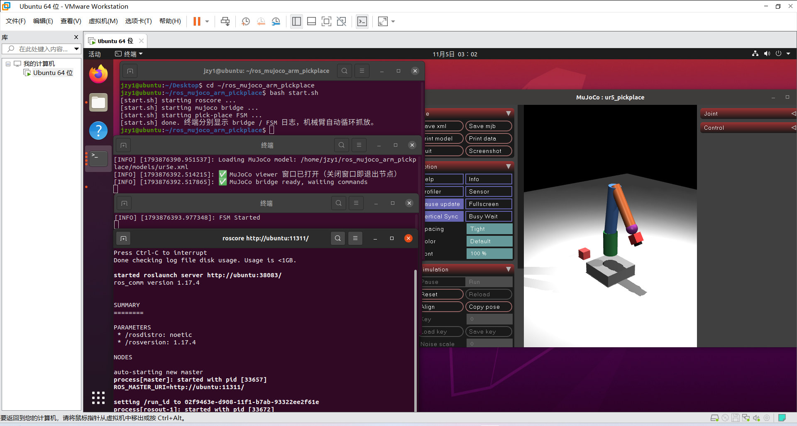
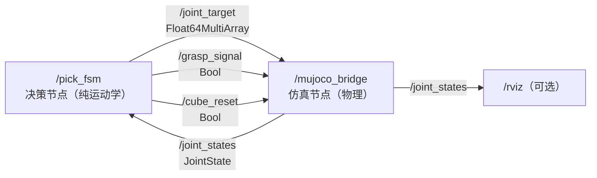
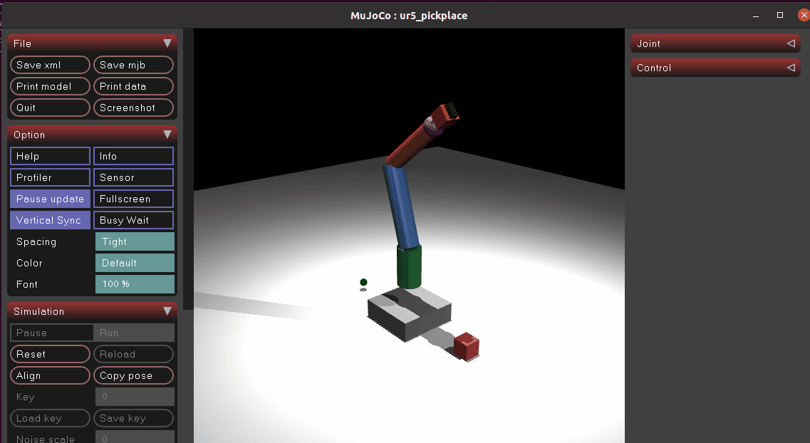

# MuJoCo UR5e 关节空间抓放控制

本模块把 MuJoCo 物理仿真与 ROS Noetic 节点解耦，实现一个 5 状态的循环抓放：
复位 → 靠近 → 下降 → 抓取 → 抬升放置 → 再复位。方块从 `(0.4, 0, 0.05)` 被抓取，
搬运到 `(-0.4, 0, 0.05)` 的绿色放置点，释放后复位并开始下一周期。

代码位置：`src/chap8/ros_mujoco_arm_pickplace/`。



## 1. 与参考模块的区别

|模块|环境|自由度|驱动方式|重点|
|-|-|-|-|-|
|`musculoskeletal_arm_reach`|ROS 2 Humble + colcon|2|Hill 肌肉激活|双关节肌与逆运动学到达|
|本模块（pick-place）|ROS Noetic + catkin|6|position 伺服（PD 闭环）|关节空间轨迹规划与状态机|

本模块不重复单关节肌肉实验，而是解决：解析 IK、三次多项式平滑轨迹、
freejoint 方块抓取（运动学硬连接）、ROS 节点线程安全与仿真稳定性。

## 2. ROS 计算图与接口



本模块创建 **2 个 ROS 1 节点**，4 个话题，不使用 service / action：

|话题|类型|方向|内容与发布时机|
|-|-|-|-|
|`/joint_target`|`std_msgs/Float64MultiArray`|FSM → Bridge|6 个关节角 `[pan, lift, elbow, w1, w2, gripper]`，每个轨迹点发布一次|
|`/joint_states`|`sensor_msgs/JointState`|Bridge → FSM/RViz|6 个机械臂关节角与速度，50 Hz，按名字发布（不受 freejoint 顺序影响）|
|`/grasp_signal`|`std_msgs/Bool`|FSM → Bridge|`True` 抓取 / `False` 释放，桥端做距离校验|
|`/cube_reset`|`std_msgs/Bool`|FSM → Bridge|每个周期开始把方块复位回抓取点|

启动后检查实时 ROS 计算图：

```bash
rostopic list
rostopic info /joint_states
rostopic hz /joint_states
rqt_graph
```

## 3. 运行逻辑与节点分工

两个节点职责严格分离，**决策节点不加载 MuJoCo 模型**：

|文件|角色|依赖|
|-|-|-|
|`scripts/pickplace_planner.py`|解析 IK、三次多项式轨迹、5 状态迁移（纯计算）|仅 `numpy`|
|`scripts/pickplace_core.py`|模型加载、`mj_step`、位置伺服、抓取锁定、无界面整周期跑测|`numpy` + `mujoco`|
|`scripts/main_pick_fsm.py`|ROS 决策节点：读 `/joint_states`，发 `/joint_target` 等|`rospy` + planner|
|`scripts/main_mujoco_bridge.py`|ROS 仿真节点：驱动物理 + 发布关节状态 + 可视化窗口|`rospy` + core|

这样 FSM 只为算关节目标和时间轴，不必为了 IK 加载整份 XML，也不会出现
「两份互不同步的物理状态副本」。

启动阶段按以下顺序执行：

1. `pick_arm.launch` 启动 `mujoco_bridge` 与 `pick_fsm`；
2. bridge 从 `models/ur5e.xml` 加载模型，创建 MuJoCo 状态与被动 viewer；
3. FSM 等待第一帧 `/joint_states` 后进入 RESET 状态；
4. bridge 以 50 Hz 循环：应用待处理标志（抓取 / 复位）→ `mj_step` 10 个子步（20 ms）→ 发布关节状态。

每个控制周期：FSM 读取真实关节角，由 `decide()` 决定当前状态下的轨迹点；
目标点通过解析 IK 给出，轨迹用三次多项式插值（起止速度 0）。
抓取前桥端校验末端 `ee_site` 与方块中心距离 `< 0.10 m`，过远则拒绝并打印告警。

控制器不直接解算肌肉激活：bridge 只把目标关节角写入 `position` 伺服执行器，
实际关节力矩由 MuJoCo 的 PD 闭环（kp/kv）计算。

## 4. 模型参数

模型位于 `models/ur5e.xml`。

|项目|数值|
|-|-|
|基座到肩部高度|0.40 m|
|上臂长度|0.40 m|
|下臂长度|0.35 m|
|工具/末端偏移|0.08 m|
|肩关节（lift）范围|-1.6 ~ 1.6 rad|
|肘关节范围|-2.8 ~ 2.8 rad|
|控制周期|20 ms（10 × 2 ms 子步）|
|方块|0.08 m 立方体，mass 0.1 kg，带 `freejoint`|
|模型规模|nq=13, nv=12, nu=6|

工作空间内端靠近目标时的 IK 误差 < 1 mm。肩关节限位裁掉了部分扇区。

六个执行器（position 伺服）：

|执行器|kp|kv|
|-|-|-|
|shoulder_pan / shoulder_lift / elbow|120 / 150 / 120|15 / 20 / 16|
|wrist_1 / wrist_2|50|8|
|gripper|30|4|

关节默认 `armature=0.01, damping=3.0`，连杆显式轻质量（0.05~0.8 kg），
这是消除高频自激、保持仿真数值稳定的关键参数。

## 5. 逆运动学与轨迹

末端位姿由两连杆解析 IK 给出（本模型连杆方向为 `(sinθ, cosθ)`，角度映射
`θ1 = π/2 − β1, θ2 = −β2`），六个路点：

|路点|末端 x-z|关节角 (lift, elbow)|
|-|-|-|
|HOME|(0.15, 0.55)|-0.667, 2.63|
|APPROACH|(0.40, 0.20)|0.975, 2.006|
|GRASP|(0.40, 0.12)|1.189, 1.886|
|LIFT|(0.30, 0.45)|0.116, 2.395|
|PLACE_A|(-0.30, 0.45)|0.116, 2.395（pan 翻转 π）|
|PLACE|(-0.40, 0.12)|1.189, 1.886（pan 翻转 π）|

每个状态内部用三次多项式插值：

```text
q(t) = q0 + (qf-q0)·(3(t/T)² − 2(t/T)³)
```

启停速度为 0，无冲击；到达判据 `max|q_now − q_target| < 0.06 rad`
（抓取后阈值放宽到 0.10，避免负载扰动误判）。

## 6. 构建与运行

```bash
source /opt/ros/noetic/setup.bash
# 依赖（在包目录执行）
cd src/chap8/ros_mujoco_arm_pickplace
pip3 install --user -r requirements.txt

mkdir -p ~/catkin_ws/src
# 把本包放为 ~/catkin_ws/src/ros_mujoco_arm_pickplace
cd ~/catkin_ws
catkin_make
source devel/setup.bash

roslaunch ros_mujoco_arm_pickplace pick_arm.launch
# 或纯后台不出窗口：
roslaunch ros_mujoco_arm_pickplace pick_arm.launch viewer:=false
# 或免编译直接跑：
cd src/chap8/ros_mujoco_arm_pickplace && bash start.sh
```

发送一次单步抓取（调试用）：

```bash
rostopic pub -1 /joint_target std_msgs/Float64MultiArray \
  "data: [0.0, 1.189, 1.886, 0.0, 0.0, 0.0]"
```

## 7. 测试

```bash
# 在包目录执行
cd src/chap8/ros_mujoco_arm_pickplace
python3 -m pytest test -q
```

`test/` 下分两层，未装 `mujoco` 时物理层整体 skip，决策层仍可跑：

|用例文件|覆盖内容|是否需 mujoco|
|-|-|-|
|`test/test_pickplace_planner.py`|关节表一致性、六个路点 IK 往返误差、pan 映射、限位裁剪、1/2 周期状态链、每周期只复位一次、planner 不间接导入 mujoco|否|
|`test/test_pickplace_core.py`|模型结构（nq/nv/nu、freejoint、ee_site）、IK 与 MuJoCo FK 对账、IK 不污染 qpos、方块复位与落地、远端抓取被拒、整周期无 NaN 且方块被搬运|是|

## 8. 闭环运行结果

默认 2 周期循环下实测：

```text
nan_count      = 0
transitions    = [0,1,2,3,4,0,1,2,3,4,0]
cube_x_range   = (-0.406, 0.405)
抓取时刻 ee-方块距离 = 0.068 m（阈值 0.10）
IK 六路口径误差      ≈ 0 m
```

机械臂平滑完成 复位→靠近→下降→抓取→抬升→搬运→下降→释放→复位，无超调崩溃。



## 9. 当前边界

* 抓取采用「运动学硬连接」（每子步把方块位姿锁定到末端参考系），
不依赖 MuJoCo `<equality>` weld 约束（3.17 实测其约束雅可比不生效）；
* 夹爪开合仅为视觉装饰，不参与物理夹持；
* 所有路点为预设关节空间轨迹，无在线采样 IK / 无碰撞路径规划；
* 尚未加入力控、视觉感知与双臂协同。

这些内容分别进入后续「柔性夹爪 / 视觉抓取 / 双臂」提交，避免一次提交同时修改
模型、物理与控制造成难以验收。

## 10. AI 使用声明

本模块的代码、XML 模型、文档与测试用例在编写过程中使用豆包（Doubao）辅助生成、
调试与整理；所有运行结果均来自 Ubuntu 20.04 + ROS Noetic + MuJoCo 环境的实际运行，
提交者已逐条审阅并对提交内容负责。
