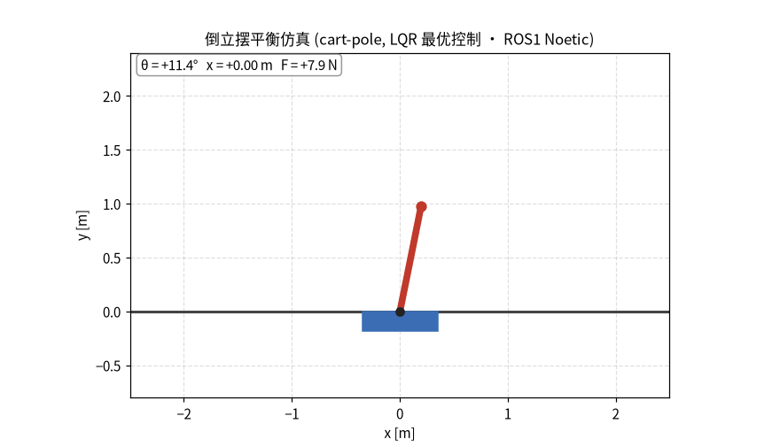

# 倒立摆平衡小车 (cart-pole, LQR 最优控制)

倒立摆(cart-pole)是最经典的控制问题之一:小车在滑轨上水平运动,摆杆铰接在小车上并会自然倾倒。本模块用 **LQR 线性二次型最优控制** 让摆杆从初始倾斜状态被拉回并保持在竖直位置(不倒),同时让小车尽量回到原点。属于**经典控制**方向,仓库此前未覆盖。

三个 ROS1 节点演示最基础的**发布/订阅**通信闭环,无需真实机器人,`roslaunch` 一键即可运行:


## 运行效果



倒立摆从初始倾斜约 0.2 rad(≈11°)被 LQR 控制器拉回竖直,之后一直保持不倒、仅做小幅振荡,小车也被拉回原点附近。

## 功能包结构

```
src/cartpole_balance/
├── CMakeLists.txt
├── package.xml
├── launch/main.launch
├── README.md
└── scripts/
    ├── balance_controller.py   # 节点1: LQR控制器, 订阅状态->发布控制力
    ├── cartpole_sim.py         # 节点2: 物理仿真, 订阅控制力->50Hz发布状态
    └── cartpole_visualizer.py  # 节点3: 可视化, 订阅状态->画图并存GIF
```

## 运行环境(虚拟机)

- Ubuntu 20.04 + **ROS Noetic**(桌面完整版 `ros-noetic-desktop-full`)
- Python 3 + `numpy`、`scipy`、`matplotlib`、`pillow`

```bash
sudo apt-get install -y python3-numpy python3-scipy python3-matplotlib python3-pil
```

## 编译与运行(逐步)

```bash
# 1. 创建工作空间
mkdir -p ~/catkin_ws/src && cd ~/catkin_ws
catkin_make && source devel/setup.bash

# 2. 把功能包复制到工作空间
cp -r <仓库>/src/cartpole_balance ~/catkin_ws/src/

# 3. 重新编译
cd ~/catkin_ws && catkin_make && source devel/setup.bash

# 4. 一键启动(三个节点)
roslaunch cartpole_balance main.launch
```

## 验证是否工作

另开一个终端:

```bash
source ~/catkin_ws/devel/setup.bash

# 看状态: theta(第3个数据)应快速收敛到 0, 表示摆杆竖直
rostopic echo /cartpole/state

# 看控制器输出的控制力
rostopic echo /cartpole/cmd

# 图形化查看节点/话题关系
rqt_graph
```

可视化节点会把动图保存到 `~/cartpole_balance.gif`,双击即可看到小车+摆杆稳定平衡的动画。

## 话题与状态说明

| 话题 | 类型 | 说明 |
|---|---|---|
| `/cartpole/cmd` | `std_msgs/Float64` | LQR 控制器输出的水平控制力 F (N) |
| `/cartpole/state` | `std_msgs/Float64MultiArray` | 倒立摆状态 `[x, x_dot, theta, theta_dot]` |

状态四维数据含义:

| 下标 | 含义 | 单位 |
|---|---|---|
| 0 | x 小车水平位置 | m |
| 1 | x_dot 小车速度 | m/s |
| 2 | theta 摆杆偏角(0=竖直) | rad |
| 3 | theta_dot 摆杆角速度 | rad/s |

## 控制原理(LQR)

在竖直平衡点 θ=0 处把动力学线性化,得到状态矩阵 **A**、输入矩阵 **B**,再求解连续代数 Riccati 方程得到最优反馈增益:

$$
A^T P + P A - P B R^{-1} B^T P + Q = 0,\qquad K = R^{-1} B^T P
$$

控制律为状态反馈:

$$
F = -K\,\left[x,\;\dot x,\;\theta,\;\dot\theta\right]^T
$$

权重取 $Q=\mathrm{diag}(5,0.1,100,10)$、$R=1$(更看重摆角稳定),得到增益 $K\approx[-2.24,-3.65,-39.74,-10.33]$,控制力限幅到 ±40 N。

> **声明**:本模块代码与文档由大语言模型(AI)辅助生成,已核对内容并对提交结果负责。
