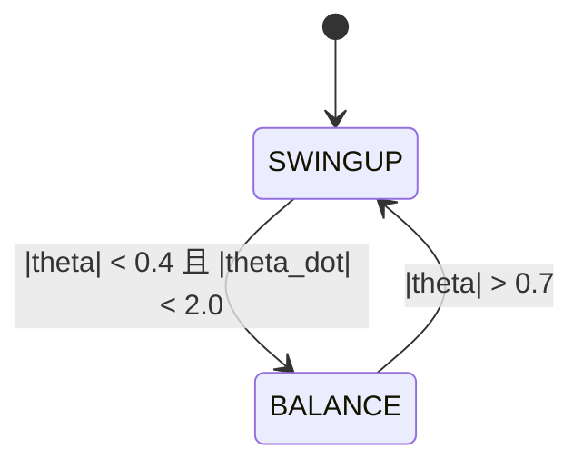
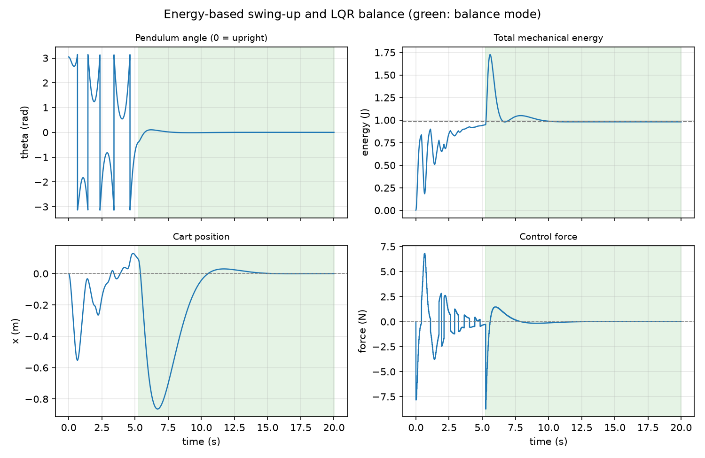
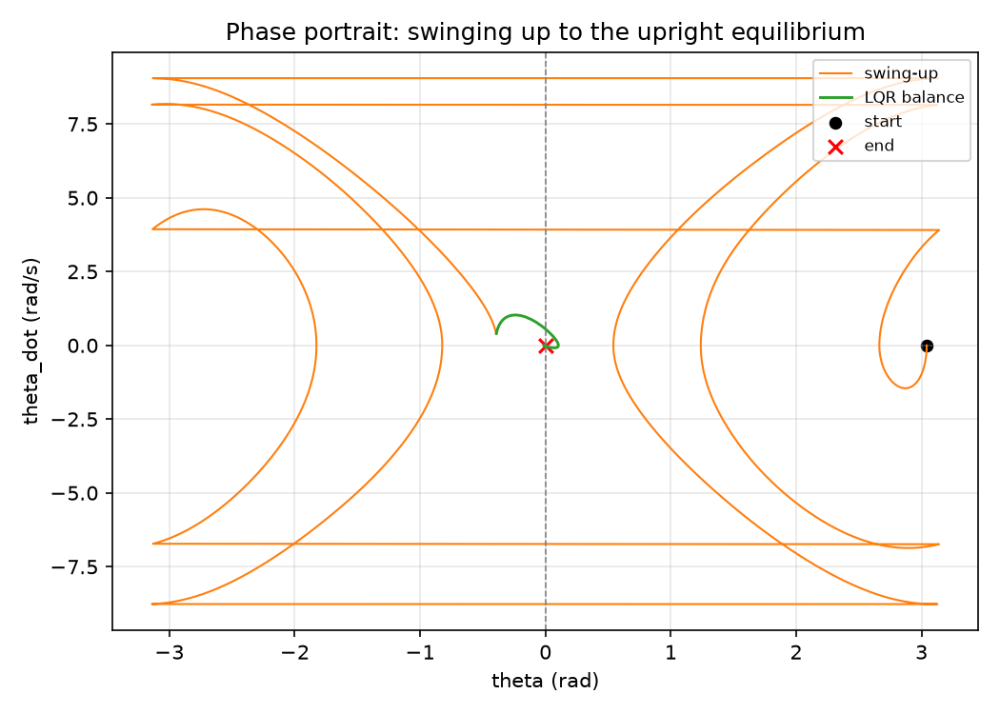
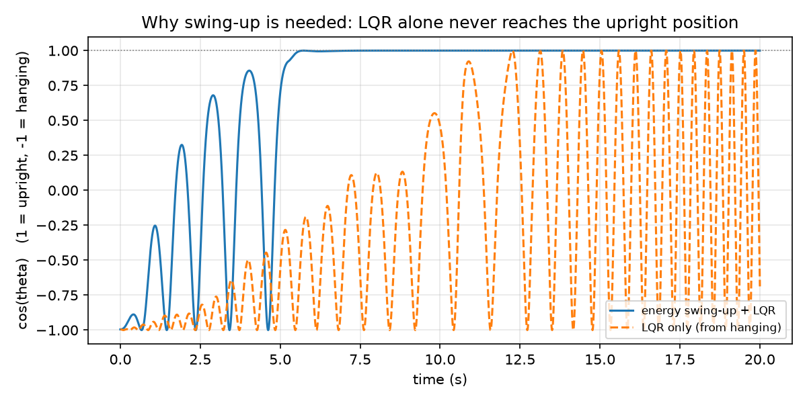

# 倒立摆能量摆起与 LQR 平衡实验

仓库里已有的 `cartpole_balance` 只演示「摆杆初始倾斜约 0.2 rad 时用 LQR 拉回竖直」。
本实验处理更难的起点：摆杆从**自然下垂**（`theta = π`）出发，先用能量控制把能量泵到
竖直向上的目标能量，接近平衡点时再切换 LQR 保持不倒，并把小车拉回原点。

## 一、实验目的与环境说明

### 1.1 实验目的

1. 掌握倒立摆非线性动力学方程，以及用 RK4 积分仿真的方法；
2. 理解能量控制的思想：通过小车加速度改变摆杆机械能，把摆杆“荡”到竖直附近；
3. 掌握在竖直平衡点线性化、离散 Riccati 迭代求 LQR 增益的方法；
4. 设计「能量摆起 + LQR 平衡」的模式切换逻辑，理解切换阈值对成功率和稳定性的影响；
5. 用离线仿真复现并量化摆起时间、稳定时间和控制力。

### 1.2 实验环境

| 项目 | 配置 |
| ---- | ---- |
| 操作系统 | Ubuntu 20.04（ROS 端）；Windows/Linux（离线仿真） |
| ROS 发行版 | ROS Noetic（Python 3） |
| 依赖 | rospy、std_msgs、python3-numpy |
| 离线仿真依赖 | Python 3、numpy、matplotlib |
| 被控对象 | 需要外部提供 `/cartpole/state` 的倒立摆仿真器或实车 |

功能包目录结构：

```text
cartpole_swingup/
├── main.py            # ROS 节点入口：状态订阅、控制力发布
├── cartpole_model.py  # 动力学、能量、LQR、双模控制器（纯 Python）
├── offline_sim.py     # 离线仿真与出图
├── launch/main.launch # roslaunch 入口
├── config/params.yaml
├── package.xml
├── CMakeLists.txt
└── README.md
```

## 二、实验原理

### 2.1 动力学模型

记小车质量 $m_c$、摆杆质量 $m_p$、摆杆半长 $l$，摆角 $\theta$ 从竖直向上方向量起。
小车位置 $x$、控制力 $F$，则

$$
(m_c + m_p)\ddot{x} + m_p l \ddot{\theta}\cos\theta - m_p l \dot{\theta}^2\sin\theta = F
$$

$$
m_p l^2 \ddot{\theta} + m_p l \ddot{x}\cos\theta - m_p g l \sin\theta = 0
$$

每个仿真步求解这个二元一次方程组得到 $\ddot{x}$、$\ddot{\theta}$，再用 RK4 积分。
参数取 $m_c = 1.0\ \mathrm{kg}$、$m_p = 0.1\ \mathrm{kg}$、$l = 0.5\ \mathrm{m}$、$g = 9.81\ \mathrm{m/s^2}$。

### 2.2 能量控制

相对自然下垂位置的总机械能为

$$
E = \frac{1}{2}(m_c + m_p)\dot{x}^2 + m_p l \dot{x}\dot{\theta}\cos\theta
  + \frac{1}{2}m_p l^2 \dot{\theta}^2 + m_p g l(\cos\theta + 1)
$$

竖直静止时的目标能量为 $E^* = 2 m_p g l$。对时间求导并代入动力学可得

$$
\frac{dE}{dt} = -m_p l\, \dot{\theta}\, \ddot{x} \cos\theta
$$

因此沿着 $-\mathrm{sign}(\dot{\theta}\cos\theta)$ 的方向给小车加速，就能稳定地增加能量。
实际使用力（近似与加速度同号）作为控制量：

$$
F = -k_E (E^* - E)\,\mathrm{sign}(\dot{\theta}\cos\theta) - k_x x - k_v \dot{x}
$$

后两项让小车不要越跑越远。

### 2.3 LQR 平衡

在 $\theta = 0$、$\dot{\theta}=0$ 附近线性化，状态取 $[x, \dot{x}, \theta, \dot{\theta}]$：

$$
A = \begin{bmatrix}
0 & 1 & 0 & 0\\
0 & 0 & -\frac{m_p g}{m_c} & 0\\
0 & 0 & 0 & 1\\
0 & 0 & \frac{(m_c+m_p)g}{m_c l} & 0
\end{bmatrix},\qquad
B = \begin{bmatrix}
0\\ \frac{1}{m_c}\\ 0\\ -\frac{1}{m_c l}
\end{bmatrix}
$$

对 $(A, B)$ 离散化后迭代求解离散 Riccati 方程，得到增益 $K$，控制力为 $F = -K\mathbf{x}$。
本实验取 $Q = \mathrm{diag}(1, 0.1, 10, 0.1)$、$R = 1$。

### 2.4 模式切换



切换窗口不能太窄：能量控制会让摆杆以较高角速度经过竖直位置，窗口过窄时
（例如 0.25 rad / 1.0 rad/s）几乎抓不住；放宽到 0.4 rad / 2.0 rad/s 后
LQR 能可靠接管。

## 三、运行步骤

### 3.1 ROS 节点

```bash
mkdir -p ~/catkin_ws/src
cp -r <本仓库>/src/classical_control/cartpole_swingup ~/catkin_ws/src/
chmod +x ~/catkin_ws/src/cartpole_swingup/main.py
cd ~/catkin_ws && catkin_make
source devel/setup.bash

# 先启动能发布 /cartpole/state、订阅 /cartpole/force 的仿真器
roslaunch cartpole_swingup main.launch
```

节点启动时打印 LQR 增益，摆起过程中打印 `SWINGUP -> BALANCE` 模式切换日志。

### 3.2 离线仿真

```bash
cd <本仓库>
python -m pip install numpy matplotlib
python src/classical_control/cartpole_swingup/offline_sim.py
```

脚本用 0.002 s 步长的 RK4 积分、50 Hz 控制器，复现同一套控制逻辑，
并额外跑一组「只用 LQR」的对照。

## 四、实验结果

初始状态：$x=0$、$\dot{x}=0$、$\theta=\pi-0.1$、$\dot{\theta}=0$。

### 4.1 摆起与平衡全过程



四个子图分别为摆角、总能量、小车位置和控制力，绿色区域为 LQR 平衡阶段。
能量在前 5 s 从 0 泵到目标值附近，摆杆多次经过竖直方向；5.26 s 切入 LQR 后
角度迅速收敛，小车从约 −0.86 m 缓慢回到原点。

### 4.2 相图



橙色为摆起阶段：轨迹从下垂点出发，能量逐渐增加，相轨迹一圈圈抬高；
绿色为 LQR 阶段：轨迹收敛到 $(0, 0)$ 平衡点。

### 4.3 与“只用 LQR”的对比



LQR 是在竖直平衡点附近线性化的。从下垂位置出发时，它虽然偶尔能把摆杆甩到竖直附近
（$\cos\theta$ 短暂接近 1），但无法稳定，之后继续在 −1～1 之间大幅摆动；
而能量摆起 + LQR 在约 5.5 s 后就稳定保持在 $\cos\theta \approx 1$。
这说明**大范围摆起需要非线性能量控制**，LQR 只负责平衡点附近的镇定。

### 4.4 指标

| 指标 | 数值 |
| ---- | ---- |
| 切入 LQR 时间 | 5.26 s |
| 角度稳定时间（|θ|<0.05 rad） | 7.00 s |
| 角度与小车都稳定时间 | 10.10 s |
| 最终角度误差 | < 0.001° |
| 最终小车位置 | ≈ 0 m |
| 小车最大行程 | 0.86 m |
| 最大控制力 | 8.73 N |

## 五、讨论与限制

1. 能量控制没有考虑执行器延迟和摩擦，实机上需要增加速度反馈或降低 $k_E$；
2. 切换阈值是手工整定的，窗口过窄会“抓不住”，过宽会让 LQR 在非线性较强时接管；
3. 仿真为理想模型，不含传感器噪声、电机死区和轨道限位；
4. 本机为 Windows，没有 ROS 与 Gazebo，**ROS 端实际运行未验证**，
   需要在 ROS Noetic + 倒立摆仿真器/实车上按 3.1 节复验。

## 说明

本文档与配套代码在整理过程中使用了 AI 助手（DeepSeek）辅助，实验参数、运行结果
和图表均由作者实际运行核对；作者对本文内容负全部责任。
