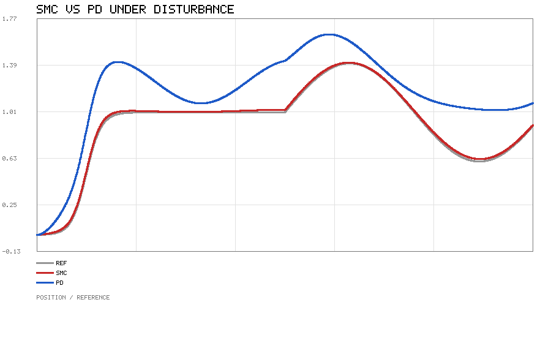

# 滑模控制（SMC）：二阶系统的鲁棒轨迹跟踪

## 1. 作业概述与背景

在机器人关节、电机、无人机姿态等大量控制问题中，被控对象常能用二阶系统描述，
且不可避免地受到建模误差与未知外部扰动。经典的 PID/PD 控制结构简单、易整定，
但在持续扰动下会留下稳态误差；而**滑模控制（Sliding Mode Control, SMC）**通过
设计一个不连续的切换控制律，使系统状态被"强制"到一条称为**滑模面**的低维流形上滑动，
从而对匹配扰动具有**不变性（invariance）**——这正是它鲁棒性强的根源。

本模块用一个含未知有界扰动的二阶系统，对比 SMC 与标称前馈 PD 的跟踪表现，
并给出可直接运行的纯 Python 仿真。模块不依赖 MuJoCo / ROS / matplotlib，
作图由手写的极简 PNG 输出完成。

## 2. 运行环境

- Python 3（仅标准库，无需任何第三方包）
- 操作系统不限（Windows / Linux / macOS）
- 运行方式：

```bash
cd src/control/sliding_mode_control
python3 scripts/main.py --outdir ../../../docs/img/classical_control/sliding_mode_control
```

运行后会在输出目录生成 `smc_response.png`（SMC 与 PD 在扰动下的跟踪对比），
配图直接写到 `docs/img/` 正版位置；并打印两种控制器的平均/稳态误差。

## 3. 核心代码文件清单

```
src/control/sliding_mode_control/
├── scripts/
│   ├── smc_model.py      # 被控对象、参考、扰动、SMC 与 PD 控制器与仿真
│   ├── simulate.py       # 组装曲线并调用手写 PNG 作图
│   ├── simple_plot.py    # 仅用 zlib 的极简折线图输出
│   └── main.py           # 命令行入口
├── tests/
│   └── test_smc.py       # 单元断言
├── package.xml
├── CMakeLists.txt
├── launch/main.launch   # 便于纳入 catkin 工作空间统一启动
├── README.md
└── requirements.txt     # 空（无第三方依赖）
```

## 4. 处理原理

### 4.1 被控对象

考虑二阶系统（含未知有界扰动 $d(t)$）：

$$m\,\ddot{x} + c\,\dot{x} + k\,x = u + d(t)$$

其中 $m$ 为等效质量，$c$ 为阻尼，$k$ 为刚度，$u$ 为控制输入。控制目标是让
$x(t)$ 跟踪参考轨迹 $r(t)$，定义跟踪误差 $e = x - r$。扰动满足
$|d(t)| \le D_{\max}$。

### 4.2 滑模面与等效控制

定义滑模面（一阶滑模）：

$$s = \dot{e} + \lambda\,e, \qquad \lambda > 0$$

理想情况下希望 $s \equiv 0$，即误差沿指数趋近 $\dot{e} = -\lambda e$。对 $s$ 求导并代入对象：

$$\dot{s} = \ddot{e} + \lambda\dot{e}
= \frac{u + d - c\dot{x} - kx}{m} - \ddot{r} + \lambda\dot{e}$$

取**等效控制**抵消标称动力学、再用**边界层切换项**抑制扰动：

$$u = m\big(\ddot{r} - \lambda\dot{e}\big) + c\dot{x} + kx - K\,\mathrm{sat}\!\left(\frac{s}{\varphi}\right)$$

其中 $\mathrm{sat}(z)=\tanh z$ 为边界层符号函数（用 $\tanh$ 代替硬 $\mathrm{sign}$ 以削弱抖振），
$K$ 为切换增益。代入 $\dot{s}$ 得 $\dot{s} = \big(d - K\,\mathrm{sat}(s/\varphi)\big)/m$。

**理想 sign 切换**（$\varphi\to 0$，硬切换）：只要 $K > D_{\max}$，就有
$\dot{s}\cdot s < 0$ 在全空间成立，状态在有限时间内到达滑模面并保持
$s\equiv 0$，误差按 $e(t)\to 0$ 指数收敛，且与扰动 $d(t)$ 的具体形式无关——
这是滑模不变性的严格结论。代价是切换增益在 $s=0$ 附近高频抖振，实际系统难以接受。

**tanh 边界层近似**（本模块实现）：$\tanh$ 是有界连续函数，永远到不了 $\pm1$，
因此扰动不会精确抵消，而是收敛到一个小的平衡残差。令 $\dot{s}=0$：

$$K\,\tanh\!\left(\frac{s^*}{\varphi}\right) = d
\;\Longrightarrow\; s^* = \varphi\,\mathrm{atanh}\!\left(\frac{d}{K}\right),
\qquad e^* = \frac{s^*}{\lambda}
= \frac{\varphi\,\mathrm{atanh}(d/K)}{\lambda}$$

平衡点存在仍需 $K>|d|$；到达条件只在边界层外成立（$|s|>s^*$ 时
$\dot{s}\cdot s<0$），状态被吸引到 $|s|\le s^*$ 而不是 $0$。取本模块参数
$d=2, K=5,\ \varphi=0.08,\ \lambda=3$：

$$s^* = 0.08\times\mathrm{atanh}(0.4) \approx 0.034,\qquad
e^* \approx 0.0113$$

即常值扰动下误差收敛到约 $0.011$ 而非严格归零；残差随 $\varphi$ 线性增大、
随 $K$ 与 $\lambda$ 增大而减小。$\varphi\to 0$ 时该式退化为理想结论 $e^*\to 0$。
`boundary_residual()` 与 `test_constant_disturbance_residual_matches_analytic()`
把这一分析锁进了回归测试。

### 4.3 对照：标称前馈 PD

作为对比，给出同样含标称前馈但**无主动扰动抑制**的 PD：

$$u = m\,\ddot{r} + c\,\dot{x} + k\,x - K_p\,e - K_d\,\dot{e}$$

在持续常值扰动 $d_0$ 下，稳态误差为 $e_{ss} = d_0/K_p > 0$，即无法完全消除。

## 5. 仿真结果

仿真设置：参考轨迹为 $0\to 1$ 的平滑阶跃（logistic），5 s 后叠加 $0.4\sin(1.2t)$ 摆动；
扰动取 $d(t)=1.5\sin(1.7t)+2.0$（均值 2.0、峰值约 3.5）。取 $m=1,\,c=0.6,\,k=2$，
$\lambda=3.0,\,K=5.0,\,\varphi=0.08$，PD 取 $K_p=8,\,K_d=4$。



从上图可见：

- **SMC（红）** 几乎紧贴参考（灰），全程平均误差约 $0.012$；
- **PD（蓝）** 全程明显偏离，稳态误差约 $0.25$，正是常值扰动造成的残留偏差。

SMC 的 $0.012$ 不是数值噪声，而正是 4.2 节边界层分析的残差量级：本场景扰动
均值 $\bar d=2$，解析残差 $e^*=\varphi\,\mathrm{atanh}(\bar d/K)/\lambda\approx 0.0113$。
**常值扰动验证**（$d(t)\equiv 2$，其余参数不变）：SMC 稳态误差实测 $0.01125$，
与解析值 $0.01130$ 一致；同场景下 PD 稳态误差 $0.2493$，与 $d/K_p=0.25$ 一致。
两者对比直观体现了滑模控制对匹配扰动的抑制能力——但要注意：
在 tanh 边界层下它是「把残差压低两个量级」，而不是理想硬切换下的严格无静差。

## 6. 小结

- 滑模控制通过滑模面把跟踪误差约束到指数稳定的低维流形；
- 理想硬 sign 切换下，$K>D_{\max}$ 保证到达条件 $\dot{s}\cdot s<0$ 与严格无静差；
- 用 tanh 边界层软化抖振后，结论应表述为：误差收敛到解析残差
  $e^*=\varphi\,\mathrm{atanh}(d/K)/\lambda$（本参数下约 $0.011$）而非严格归零，
  残差随 $\varphi$ 线性增大、随 $K$ 增大而减小；
- 与仅含前馈的 PD 相比，SMC 在持续扰动下把稳态误差压低约两个量级（$0.25\to0.011$）。

## 参考

- V. I. Utkin, *Sliding Modes in Control and Optimization*, 1992
- J. J. E. Slotine, W. Li, *Applied Nonlinear Control*, 1991
- K. D. Young, V. I. Utkin, Ü. Özgüner, *A control engineer's guide to sliding mode control*, 1999

> 说明：本模块仅依赖 Python 标准库，开箱即跑；文档与代码在编写过程中使用 AI 辅助，
> 但均经实跑验证（单元测试与 `python3 main.py` 生成上图），作者对内容正确性负责。
