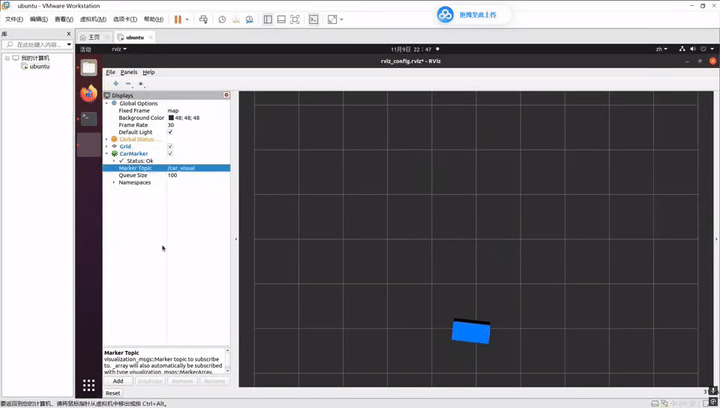

# 基于 ROS 与 Rviz 的移动机器人 8 字轨迹生成与可视化仿真

## 修改目的与内容
本项目在 ROS 节点底层通过三角函数算法生成 8 字型轨迹，并使用 Marker 消息将机器人的位置与姿态实时发布到 Rviz 中进行 3D 可视化展示。

## 运行环境
- Ubuntu 20.04
- ROS Noetic
- Python 3.8

## 文件结构
```
src/
└── figure8_sim/
    ├── package.xml
    ├── CMakeLists.txt
    ├── rviz/
    │   └── rviz_config.rviz
    ├── launch/
    │   └── figure8_sim.launch
    └── scripts/
        └── main.py
```

## 运行步骤
1. 编译工作空间：`catkin_make`
2. 加载环境变量：`source devel/setup.bash`
3. 一键启动仿真：`roslaunch figure8_sim figure8_sim.launch`
4. 观察 Rviz 窗口，蓝色小车将自动沿着 8 字型轨迹平稳运动。

## 运行结果


## 大模型使用声明
代码与文档编写过程中使用了大模型进行辅助生成，核心逻辑与测试已由本人独立完成并验证。
