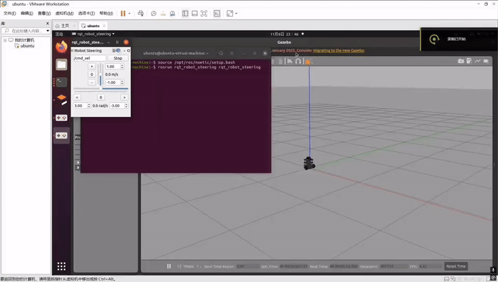

# 基于 Gazebo 与 rqt 的移动机器人运动学交互仿真

## 任务说明
本人选择任务（1）：车辆运动仿真。本项目使用 Gazebo 3D 物理引擎加载 Turtlebot3 机器人模型，通过 rqt_robot_steering 节点发布 /cmd_vel 线速度与角速度话题，实现对机器人的实时运动控制。

## 运行环境
- Ubuntu 20.04
- ROS Noetic
- Gazebo

## 依赖安装
```bash
sudo apt install ros-noetic-turtlebot3 ros-noetic-turtlebot3-simulations ros-noetic-rqt-robot-steering -y
```

## 文件结构
```
src/
└── gazebo_robot_steering/
    ├── package.xml
    ├── CMakeLists.txt
    ├── scripts/
    │   └── main.py
    ├── launch/
    │   └── robot_steering.launch
    └── docs/
        ├── README.md
        └── gazebo_demo.gif
```

## 运行步骤
1. 编译并刷新环境：`catkin_make && source devel/setup.bash`
2. 直接启动：`roslaunch gazebo_robot_steering robot_steering.launch`
   （或运行 `rosrun gazebo_robot_steering main.py`，无需先启动 roscore）
3. 在弹出的 Robot Steering 面板中拖动滑动条调整线速度和角速度。
4. 观察 Gazebo 环境中机器人的实时运动。

## 运行结果


## 大模型声明
代码由本人参考 ROS 官方文档和课程资料编写，未使用大模型生成。
