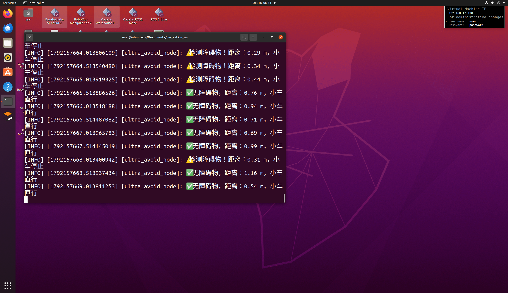

# ROS2移动小车超声波避障节点开发（传感器数据模拟）
## 1.项目简介
本项目基于ROS2 Humble，使用Python开发地面移动小车的超声波避障算法节点。程序内部通过定时器模拟超声波测距传感器的数据，实时判断障碍物距离。
- 距离＜0.5m：判定前方存在障碍物，小车停止运动，终端输出告警；
- 距离≥0.5m：无障碍物，小车保持向前直行。
本项目用于验证阈值式避障算法，运行状态打印在终端，完成地面移动机器人基础避障逻辑验证。

## 2.项目目录结构
ultra_avoid/
├── ultra_avoid/
│   ├── **init**.py
│   └── ultra_node.py       # 核心避障算法代码
├── launch/
│   └── car.launch.py       # 项目启动文件
├── urdf/
│   └── car.urdf            # 小车 URDF 车体描述文件
├── package.xml
└── setup.py

## 3.环境依赖
- ROS2 Humble
- Python3
- rclpy、geometry_msgs、sensor_msgs

## 4.编译与运行命令
```bash
#编译功能包
colcon build --packages-select ultra_avoid
# 加载环境变量
source install/setup.bash
# 运行避障节点
ros2 run ultra_avoid ultra_node
```
## 5.核心代码

1.ultra_node.py
```python
import rclpy
from rclpy.node import Node
from sensor_msgs.msg import Range
from geometry_msgs.msg import Twist
import random

class UltraAvoidNode(Node):
    def __init__(self):
        super().__init__('ultra_avoid_node')
        # 速度发布器，发布小车运动速度
        self.pub = self.create_publisher(Twist, '/cmd_vel', 10)
        # 创建定时器，0.5s执行一次，模拟超声波传感器
        self.timer_period = 0.5
        self.timer = self.create_timer(self.timer_period, self.simulate_ultra)
        self.twist = Twist()

    def simulate_ultra(self):
        # 随机模拟障碍物距离，范围0.2~1.2米
        distance = random.uniform(0.2,1.2)
        # 避障判断逻辑
        if distance < 0.5:
            self.twist.linear.x = 0.0
            self.get_logger().info(f"⚠️检测障碍物！距离：{distance:.2f} m，小车停止")
        else:
            self.twist.linear.x = 0.2
            self.get_logger().info(f"✅无障碍物，距离：{distance:.2f} m，小车直行")
        self.pub.publish(self.twist)

def main(args=None):
    rclpy.init(args=args)
    node = UltraAvoidNode()
    rclpy.spin(node)
    node.destroy_node()
    rclpy.shutdown()

if __name__ == '__main__':
    main()
```
2.car.launch.py
```python
from launch import LaunchDescription
from launch_ros.actions import Node
from launch_ros.substitutions import FindPackageShare
from launch.substitutions import PathJoinSubstitution

def generate_launch_description():
    pkg_share = FindPackageShare(package='ultra_avoid').find('ultra_avoid')
    urdf_file = PathJoinSubstitution([pkg_share, 'urdf', 'car.urdf'])

    return LaunchDescription([
        Node(
            package='robot_state_publisher',
            executable='robot_state_publisher',
            arguments=[urdf_file],
            output='screen'
        ),
        Node(
            package='ultra_avoid',
            executable='ultra_node',
            output='screen'
        )
    ])
```
3. car.urdf
```python
<?xml version="1.0"?>
<robot name="simple_car">
  <!-- 车体 -->
  <link name="base_link">
    <visual>
      <geometry><box size="0.4 0.2 0.15"/></geometry>
      <material name="blue"><color rgba="0 0 1 1"/></material>
    </visual>
  </link>
  <!-- 超声波传感器 -->
  <link name="ultrasonic_link">
    <visual>
      <geometry><box size="0.05 0.05 0.05"/></geometry>
      <material name="red"><color rgba="1 0 0 1"/></material>
    </visual>
  </link>
  <joint name="ultra_joint" type="fixed">
    <parent link="base_link"/>
    <child link="ultrasonic_link"/>
    <origin xyz="0.2 0 0.075" rpy="0 0 0"/>
  </joint>
</robot>
```
4.setup.py
```python
from setuptools import setup
package_name = 'ultra_avoid'
setup(
    name=package_name,
    version='0.0.0',
    packages=[package_name],
    data_files=[
        ('share/ament_index/resource_index/packages',
            ['resource/' + package_name]),
        ('share/' + package_name, ['package.xml']),
        ('share/' + package_name + '/launch', ['launch/car.launch.py']),
        ('share/' + package_name + '/urdf', ['urdf/car.urdf']),
    ],
    install_requires=['setuptools'],
    zip_safe=True,
    maintainer='user',
    maintainer_email='user@todo.todo',
    description='ROS2移动小车超声波避障节点开发（传感器数据模拟）',
    license='Apache-2.0',
    tests_require=['pytest'],
    entry_points={
        'console_scripts': [
            'ultra_node = ultra_avoid.ultra_node:main',
        ],
    },
)
```
5.package.xml
```python
<?xml version="1.0"?>
<?xml-model href="http://download.ros.org/schema/package_format3.xsd" schematypens="http://www.w3.org/2001/XMLSchema"?>
<package format="3">
  <name>ultra_avoid</name>
  <version>0.0.0</version>
  <description>ROS2移动小车超声波避障节点开发（传感器数据模拟）</description>
  <maintainer email="user@todo.todo">user</maintainer>
  <license>Apache-2.0</license>
  <buildtool_depend>ament_python</buildtool_depend>
  <build_depend>rclpy</build_depend>
  <build_depend>sensor_msgs</build_depend>
  <build_depend>geometry_msgs</build_depend>
  <exec_depend>rclpy</exec_depend>
  <exec_depend>sensor_msgs</exec_depend>
  <exec_depend>geometry_msgs</exec_depend>
  <test_depend>ament_pytest</test_depend>
  <export>
    <build_type>ament_python</build_type>
  </export>
</package>
```
## 6.操作说明
### 6.1 准备工作
打开虚拟机终端，进入ROS2工作空间src目录，**执行下面命令新建项目目录**：
```bash
# 进入工作空间src文件夹
cd ~/Documents/mw_catkin_ws/src
# 创建功能包主文件夹 ultra_avoid
mkdir ultra_avoid
# 进入ultra_avoid目录
cd ultra_avoid
# 创建内部子文件夹
mkdir ultra_avoid launch urdf
```
### 6.2 编译功能包
执行编译命令，构建 ultra_avoid 功能包：
```
colcon build --packages-select ultra_avoid
```
### 6.3 加载环境变量
每次新开终端，都需要执行这一步**，让 ROS2 找到我们写的功能包。
```
source install/setup.bash
```
### 6.4 运行避障节点
```
ros2 run ultra_avoid ultra_node
```
### 6.5 查看运行结果


