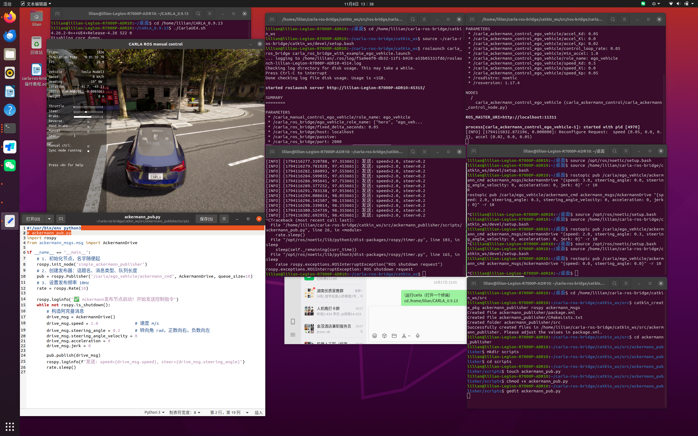

# 阿克曼控制

## 简介

在 Ubuntu 20.04 上完成 CARLA 与 ROS 桥接后，通过 `ackermann_msgs/AckermannDrive` 消息向主车发布阿克曼控制命令（目标速度 + 转向角）。本文提供两种方式：先用 `rostopic pub` 命令行快速验证直行、转向与停止，再编写 Python 发布节点以固定频率持续发送控制指令。

> 说明：下文命令中的 `~` 指你的主目录，请按实际安装位置调整路径。

## 环境要求

* Ubuntu 20.04
* ROS Noetic
* CARLA（安装目录 `~/CARLA_0.9.13`；若通过 apt 系统安装则位于 `/opt/carla-simulator`）
* carla-ros-bridge（工作区 `~/carla-ros-bridge/catkin_ws`，已编译）

## 配套代码

本教程对应的代码位于仓库 `src/ground/ackermann_publisher/` 目录，与下面各步骤的命令一一对应：

| 步骤 | 代码文件 |
| ---- | ---- |
| 安装依赖 | `src/ground/ackermann_publisher/install_deps.sh` |
| 启动 CARLA | `src/ground/ackermann_publisher/start_carla.sh` |
| 启动 ROS 桥与主车 | `src/ground/ackermann_publisher/start_bridge.sh` |
| 发布直行命令 | `src/ground/ackermann_publisher/drive_straight.sh` |
| 发布转向命令 | `src/ground/ackermann_publisher/drive_turn.sh` |
| 发布停止命令 | `src/ground/ackermann_publisher/stop.sh` |
| 创建发布功能包 | `src/ground/ackermann_publisher/create_pkg.sh` |
| Python 发布节点（第六步代码） | `src/ground/ackermann_publisher/ackermann_pub.py` |
| 编译并运行 | `src/ground/ackermann_publisher/build_run.sh` |

## 第一步：安装依赖

```bash
# 阿克曼消息包
sudo apt install ros-noetic-ackermann-msgs

# PID依赖（carla_ackermann_control用）
pip install simple-pid
```

## 第二步：启动 CARLA（终端 1）

```bash
cd ~/CARLA_0.9.13

./CarlaUE4.sh
```

> apt 系统安装时将目录替换为 `/opt/carla-simulator`。

等待 CARLA 窗口加载出地图画面。

## 第三步：加载环境并启动 bridge（终端 2）

```bash
# 先加载环境
source /opt/ros/noetic/setup.bash
source ~/carla-ros-bridge/catkin_ws/devel/setup.bash

# 启动 bridge 并生成一辆 ego 车
roslaunch carla_ros_bridge carla_ros_bridge_with_example_ego_vehicle.launch
```

运行成功后，CARLA 窗口会生成主车，manual control 面板显示 `ego_vehicle running`。

## 第四步：rostopic 发布阿克曼命令（终端 3）

先加载环境：

```bash
source /opt/ros/noetic/setup.bash
source ~/carla-ros-bridge/catkin_ws/devel/setup.bash
```

**直行**：速度 3 m/s，转角 0 rad，以 10 Hz 发布：

```bash
rostopic pub /carla/ego_vehicle/ackermann_cmd ackermann_msgs/AckermannDrive "{speed: 3.0, steering_angle: 0.0, steering_angle_velocity: 0.0, acceleration: 0.0, jerk: 0.0}" -r 10
```

**转向**：速度 2 m/s，转角 0.3 rad：

```bash
rostopic pub /carla/ego_vehicle/ackermann_cmd ackermann_msgs/AckermannDrive "{speed: 2.0, steering_angle: 0.3, steering_angle_velocity: 0, acceleration: 0, jerk: 0}" -r 10
```

**停止**：目标速度 0：

```bash
rostopic pub /carla/ego_vehicle/ackermann_cmd ackermann_msgs/AckermannDrive "{speed: 0.0, steering_angle: 0.0}" -r 10
```

## 第五步：创建发布功能包（终端 4）

```bash
cd ~/carla-ros-bridge/catkin_ws/src

catkin_create_pkg ackermann_publisher rospy ackermann_msgs

cd ackermann_publisher
mkdir scripts
cd scripts
touch ackermann_pub.py
chmod +x ackermann_pub.py
```

## 第六步：编写 Python 发布节点

编辑 `ackermann_pub.py`：

```python
#!/usr/bin/env python3
# ackermann_pub.py
import rospy
from ackermann_msgs.msg import AckermannDrive

if __name__ == "__main__":
    # 1. 初始化节点
    rospy.init_node("simple_ackermann_publisher")
    # 2. 创建发布器：话题名、消息类型、队列长度
    pub = rospy.Publisher("/carla/ego_vehicle/ackermann_cmd", AckermannDrive, queue_size=10)
    # 3. 设置发布频率 10Hz
    rate = rospy.Rate(10)

    rospy.loginfo("Ackermann发布节点启动，开始发送控制指令")
    while not rospy.is_shutdown():
        # 构造阿克曼消息
        drive_msg = AckermannDrive()
        drive_msg.speed = 2.0               # 速度 m/s
        drive_msg.steering_angle = 0.2      # 转向角 rad，正数向右，负数向左
        drive_msg.steering_angle_velocity = 0
        drive_msg.acceleration = 0
        drive_msg.jerk = 0

        pub.publish(drive_msg)
        rospy.loginfo(f"发送: speed={drive_msg.speed}, steer={drive_msg.steering_angle}")
        rate.sleep()
```

## 第七步：编译并运行

```bash
cd ~/carla-ros-bridge/catkin_ws
catkin_make
source devel/setup.bash

source /opt/ros/noetic/setup.bash
rosrun ackermann_publisher ackermann_pub.py
```

节点启动后以 10 Hz 持续发送 `speed=2.0`、`steer=0.2` 的阿克曼命令，主车按该速度与转角行驶。

## 运行效果

完整操作截图：CARLA 主车已生成、bridge 启动参数、三条 rostopic 命令与 Python 节点循环发送日志（`Ctrl+C` 正常退出）：



## AckermannDrive 字段说明

| 字段 | 类型 | 含义 | 示例 |
| ---- | ---- | ---- | ---- |
| `speed` | float32 | 目标速度（m/s） | `3.0` 直行；`0.0` 停止 |
| `steering_angle` | float32 | 目标转向角（rad），正数向右、负数向左 | `0.3` 右转；`-0.3` 左转 |
| `steering_angle_velocity` | float32 | 转向角速度（rad/s） | `0.0` |
| `acceleration` | float32 | 目标加速度（m/s²） | `0.0` |
| `jerk` | float32 | 加加速度（m/s³） | `0.0` |

## 常见问题

* **`apt install` 提示找不到 `ros-noetic-ackermann-msgs`**：先执行 `sudo apt update`，并确认已正确安装 ROS Noetic 软件源。

* **`rostopic pub` 报错话题不存在**：确认终端 3 已 `source` 桥接环境，且终端 2 的 `roslaunch` 正常运行、主车已生成。

* **`rosrun` 找不到 `ackermann_pub.py`**：确认脚本已 `chmod +x` 且位于功能包 `scripts/` 目录内，并在 `catkin_make` 后重新 `source devel/setup.bash`。

* **启动时报错 `KeyError: 'simple_pid'`**：simple-pid 2.0.x 与 carla-ros-bridge 不兼容，卸载后换装兼容版本：

```bash
# 1. 卸载不兼容的 2.0.1
pip3 uninstall simple-pid -y

# 2. 安装兼容旧版 0.2.2
pip3 install simple-pid==0.2.2
```

## 参考

* [Carla 阿克曼控制（官方说明）](https://openhutb.github.io/doc/carla_ackermann_control/)
* [设置并连接到 Carla 模拟器](../set_up_and_connect_to_carla.md)
