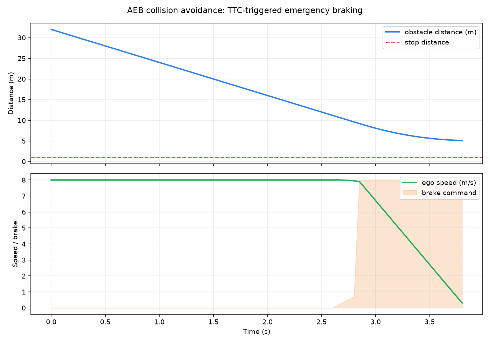

# 无人车前向碰撞预警与自动紧急制动（AEB）

> 对应无人车方向的主动安全功能：根据前方障碍物距离与自车速度判断碰撞风险，先分级预警，再自动施加最大制动力，并在安全距离内停车。



## 功能目标

1. 用**所需制动距离**与**碰撞时间（TTC）**两个判据共同判断风险，输出安全、预警、制动、停止四种状态。
2. 预警状态进行有限预制动；紧急状态输出最大制动力和零目标速度。
3. 紧急制动一旦触发即**锁存**，直到车辆停车或风险解除，避免制动命令反复通断。
4. 提供可选 ROS 2 节点，用标准话题连接上游感知与下游控制。

## 与已有示例的区别

| 示例 | 主要功能 | 本模块的区别 |
| --- | --- | --- |
| [CARLA 地面载具物理仿真与键盘运动控制](carla_keyboard_control.md) | 在 CARLA 中进行物理仿真和人工键盘操控 | 本模块增加自动风险评估与紧急制动，不重复键盘控制 |
| [车辆键盘遥操作与二维模拟](vehicle_pygame_teleop.md) | 手动输入速度和转向，并模拟车辆运动 | 本模块由障碍物距离触发制动，驾驶员无需按键 |
| 路径规划、配送或停车模拟 | 规划目标路线或特定任务流程 | 本模块是与规划任务解耦的前向碰撞安全层，重点在风险评估与制动响应 |

## 决策原理

速度 \(v\)、最大制动减速度 \(a_{max}\)、系统响应时间 \(t_{resp}\)、停车余量 \(d_{stop}\) 给定时，安全停车所需距离为：

\[
d_{req} = \frac{v^2}{2a_{max}} + v \cdot t_{resp} + d_{stop}
\]

其中距离项 \(d_{req}\) 是主判据，碰撞时间 \(TTC = d / v\) 作为补充判据。**只用车速与距离的比值判据会在减速后失效**：车速降低会让 TTC 重新变大，制动命令于是在“制动”和“预警”之间抖动。因此本模块：

- 以 \(d \le d_{req}\)（或 \(TTC \le 1.2\ s\)）触发紧急制动；
- 紧急制动**锁存**，仅当车辆停车、或同时满足 \(d > 1.8 d_{req}\) 与 \(TTC > 2.5\ s\) 才解除；
- 进入停车余量（\(d \le d_{stop}\)）后保持最大制动，避免车辆继续向障碍物蠕动。

默认阈值：

| 条件 | 状态 | 制动行为 |
| --- | --- | --- |
| \(d > 1.8 d_{req}\) 且 \(TTC > 2.5\ s\) | SAFE | 不制动 |
| \(d \le 1.8 d_{req}\) 或 \(TTC \le 2.5\ s\) | WARNING | 有限预制动 |
| \(d \le d_{req}\) 或 \(TTC \le 1.2\ s\) | BRAKING | 最大制动力，目标速度 0 |
| \(d \le 1.0\ m\) | STOPPED | 保持最大制动 |

阈值集中在 `src/ground/aeb_collision_avoidance/config/aeb_params.yaml`，可按车型和场景调整。本模块使用简化纵向模型，不替代经实车标定的安全系统。

## 独立运行与效果验证

环境要求 Python 3.8+、`matplotlib`。在仓库根目录执行：

```bash
python src/ground/aeb_collision_avoidance/main.py --output-dir src/ground/aeb_collision_avoidance/results
```

默认场景从 32 m、8 m/s 出发，程序输出停车结果与最终状态，并生成 `aeb_simulation.png` 与 `aeb_simulation.csv`。该模式不依赖 ROS 或 CARLA，便于快速复现。

测试覆盖安全/预警/制动/停止四态、所需距离随车速增长、制动锁存与解除、默认场景与高速场景无碰撞停车、制动命令不抖动，以及关闭制动后必然碰撞的可证伪对照：

```bash
python -m pytest -q src/ground/aeb_collision_avoidance/test
```

## ROS 2 接入

在 ROS 2 Humble 工作空间构建并启动：

```bash
colcon build --packages-select aeb_collision_avoidance --symlink-install
source install/setup.bash
ros2 launch aeb_collision_avoidance main.launch.py
```

订阅 `/aeb/obstacle_distance`（`std_msgs/Float32`，单位 m）与 `/aeb/ego_speed`（`std_msgs/Float32`，单位 m/s）；发布 `/aeb/brake_command`（`std_msgs/Float32MultiArray`，依次为制动力与目标速度）和 `/aeb/state`（`std_msgs/String`）。CARLA 数据可由既有桥接节点转换到这些接口；通用 CARLA/ROS 网络配置请参考[设置并连接到 Carla 模拟器](../set_up_and_connect_to_carla.md)。

## 源码

功能包源码位于 `src/ground/aeb_collision_avoidance`，`main.py` 为模块主入口。开发辅助使用了 DeepSeek；提交者需核实结果并对提交内容负全部责任。
