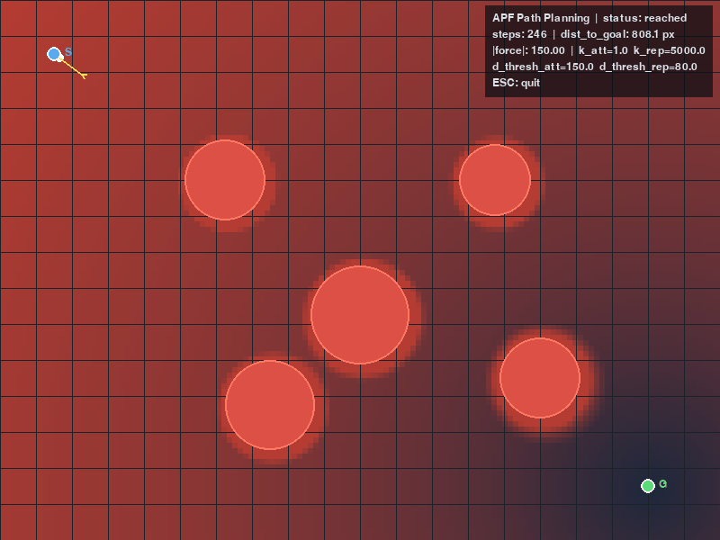

# 人工势场法（APF）路径规划

基于 Khatib (1986) 的反应式规划方法：目标产生引力、障碍物产生斥力，机器人沿合力方向步进。纯 pygame 2D 可视化，含势场热图、路径动画、合力箭头与演示 gif 录制。

## 概述

人工势场法（Artificial Potential Field, APF）由 Oussama Khatib 于 1986 年提出，是机器人反应式路径规划的经典方法。核心思想是将机器人建模为人工势场中的质点：

- **目标**对机器人产生**引力**（势能随远离目标增大）
- **障碍物**对机器人产生**斥力**（势能随接近障碍物增大）
- 机器人沿总势能的**负梯度**方向运动，自然趋向目标、避开障碍

本项目实现包含三项经典改进，使其在实际场景中更鲁棒。

## 算法原理

### 引力势函数（分段）

| 区域 | 条件 | 公式 | 梯度幅值 |
|---|---|---|---|
| 近场 | d ≤ d₀ | U = ½·k·d² | k·d（线性增长） |
| 远场 | d > d₀ | U = k·d₀·d - ½·k·d₀² | k·d₀（恒定） |

分段设计避免远距离引力过大导致步进发散——这是 APF 的经典改进，原始 Khatib 公式用纯二次型 U=½kd²，远距离时梯度无界。

### 斥力势函数

障碍物建模为圆形（圆心 + 安全半径），斥力按机器人到障碍物**边界**的距离 d 计算：

- 影响范围内 (0 < d ≤ d_thresh)：U = ½·k_rep·(1/d - 1/d_thresh)²
- 影响范围外 (d > d_thresh)：U = 0
- 穿入障碍物 (d ≤ 0)：U = +∞

### 合力与步进

合力 F = -∇U_att - ∇U_rep，归一化为单位向量后乘步长 step_size。归一化保证步长恒定，避免合力过大时跨过障碍物。

### 局部最小值逃逸

APF 的经典缺陷：当障碍物正后方形成势阱（引力与斥力方向相反、幅值接近），机器人会停滞。本实现检测两种停滞信号：

1. 合力幅值 < 阈值
2. 距目标距离持续不下降

超过 patience 次后注入随机扰动跳出局部势阱。这是工程上常用的简单逃逸策略（更高级的方法有模拟退火、随机旋转等）。

### 与其他规划方法的对比

| 方法 | 类别 | 原理 | 优势 | 局限 |
|---|---|---|---|---|
| A* | 栅格搜索 | 离散图搜索 | 全局最优 | 分辨率依赖 |
| RRT | 采样式 | 随机树扩展 | 高维适用 | 路径不光滑 |
| Dubins | 几何闭式 | 运动学约束最短路径 | 解析解 | 需知起末位姿 |
| **APF** | **反应式** | **虚拟力场梯度下降** | **实时、低算力** | **局部最小值** |

## 实现细节

### 源码结构

| 文件 | 内容 | 行数 |
|---|---|---|
| `apf.py` | 核心算法：势函数、梯度、合力、步进、规划、逃逸 | 279 |
| `main.py` | pygame 可视化：势场热图、障碍物、路径动画、合力箭头、HUD、录制 | 302 |
| `config.py` | 画布尺寸、颜色、默认场景、APF 参数、params.yaml 加载 | 143 |
| `test_apf.py` | 36 项离线单测 | 291 |

### 参数配置

`config/params.yaml` 会真正被读取（`config.load_params()`），查找顺序：

1. 环境变量 `APF_PARAMS` 指向的文件
2. ROS 2 安装空间 `<share>/apf_path_planning/config/params.yaml`（`ros2 run` 走的路径）
3. 源码树 `<包根>/config/params.yaml`

可配置 `canvas.{width,height,fps}`、`scene.{start,goal,obstacles}`、`apf.{k_att,k_rep,d_thresh_att,d_thresh_rep,step_size,max_iter,goal_tol}`。
未安装 PyYAML 时自动退回内置默认值，不会报错。

> 说明：本模块是 pygame 2D 可视化，没有 rclpy 节点，所以 params.yaml 是**模块配置**，
> 不含 `ros__parameters`（原先的写法会让人误以为是 ROS 参数文件，实际无人读取）。

### 可视化效果

演示 gif（`apf_demo.gif`）展示：

1. **势场热图背景**：低势能暗蓝、高势能亮红，直观展示引力场与斥力场分布
2. **障碍物**（红色填充圆 + 边框）：5 个圆形障碍物
3. **路径生长动画**（蓝色线）：从起点 S 到目标 G 的逐步生长
4. **当前合力箭头**（黄色）：实时显示机器人受力方向
5. **HUD**：状态（reached/timeout）、步数、距目标距离、合力幅值、参数



## 运行步骤

### 直接运行

```bash
pip install pygame pillow pyyaml
python main.py                  # 交互模式
python main.py --record         # 录制演示 gif
python main.py --params my.yaml # 指定参数文件
```

### ROS 2 运行

```bash
cd ~/ros2_ws
colcon build --packages-select apf_path_planning --symlink-install
source install/setup.bash
ros2 run apf_path_planning main
```

无显示设备的机器（VM / CI）用 launch 参数切到离屏录制，不会因为没有窗口而崩：

```bash
ros2 launch apf_path_planning main.launch.py mode:=record output:=/tmp/apf_demo.gif
ros2 launch apf_path_planning main.launch.py params:=/path/to/params.yaml
```

## 单元测试

```bash
cd apf_path_planning
python -m pytest test/ -v          # 或 python test/test_apf.py
```

36 项单测覆盖：参数校验、距离函数、障碍物距离、引力势函数（目标处为零/近场二次/远场锥形/阈值连续性）、引力梯度（方向/幅值/远场恒定）、斥力势函数（障碍外为零/影响内为正/穿入为 inf）、斥力梯度方向、合力（无障碍等于引力/指向目标）、步进（趋向目标/步长上界）、规划（无障碍到达/侧方障碍避让/多障碍全避让）、总势能，以及打包自检（setup.py 引用文件真实存在、share 目录只注册一次）与 params.yaml 键生效性。

CI：`.github/workflows/apf_path_planning_tests.yml` 在无 ROS / 无显示设备的环境里跑
`pytest test/` 与 `main.py --mode record` 冒烟。

## 大模型使用声明

本项目在开发过程中使用了大语言模型辅助代码编写与文档生成，具体用于：

- 人工势场法势函数与梯度公式的 Python 实现
- pygame 可视化与势场热图绘制代码框架
- 单元测试用例设计
- 文档撰写

核心算法逻辑（分段引力势、斥力势、负梯度合力、局部最小值逃逸）均基于经典教材与公开文献（Khatib 1986）实现，AI 辅助部分经过人工审核与虚拟机实测验证。