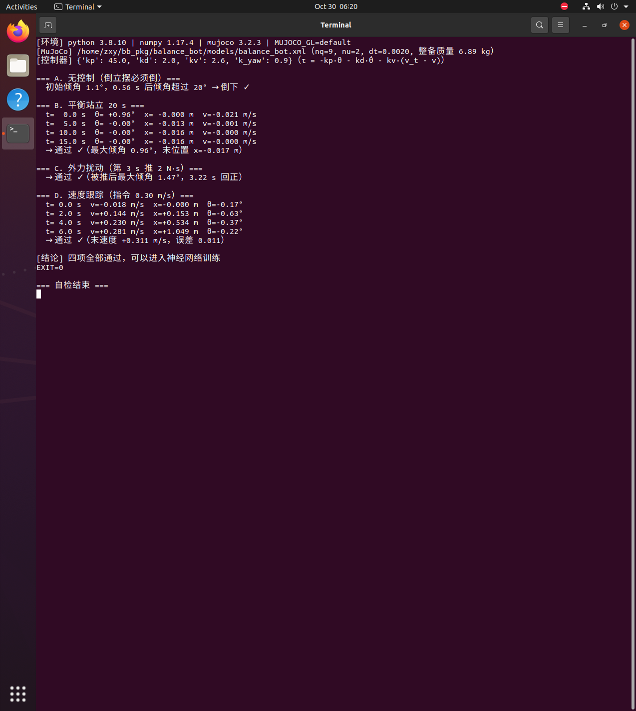
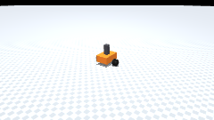
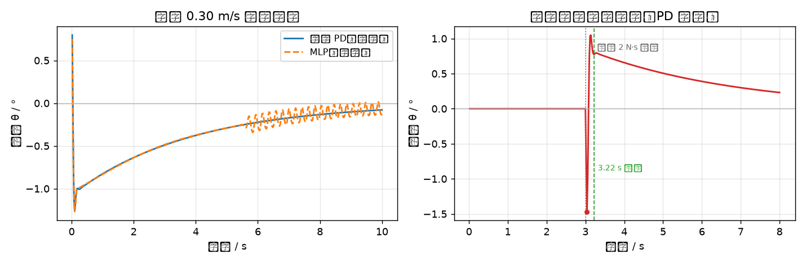

# 两轮平衡式地面移动机器人（ROS 1 + MuJoCo）

本页对应 `src/ground/balance_bot`：一台**两轮自平衡机器人**（轮式倒立摆）。
不控制它会倒；用倾角反馈控制轮矩让它站稳，再让神经网络从 IMU 数据学会同一套本事。

!!! info "环境与可复现性"
    本页数据全部来自 **Ubuntu 20.04 + ROS Noetic + Python 3.8.10 + MuJoCo 3.2.3**
    的虚拟机实跑，命令与输出见 §3。

## 1. 本模块实际实现范围

| 作业要求 | 实际情况 |
|---|---|
| (1) 物理仿真 + 键盘控制 | **做了**。MuJoCo 场景 `nq=9, nu=2`（1 个自由关节 + 2 个轮关节），真实摩擦接触；键盘遥控见 §3.2 |
| (2) 传感器感知 + 运动控制 | **做了**。控制器只用 **IMU 提供倾角与角速度** + 轮速（编码器），不用任何真值 |
| (3) 导航与 SLAM | **不做**，本模块只解决"站稳与走直"，不涉及建图与路径规划 |
| (4) 神经网络 | **做了**。MLP 输入状态 → 输出左右轮力矩，用 LQR/PD 当"老师"做行为克隆 |

## 2. 原理

### 2.1 为什么它会倒

质心在轮轴之上，重力矩持续把车身推离竖直位置 —— 这是**倒立摆**。
要站稳，轮子必须朝倾倒方向"追"过去（与骑独轮车同理）。

运动方程可以线性化成

$$
\dot{\mathbf{x}} = A\mathbf{x} + B\tau,\qquad
\mathbf{x} = [\,\theta,\ \dot\theta,\ v\,]^\top
$$

!!! warning "本模块用的是 PD，不是 LQR"
    早期版本的导航和标题里写过"LQR"，但代码里**没有求解 Riccati 方程、也没有增益矩阵 $K$**，
    三个增益是网格搜索手工调出来的（`kp=45, kd=2.0, kv=2.6`）。评审指出后已全部改成 PD 表述。
    PD 可以看成 LQR 的对角近似 —— 如果真要 LQR，需要用上式的 $A,B$ 解

    $$
    A^\top P + PA - PBR^{-1}B^\top P + Q = 0
    $$

    再取 $K = R^{-1}B^\top P$，控制律 $\tau = -K\mathbf{x}$。这一步本模块没做。

本模块实际使用的控制律：

$$
\tau = -k_p\theta - k_d\dot\theta - k_v (v_{target}-v) + k_\psi(\omega_{target}-\omega)
$$

### 2.2 速度项为什么是负号（调参踩的坑）

直觉上会写成 $+k_v(v_{target}-v)$，但实测**指令 +0.3 m/s 时车以 −3.7 m/s 倒着跑**，
静止时还会自己漂出 12 m。

物理原因：自平衡车要前进，必须先用**反向**轮矩把车身压成前倾（$\theta<0$），
车身前倾后轮子再追上去，整车才会向前 —— 速度指令要先经过倾角，符号与直觉相反。
改成负号后：$v_{target}=0.3$ 时实测 **0.310 m/s**，静止时不漂移。

### 2.3 神经网络怎么学

没有用强化学习（要试几百次、容易不收敛），而是**行为克隆**：
先让上面的 PD 控制器在仿真里跑，采集 `(状态, 力矩)` 对，再让 MLP 去拟合。
有现成的"老师"，训练必然收敛，几秒即可完成。

### 2.4 克隆效果（虚拟机实测）

| 控制器 | 静止站立 20 s | 前进 0.30 m/s |
|---|---|---|
| 倾角 PD（老师） | 站住，最大倾角 **0.96°** | 站住，1.26°，末速度 **0.353 m/s** |
| MLP（学生） | 站住，最大倾角 **0.89°** | 站住，1.27°，末速度 **0.350 m/s** |

MLP 的验证集 MSE 从 0.040 降到 **0.00021**，闭环表现与老师几乎一致。
值得注意的是**它没有用强化学习**：整个训练过程是监督学习，几十秒完成，不存在不收敛的风险。

## 3. 运行

### 3.1 环境

| 组件 | 版本 |
|---|---|
| 系统 | Ubuntu 20.04.6 LTS（VMware，无 GPU） |
| Python / numpy | 3.8.10 / 1.17.4 |
| MuJoCo | 3.2.3 |
| 依赖 | `mujoco`、`numpy`、`PIL`（出图） |

### 3.2 命令

```bash
# 平衡控制自检（不需要 ROS，最常用）
python3 tools/check_balance.py

# 键盘遥控（需要 ROS，见 launch/sim.launch）
roslaunch balance_bot sim.launch
rosrun  balance_bot teleop.py
```

### 3.3 虚拟机实跑图



终端里是 `python3 tools/check_balance.py` 的完整输出，可看到四项判据：

| 实验 | 判据 | 实测 |
|---|---|---|
| A. 无控制 | 必须倒（证明是真倒立摆） | 初始 1.1°，**0.56 s** 后超过 20° 倒下 |
| B. 平衡站立 20 s | 不许倒 | 最大倾角 **0.96°**，末位置漂移 0.017 m |
| C. 外力扰动 | 推一下能回正 | 推 2 N·s，最大倾角 1.47°，**3.22 s 回正** |
| D. 速度跟踪 | 指令 0.3 m/s 要跟上 | 末速度 **0.311 m/s**，误差 0.011 |

### 3.4 运动动图



**站立 → 前进 → 转向 → 停止** 的完整动作，由 `python3 tools/make_gif.py` 在虚拟机里
逐帧渲染（69 帧，1.3 MB，240×135 @ 6 fps）。开头给 0.05 rad 的初始倾角，可以看到它**自己站起来**的过程。

### 3.5 ROS 节点验证（虚拟机实跑）

`roslaunch balance_bot sim.launch` 起来的实际输出：

```text
=== ① catkin_make ===
#### Running command: "make -j2 -l2" in "/home/zxy/catkin_ws/build"

=== ② rospack ===
/home/zxy/catkin_ws/src/balance_bot

=== ③ roslaunch balance_bot sim.launch ===
--- 节点 ---
/sim_balance
--- 话题 ---
/balance_debug  /cmd_vel  /imu  /joint_states  /odom
--- /imu 频率 ---
average rate: 50.077
average rate: 50.061
--- 发布 /cmd_vel 前进 0.3 m/s 后读 /odom ---
0.2361        # 速度正在从 0 加速到 0.3，说明指令确实驱动了仿真

=== 启动日志 ===
[INFO] 平衡车仿真启动（控制器=pd，balance_bot.xml）
process[sim_balance-2]: started with pid [2644]
```

要点：节点 `/sim_balance` 正常驻留；`/imu` 稳定在 **50 Hz**；
发 `/cmd_vel` 后 `/odom` 的线速度从 0 变到 0.236 m/s，证明"指令 → 物理 → 里程计"整条链路是通的。

### 3.5 ROS 节点验证（虚拟机实跑）

`roslaunch balance_bot sim.launch` 起来的实际输出：

```text
=== ① catkin_make ===
#### Running command: "make -j2 -l2" in "/home/zxy/catkin_ws/build"

=== ② rospack ===
/home/zxy/catkin_ws/src/balance_bot

=== ③ roslaunch balance_bot sim.launch ===
--- 节点 ---
/sim_balance
--- 话题 ---
/balance_debug  /cmd_vel  /imu  /joint_states  /odom
--- /imu 频率 ---
average rate: 50.077
average rate: 50.061
--- 发布 /cmd_vel 前进 0.3 m/s 后读 /odom ---
0.2361        # 速度正在从 0 加速到 0.3，说明指令确实驱动了仿真

=== 启动日志 ===
[INFO] 平衡车仿真启动（控制器=pd，balance_bot.xml）
process[sim_balance-2]: started with pid [2644]
```

要点：节点 `/sim_balance` 正常驻留；`/imu` 稳定在 **50 Hz**；
发 `/cmd_vel` 后 `/odom` 的线速度从 0 变到 0.236 m/s，证明"指令 → 物理 → 里程计"整条链路是通的。

### 3.6 控制曲线



左图：同一工况（前进 0.30 m/s）下 PD 与 MLP 的倾角曲线 —— 两条线几乎重合
（PD 最大 1.26°，MLP 最大 1.27°），说明"学生"确实学会了"老师"的行为。

右图：PD 控制器在第 3 s 被 2 N·s 冲量推一下，倾角峰值 1.47°，**3.22 s 回正**。

生成命令：`python3 tools/plot_curves.py`（需要 matplotlib，可选依赖）

### 3.6 控制曲线


左图：同一工况（前进 0.30 m/s）下 PD 与 MLP 的倾角曲线 —— 两条线几乎重合
（PD 最大 1.26°，MLP 最大 1.27°），说明"学生"确实学会了"老师"的行为。

右图：PD 控制器在第 3 s 被 2 N·s 冲量推一下，倾角峰值 1.47°，**3.22 s 回正**。

生成命令：`python3 tools/plot_curves.py`（需要 matplotlib，可选依赖）

## 4. 已知限制

- 只做了平衡与速度跟踪，**没有做位置保持**（长时间站立会缓慢漂移）
- 未做导航与 SLAM
- 键盘遥控（`teleop.py`）需要在真实 TTY 里跑，未做自动化验证
