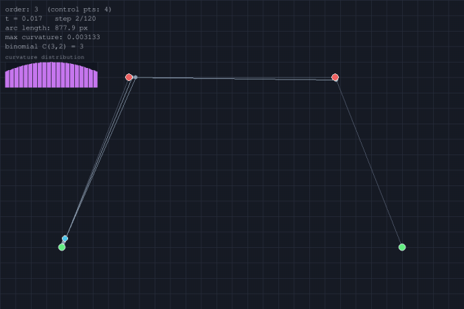

# Bezier 曲线轨迹生成与可视化

基于 de Casteljau 算法与 Bernstein 多项式的 Bezier 曲线生成模块，附 B 样条对比、曲率分析与弧长计算，纯 pygame 2D 可视化。

## 概述

Bezier 曲线是机器人轨迹规划中最基础的曲线生成方法之一，由法国工程师 Pierre Bézier 于 1962 年在 Renault 汽车设计中提出，其数学基础（de Casteljau 算法）更早可追溯至 1959 年。本项目实现 Bezier 曲线的生成、求值、导数计算、曲率分析与弧长积分，并以 B 样条曲线做对比可视化。

## 算法原理

### Bezier 曲线定义

给定 n+1 个控制点 P₀, P₁, ..., Pₙ，n 次 Bezier 曲线：

```
B(t) = Σ C(n,i) (1-t)^(n-i) t^i P_i,  t ∈ [0, 1]
```

其中 C(n,i) 为组合数。

### 两种等价求值方式

**de Casteljau 递推算法**：通过逐级线性插值得到曲线点。

```
P_i^(r)(t) = (1-t) P_i^(r-1)(t) + t P_{i+1}^(r-1)(t)
```

从 P_i^(0) = P_i 开始，递推到 P_0^(n) 即为 B(t)。数值稳定性优于直接多项式求值。

**Bernstein 多项式形式**：直接用基函数加权求和。

```
B_i,n(t) = C(n,i) (1-t)^(n-i) t^i
B(t) = Σ B_i,n(t) P_i
```

两种方式数学等价，本项目同时实现并通过单测验证一致性。

### 关键性质

| 性质 | 说明 | 单测验证 |
|---|---|---|
| 端点插值 | B(0)=P₀, B(1)=Pₙ | ✓ |
| 凸包性 | 曲线在控制点凸包内 | ✓ |
| 导数 | B'(0)=n(P₁-P₀), B'(1)=n(Pₙ-Pₙ₋₁) | ✓ |
| 曲率 | κ=\|x'y''-y'x''\|/(x'²+y'²)^(3/2) | ✓ 直线为零、曲线非零 |
| 弧长 | 梯形法数值积分 | ✓ ≥ 端点直线距离 |

### B 样条对比

3 次 B 样条使用 Cox-de Boor 递归基函数：

```
N_{i,0}(u) = 1  if u_i ≤ u < u_{i+1}
N_{i,p}(u) = (u-u_i)/(u_{i+p}-u_i) N_{i,p-1}(u) + (u_{i+p+1}-u)/(u_{i+p+1}-u_{i+1}) N_{i+1,p-1}(u)
```

与 Bezier 的区别：

- B 样条不通过中间控制点（局部性），Bezier 通过端点
- B 样条有局部支撑性（改一个控制点只影响附近段）
- Bezier 是 B 样条的特例（节点向量全 0 和全 1 时）

## 实现细节

### 源码结构

| 文件 | 内容 | 行数 |
|---|---|---|
| `bezier.py` | 核心算法：binomial、de_casteljau、bernstein、derivative、curvature、arc_length、bspline | ~150 |
| `main.py` | pygame 可视化：网格、控制多边形、曲线、de Casteljau 动画、曲率条形图、HUD、录制 | ~200 |
| `config.py` | 画布尺寸、颜色、控制点、采样参数 | ~40 |
| `test_bezier.py` | 21 项离线单测 | ~120 |

### 可视化效果

演示 gif（`bezier_demo.gif`）展示：

1. **de Casteljau 动画**（前半段）：曲线从起点逐步绘制，同时显示算法各级中间插值线段与点
2. **完整曲线 + B 样条对比**（后半段）：青色 Bezier 曲线与金色 B 样条曲线并排显示，左上角 HUD 实时显示阶数、参数 t、弧长、最大曲率，下方为曲率分布条形图



## 运行步骤

### 直接运行

```bash
pip install pygame numpy pillow
python main.py                  # 交互模式
python main.py --record         # 录制演示 gif
```

### ROS 2 运行

```bash
cd ~/ros2_ws
colcon build --packages-select bezier_trajectory --symlink-install
source install/setup.bash
ros2 run bezier_trajectory main
```

## 单元测试

```bash
cd bezier_trajectory
python -m pytest test/ -v
```

21 项单测覆盖：

| 类别 | 测试项 |
|---|---|
| 组合数 | 基本值、对称性、越界 |
| 端点插值 | B(0)=P₀、B(1)=Pₙ |
| 求值一致性 | de Casteljau 与 Bernstein 结果相同、线性退化 |
| 导数 | 端点导数 = n×(P₁-P₀)、零阶导数=曲线点 |
| 曲率 | 直线曲率为零、曲线非负、弯曲曲线非零 |
| 弧长 | 直线段长度精确、曲线为正且≥直线距离、空输入 |
| 采样 | 采样数量、端点对齐 |
| B 样条 | 基函数非负、凸包性、采样数量、clamped 端点行为 |

## 大模型使用声明

本项目在开发过程中使用了大语言模型辅助代码编写与文档生成，具体用于：

- Bezier 曲线算法的 Python 实现与数值计算
- pygame 可视化代码框架
- 单元测试用例设计
- 文档撰写

核心算法逻辑（de Casteljau 递推、Bernstein 多项式、Cox-de Boor 递归）均基于经典教材与公开文献实现，AI 辅助部分经过人工审核与虚拟机实测验证。
