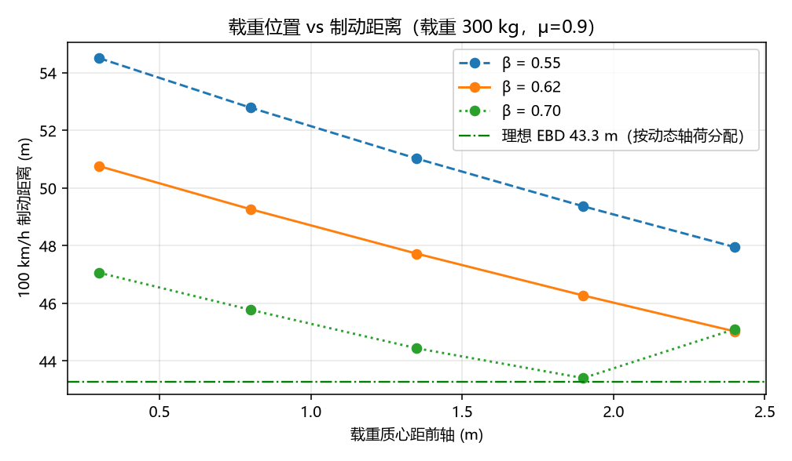
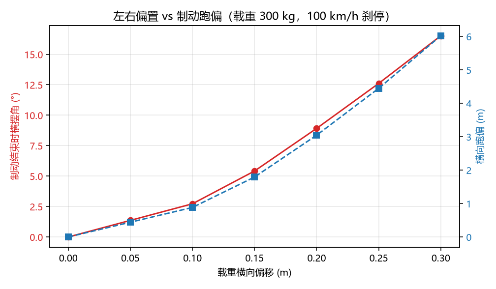

# 载重偏置下的制动距离与跑偏（轴荷转移的定量分析）

装货装偏了，刹车距离会差多少？这是驾校不讲、仿真论文也很少单独讨论的问题，但它在工程上很实在：
同一辆车、同样踩死刹车，**仅仅因为 300 kg 货物的位置从车头挪到车尾，100 km/h 的制动距离就能变化 11%**；
如果货物还偏了 20 cm，刹停时车头已经偏出去 3 m。

本模块用纯 numpy 的准静态模型把这三件事算成数字：**轴荷转移 → 固定制动力分配下的抱死顺序 → 制动距离**，
以及**左右载荷差 → 制动力不均衡 → 横摆 → 跑偏量**。属于**地面载具**方向。

与仓库已有模块的分工：

| 模块 | 回答的问题 | 本模块的区别 |
|---|---|---|
| `carla_aeb_braking` | 什么时候该刹车（感知触发 AEB） | 不涉及感知；问的是"刹车本身能刹多短" |
| `carla_vehicle_dynamics_test` | 加速能力与极限动力性 | 只管制动工况，且把轴荷转移显式建模 |
| `lateral_control_benchmark` | 转向控制算法对比 | 这里的横向偏移**由制动力不均衡被动产生**，不是主动打方向 |

## 运行效果



三种制动力分配（β = 0.55 / 0.62 / 0.70）下，制动距离随载重位置的变化；
绿色虚线是同工况的**理想 EBD**（每一步按动态轴荷分配制动力），43.2 m。



左右载重偏移对横摆角与横向跑偏的影响（载重 300 kg，100 km/h 刹停）。

## 功能包结构

```
src/ground/brake_load_transfer/
├── package.xml  setup.py  setup.cfg  requirements.txt
├── main.py                     # 脚本入口（不需要 ROS）
├── brake_load_transfer/
│   ├── core.py                 # 轴荷、制动力分配、纵向/横向积分（纯 numpy）
│   ├── cli.py                  # 结果排成 Markdown 表格
│   ├── main.py                 # 命令行参数与输出
│   └── ros_node.py             # ROS 2 包装节点
├── config/params.yaml
├── launch/main.launch.py
├── tools/make_figures.py       # 生成上面两张图（需要 matplotlib）
└── test/test_core.py           # 18 项单元测试
```

## 运行环境

| 项 | 版本 | 说明 |
|---|---|---|
| OS | 任意 | 纯 Python，无仿真器 |
| Python | 3.10 / 3.12 | 只用 `numpy` |
| ROS 2（可选） | Humble | 仅 `ros_node.py` 需要 |
| matplotlib（可选） | ≥3.5 | 仅 `tools/make_figures.py` 需要 |

已实测：**Windows 11 + Python 3.12.14 + NumPy 2.5.4**（不装 ROS 也能跑完全部计算与测试）。

## 编译与运行

```bash
# A. 不需要 ROS
cd src/ground/brake_load_transfer
pip3 install numpy
python3 main.py --all                 # 四张表
python3 main.py --lateral             # 只看跑偏
python3 main.py --json out.json

# B. ROS 2
colcon build --packages-select brake_load_transfer --symlink-install
source install/setup.bash
ros2 launch brake_load_transfer main.launch.py payload:=300.0 payload_x:=2.4
ros2 topic pub --times 1 /vehicle/brake_cmd std_msgs/msg/Float64 "{data: 1.0}"
ros2 topic echo /vehicle/brake_state

# C. 测试
python3 -m unittest discover -s test -p "test_*.py" -v     # 18 passed
```

## 原理与公式

### 1. 载重改变质心，进而改变轴荷

设整备质量 `m`、质心距前轴 `a`、轴距 `L`；载重 `Δm` 位于距前轴 `x_p` 处，则合成质心

```
a' = (m·a + Δm·x_p) / (m + Δm),    b' = L − a'
Fz_front = (m+Δm)·g·b'/L,          Fz_rear = (m+Δm)·g·a'/L
```

### 2. 制动时的轴荷转移

对后轮接地点取矩得到

```
Fz_front(dyn) = m·g·b'/L + m·a_x·h/L
Fz_rear(dyn)  = m·g·a'/L − m·a_x·h/L      （截断到 ≥ 0，即"后轴抬轮"）
```

前轴加载、后轴等量卸载，转移量正比于减速度 `a_x` 与质心高度 `h`。

### 3. 固定 bias 下的抱死与距离

前后制动力按 `β : (1−β)` 分配，各自受 `μ·Fz` 限制：

```
Fx_f = min(β·F_demand, μ·Fz_front),   Fx_r = min((1−β)·F_demand, μ·Fz_rear)
a_x  = (Fx_f + Fx_r + ½ρCdA·v²) / m
```

一旦某一轴到 μ 上限，它就只能贡献 `μ·Fz`，总制动力随之下降——这就是"固定 bias + 无 ABS"
时制动距离变长的机制。

**抱死顺序怎么判**：载荷依赖减速度、减速度又依赖载荷，所以要解不动点——
每个时间步用当前减速度反算轴荷、再按 `μ·Fz` 截断、得到新减速度，迭代到收敛，
在**收敛后的状态**上判定哪个轴饱和。（早期实现用上一步减速度估载荷，第一步没有载荷前移，
会把前轴瞬时压爆并误判为"前轴先抱死"；这一点由 review 指出后已改为自洽迭代。）反过来，若每一步都按**动态轴荷**分配（理想 EBD），四轮同时到极限，
得到本模型的最短距离 `43.2 m`（闭式 `v²/(2μg) = 43.7 m` 略长，因为它没算空气阻力）。

### 4. 左右偏置 → 跑偏

左右载荷按 `0.5 ± dy/T` 分配（`dy` 为载重横向偏移，`T` 为轮距），同一 bias 下两侧制动力不等，
产生绕质心的横摆力矩 `Mz = ΔFx·T/2`。用 3 自由度（`vx, vy, r`）+ 线性轮胎积分到停车：

```
m(v̇y + r·vx) = Fy_f + Fy_r,     Iz·ṙ = a·Fy_f − b·Fy_r + Mz
Fy = −Cα·α（线性轮胎，截断到 0.95·μFz）
```

## 结果

### 基准（空载，β=0.62，μ=0.9，100 km/h）

| 指标 | 数值 |
|---|---|
| 制动距离 | **48.04 m** |
| 理想 EBD（含风阻） | 43.18 m |
| 与理想差距 | **+11.2%**（+4.86 m） |
| 峰值减速度 | 8.12 m/s² |
| 先抱死轴 | 后轴（自洽迭代后的稳态） |

### 载重 300 kg 前后位置扫描（β=0.62 固定）

| 载重位置 | 合成质心 | 前轴载荷 | 后轴载荷 | 制动距离 | 相对空载 |
|---|---|---|---|---|---|
| 0.30 m（靠前） | 1.05 m | 10791 N | 6867 N | 50.75 m | +5.6% |
| 0.80 m | 1.13 m | 10246 N | 7412 N | 49.26 m | +2.5% |
| 1.35 m（居中） | 1.23 m | 9646 N | 8012 N | 47.72 m | −0.7% |
| 1.90 m | 1.32 m | 9047 N | 8611 N | 46.27 m | −3.7% |
| 2.40 m（靠后） | 1.40 m | 8502 N | 9156 N | 45.02 m | −6.3% |

### 制动力分配扫描（载重后移到 2.4 m）

| 前轴占比 β | 制动距离 |
|---|---|
| 0.50 | 50.28 m |
| 0.55 | 47.95 m |
| 0.60 | 45.82 m |
| 0.62 | 45.02 m |
| **0.65** | **43.88 m（最优）** |
| 0.70 | 45.09 m |

### 左右偏置导致的跑偏（载重 300 kg，居中）

| 横向偏移 | 左右制动力差 | 横摆角 | 横向跑偏 |
|---|---|---|---|
| 0.00 m | 0 N | 0.00° | 0.00 m |
| 0.10 m | 554 N | 2.73° | 0.88 m |
| 0.20 m | 1734 N | 8.92° | 3.05 m |
| 0.30 m | 3036 N | 16.52° | 6.02 m |

## 三条结论

1. **载重位置的影响比想象的大**：同样 300 kg，靠前装与靠后装相差 5.7 m（50.75 vs 45.02 m）。
   而且"靠后更短"并不是好消息——它靠的是后轴载荷变大、后轴能多出力，代价是**后轴更容易先饱和**，
   实车极限工况下更易甩尾（本模型不含侧向失稳，不能直接下这个结论）。
2. **bias 该跟着载重走**：把 β 从 0.62 提到 0.65，载重后移工况从 45.02 m 降到 43.88 m，
   已经接近理想 43.2 m（差 1.8%）。这就是 EBD 的价值：**它不是一个固定值，而是随轴荷变化的函数**。
3. **左右偏置 0.2 m 就足以让车跑出 3 m**：轮距 1.55 m，偏移 0.2 m 只是 13% 的载荷转移，
   但制动跑偏 3.05 m、横摆 8.9°，已经超过一条车道。这条对"货物固定"的要求比很多人以为的严格。

## 可以继续做的实验（留给读者）

- 把 `mu` 改成 0.5（湿滑路面），看最优 β 是否下移；
- 把载重加到 500 kg，观察后轴是否出现"抬轮"（`rear_lift`）；
- 给 `simulate_lateral` 加一个横摆角速度反馈（模拟 ESP 单轮制动），看能把 3 m 压到多少；
- 把 `payload_y` 与 `brake_bias` 联合扫描，画"跑偏等值线"。

## 模型边界

- 纵向不含 ABS 循环控制：抱死后按 `μ·Fz` 恒力处理，因此**不体现"峰值附着 > 滑动附着"**；
- 轮胎只有 μ 上限，没有 μ–滑移曲线，也没有载荷敏感性（`μ(Fz)`）；
- 横向用线性轮胎 + 准静态轴荷，只给量级；不含侧倾/俯仰动力学与悬架，极限工况会低估载荷再分配；
- 不含 ABS/ESP 的轮缸压力调节，因此表中的跑偏量是"无电子辅助"的下限估计。
