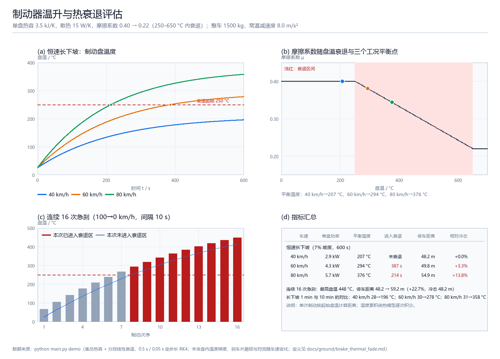

# 制动器温升与热衰退评估

## 一、项目简介

仓库里已有 AEB 决策（`carla_aeb_braking`）、崖边紧急制动（`cliff_brake`）等**逻辑层**
模块，但它们都假设"制动力恒定可用"。真实车辆连续制动或长下坡时，制动盘温度升高会
让摩擦系数下降（热衰退），制动距离随之变长，严重时还会出现制动力不足。

本项目回答三个具体问题：

1. 一条 7% 的长下坡，以 40 / 60 / 80 km/h 恒速下行，制动盘最终稳定在多少度？
2. 多久会进入衰退区（摩擦系数开始下降）？
3. 盘温升高后，100→0 km/h 的停车距离会从多少变成多少？

模块不依赖 ROS 2、CARLA、AirSim 或 GPU，`python main.py demo` 一条命令即可得到指标
与运行效果图。

## 二、项目目录结构

```text
src/ground/brake_thermal_fade/
├── main.py                       # 入口：demo / check / ros
├── launch/main.launch.py         # ROS 2 启动文件
├── package.xml / setup.py / setup.cfg
├── requirements.txt              # numpy、Pillow
├── resource/brake_thermal_fade
├── brake_thermal_fade/
│   ├── disc.py                   # 集总热容 + 分段线性摩擦衰退曲线
│   ├── vehicle.py                # 减速度、停车距离、单盘功率
│   ├── scenario.py               # 长下坡与连续制动两个工况
│   ├── visualize.py              # Pillow 2×2 效果图
│   ├── ros_node.py               # ROS 2 适配节点
│   └── cli.py                    # 命令行分派
├── tests/                        # 37 个单元测试
└── results/                      # demo 输出

docs/
├── ground/brake_thermal_fade.md                                 # 本文档
└── img/ground/brake_thermal_fade/demo_screenshot.png            # 运行效果图
```

## 三、环境依赖

| 项目 | 版本 |
|---|---|
| 操作系统 | Windows 11（实测） |
| Python | 3.12.14（需要 3.10+） |
| NumPy | 2.3.5 |
| Pillow | 12.3.0（仅 `demo` 绘图需要） |
| ROS 2 | Humble（仅节点需要，见第六节） |

```bash
python -m pip install -r src/ground/brake_thermal_fade/requirements.txt
```

## 四、运行步骤

```bash
cd src/ground/brake_thermal_fade
python main.py demo
```

可选参数：

```bash
python main.py demo --grade 0.06 --duration 900     # 6% 坡度、15 分钟
python main.py demo --cycles 20 --cooldown 5        # 20 次急刹、间隔 5 s
python main.py check --speed 80 --temperature 400   # 单车速/单温度速查
```

终端输出（实测）：

```text
制动盘：单盘 7.0 kg，热容 3.5 kJ/K，散热 15 W/K，环境 25 °C
摩擦：常温 μ=0.40，250–650 °C 内衰退到 μ=0.22
整车：1500 kg，4 个制动盘，常温减速度 8.0 m/s^2

恒速长下坡（7% 坡度，600 s）：
  车速(km/h)      单盘功率(kW)      平衡温度(C)      进入衰退(s)    100→0 停车(m)
        40          2.86          207          未衰退           48.2
        60          4.29          294           387           49.8
        80          5.72          376           214           54.9

连续 16 次急刹：最高盘温 448 °C，停车距离 48.2 → 59.2 m（+22.7%）
```

## 五、模型与指标定义

### 5.1 集总热模型

单只制动盘按温度均匀处理：

$$
C\frac{dT}{dt} = P_{in} - hA\,(T - T_{amb}) - \varepsilon\sigma A\left[(T+273.15)^4 - (T_{amb}+273.15)^4\right]
$$

其中 `C = m c_p = 3.5 kJ/K`，`hA = 15 W/K`，`εσA` 为辐射项（默认 ε=0.8、A=0.06 m²）。
积分用定步长 RK4（演示 0.5 s，连续制动 0.05 s）。

### 5.2 摩擦衰退

分段线性：`μ = 0.40`（≤250 °C）→ 线性降到 `μ = 0.22`（650 °C）→ 之后保持 0.22。
可用减速度按同一比例缩放：

$$
a(T) = a_{ref}\frac{\mu(T)}{\mu_{cold}},\qquad a_{ref} = 8.0\ \text{m/s}^2
$$

停车距离取 `s = v² / (2a(T))`，评估车速固定为 100 km/h。

### 5.3 两个工况

- **恒速长下坡**：坡度 `θ`，恒速 `v`，单盘输入功率 `P = m g sinθ v / 4`，恒定加热 600 s；
- **连续急刹**：100→0 km/h 急刹到停，把动能 `½mv²` 平均给 4 个盘，制动时长内功率恒定；
  停稳后冷却 `cooldown` 秒，再重复。

### 5.4 单次制动的量级

100→0 km/h 的动能 `½·1500·27.8² ≈ 578 kJ`，每盘约 145 kJ，对应升温 **41 K**。这解释了
为什么单次急刹不会衰退，而短间隔连续 8 次以上就会。

## 六、ROS 2 接口

```bash
cd ~/ros2_ws
colcon build --packages-select brake_thermal_fade
source install/setup.bash
ros2 launch brake_thermal_fade main.launch.py

ros2 topic pub -r 2 /vehicle/brake_temperature std_msgs/msg/Float64 "{data: 420.0}"
ros2 topic echo /vehicle/brake_thermal
```

| 话题 | 类型 | 方向 | 说明 |
|---|---|---|---|
| `/vehicle/brake_temperature` | `std_msgs/Float64` | 订阅 | 制动盘温度（°C） |
| `/vehicle/brake_thermal` | `std_msgs/String` | 发布 | JSON：温度、峰值温度、μ、减速度、停车距离、相对冷态增幅、衰退比例、建议 |

节点参数：`stop_speed_kmh`（默认 100）、`ambient_c`、`fade_start_c`、`fade_end_c`、
`mu_cold`、`mu_hot`。

## 七、运行结果



从图里能直接读到三件事：

1. **平衡温度随车速线性增长**：40 / 60 / 80 km/h 分别是 207 / 294 / 376 °C，因为恒速下坡的
   单盘输入功率与车速成正比（2.86 / 4.29 / 5.72 kW）；
2. **衰退是"越线"事件**：40 km/h 的平衡温度（207 °C）低于衰退起点，永远不衰退；
   60 km/h 在第 387 s、80 km/h 在第 214 s 越过 250 °C；
3. **制动距离的代价是渐进的**：越过衰退线后，100→0 km/h 停车距离从 48.2 m 增长到
   49.8 m（+3.3%）和 54.9 m（+13.8%）；连续 16 次急刹把盘温推到 448 °C 时是 59.2 m（+22.7%）。

第 (c) 张图还给出一个有用的操作结论：**从第 8 次急刹开始，每一次的起始盘温都已进入
衰退区**，此后每次制动的距离单调增长——这正是"热衰退是累积效应"的直观表现。

## 八、参数与调参

| 参数 | 默认值 | 含义 |
|---|---|---|
| `disc_mass_kg` | 7.0 | 单个制动盘质量（kg） |
| `specific_heat_j_per_kgk` | 500 | 比热容（J/(kg·K)） |
| `cooling_w_per_k` | 15.0 | 对流散热（W/K） |
| `radiation_area_m2` / `emissivity` | 0.06 / 0.80 | 辐射散热面积与发射率 |
| `ambient_c` | 25.0 | 环境温度（°C） |
| `mu_cold` / `mu_hot` | 0.40 / 0.22 | 常温与完全衰退后的摩擦系数 |
| `fade_start_c` / `fade_end_c` | 250 / 650 | 衰退起止温度（°C） |
| `mass_kg` | 1500 | 整车质量（kg） |
| `reference_decel_mps2` | 8.0 | 常温制动减速度（m/s²） |
| `brake_count` | 4 | 制动盘数量 |

想看"散热变差会怎样"，把 `cooling_w_per_k` 调到 8 左右：平衡温度接近翻倍，40 km/h 也会
进入衰退。想看"重载"，把 `mass_kg` 加到 2500。

## 九、单元测试

```bash
cd src/ground/brake_thermal_fade
python -m unittest discover -s tests -v
```

实测 `Ran 37 tests in 0.140s OK`。除常规的边界与非法输入外，重点是**解析解校验**：

- 无输入时盘温按 `T(t) = T_amb + (T_0-T_amb)e^{-t/τ}` 冷却（`τ = C/hA`）；
- 绝热工况（`hA = 0`、`ε = 0`）满足 `ΔT = P·t/C`；
- 线性散热下平衡温度满足 `T_eq = T_amb + P/hA`；
- 停车距离满足 `s = v²/(2a)`，且冷态 100→0 为 48.2 m。

## 十、已知限制

- **集总热容**：盘内温度梯度、刹车片导热、卡钳传热被忽略，盘温偏低、衰退偏慢；
- **散热系数固定**：真实对流随车速与通风量变化，这里用常数，高速工况的冷却被低估；
- **摩擦曲线是经验形状**：真实衰退与配方、磨损、水膜和高温历史有关；
- **单次制动按起始盘温定距离**：没有在单次制动内耦合温度变化（单次升温 41 K，影响可忽略）；
- **ROS 2 未实测**：开发机没有 ROS 2，只验证了节点调用的同一套函数。
