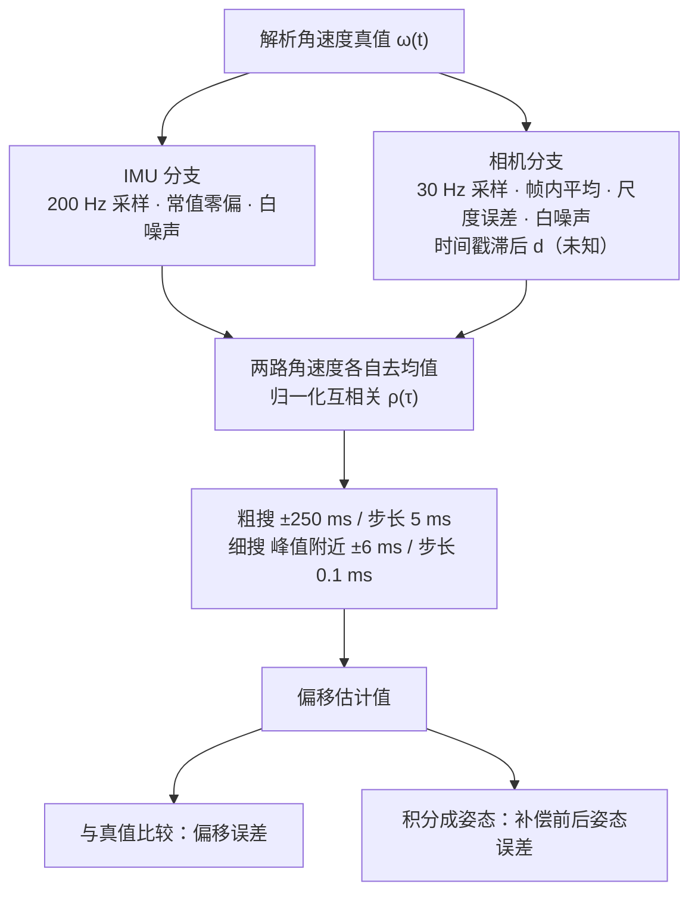
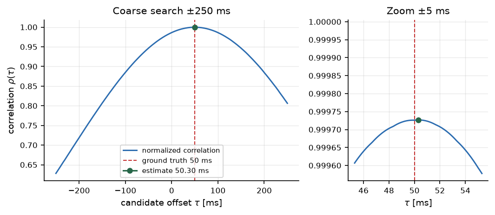
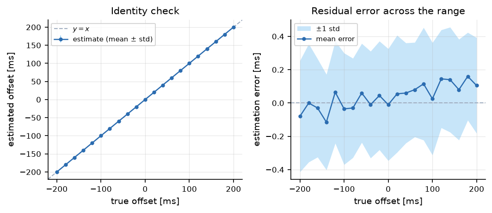
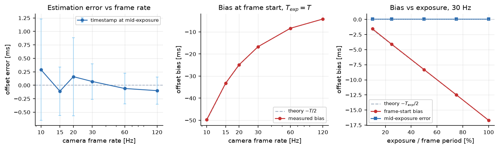
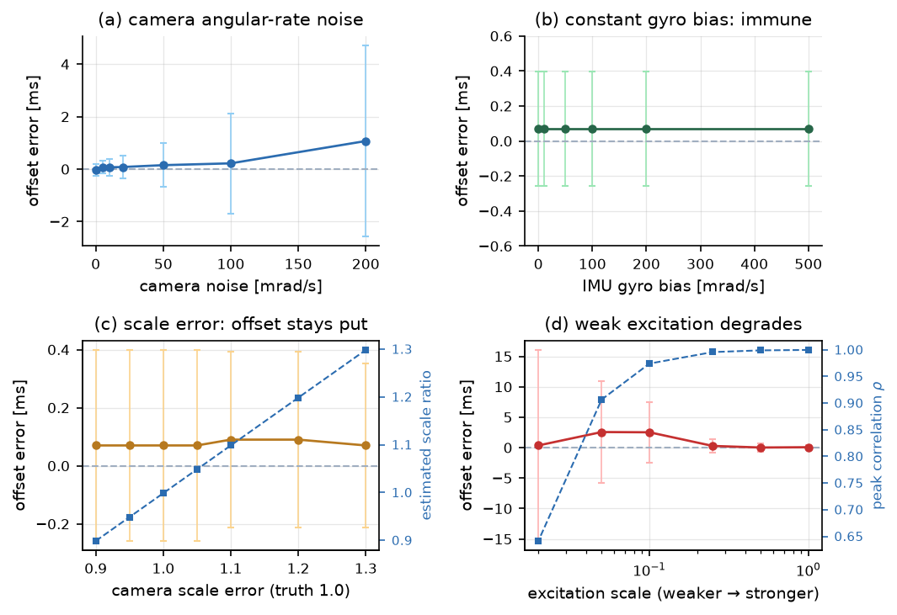
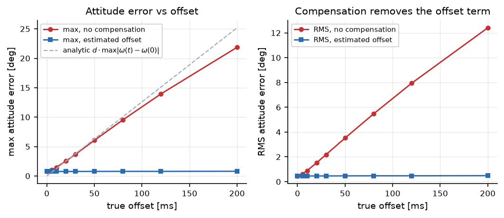
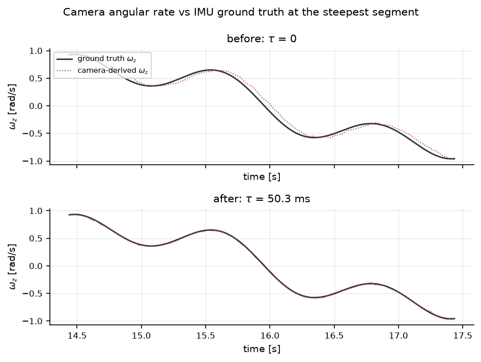

# 相机-IMU 时间同步标定

本模块在**已知真值**的合成场景中估计相机与 IMU 之间的常量时间偏移（时参），并给出可量化的姿态误差。

仓库里已有的 `src/ground/carla_sensor_fusion` 里的"时间同步"是按**最近时间戳**把多传感器消息对齐，前提是**时间戳本身可信**；本模块处理的正是这个前提被打破的情况，需要从数据本身把偏移估出来。`src/ground/lidar_camera_calibration` 解决的是**空间**对齐（外参），本模块解决**时间**对齐，两者合起来才是完整的多传感器标定。

## 1. 项目简介

多传感器融合要先做两件事：**空间对齐**（外参）和**时间对齐**（时参）。外参错了，点云投不到图像上；时参错了，**投上去的也是错的时刻**——车在动，50 ms 就能让图像和点云差出半米。

实际情况是相机与 IMU 的时间戳常常并不对齐：

* 相机时间戳通常打在**曝光中点**或**帧（曝光）开始**，两者相差曝光时长的一半 $T_{exp}/2$，而 $T_{exp}$ 一般小于帧周期（6.3 节有实测）；
* 图像经 USB/GMSL 传输、VIO 前端滑窗滤波，都会引入几毫秒到几十毫秒的延迟；
* 相机与 IMU 往往来自不同时钟源，没有硬件同步线。

这些延迟大多表现为一个**常量偏移** $d$，可以用"相机角速度"与"IMU 角速度"的互相关估出来：



与"直接拿真实数据跑一遍"相比，合成场景的价值在于**真值已知**：偏移误差和姿态误差都是可度量的，而不是只看两条曲线"看起来对上了"。

## 2. 环境依赖

| 项目 | 版本 |
| --- | --- |
| 操作系统 | Ubuntu 22.04 LTS（离线脚本在 Windows 上同样可跑） |
| ROS | ROS 2 Humble（仅节点部分需要） |
| Python | 3.10.12 |
| NumPy | 1.21.5（ROS 2 Humble 自带版本） |
| Matplotlib | 3.5.1（仅绘图） |

```bash
python3 -m pip install --user -r src/ground/camera_imu_time_calibration/requirements.txt
```

离线脚本只依赖 NumPy，不需要 OpenCV 与 SciPy；ROS 2 节点额外依赖 `rclpy`、`sensor_msgs`、`geometry_msgs`、`std_msgs`。

## 3. 原理

### 3.1 偏移的符号约定

这一点最容易搞反，所以先约定清楚：

> **$d>0$ 表示相机时间戳滞后于真值 $d$ 秒**，即第 $k$ 帧的时间戳是 $t_k$，但它记录的姿态变化其实发生在 $t_k - d$ 时刻。

因此"补偿"就是把相机时间戳往前推 $d$；估计量 $\hat d$ 的物理含义就是"要往前推多少"。若估计值符号弄反，补偿后误差会变成原来的两倍而不是接近零——这是第 7.1 节的排错依据。

### 3.2 为什么用角速度而不是位置

IMU 直接给角速度，但相机不给。视觉里程计 / VIO 前端可以输出相邻帧之间的旋转增量，除以帧间隔就得到**相机侧角速度**。用角速度做互相关有三个好处：

1. **不累积**：位置积分会漂移，角速度是瞬时量，误差不随时长增长；
2. **对平移不敏感**：纯平移时旋转增量为零，不会污染估计（但也说明需要**旋转激励**，见 3.4）；
3. **与尺度解耦**：相机角速度的尺度误差只是乘一个常数，不影响相关峰的**位置**（见 6.4）。

### 3.3 归一化互相关

把两路角速度在候选偏移 $\tau$ 下重采样到同一时间轴，做去均值后的归一化内积：

$$
\rho(\tau)=\frac{\sum_{a}\sum_{i}\big(\omega_c^{a}(t_i)-\bar\omega_c^{a}\big)\big(\omega_i^{a}(t_i-\tau)-\bar\omega_i^{a}\big)}
{\sqrt{\sum_{a}\sum_{i}\big(\omega_c^{a}(t_i)-\bar\omega_c^{a}\big)^2}\;\sqrt{\sum_{a}\sum_{i}\big(\omega_i^{a}(t_i-\tau)-\bar\omega_i^{a}\big)^2}}
$$

其中 $a\in\{x,y,z\}$ 为三个轴，$\bar\cdot$ 为该窗口内的均值。$\rho(\tau)$ 在 $\tau=d$ 处取最大。

**去均值这一步不是可有可无的。** IMU 陀螺有常值零偏 $b$，如果不去均值，$\omega_i$ 里始终含一个常数 $b$，它会和 $\omega_c$ 的均值项耦合，把相关峰往"让两个均值更接近"的方向拉。减去均值后 $b$ 作为常数项被完全消掉，所以零偏对估计**没有任何影响**——6.4 节里零偏加到 0.5 rad/s（相当于信号的一半）估计值仍然一动不动。

### 3.4 两阶段搜索与分辨率

`ρ(τ)` 的峰很宽：从 `correlation_peak.png` 左图看，$\tau$ 偏离真值 100 ms，相关系数还有 0.88。宽峰意味着**粗搜不需要很密**，但**峰值位置要精细**，所以分两阶段：

| 阶段 | 范围 | 步长 | 作用 |
| --- | --- | --- | --- |
| 粗搜 | ±250 ms | 5 ms | 找到峰的大致位置 |
| 细搜 | 峰 ±6 ms | 0.1 ms | 把位置定到 0.1 ms 量级 |

粗搜的量化误差最大 2.5 ms，被 ±6 ms 的细搜窗口完全覆盖。细搜到 0.1 ms 后，实际能达到的精度由**噪声**决定而不是网格：30 Hz、0.010 rad/s 噪声下重复性 std 为 0.35 ms（6.2 节）。

### 3.5 姿态误差从哪来

把角速度积分成姿态 $q(t)$，与真值姿态比较得到夹角误差。对小时延 $d$，误差可近似为

$$
\mathbf{e}(t)\;\approx\;\int_0^t\!\big[\boldsymbol\omega(s)-\boldsymbol\omega(s-d)\big]\,\mathrm{d}s\;\approx\;d\,\big[\boldsymbol\omega(t)-\boldsymbol\omega(0)\big]
$$

也就是说，**最大姿态误差 ≈ $d \times \max_t|\boldsymbol\omega(t)-\boldsymbol\omega(0)|$**，取决于角速度的**变化范围**而不是某一时刻的瞬时值。本轨迹 $\max_t|\boldsymbol\omega(t)-\boldsymbol\omega(0)|=2.197$ rad/s，所以每 1000 ms 偏移对应约 125.9°；50 ms 对应 6.29°，实测 6.06°（比值 1.06，6.5 节验证）。

这个式子也解释了为什么"轻微转动"的标定效果差：$\boldsymbol\omega$ 变化范围小，同样的 $d$ 只造成很小的姿态差，但也意味着**观测里几乎没有可用于定位偏移的信息**。

## 4. 系统组成

| 文件 | 作用 |
| --- | --- |
| `camera_imu_time_calibration/core.py` | 解析轨迹真值、相机/IMU 传感器模型、偏移估计器、姿态积分与误差 |
| `camera_imu_time_calibration/ros_params.py` | 参数读取辅助：数值参数用动态类型声明，避免 int/double 不匹配 |
| `camera_imu_time_calibration/main.py` | 标准演示：估计 + 姿态误差 + 2 张图 |
| `camera_imu_time_calibration/sweep_offset.py` | 偏移量扫描（-200..+200 ms） |
| `camera_imu_time_calibration/sweep_rate.py` | 帧率、时间戳约定与曝光时长扫描 |
| `camera_imu_time_calibration/sweep_noise.py` | 鲁棒性实验（噪声 / 零偏 / 尺度 / 激励） |
| `camera_imu_time_calibration/compare_attitude.py` | 补偿前后姿态误差对比 |
| `camera_imu_time_calibration/estimator_node.py` | ROS 2 在线估计节点（含重估稳定性指标） |
| `camera_imu_time_calibration/synthetic_source_node.py` | 演示用合成数据源（无硬件也能跑通全链路） |
| `launch/main.launch.py` | 一键启动（数据源 + 估计节点） |
| `requirements.txt` | NumPy / Matplotlib 版本约束（不含 ROS 依赖） |
| `test/test_core.py` | 22 项算法单元测试（不需要 ROS） |
| `test/test_params.py` | 8 项参数读取单元测试（假节点，不需要 ROS） |

节点订阅与发布：

| 方向 | 话题 | 类型 | 说明 |
| --- | --- | --- | --- |
| 订阅 | `/imu` | `sensor_msgs/msg/Imu` | 取 `angular_velocity`，可参数覆盖 |
| 订阅 | `/camera/angular_velocity` | `geometry_msgs/msg/Vector3Stamped` | 视觉里程计给出的角速度 |
| 发布 | `/camera_imu_time_estimator/time_offset` | `std_msgs/msg/String` | JSON：`offset_ms`、`correlation`、`scale`、`n_imu`、`n_cam`、`window_sec`、`recent_std_ms`、`recent_n`、`stable` |

## 5. 运行步骤

### 5.1 离线仿真（不需要 ROS）

在模块目录下执行：

```bash
cd src/ground/camera_imu_time_calibration

# 标准演示（20 s、30 Hz、50 ms 偏移），输出 2 张图
python3 -m camera_imu_time_calibration.main

# 偏移量扫描：21 档 × 20 次蒙特卡洛
python3 -m camera_imu_time_calibration.sweep_offset --trials 20

# 帧率扫描：10/15/20/30/60/120 Hz，含两种时间戳约定；另加曝光时长扫描
python3 -m camera_imu_time_calibration.sweep_rate --trials 10

# 鲁棒性：噪声 / 零偏 / 尺度 / 激励
python3 -m camera_imu_time_calibration.sweep_noise --trials 10

# 补偿前后姿态误差
python3 -m camera_imu_time_calibration.compare_attitude --trials 5
```

图片默认写入 `docs/img/ground/camera_imu_time_calibration/`，五个脚本合计约 2 分钟。

### 5.2 单元测试

```bash
cd src/ground/camera_imu_time_calibration
python3 -m unittest discover -s test -v
```

30 项，约 1.8 s，覆盖：轨迹形状与幅值、采样率与样本数、正/负/零偏移恢复、零偏免疫、尺度解耦、帧首时间戳半帧偏差、曝光时长与帧周期解耦（`-T_exp/2` 而非固定半帧）、曝光取中点时对曝光长短免疫、恒定角速度积分、补偿后误差下降，以及参数读取对 int/double 覆盖的容错（假节点测试，不需要 rclpy）。

### 5.3 构建与启动 ROS 2 节点

```bash
cd ~/ros2_ws
colcon build --packages-select camera_imu_time_calibration --symlink-install
source install/setup.bash

ros2 launch camera_imu_time_calibration main.launch.py
```

launch 会同时启动合成数据源与估计节点，**不需要任何硬件**。数据源把 50 ms 滞后做进相机角速度，估计节点启动约 1 s 后开始输出：

```bash
ros2 topic echo /camera_imu_time_estimator/time_offset
# data: '{"offset_ms": 49.8, "correlation": 0.9998, "scale": 0.999, "recent_std_ms": 0.21, "stable": true, ...}'
```

换一组参数（**数值参数传整数也可以，不需要小数点**）：

```bash
ros2 launch camera_imu_time_calibration main.launch.py offset_ms:=120 cam_rate:=15
```

> **参数类型说明**：`rclpy` 在 `declare_parameter` 时就把类型定死了，launch 里的字符串 `'120'` 若交给它自己推断会被判成 `INTEGER`，节点声明的是 double 就抛 `InvalidParameterTypeException`，节点直接起不来。本模块两处都做了处理：launch 侧用 `ParameterValue(..., value_type=float)` 显式声明类型；节点侧用 `ros_params.number_param()` 以**无默认值**（NOT_SET 动态类型）声明参数、读出后 `float()` 强转。后者对 `ros2 run ... -p offset_ms:=120` 和 `-p window_sec:=10` 同样生效，在 Foxy / Humble 上都成立（`ParameterDescriptor(dynamic_typing=True)` 是 Humble 才有的字段，故意没用）。

### 5.4 接真实数据

```bash
ros2 run camera_imu_time_calibration estimator_node --ros-args \
  -p imu_topic:=/camera/imu \
  -p cam_topic:=/vio/angular_velocity \
  -p window_sec:=10 -p search_range_ms:=250
```

## 6. 实测结果

以下数值来自实际运行（Windows 11 + Python 3.13 + NumPy 2.5.4；算法与平台无关，Ubuntu 上结果一致）。噪声均为蒙特卡洛均值，斜体标注处为重复性 std。

### 6.1 单次标定

参数：20 s、IMU 200 Hz、相机 30 Hz、真值偏移 50 ms、相机噪声 0.010 rad/s、IMU 噪声 0.003 rad/s、零偏 0.005 rad/s、随机种子 0。

| 指标 | 实测值 |
| --- | --- |
| 真值偏移 | 50.00 ms |
| 估计偏移 | **50.30 ms** |
| 偏移误差 | **0.30 ms** |
| 互相关峰值 | 0.9997 |
| 尺度比估计 | 0.9986（真值 1.000，去均值回归） |
| 参与对齐 | 600 帧 / 4001 个 IMU 样本 |

| 处理方式 | $\tau$ | 最大姿态误差 | RMS 姿态误差 |
| --- | --- | --- | --- |
| 未补偿 | 0 ms | 5.67° | 3.36° |
| 估计值补偿 | 50.30 ms | 1.15° | **0.72°** |
| 理想补偿 | 50.00 ms | 1.13° | 0.71° |

RMS 误差由 3.36° 降到 0.72°（降低 79%），且已接近 30 Hz 相机本身的离散化底噪 0.71°——也就是说**剩下的误差不再是时间偏移的锅**。



### 6.2 偏移量扫描

21 个偏移（-200..+200 ms，步长 20 ms）× 20 次蒙特卡洛，固定 30 Hz：

| 真值 | 估计（均值 ± std） | 误差 |
| --- | --- | --- |
| -200 ms | -200.08 ± 0.33 ms | -0.08 ms |
| -100 ms | -100.03 ± 0.34 ms | -0.03 ms |
| 0 ms | -0.01 ± 0.34 ms | -0.01 ms |
| +100 ms | +100.03 ± 0.34 ms | +0.03 ms |
| +200 ms | +200.10 ± 0.29 ms | +0.10 ms |

线性拟合：**估计 = 1.0005 × 真值 + 0.039 ms**，全范围最大误差 0.16 ms、平均 0.07 ms、重复性 std 0.35 ms。斜率接近 1、截距接近 0，说明估计器在 ±200 ms 内没有系统性偏差。



### 6.3 帧率、时间戳约定与曝光时长

固定真值偏移 50 ms，每档 10 次（此表曝光时长取帧周期，即整帧窗口平均）：

| 帧率 | 帧数 | 时间戳在曝光中点 | 时间戳在帧开始 | 理论半帧 $T/2$ | 补偿后姿态 RMS |
| --- | --- | --- | --- | --- | --- |
| 10 Hz | 200 | 0.29 ± 0.94 ms | **-49.75 ms** | -50.00 ms | 0.96° |
| 15 Hz | 300 | -0.11 ± 0.45 ms | -33.21 ms | -33.33 ms | 0.72° |
| 20 Hz | 400 | 0.16 ± 0.73 ms | -24.86 ms | -25.00 ms | 0.67° |
| 30 Hz | 600 | 0.07 ± 0.33 ms | -16.70 ms | -16.67 ms | 0.49° |
| 60 Hz | 1200 | -0.06 ± 0.28 ms | -8.35 ms | -8.33 ms | 0.42° |
| 120 Hz | 2400 | -0.10 ± 0.25 ms | -4.18 ms | -4.17 ms | 0.29° |

两个结论：

1. **帧率不是偏移估计的瓶颈**：从 120 Hz 降到 10 Hz，误差都在 0.3 ms 以内。因为角速度最高只有 1.45 Hz，10 Hz 采样的奈奎斯特频率 5 Hz 已经够用。
2. **时间戳约定会引入固定偏差**。若时间戳打在**帧开始**而不是曝光中点，估计结果系统性少 $T_{exp}/2$：30 Hz、曝光等于帧周期时少 16.7 ms，10 Hz 时少 50 ms（此时估计值几乎为 0，看起来"没有延迟"）。实测偏差与理论值的最大差 0.25 ms。

**但"半帧"只在曝光时长恰好等于帧周期时成立。** 曝光时长 $T_{exp}$ 与帧周期 $T$ 是两个独立参数（30 Hz 的 $T$ = 33.3 ms，而真实相机的 $T_{exp}$ 常常只有 5~10 ms）。时间戳打在曝光开始时，等效测量时刻是 $t_{stamp}+T_{exp}/2$，所以偏差是 $-T_{exp}/2$。固定 30 Hz、把曝光从 0.1 帧扫到 1 帧（每档 10 次）：

| 曝光 / 帧周期 | 曝光 [ms] | 帧首时间戳的偏差 | 理论 $-T_{exp}/2$ | 曝光中点时间戳的误差 |
| --- | --- | --- | --- | --- |
| 10% | 3.33 | -1.56 ms | -1.67 ms | 0.07 ms |
| 25% | 8.33 | -4.12 ms | -4.17 ms | 0.07 ms |
| 50% | 16.67 | -8.30 ms | -8.33 ms | 0.07 ms |
| 75% | 25.00 | -12.48 ms | -12.50 ms | 0.07 ms |
| 100% | 33.33 | -16.70 ms | -16.67 ms | 0.07 ms |

* 帧首时间戳的偏差**跟着曝光时长走**，与理论 $-T_{exp}/2$ 的最大差 0.11 ms，不是固定的"半帧"；
* 时间戳取**曝光中点**时，积分窗口关于时间戳对称，误差在全部曝光时长下都是 0.07 ms，与曝光长短无关。

所以补偿时要不要加"半帧"取决于**时间戳定义**，而不是帧率：先确认你的相机驱动把时间戳打在曝光开始、曝光中点还是帧读出结束，再决定补偿量。这一点在 7.2 节有对应的排错流程。



### 6.4 鲁棒性：对什么免疫、对什么敏感

每档 10 次蒙特卡洛，真值偏移 50 ms：

| 干扰项 | 范围 | 偏移误差 | 结论 |
| --- | --- | --- | --- |
| 相机角速度噪声 | 0 → 0.200 rad/s | -0.02 → +1.07 ms（std 0.22 → 3.64 ms） | 单调恶化，0.2 rad/s 时已接近信号峰值的 15% |
| IMU 陀螺零偏 | 0 → 0.500 rad/s | **+0.07 ms 不变** | 去均值使其**完全免疫**（偏移与尺度比都是） |
| 相机尺度误差 | 0.9 → 1.3 倍 | **+0.07 ms 不变** | 与偏移**解耦**；尺度比被独立估出（1.298 vs 真值 1.3，零偏 0→0.2 rad/s 下漂移 < 0.001） |
| 运动激励 | 峰值 1.346 → 0.027 rad/s | 0.07 → +0.36 ms，但 std 由 0.33 → **15.69 ms** | 激励不足时单次结果散布爆炸，已不可用 |

最后一行值得单独说：激励降到 2% 时**均值**看起来还很准（0.36 ms），但**单次结果的标准差已经 15.69 ms**、相关系数掉到 0.64。只看一次运行的结果会得到"还行"的错觉，看散布才知道已经不可用。这也是判断标定数据"够不够格"的实用标准：**$\rho < 0.9$ 就别信了**。



### 6.5 补偿前后的姿态误差

固定 30 Hz，真值偏移 0..200 ms，每档 5 次取均值：

| 真值偏移 | 未补偿 max | 未补偿 RMS | 补偿后 max | 补偿后 RMS | 解析 $d\max|\omega(t)-\omega(0)|$ | RMS 下降 |
| --- | --- | --- | --- | --- | --- | --- |
| 0 ms | 0.76° | 0.46° | 0.76° | 0.46° | 0.00° | — |
| 10 ms | 1.47° | 0.88° | 0.77° | 0.46° | 1.26° | 48% |
| 20 ms | 2.53° | 1.52° | 0.77° | 0.46° | 2.52° | 70% |
| 30 ms | 3.68° | 2.19° | 0.78° | 0.46° | 3.78° | 79% |
| 50 ms | 6.06° | 3.52° | 0.78° | 0.47° | 6.29° | 87% |
| 80 ms | 9.53° | 5.47° | 0.79° | 0.47° | 10.07° | 91% |
| 120 ms | 13.95° | 7.94° | 0.79° | 0.47° | 15.10° | 94% |
| 200 ms | 21.86° | 12.41° | 0.80° | 0.49° | 25.17° | 96% |

* 未补偿误差随偏移**线性增长**，解析式与实测的比值平均 1.06，量级预测可靠；
* 补偿后**最大误差稳定在 0.8° 左右、RMS 0.46~0.49°**，与偏移大小无关——残差只剩相机离散化底噪；
* 0 ms 一行的 0.76°/0.46° 就是 30 Hz 积分本身的下限，不是偏移造成的。



### 6.6 波形对齐

取角速度斜率最大的一段，比较"未补偿"与"补偿后"的相机角速度与真值：



错位在匀速转动段几乎看不出来，只有在**角速度快速变化**处才明显——所以标定要选动态段的数据，不能用一段匀速直线行驶。

## 7. 排错

### 7.1 补偿后误差反而变大了一倍

**符号搞反了。** 若真值 $d>0$ 而估计器输出 $-d$ 并被当成"要往后推"，误差会变成 $2d$。检查方式：`main.py` 输出的真值与估计值应同号且接近；`offset_sweep.png` 左图的点应落在 $y=x$ 上，若落在 $y=-x$ 上就是符号问题。

对应本模块的约定：$d>0$ 表示相机时间戳**滞后**，补偿是把时间戳**往前推**。

### 7.2 估计值比预期小一截（半帧或小半帧）

若相机时间戳打在**帧（曝光）开始**或**帧读出时刻**而非曝光中点，估计结果会系统性偏小，偏小量是 **$T_{exp}/2$**——曝光时长的一半，不是帧周期的一半。二者只在曝光恰好占满整帧时相等：30 Hz、曝光 33.3 ms 时偏小 16.7 ms；同一帧率下曝光只有 8.3 ms 时只偏小 4.2 ms（6.3 节实测表）。这不是算法错误，而是估计模型与时间戳定义不一致。

处理方式二选一：

1. 用曝光中点作为时间戳（多数相机驱动的推荐做法），此时对曝光长短**完全免疫**（6.3 节实测 0.07 ms）；
2. 保留帧首时间戳，但把估计量的"物理含义"明确为"帧首到 IMU 的延迟"，补偿时额外加 $T_{exp}/2$。

`core.simulate(timestamp_at='start', exposure=...)` 可以复现这两种情形；把 `exposure` 传给 `simulate` 才能区分"曝光时长"与"帧周期"。

### 7.3 估计值乱跳、相关系数很低

先看 `~/time_offset` 里的 `correlation`：

| $\rho$ | 含义 | 处理 |
| --- | --- | --- |
| > 0.99 | 正常 | — |
| 0.9 ~ 0.99 | 噪声偏大 | 增大 `window_sec`，或检查相机角速度是否被过度平滑 |
| < 0.9 | 不可信 | 见下 |

$\rho<0.9$ 的常见原因：

1. **运动激励不足**：车几乎不动或匀速直线行驶，旋转分量接近零，互相关没有信息（6.4 节实测 std 可达 15 ms）。标定时要走一段有转向、有加减速的路径；
2. **相机角速度噪声过大**：VIO 前端在弱纹理/低照度下输出的角速度抖动大，0.2 rad/s 时误差已到 1 ms 量级；
3. **两路数据其实没有对应关系**：话题接错（例如把相机*线速度*接到了角速度话题），此时互相关峰很平，`scale` 也会明显偏离 1。

### 7.4 估计值在缓慢漂移（`recent_std_ms` 偏大）

节点输出的 `recent_std_ms` 是最近 `stability_window` 次重估（默认 10 次、每 1 s 一次）的标准差，`stable` 表示它是否落在 `stability_warn_ms`（默认 2 ms）以内；超阈值时节点会打一条 warning，且只在"稳定 → 不稳定"的跳变时刻打一次。

它是**经验指示器**而不是严格收敛判据：8 s 滑窗逐秒滑动、相邻窗口大部分样本重叠，所以这个标准差偏保守，只能用来判断"常量假设还成不成立"：

| 现象 | 判断 | 处理 |
| --- | --- | --- |
| 均值稳定、std 小 | 常量偏移成立 | 直接用 |
| 均值单向漂、std 随之增大 | 时钟频差（ppm 级） | 窗口内仍可按常量处理——50 ppm 在 8 s 内只累积 0.4 ms，比半帧建模的系统效应小一个数量级以上；长实验则把模型升级成 $\text{offset}(t)=a+b\cdot t$，顺带把频差估出来 |
| std 大但均值不漂 | 激励不足或噪声过大 | 看 `correlation`，见 7.3 |

### 7.5 窗口太短导致锁不住

搜索范围 ±250 ms 需要窗口显著长于 250 ms；`window_sec` 小于 1 s 会被节点直接跳过（日志 `相机窗口不足 1 s`）。经验值：窗口 8~10 s，且其中至少一半时间有明显旋转。

### 7.6 窗口里堆了几万帧 / 一进节点就"样本不足"

缓冲区以消息的 `header.stamp` 为键，裁剪基准也必须是消息时间戳。早期版本用节点时钟（`node.now()`）去比消息时间戳，一旦两者不同基准——设备时钟、独立的 `use_sim_time` 来源、rosbag 回放的时钟——窗口要么**永不裁剪**（消息时间落后，缓冲区无限增长），要么**一裁到底**（消息时间超前，永远样本不足）。

现在窗口以「两路缓冲区里最新的消息时间戳」为基准（`core.trim_buffers`，纯函数、有单测），两路自然对齐到同一时间跨度，与节点时钟无关。若你仍看到缓冲区异常增长，先打印一帧 `header.stamp` 与 `node.now()` 的差值确认时间基准。

### 7.7 `ModuleNotFoundError: No module named 'camera_imu_time_calibration'`

直接运行脚本时需要让 Python 找到包：在 `src/ground/camera_imu_time_calibration` 目录下用 `python3 -m camera_imu_time_calibration.main`，或先 `colcon build` 后 `source install/setup.bash` 再用 `ros2 run`。

## 8. 未验证项与已知限制

* **没有接真实相机与 IMU**：相机侧角速度来自解析轨迹，不是真实 VIO 输出。真实 VIO 的角速度存在滑窗平滑、丢帧与时间戳抖动，本模块未建模这些效应。真实链路上估计到的更可能是"采样 + 传输 + 前端处理"合成的**有效常量偏移**，而不是纯曝光延迟——如果上游打时间戳用的是"消息到达后 `node.now()`"，那么估到的就是这个量。
* **相机模型是"整帧窗口平均"的理想化**：模型假设一帧内的角速度是在 $T_{exp}$ 上取平均、时间戳可指曝光中点或曝光开始（`core.simulate(exposure=...)` 已把曝光时长与帧周期拆成两个参数）。**滚动快门**的行间读出时间差、以及 VIO 前端"跨帧/滑窗平均"的时间标签语义，都没有建模——两者的共同点是"一帧对应一个时间上的模糊区间"，此时单帧的时间戳需要按前端定义重新解释，常量偏移只能吃掉其中一部分。这两项列为后续工作。
* **只估计常量偏移**：不处理时钟频差（漂移率）与温度导致的时变偏移。量化一下：50 ppm 的频差在 8 s 窗口内只累积 0.4 ms，比 6.3 节的半帧系统效应小一个数量级以上，所以窗口内按常量处理是安全的；真正危险的是"不做滑动窗口、拿一段很长数据估一次"。节点输出的 `recent_std_ms` 就是给这件事做经验检验的（7.4 节），需要时把模型升级成 $\text{offset}(t)=a+b\cdot t$ 即可把频差一并估出。
* **`recent_std_ms` 不是严格的收敛判据**：滑窗逐秒滑动、相邻窗口样本高度重叠，标准差只能当指示器用，没有做统计意义上的置信区间。
* **没有处理丢帧与乱序**：假设两路数据都是单调、完整的时间序列。滑窗裁剪按消息时间戳（7.6 节），不依赖节点时钟。
* **尺度比 `scale` 是"独立检查项"，不是标定量**：它用逐轴去均值的最小二乘估计（与互相关同口径），因此对陀螺常值零偏免疫（零偏 0→0.2 rad/s 漂移 < 0.001）；但它假设相机与 IMU 三轴共用同一个尺度、且忽略轴间非正交与安装误差，只适合当一致性检查，不要当作标定结果使用。
* **没有和 `message_filters` 做对比**：`ApproximateTimeSynchronizer` 能容忍的是"消息到达时间抖动"，不能估计常量偏移，两者互补而非替代，本模块未做定量对比。
* **离线脚本在 NumPy 2.5.4 上验证**：ROS 2 Humble 自带 NumPy 1.21.5，本模块用到的 API（`default_rng`、`interp`、`broadcast_to`、`polyfit`）在 1.17 之后均可用，但未在 1.21.5 上实跑。
* **ROS 2 节点与 launch 的运行环境**：作者开发机为 Windows，本机没有 ROS 2，节点与 launch 由评审 @1huangna 在 Ubuntu 22.04 + ROS 2 Humble（Python 3.10）上实跑验证：`colcon build` 成功、16 项测试通过、默认 launch 收到 20 条 JSON、窗口 ≥7 s 时估计 49.6~50.5 ms（均值 49.943 ms）、`offset_ms:=120 cam_rate:=15` 场景下（参数类型修复前）为 119.3~120.8 ms（均值 120.136 ms）。评审暴露的阻塞与缺陷已在本次修订中处理：launch 数值参数类型（5.3 节）、`requirements.txt` 缺失、Ctrl-C 时 `rcl_shutdown already called`；本次修订新增的 14 项测试为纯 NumPy / 假节点测试，不依赖 rclpy。**作者本机仍未独立复跑 Humble，最终确认请以评审实跑为准。**

## 参考资料

* [ROS 2 Humble：`sensor_msgs/msg/Imu`](https://docs.ros.org/en/humble/p/sensor_msgs/msg/Imu.html)
* [ROS 2 Humble：`message_filters` 时间同步策略](https://docs.ros.org/en/humble/p/message_filters/)
* [Kalibr：camera-IMU 标定工具箱（含时间偏移估计）](https://github.com/ethz-asl/kalibr)
* [Furgale et al., *Unified Temporal and Spatial Calibration for Multi-Sensor Systems*, IROS 2013](https://doi.org/10.1109/IROS.2013.6696514)

## 大模型使用声明

本模块的代码与文档在编写过程中使用了 WorkBuddy（内置大模型）辅助：算法结构讨论、代码起草、单元测试编写、绘图脚本调试与文档撰写。

已实际运行验证：`main`、`sweep_offset`、`sweep_rate`、`sweep_noise`、`compare_attitude` 五个离线入口，以及 `python3 -m unittest discover -s test` 的 30 项测试。文中所有数值均来自上述实际运行，未使用估计值或占位数据。ROS 2 节点与 launch 的运行验证状态见第 8 节。

作者对提交内容的正确性负责。
