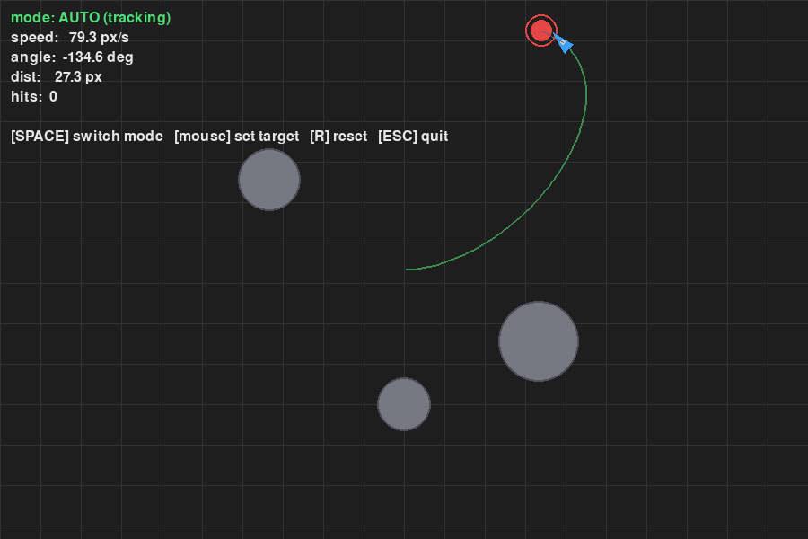
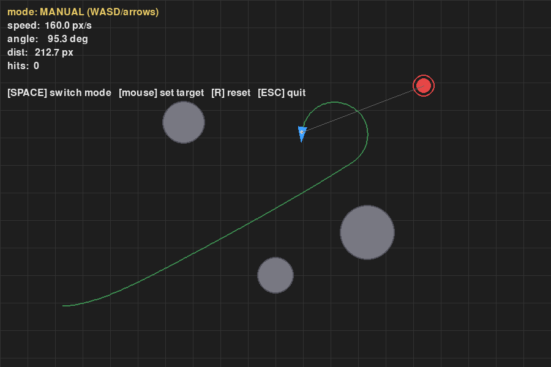

# 2D 小车目标追踪仿真（Pygame）

纯 Pygame 实现的 2D 平面小车追踪仿真，不依赖 ROS / Gazebo / CARLA。
小车自动追一个随机游走的红色目标，支持手动模式切换，场景内有静态障碍物。

## 环境

- Windows 11 家庭版（Build 26200）
- Python 3.12.0
- pygame 2.5.2（SDL 2.28.3）
- 复现环境：Python 3.13.14 + pygame 2.6.1（SDL 2.28.4），代码只用基础 API，2.5.2 起兼容

```bash
pip install -r src/ground/car_2d_target_tracker/requirements.txt
# 或固定旧版本：pip install pygame==2.5.2
```

## 运行

代码位于 `src/ground/car_2d_target_tracker/main.py`，在仓库根目录下执行。
命令里的 `python` 在 Linux/macOS 上通常写成 `python3`，Windows 也可以用 `py -3`；
Windows 终端中文乱码时先执行 `chcp 65001`：

```bash
python src/ground/car_2d_target_tracker/main.py
```

演示模式（自动跑三个场景并保存截图到 `demo_out/`）：

```bash
python src/ground/car_2d_target_tracker/main.py --demo
```

无窗口评测（不打开窗口，跑固定时长并写 `metrics.json`）：

```bash
python src/ground/car_2d_target_tracker/main.py --headless --duration 20 --seed 42 --outdir demo_out
```

## 操作

| 按键 | 功能 |
|---|---|
| 空格 | 自动模式 / 手动模式切换 |
| 鼠标左键 | 自动模式下，点击位置设为新目标 |
| W / ↑ | 手动模式前进 |
| S / ↓ | 手动模式倒车 |
| A / D 或 ← / → | 手动模式转向 |
| R | 小车重置到窗口中央 |
| ESC | 退出 |

## 实现

小车用独轮运动学模型：

```
dx = v * cos(theta) * dt
dy = v * sin(theta) * dt
dtheta = omega * dt
```

自动模式每帧：

1. `target_angle = atan2(ty - y, tx - x)`
2. `err = normalize(target_angle - theta)`
3. `omega = clip(Kp * err, -max_steer, max_steer)`
4. `v = max_speed * cos(err) * min(1, dist / 60)`
5. 距离 < 18px 则停车

`dist / 60` 里的 60 是减速距离 `SLOWDOWN_DISTANCE`。这个值不能太大：如果取
120，目标以 60 px/s 移动时，小车在 40 px 外就把速度降到和目标一样，只能一直
跟在后面，追不上。

碰撞检测：小车新位置到每个障碍物圆心距离小于 `obstacle_r + car_r` 则放弃位移。
撞上后小车原地转向（保持同一方向约 0.35 s，避免每帧来回抖），并按一次接触事件把
`hits` 加一（持续贴墙只记一次）；手动模式同样允许贴墙原地转向，否则会卡死。

## 无窗口评测

`--headless` 使用 SDL dummy 驱动，不开窗口，按固定 60 Hz 步长跑完 `--duration`
秒，输出 `metrics.json`：

```
steps=1200 time=20.00s arrived_once=True t_target=14.70s
mean_dist=33.8px final_dist=20.2px path=1422.1px hits=0
```

| 字段 | 含义 |
|---|---|
| `arrived` | 最后一帧是否在 18 px 到达半径内（目标移动后会变化） |
| `arrived_once` | 是否至少进入过一次 18 px 到达半径 |
| `time_to_target` | 第一次到达的时间，没到达为 `null` |
| `mean_distance` / `final_distance` | 全程平均 / 结束时与目标的距离 |
| `path_length` | 小车实际走过的路径长度 |
| `collisions` | 碰撞事件次数（一次持续接触只记一次） |

固定 `--seed` 后指标可完全复现，适合做回归对比。加 `--save-frame` 会保存
`final_frame.png`。

## 测试

```bash
python -m unittest discover -s src/ground/car_2d_target_tracker/tests -v
```

14 个用例，覆盖角度归一化、自动追踪、到达判定、碰撞事件计数、手动贴墙转向、
目标边界反弹、headless 指标与同种子确定性。

## 参数

| 参数 | 默认值 | 说明 |
|---|---|---|
| `MAX_SPEED` | 180 px/s | 自动模式最大速度 |
| `MAX_STEER` | 3.5 rad/s | 自动模式最大转向角速度 |
| `KP_TURN` | 2.5 | 朝向误差比例增益 |
| `SLOWDOWN_DISTANCE` | 60 px | 距目标多近开始线性减速 |
| `ARRIVE_RADIUS` | 18 px | 到达判定半径 |
| `MANUAL_SPEED` | 160 px/s | 手动模式速度 |
| `FIXED_DT` | 1/60 s | headless/demo 固定步长 |

## 限制

- 自动模式是贪心追踪，没有全局路径规划；目标正好在障碍物正后方时可能卡住，
  只能靠原地转向尝试脱困。
- 目标不避障，可能穿过障碍物。
- 窗口固定 900×600，没有缩放。
- 碰撞检测只检查新位置，不检查车身扫过的区域。

## 运行截图

以下截图由 `--demo` 实际运行生成（headless 模式保存）。

**自动模式：小车追踪移动目标**

绿色线为小车行驶轨迹，灰色圆为障碍物。左上角实时显示速度、角度、与目标距离
和碰撞次数 `hits`。



**自动模式：小车穿过障碍物之间的空隙**

小车从左下方出发，目标在右上方，绿色轨迹从两个障碍物之间穿过。


**手动模式：WASD 控制**

按空格切到手动模式（左上角黄色字样 MANUAL），方向键开车。



## 声明

本作业使用大模型辅助编写代码与文档。
