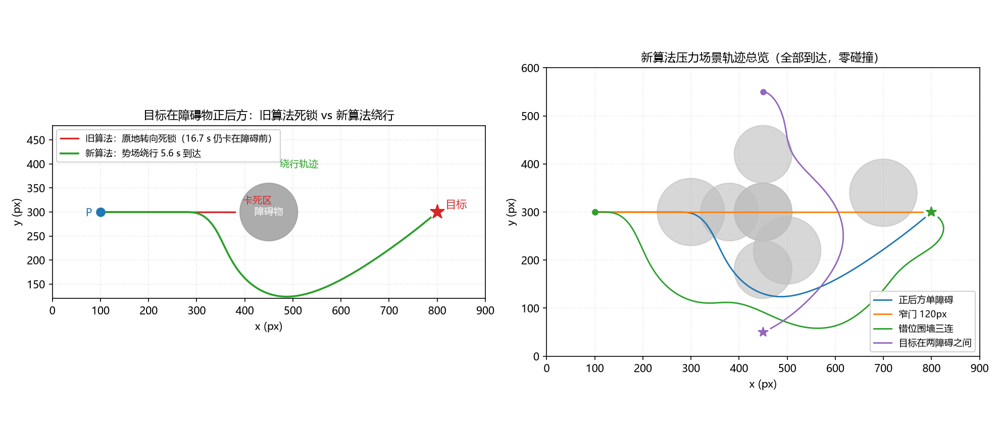

# 2D 小车目标追踪仿真（Pygame）

纯 Pygame 实现的 2D 平面小车追踪仿真，不依赖 ROS / Gazebo / CARLA。
小车自动追一个随机游走的红色目标，支持手动模式切换，场景内有静态障碍物。

## v2 修复：绕障死锁

旧版自动模式撞到障碍物后只会原地全锁转向（`omega = copysign(MAX_STEER, omega)`），
不记住绕行方向、不绕行。当目标恰好在障碍物正后方时，小车
"撞上 → 原地转 → 又撞上"形成极限环，永远到不了目标
（实测 3000 步仍卡在障碍物前 421px）。此外轨迹点列表无限增长。

v2 把核心逻辑抽出为不依赖 pygame 的 `tracker_core.py`，改用**人工势场法**：

1. 合成航向 = 目标引力 + 障碍物斥力 + **固定旋向的切向分量**——切向分量专治
   "目标在障碍物正后方"的局部极小（纯引力+斥力会在此对消卡死）；
2. 绕行旋向按"障碍物与目标射线的相对方位"逐障碍物选择并记忆，
   多障碍（窄门）场景下各障碍物独立选边，避免切向分量互相抵消；
3. 目标临近区（<40px）关闭斥力改纯引力收敛——终点常位于障碍物
   影响圈内，不衰减斥力小车会绕着到达圈打转进不了终点；
4. 真死锁退避：与 60 步前位置比较（贴障慢行 2~7px/s 不会误判），
   确认卡死才倒车脱离；目标距离连续 180 步无进展同样触发（绕圈检测）；
5. 反复卡死时设置垂直于目标方向的**临时绕行点**，打破错位围墙类
   势场局部极小；
6. 轨迹点用定长队列封顶。

7 个压力场景（正后方障碍/窄门/错位围墙/目标夹缝/终点贴障/起点贴障/
移动目标）全部通过，12 项单元测试：

```bash
cd src/ground/car_2d_target_tracker
python -m pytest test_tracker_core.py -v
```



左图：同一"目标在障碍物正后方"场景，旧算法原地转向死锁（16.7s 仍卡在障碍前），
新算法势场绕行 5.6s 到达；右图：压力场景轨迹总览，全部到达且零碰撞。

## 环境

- Windows 11 家庭版（Build 26200）
- Python 3.12.0
- pygame 2.5.2（SDL 2.28.3）

```bash
pip install pygame==2.5.2
```

## 运行

代码位于 `src/ground/car_2d_target_tracker/main.py`，在仓库根目录下执行：

```bash
python src/ground/car_2d_target_tracker/main.py
```

## 操作

| 按键 | 功能 |
|---|---|
| 空格 | 自动模式 / 手动模式切换 |
| 鼠标左键 | 自动模式下，点击位置设为新目标 |
| W / ↑ | 手动模式前进 |
| S / ↓ | 手动模式倒车 |
| A / D 或 ← / → | 手动模式转向 |
| R | 小车重置到窗口中央 |
| ESC | 退出 |

## 实现

小车用独轮运动学模型：

```
dx = v * cos(theta) * dt
dy = v * sin(theta) * dt
dtheta = omega * dt
```

自动模式（详见 `tracker_core.py`）：势场合成航向 → 转向控制 →
净空自适应减速 → 碰撞积分兜底。

## 运行截图

以下均为真实运行窗口截图。

**自动模式：小车追踪移动目标**

绿色线为小车行驶轨迹，灰色圆为障碍物。左上角实时显示速度、角度、与目标距离。


**自动模式：势场绕行穿越障碍物区**

小车从左侧出发，目标在右侧障碍物后方，沿平滑曲线绕行通过。


**手动模式：WASD 控制**

按空格切到手动模式（左上角黄色字样 MANUAL），方向键开车。


## 声明

本作业使用大模型辅助编写代码与文档。
