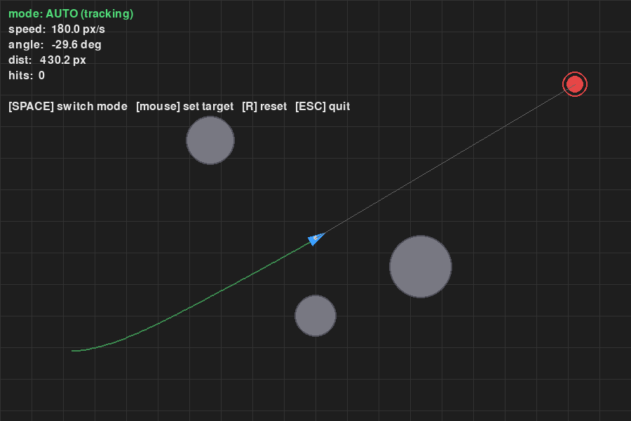

# 2D 小车目标追踪仿真

2D 平面里的单轮车目标追踪：小车自动追一个会移动的目标，场地上有静态障碍。
本文除了说明怎么运行，还给出一套**可复算的指标**（到达时间、路径长度、与障碍的
最小间隙、卡死时间占比），并对照两种控制器说明「撞上障碍原地打转」为什么会卡死。

源码位于 [`src/ground/car_2d_target_tracker`](https://github.com/OpenHUTB/ros2/tree/master/src/ground/car_2d_target_tracker)，
完整参数与调参记录见该目录的
[`README.md`](https://github.com/OpenHUTB/ros2/blob/master/src/ground/car_2d_target_tracker/README.md)。

## 1. 原理

### 1.1 单轮车运动学

$$
x' = x + v\cos\theta\,dt,\qquad
y' = y + v\sin\theta\,dt,\qquad
\theta' = \theta + \omega\,dt
$$

状态只有 \((x, y, \theta)\)，控制量是线速度 \(v\) 与角速度 \(\omega\)（定步长 1/60 s）。

### 1.2 追踪控制律

$$
e_\psi = \mathrm{atan2}(y_t - y,\ x_t - x) - \theta,\qquad
\omega = \mathrm{clip}(K_p e_\psi,\, \pm\omega_{\max})
$$

$$
v = v_{\max}\cos(e_\psi)\cdot\min\!\Big(1,\ \frac{d}{d_{\text{taper}}}\Big)
$$

"朝向目标 + 按距离减速"：正对目标时全速，方向偏差大时先转、再走。**减速半径
\(d_{\text{taper}}\) 是原实现的一个坑**：取 120 px 时，靠近移动目标速度会被压到与目标
同量级（60 px/s），末距停在 40 px 永远追不上；改进版只在快到（40 px）时才减速。

### 1.3 两种控制器

| 模式 | 撞到障碍时 | 结果 |
|---|---|---|
| `baseline`（复原原实现） | 速度清零 + **原地按最大角速度打转** | 障碍正挡在目标方向上时几乎不动（卡死占比 95.6%），30 s 内到不了 |
| `escape`（改进） | 沿**障碍表面切向**以 0.85·v_max 前进，持续卡住则翻转绕行方向 | 绕过障碍后回到直冲，10.27 s 到达 |

不在障碍区时两者完全一致，差异只出现在"被挡"这一支路上。

### 1.4 碰撞：为什么必须做"扫掠"

原实现只检查**新位置**是否与障碍相交。一步跨得比障碍直径还远时（高速或大步长），
车会直接穿过去。本版沿整段路径按不超过一个车半径的间距采样，取第一个碰撞点之前的
位置作为终点：**车贴住障碍，而不是穿过去**。

> 踩过的坑：一开始想用二分找"最远能走到的位置"，但碰撞判定沿路径是**非单调**的
> （障碍只占中间一小段），二分会跳过它，反而把车送到障碍另一侧。

## 2. 运行

```bash
cd src/ground/car_2d_target_tracker
pip install -r requirements.txt          # 只需要 numpy
pip install pygame matplotlib            # 可选：GUI / 出图

python3 main.py                          # 离线批跑（默认）：3 场景 × 2 控制器
bash main.sh                             # Linux/macOS
main.bat                                 # Windows
python3 main.py --gui                    # pygame 窗口（对应下面三张截图）
python3 main.py --selftest               # 22 项单元测试
ros2 launch car_2d_target_tracker main.launch.py mode:=both sim_time:=30
```

无显示器环境想验证 GUI 代码没写坏：

```bash
SDL_VIDEODRIVER=dummy python3 main.py --gui --frames 80
```

## 3. 实测指标（本机实测，可由 CSV 逐帧复算）

判据：到达半径 18 px；"卡死"= 速度 < 5 px/s；单场景 30 s；目标随机种子 42。

| 场景 | 控制器 | 到达 | 时间 | 路径 | 间隙 | 卡死 | 末距 |
|---|---|---|---|---|---|---|---|
| `chase`（追移动目标） | baseline | **否** | — | 1940 px | — | 0.1% | **40.2 px** |
| | escape | 是 | **2.52 s** | 381 px | — | 0.7% | 17.7 px |
| `gate`（穿两障碍间隙） | baseline | 是 | 4.48 s | 682 px | 20.0 px | 0.4% | 17.7 px |
| | escape | 是 | **3.85 s** | 683 px | 20.0 px | 0.4% | 17.0 px |
| `blocked`（障碍正挡路） | baseline | **否** | — | 240 px | 0.0 px | **95.6%** | **440 px** |
| | escape | 是 | **10.27 s** | 737 px | 0.0 px | 54.1% | 18.0 px |


左列 `baseline`、右列 `escape`，灰色圆是障碍、红点是目标。上排追移动目标（baseline 绕圈
追不上，escape 2.52 s 到达）；中排从两障碍之间的缝穿过（两者都过，escape 略快）；下排
障碍正压在目标方向上（baseline 停在障碍前 95.6% 的时间几乎不动，escape 抬升绕过）。


## 4. GUI 模式画面

以下三张为**真实运行窗口截图**（pygame 窗口，60 FPS）：

**自动模式：小车追踪移动目标**

绿色线为行驶轨迹，灰色圆为障碍。左上角实时显示速度、角度、与目标距离。


**自动模式：小车穿越障碍间隙**

小车从左侧出发、目标在右侧，沿直线穿过两个障碍之间。



**手动模式：WASD 控制**

按空格切到手动模式（左上角黄色字样 `MANUAL`），方向键开车。


| 按键 | 功能 |
|---|---|
| 空格 | 自动模式 / 手动模式切换 |
| 鼠标左键 | 自动模式下把点击位置设为目标 |
| `W`/`↑`、`S`/`↓` | 手动模式前进 / 倒车 |
| `A`/`D` 或 `←`/`→` | 手动模式转向 |
| `R` | 小车复位到窗口中心 |
| `ESC` | 退出 |

## 5. 常见问题

**Q1：`--gui` 报 `ModuleNotFoundError: pygame`？**
GUI 是可选依赖：`pip install pygame`。没有图形界面时直接用 `python3 main.py`，
指标与 CSV 完全一样。

**Q2：`blocked` 场景里 escape 的卡死占比还有 54%，算成功吗？**
算成功：它确实在 10.27 s 内绕到目标（末距 18 px），只是贴着障碍爬的那段时间速度低于
5 px/s。想要更快的绕行可以调大 `escape_speed_ratio`。

**Q3：为什么指标里的"最小间隙"可以是 0.0 px？**
车贴在障碍表面绕行，间隙就是 0（但不为负，说明没有穿进去）。若为负值则意味着发生了
穿透——这正是 1.4 节"扫掠碰撞"要防的情况，单元测试里专门卡了一条。

**Q4：指标每次跑都一样吗？**
一样。目标运动用固定种子（默认 42），仿真固定步长，没有其它随机源；`--seed` 可改。

## 6. 文件结构

```
docs/
├── ground/car_2d_target_tracker.md
└── img/ground/
    ├── car_2d_tracker_1.png / _2.png / _3.png     # GUI 真实截图
    ├── car_2d_tracker_trajectories.png            # 轨迹对照
    └── car_2d_tracker_metrics.png                 # 指标对照
src/ground/car_2d_target_tracker/
├── main.py / main.sh / main.bat
├── car_2d_target_tracker/
│   ├── cli.py / config.py / geometry.py / car.py / target.py
│   ├── controller.py / metrics.py / runner.py
│   └── plotting.py / gui.py
├── launch/main.launch.py
├── test/test_tracker_logic.py                   # 22 项
├── package.xml / setup.py / setup.cfg / requirements.txt
└── README.md
```

## 7. 已知限制

- 运动学模型（无动力学、无轮胎滑移），低速转弯特性与真实车辆有差距。
- 绕障是"沿切向 + 卡住翻转"的启发式，不保证最优；遇到凹形障碍群可能来回试探，
  没有全局规划。
- 障碍只有圆形、且静止；碰撞把车贴到表面，没有回弹与摩擦。
- 指标都在 60 Hz、30 s 场景内成立；目标运动是匀速直线 + 边界反弹。
- 本机未安装 ROS，`ros2 launch` / `colcon build` 路径未实测。

## 8. 声明

本模块在 AI 大模型辅助下完成（代码重构、指标设计、调参实验、文档撰写）。
所有数字均由 `python3 main.py` 实际跑出，`python3 main.py --selftest` 可复现 22 项测试。
