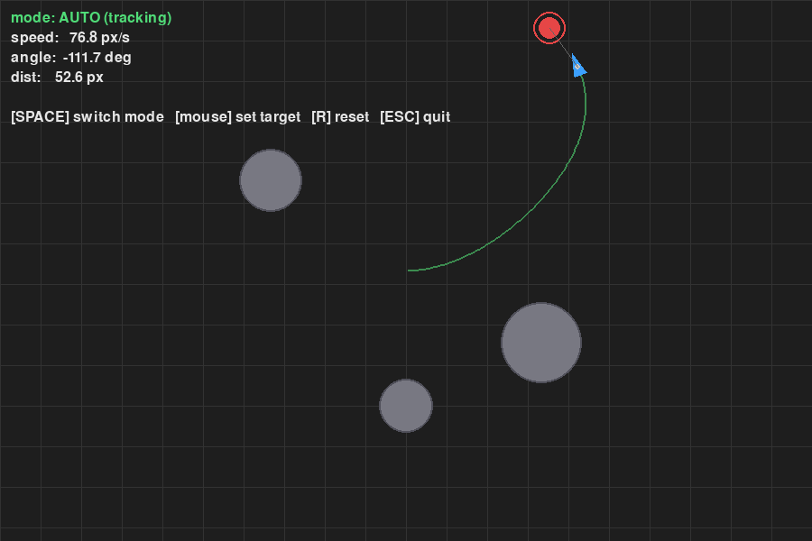
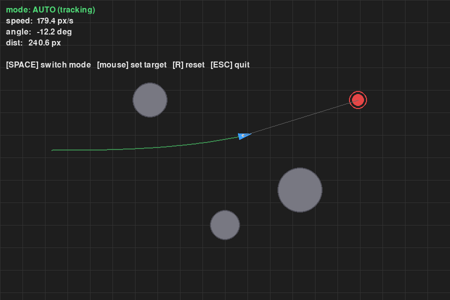
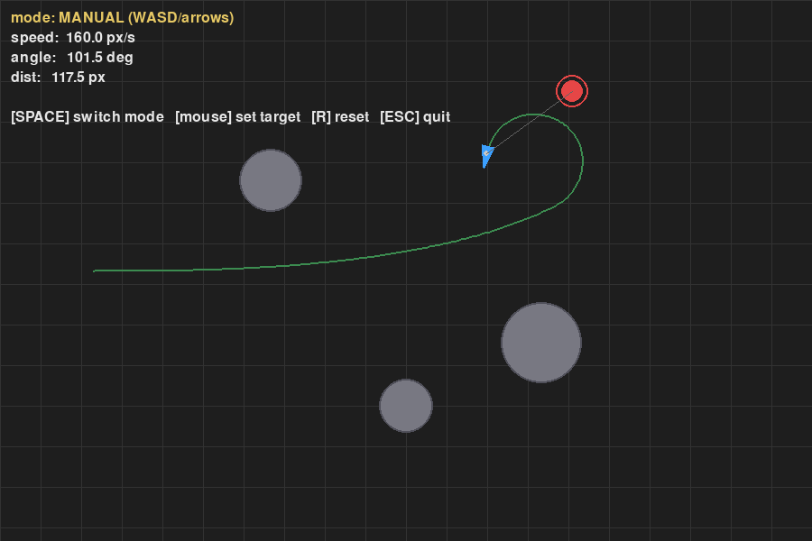

# 2D 小车目标追踪仿真（Pygame）

纯 Pygame 实现的 2D 平面小车追踪仿真，不依赖 ROS / Gazebo / CARLA。
小车自动追一个随机游走的红色目标，支持手动模式切换，场景内有静态障碍物。

## 环境

- Windows 11 家庭版（Build 26200）
- Python 3.12.0
- pygame 2.5.2（SDL 2.28.3）

```bash
pip install pygame==2.5.2
```

## 运行

代码位于 `src/ground/car_2d_target_tracker/main.py`，在仓库根目录下执行：

```bash
python src/ground/car_2d_target_tracker/main.py
```

## 操作

| 按键 | 功能 |
|---|---|
| 空格 | 自动模式 / 手动模式切换 |
| 鼠标左键 | 自动模式下，点击位置设为新目标 |
| W / ↑ | 手动模式前进 |
| S / ↓ | 手动模式倒车 |
| A / D 或 ← / → | 手动模式转向 |
| R | 小车重置到窗口中央 |
| ESC | 退出 |

## 实现

小车用独轮运动学模型：

```
dx = v * cos(theta) * dt
dy = v * sin(theta) * dt
dtheta = omega * dt
```

自动模式每帧：

1. `target_angle = atan2(ty - y, tx - x)`
2. `err = normalize(target_angle - theta)`
3. `omega = clip(Kp * err, -max_steer, max_steer)`
4. `v = max_speed * cos(err) * min(1, dist/120)`
5. 距离 < 18px 则停车

碰撞检测：小车新位置到每个障碍物圆心距离小于 `obstacle_r + car_r` 则放弃位移。

## 运行截图

以下均为真实运行窗口截图。

**自动模式：小车追踪移动目标**

绿色线为小车行驶轨迹，灰色圆为障碍物。左上角实时显示速度、角度、与目标距离。



**自动模式：小车穿越障碍物间隙**

小车从左侧出发，目标在右侧，沿直线穿过两个障碍物之间。



**手动模式：WASD 控制**

按空格切到手动模式（左上角黄色字样 MANUAL），方向键开车。



## 声明

本作业使用大模型辅助编写代码与文档。
