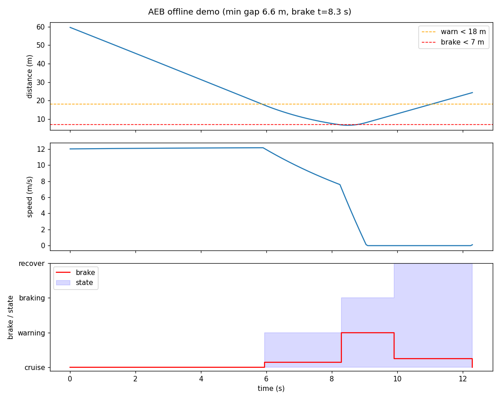
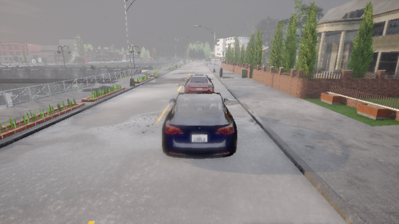
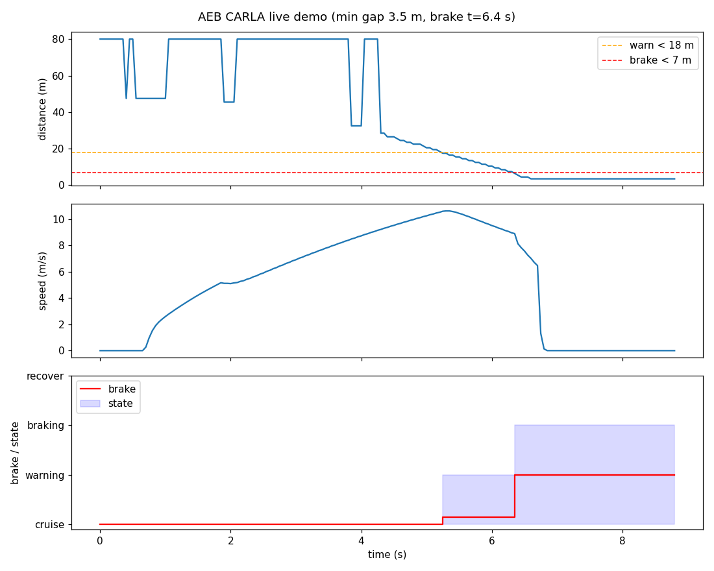

# CARLA 自动紧急制动（AEB）

> 使用前向激光雷达实时测量与前方障碍车的距离，AEB 滞回状态机
> （cruise → warning → braking → recover）在障碍逼近时自动预警并全力制动，
> 障碍消除后缓释恢复。提供离线制动曲线演示与连 CARLA 真实场景演示两条验证路径。

## 1. 概述与目标

本模块实现乘用车 **AEB（Autonomous Emergency Braking，自动紧急制动）** 功能的
完整闭环，在 CARLA 0.9.16 中可一键复现：

| 环节 | 实现 |
|---|---|
| 感知 | 前向 64 线激光雷达 → 车道带 + 车身高度带滤波 + 距离直方图聚类 → 障碍车距离 |
| 决策 | 滞回状态机 cruise → warning → braking → recover，接近速度门限防误触发 |
| 控制 | 按状态输出油门/制动：巡航 0.55 → 预警缓刹 0.15 → 紧急制动 1.0 → 恢复缓释 |

代码位于 `src/ground/carla_aeb_braking/`。

### 1.1 与仓库中其它地面载具模块的区分

| 模块 | 输入 | 算法 | 特点 |
|---|---|---|---|
| 神经网络感知与轨迹跟踪（`carla_perception_control`） | 相机/深度/雷达 + 轨迹 | 感知 NN + 控制 NN | 轨迹跟踪，无安全状态机 |
| 神经网络自适应跟车 ACC（`carla_nn_car_following`） | 相机图像 | NN 回归油门 | 舒缓跟车，不涉及紧急制动 |
| **本模块** | **前向 LiDAR 点云** | **规则式滞回状态机** | **安全件逻辑，全力制动 + 可解释阈值** |

AEB 是典型**安全件**：决策必须可解释、可测试、可复现，因此本模块采用规则式
状态机（每条进入/退出阈值都是显式参数），而非端到端网络；同时全部决策逻辑
（测距 + 状态机）均为纯离线函数，53 个单元测试不依赖 ROS 与 CARLA 即可完整覆盖。

### 1.2 为什么用 LiDAR 而不是深度相机

模块早期版本用深度相机取"中央前向区域最小深度"测距，实测发现两个致命问题：

1. **自车车身近距回波**：相机装在车内，前机盖/挡风玻璃在深度图上位于中央区域，
   最小深度永远是车身自己（< 0.5 m）；
2. **前向地面主导**：相机下俯视角使地面像素落入前向区域，地面深度随俯仰角
   变化（加速下俯时距离骤降），会伪造"近距障碍"。

LiDAR 点云可直接按**几何**过滤（横向车道带、高度带、距离直方图聚类），
每一层都有明确的物理含义，是本模块的主测距源。深度相机解码/测距函数
（`decode_carla_depth` / `depth_min_distance`）保留为工具函数并有完整测试，
但不再用于 AEB 决策。

## 2. 计算原理

### 2.1 LiDAR 障碍测距

输入为 CARLA `sensor.lidar.ray_cast` 的原始点云，解析为 (N,4) 数组
（传感器系：x 前、y 左、z 上），经过三层几何滤波后按距离直方图聚类：

```
原始点云 (N,4)
  │  ① 横向车道带：|y| < 2.0 m
  │  ② 高度带：z ∈ [-1.7, -0.4] m（传感器装高 2.0 m，即世界高度 0.3~1.6 m）
  │  ③ 距离带：x ∈ [3, 100) m（滤自车车身回波）
  ▼
按 x 分 1 m 一箱计数
  │  ④ 取"点数 ≥ 6 的最近一箱"的中点作为障碍距离
  ▼
障碍距离 d（无障碍时返回 80 m 哨兵值）
```

各层过滤的实测依据（Town01_Opt，传感器装高 2.0 m）：

| 过滤层 | 滤掉的杂波 | 实测现象 |
|---|---|---|
| 横向带 \|y\| < 2.0 | 车道边缘路缘 | 路缘在 y≈2.4~2.5、世界高 0.1 m；自车加速下俯时其 z 抬高进入高度带，被误判为 7.5 m 近距障碍 |
| 高度带 z ∈ [-1.7, -0.4] | 地面 + 路侧标志 | 地面在传感器系 z≈-2.0；车道内 9~13 m 处 2 m 高标志在 z≈0，不滤会抢先触发制动 |
| 直方图聚类 ≥6 点 | 孤立杂波点 | 障碍车车身是连续表面（同距离点数多），杂波是孤立点；裸取最小值会被单点杂波主导 |

另有两项工程处理：

* **8 帧时间融合**：64 通道雷达在 20 m 外对轿车（张角约 5.4°）单帧仅 3~4 点，
  逐帧测距会闪烁；滑动融合最近 8 帧后 20 m 处约 24 点、50 m 处约 40 点，稳定可聚类。
* **接近速度差分**：相邻两帧距离差分 \(\dot d = (d_{k-1}-d_k)/\Delta t\)，
  首帧以自车速度兜底（静止障碍物 + 自车前行的最常见工况）。

### 2.2 AEB 滞回状态机

四个状态，每个状态都有独立的进入/退出阈值（滞回），避免临界抖动：

$$
\text{cruise} \xrightarrow{d < 18\,\text{m}} \text{warning}
\xrightarrow{d < 7\,\text{m} \,\wedge\, \dot d > 0.5} \text{braking}
\xrightarrow{d > 12\,\text{m}} \text{recover}
\xrightarrow{d > 24\,\text{m}} \text{cruise}
$$

| 状态 | 进入条件 | 退出条件 | 油门 | 制动 |
|---|---|---|---|---|
| cruise | — | d < 18 m | 0.55 | 0 |
| warning | d < 18 m | d > 24 m | 0.275 | 0.15 |
| braking | d < 7 m **且** \(\dot d\) > 0.5 | d > 12 m | 0 | 1.0 |
| recover | d > 12 m（自 braking） | d > 24 m | 0.25 | 0.25 |

三个设计要点：

1. **接近速度门限**：进入紧急制动需 \(\dot d > 0.5\,\text{m/s}\)。静止/远离的
   近距障碍（如旁车并行）只预警不全力制动，避免误触发；
2. **预警缓刹取小值**：warn_brake 从 0.35 降到 0.15——0.35 太猛会把接近速度
   拖垮到 0.5 m/s 以下，d 到达 7 m 时不满足"正在接近"，形成
   warn→缓停→cruise 极限环，永远到不了全力制动；
3. **滞回带宽度**：warn 进入 18 m / 退出 24 m、brake 进入 7 m / 退出 12 m，
   距离在带内波动时状态不变，消除阈值附近的抖动。

### 2.3 演示场景的自适应选点

真实场景演示（`demo --live`）自动扫描地图前 15 个出生点，为每个点临时挂
LiDAR 采 8 帧点云，计算"前向车道内最近障碍簇距离"，选**车道最干净**的出生点；
障碍车初始距离取 \(\min(\text{gap},\ \text{干净距离} - 3\,\text{m})\)。

这样保证障碍车一定是 AEB 的制动目标——Town01_Opt 车道内遍布路侧设施，
若固定出生点，演示会被车道内 6~15 m 处的标志/立柱抢先触发，而非生成的障碍车。

## 3. 算法流程

```
离线演示（无需 CARLA）：
  合成 60 m 障碍车场景（自车 0.55 油门起步，障碍静止）
  → 每 tick：距离 + 接近速度 → AEBController.tick
  → 记录 (t, state, d, closing, throttle, brake, event)
  → 导出 CSV + 三行曲线 PNG

真实场景演示（--live，需 CARLA）：
  连 CARLA（同步模式 20 Hz）→ 清理残留 actor → 扫描出生点选最干净车道
  → 生成自车 + 前向 LiDAR → 生成障碍车（gap 距离）
  → 每 tick：8 帧融合点云 → 测距 → 状态机 → apply_control → world.tick
  → 全力制动瞬间挂临时 RGB 相机截图
  → 导出 CSV + 曲线 PNG（自动恢复异步模式、销毁 actor）

ROS 2 节点（live 阶段）：
  桥接节点：CARLA → /aeb/obstacle_distance、/aeb/ego_speed、/aeb/odometry
            /aeb/control → CARLA 车辆
  AEB 节点：/aeb/obstacle_distance + /aeb/ego_speed → 状态机 → /aeb/control
            服务 /aeb/arm、/aeb/abort、/aeb/reset
```

## 4. 源码解析

| 文件 | 关键符号 | 职责 |
|---|---|---|
| `aeb_core.py` | `parse_lidar_points` / `lidar_obstacle_distance` | 点云解析 + 三层滤波直方图聚类测距 |
| | `decode_carla_depth` / `depth_min_distance` | 深度图解码与测距（工具函数，保留） |
| | `estimate_closing` | 帧间差分接近速度 |
| | `aeb_decide` / `AEBController` | 滞回状态机单步决策 / 有状态封装（含 `abort`/`reset`） |
| `carla_common.py` | `connect` / `restore_async` | 连 CARLA 并开同步模式 / 退出前恢复异步 |
| | `cleanup_actors` / `spawn_vehicle` / `make_lidar` | 清理残留 actor / 多出生点回退生成自车 / 前向雷达 |
| | `apply_control` / `get_speed` | 施加油门制动 / 读车速 |
| `bridge_node.py` | `AEBBridgeNode` | CARLA↔ROS 桥接：8 帧融合测距发布，控制话题施加到车 |
| `aeb_node.py` | `AEBControlNode` | 纯 ROS 决策节点：距离/速度 → 状态机 → 控制指令 |
| `demo.py` | `run_offline` / `run_live` | 离线制动曲线 / 真实 CARLA 场景（含自适应选点） |
| | `_pick_clean_spawn` / `_grab_screenshot` | 扫描最干净出生点 / 刹车瞬间截图 |
| `main.py` | `doctor` / `test` / `build` / `demo` / `live` | 统一入口五个阶段 |

话题与服务一览（ROS 2 模式）：

| 名称 | 类型 | 方向 | 含义 |
|---|---|---|---|
| `/aeb/obstacle_distance` | `std_msgs/Float32` | 桥接 → AEB | 前向障碍距离（m，无障碍 80） |
| `/aeb/ego_speed` | `std_msgs/Float32` | 桥接 → AEB | 自车速度（m/s） |
| `/aeb/odometry` | `nav_msgs/Odometry` | 桥接 → 外部 | 自车位姿（map 系） |
| `/aeb/control` | `std_msgs/Float32MultiArray` | AEB → 桥接 | `[throttle, steer, brake]` |
| `/aeb/state` | `std_msgs/String` | AEB → 外部 | 当前状态（cruise/warning/braking/recover） |
| `/aeb/event` | `std_msgs/String` | AEB → 外部 | 状态迁移事件（warn/brake/recover，仅触发时） |
| `/aeb/arm` `/aeb/abort` `/aeb/reset` | `std_srvs/Trigger` | 外部 → AEB | 启用 / 紧急中止 / 复位 |

## 5. 仿真运行步骤

### 5.1 支持与测试环境

| 组件 | 版本 / 说明 |
|---|---|
| 操作系统 | Ubuntu 22.04（ROS 2 Humble，虚拟机）实测；其它 ROS 2 发行版理论可用 |
| 仿真器 | CARLA 0.9.16（服务端运行于有 GPU 的宿主机，`-RenderOffScreen` 即可） |
| Python | 3.10+（CARLA 0.9.16 客户端 wheel 为 cp310/cp311/cp312） |
| 依赖 | `numpy`、`pyyaml`；绘图需 `matplotlib`（缺失时跳过出图，不影响数据导出） |

### 5.2 从零复现（四步）

```bash
# ① 依赖体检 + 离线单元测试（不需要 CARLA 与 ROS）
python3 src/ground/carla_aeb_braking/main.py doctor
python3 src/ground/carla_aeb_braking/main.py test

# ② 离线制动曲线演示（导出 artifacts/aeb_offline_curve.png + CSV）
python3 src/ground/carla_aeb_braking/main.py demo

# ③ 连 CARLA 真实场景演示（--host 填 CARLA 所在机器 IP；
#    自动扫描出生点选最干净车道、生成障碍车、触发 AEB、截图）
python3 src/ground/carla_aeb_braking/main.py demo --live --host 192.168.122.1

# ④ ROS 2 节点方式（colcon 构建后 launch 启动桥接 + AEB 控制两节点）
cd <ros2 工作空间根目录>
colcon build --packages-select carla_aeb_braking
source install/setup.bash
ros2 launch carla_aeb_braking main.launch.py host:=192.168.122.1
# 另开终端观察状态机：
ros2 topic echo /aeb/state
```

`demo --live` 结束会打印刹车时刻、最小间隙、是否刹停与最终状态，并把
截图/CSV/曲线写入模块 `artifacts/` 目录；退出前自动把 CARLA 世界恢复异步模式。

## 6. 运行效果与性能评价

### 6.1 离线制动曲线（无需 CARLA）

60 m 障碍车、自车 0.55 油门起步：17.5 m 进入预警（缓刹）、6.8 m 全力制动、
刹停于 6.63 m，全周期 12.4 s，最终恢复 cruise：



### 6.2 真实 CARLA 场景（Town01_Opt 实测）

Ubuntu 22.04 虚拟机（ROS 2 Humble）连宿主机 CARLA 0.9.16（offscreen），
自动选点 (299.4, 129.8) 朝向 180°（前向车道 100 m 干净），障碍车放 50 m：





状态链实测（CSV 逐帧数据，见 `aeb_live_data.csv`）：

| 时刻 | 状态 | 障碍距离 | 车速 | 说明 |
|---|---|---|---|---|
| t=0~4.5 | cruise | 47.5 → 26.5 m | 0 → 9.5 m/s | 0.55 油门加速接近 |
| t=5.2 | **warning** | 17.5 m | 10.6 m/s | 进入预警，缓刹 0.15 |
| t=6.4 | **braking** | 6.5 m | 8.9 m/s | 全力制动（d<7 且在接近） |
| t=7.0 | braking（停） | **3.5 m** | 0 | 刹停，未碰撞 |
| 全程 | 8.8 s，最小间隙 3.5 m | | | 刹车瞬间自动截图 |

### 6.3 指标汇总

| 指标 | 离线演示 | CARLA 实测 |
|---|---|---|
| 初始距离 | 60 m | 50 m |
| 进入预警 | 17.5 m @ 4.2 s | 17.5 m @ 5.2 s |
| 全力制动 | 6.8 m @ 8.3 s | 6.5 m @ 6.4 s |
| 最小间隙 | 6.63 m | **3.5 m** |
| 是否刹停 | 是 | 是（零碰撞） |
| 全程耗时 | 12.4 s | 8.8 s |

### 6.4 调优过程记录（实测踩坑）

| 问题 | 现象 | 修正 |
|---|---|---|
| 深度相机测距不可靠 | 最小深度永远被自车车身/前向地面主导 | 改用 LiDAR 三层滤波直方图聚类，深度函数保留为工具 |
| 车道内 2 m 标志误触发 | d 在 12~14 m 与 44 m 间闪烁，AEB 刹标志不刹障碍车 | 高度带收紧到车身高度 z∈[-1.7,-0.4]，滤掉世界高 2 m 的标志 |
| 路缘被误判为近距障碍 | 自车加速下俯后 d 骤降 7.5 m 触发制动 | 横向带收紧 \|y\|<2.0，滤掉 y≈2.4 的路缘 |
| 孤立杂波主导测距 | 裸取最小值被单点噪声打断 | 直方图聚类取"≥6 点最近箱" |
| 远距障碍车漏检 | 45 m 外轿车单帧仅 2~3 点 | 8 帧点云时间融合 |
| 预警缓刹过强 | warn_brake=0.35 拖垮接近速度，永远到不了全力制动 | 降到 0.15 |
| 出生点车道脏 | 固定出生点前 6~15 m 有路侧设施抢先触发 | 启动扫描前 15 个出生点选最干净车道 |
| 世界残留同步模式 | 上次被强杀后服务端永久停帧 | 启动时清理 actor + 结束恢复异步模式 |

