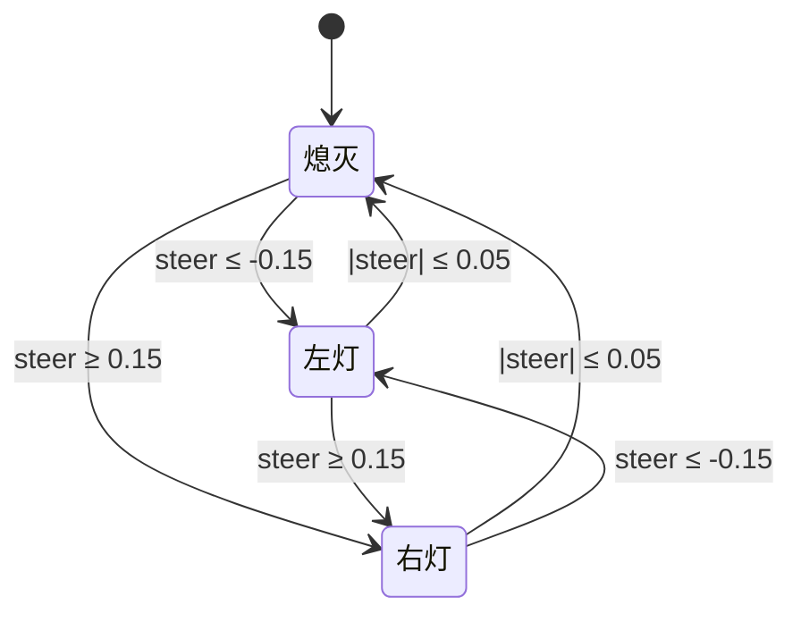
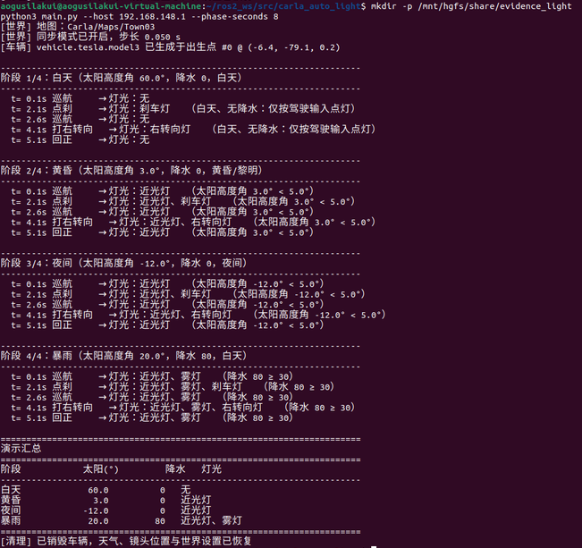
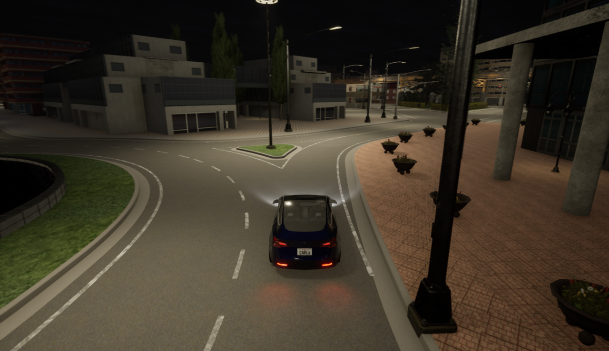
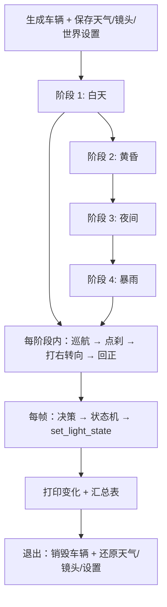

# 基于 CARLA 的地面载具灯光自动控制

本模块在 CARLA 中根据环境亮度与驾驶输入自动控制车辆灯光：近光灯、雾灯、
转向灯与刹车灯。演示按"白天 → 黄昏 → 夜间 → 暴雨"四个阶段切换天气，
每个阶段内依次执行"巡航 → 点刹 → 打右转向 → 回正"，四类灯各演一遍。

## 1. 运行环境

| 项目 | 版本 / 说明 |
|---|---|
| 宿主机 | Windows 11，CARLA 0.9.16（解压后双击 `CarlaUE4.exe`） |
| 虚拟机 | Ubuntu 22.04 LTS（VMware），ROS 2 Humble，Python 3.10.12 |
| Python 依赖 | `carla==0.9.16`（见功能包内 `requirements.txt`） |

安装依赖：

```bash
cd src/ground/carla_auto_light
python3 -m pip install --user -r requirements.txt -i https://pypi.tuna.tsinghua.edu.cn/simple
```

## 2. 目录结构

```
src/ground/carla_auto_light/
├── main.py                     统一入口（仓库约定：入口为 main.*）
├── main.sh / main.bat          一键入口
├── carla_auto_light/
│   ├── light_logic.py          纯决策逻辑：阈值表 + 转向灯状态机（可离线单测）
│   ├── carla_utils.py          CARLA 连接、同步步进、天气切换、灯光位掩码、跟随镜头
│   ├── app.py                  命令行入口与四阶段演示流程
│   └── light_node.py           ROS 2 节点：演示并发布 /vehicle/lights
├── test/test_light_logic.py    纯逻辑单元测试（53 项，不需要 CARLA）
├── launch/main.launch.py       ROS 2 启动入口
├── requirements.txt / package.xml / setup.py / setup.cfg
└── README.md
```

## 3. 控制原理

### 3.1 昼夜判断依据

CARLA 的 `carla.WeatherParameters` 直接给出太阳高度角（度），它比"读相机图像算亮度"更稳定：

* 不受视角、曝光、后处理影响；
* 取值连续，阈值可以直接写在文档里并按需调整。

本模块用的阈值：

| 参数 | 取值 | 含义 |
|---|---|---|
| `SUN_HEADLIGHT_ON` | 5° | 太阳高度角 ≤ 5° 判为黄昏/黎明，开近光灯 |
| `SUN_NIGHT` | -5° | ≤ -5° 判为夜间（仅用于日志分级） |
| `PRECIPITATION_FOG` | 30 | 降水强度 ≥ 30 时同时开雾灯 |
| `STEER_BLINKER_ON` | 0.15 | 方向盘绝对值 ≥ 0.15 打转向灯 |
| `STEER_BLINKER_OFF` | 0.05 | 方向盘回到 0.05 以内（含）转向灯自动熄灭 |
| `BRAKE_LIGHT_ON` | 0.05 | 刹车量 ≥ 0.05 点亮刹车灯 |

即"该不该开灯"由下式决定（\(a\) 为太阳高度角，\(p\) 为降水强度）：

$$
\text{近光灯} = (a \le 5^\circ) \lor (p \ge 30), \qquad
\text{雾灯} = (p \ge 30)
$$

### 3.2 转向灯状态机（回正自动熄灭）

真实汽车的方向盘下方有回位机构：打了转向灯之后，必须**把方向盘打够角度再回到中位**，
转向灯才会自动熄灭；只把方向盘轻轻动一下不会触发。这里用两个阈值复现（阈值本身即触发，全部含边界）。转向灯只看**驾驶员指令**，车道保持算出的微调量不参与判断——否则车在弯道上会一直闪。



行为细节：

1. **锁存**：方向盘一旦越过 0.15 就点亮并记住，此后方向盘在 0.05~0.15 之间摆动**不会熄灭**；
2. **回正熄灭**：方向盘回到 ±0.05 以内才熄灭，符合"先打到底再回正"的驾驶习惯；
3. **左右互斥**：确定一侧时另一侧必然熄灭，避免同时点亮。

### 3.3 灯光位掩码

CARLA 用位掩码表示灯光，本模块把决策结果映射过去：

| 决策字段 | CARLA 位 |
|---|---|
| `low_beam` | `VehicleLightState.LowBeam` |
| `fog` | `VehicleLightState.Fog` |
| `left_blinker` / `right_blinker` | `VehicleLightState.LeftBlinker` / `RightBlinker` |
| `brake_light` | `VehicleLightState.Brake` |

> 注意：`vehicle.set_light_state()` 只接受 `carla.VehicleLightState` **对象**，
> 直接把位掩码当 `int` 传会抛
> `Boost.Python.ArgumentError: set_light_state(Vehicle, int) did not match C++ signature`。
> 正确写法是 `carla.VehicleLightState(flags)` 再传入。

## 4. 运行步骤

### 4.1 启动 CARLA 服务端（Windows）

解压 CARLA 0.9.16 后双击 `CarlaUE4.exe`，等待城市画面出现。

### 4.2 查询宿主机 IP（Windows）

```bat
ipconfig
```

在 `VMware Network Adapter VMnet8` 一节找到 IPv4 地址（形如 `192.168.x.1`），替换下面命令里的地址。

### 4.3 虚拟机连通性检查

Ubuntu 22.04 默认没有 `nc`，先装一次：

```bash
sudo apt install -y netcat
nc -vz 192.168.148.1 2000
```

出现 `succeeded!` 说明能访问 CARLA 的 RPC 端口。若不想装包，也可以用 Python 直接试连：

```bash
python3 -c "import socket;s=socket.socket();s.settimeout(3);print(s.connect_ex(('192.168.148.1',2000)))"
```

输出 `0` 表示端口可达。

### 4.4 编译功能包

```bash
mkdir -p ~/ros2_ws/src && cd ~/ros2_ws/src
git clone --depth 1 https://github.com/OpenHUTB/ros2.git
cp -r ~/ros2_ws/src/ros2/src/ground/carla_auto_light ~/ros2_ws/src/
cd ~/ros2_ws
source /opt/ros/humble/setup.bash
colcon build --packages-select carla_auto_light --symlink-install
source install/setup.bash
ros2 pkg executables carla_auto_light
```

**预期输出**：`Summary: 1 package finished`，并列出 `carla_auto_light auto_light_node`。

### 4.5 离线单元测试（不需要 CARLA）

```bash
cd ~/ros2_ws/src/carla_auto_light
python3 test/test_light_logic.py
```

**预期输出**：`[结果] 53 项全部通过`。这 53 项覆盖了阈值边界、四类灯的触发条件、
状态机的锁存/回正熄灭/左右互斥，以及日志名称转换。**先跑它再连 CARLA**，
可以把"逻辑错"与"仿真器问题"分开。

### 4.6 运行演示

```bash
python3 main.py --host 192.168.148.1
```

默认按 **仿真时间 1:1** 播放（每阶段 6 秒，全程约 24 秒），并用**第三人称跟随镜头**
观察车辆，方便看清灯光切换。想更快或更慢：

```bash
python3 main.py --host 192.168.148.1 --phase-seconds 10    # 每阶段 10 秒
python3 main.py --host 192.168.148.1 --fast                # 关闭实时节奏
python3 main.py --host 192.168.148.1 --no-follow           # 关闭跟随镜头
```

### 4.7 用 ROS 2 launch 启动

```bash
cd ~/ros2_ws && source install/setup.bash
ros2 launch carla_auto_light main.launch.py host:=192.168.148.1
```

节点除了跑同一套演示，还会把当前灯光状态发布到 `/vehicle/lights`：

```bash
ros2 topic echo /vehicle/lights
# data: 近光灯、雾灯
```

## 5. 参数说明

| 参数 | 默认值 | 说明 |
|---|---|---|
| `--host` | `127.0.0.1` | Windows 宿主机 IP |
| `--port` | `2000` | CARLA RPC 端口 |
| `--town` | `Town03` | 地图 |
| `--dt` | `0.05` | 同步模式步长（秒） |
| `--vehicle` | `vehicle.tesla.model3` | 车型 blueprint |
| `--spawn-index` | `-1` | 出生点编号，-1 表示自动挑选 |
| `--phase-seconds` | `6` | 每个天气阶段时长（秒） |
| `--fast` | 关闭 | 关闭实时节奏 |
| `--no-follow` | 关闭 | 关闭第三人称跟随镜头 |

## 6. 结果与性能

一次完整运行的终端输出如下：

```
阶段 1/4：白天（太阳高度角 60.0°，降水 0，白天）
  t= 0.1s 巡航     → 灯光：无
  t= 2.1s 点刹     → 灯光：刹车灯
  t= 4.1s 打右转向   → 灯光：右转向灯
  t= 5.1s 回正     → 灯光：无

阶段 2/4：黄昏（太阳高度角 3.0°，降水 0，黄昏/黎明）
  t= 0.1s 巡航     → 灯光：近光灯
  t= 2.1s 点刹     → 灯光：近光灯、刹车灯
  t= 4.1s 打右转向   → 灯光：近光灯、右转向灯
  t= 5.1s 回正     → 灯光：近光灯

阶段 3/4：夜间（太阳高度角 -12.0°，降水 0，夜间）
  t= 0.1s 巡航     → 灯光：近光灯
  …（与黄昏阶段一致）

阶段 4/4：暴雨（太阳高度角 20.0°，降水 80）
  t= 0.1s 巡航     → 灯光：近光灯、雾灯
  t= 2.1s 点刹     → 灯光：近光灯、雾灯、刹车灯
  t= 4.1s 打右转向   → 灯光：近光灯、雾灯、右转向灯
  t= 5.1s 回正     → 灯光：近光灯、雾灯
```

四阶段汇总：

| 阶段 | 太阳高度角 | 降水 | 灯光 |
|---|---|---|---|
| 白天 | 60.0° | 0 | 无 |
| 黄昏 | 3.0° | 0 | 近光灯 |
| 夜间 | -12.0° | 0 | 近光灯 |
| 暴雨 | 20.0° | 80 | 近光灯、雾灯 |





### 6.1 结果是否合理

* 白天只按驾驶输入点灯：巡航时全灭、点刹亮刹车灯、打方向亮转向灯、回正后熄灭；
* 黄昏与夜间近光灯常亮，刹车灯与转向灯在其上叠加；
* 暴雨（太阳 20°，同属白天）因降水达 80 而开近光灯与雾灯；
* 转向灯在"回正"动作后自动熄灭，不会一直亮到下一次打方向。

### 6.2 已知限制

1. **阈值是经验值**：5° / 30 / 0.15 取自常见工程实践，未按具体车型灯具标定；
2. **只看降水不看能见度**：CARLA 没有直接给出能见度，雾天（`fog_density`）未单独判断，
   若要区分"浓雾"可增加 `fog_density` 条件；
3. **灯光是视觉表现**：CARLA 的车灯不影响其他车辆的感知，本模块只验证"状态决策→
   执行器"的正确性；
4. **转向灯只按方向盘判断**：没有读取导航意图（例如导航即将右转时提前打灯），
   真实系统里应由上游规划器给出转向意图。

## 7. 源码解析

### 7.1 `light_logic.py`：纯决策，可离线测试

| 函数 / 类 | 作用 |
|---|---|
| `sun_phase(sun_altitude)` | 太阳高度角 → 白天 / 黄昏 / 夜间（仅日志用） |
| `decide_lights(sun, precipitation, steer, brake)` | 环境与驾驶输入 → 应点亮的灯光字典 |
| `BlinkerStateMachine.update(steer)` | 转向灯锁存与回正熄灭 |
| `compose_state(decision, blinker_state)` | 合成最终状态（状态机优先） |
| `state_to_names(state)` | 转成中文名单，用于日志与话题 |

之所以做成纯函数：**灯光决策不需要仿真器就能验证**。53 项单元测试里没有一行 CARLA 代码，
涵盖阈值边界（太阳 5°、降水 30、方向盘 0.15 / 0.05、刹车 0.05）与状态机的全部转移。

### 7.2 `carla_utils.py`：连接与"干净的退出"

* `LightSession` 打开同步模式前会先检查**残留的同步状态**（上次异常退出留下的），
  先恢复异步再记录"原始设置"，避免退出时无法还原；
* **记录并还原三样东西**：天气、观察者镜头位置、世界设置。跟随镜头会把观察者挪到车后，
  不还原的话下次打开 CARLA 视角会停在上一段演示的终点；
* `light_state_to_carla` 负责字典 → `carla.VehicleLightState` 的映射（含上面提到的
  `int` 与对象之争）。

### 7.3 `app.py`：四个阶段的演示编排



每个阶段内的时间窗是固定的：2.0~2.5 s 点刹、4.0~5.0 s 打右转向、之后回正，
因此每次运行的灯光变化序列完全一致，便于截图与核对。

## 8. 常见问题

**Q1：`Boost.Python.ArgumentError: set_light_state(Vehicle, int) did not match`**
把位掩码包成 `carla.VehicleLightState(flags)` 再传入即可（见 3.3 节）。

**Q2：灯光状态打印正确，但 CARLA 窗口里看不到灯亮**
车灯是视觉表现，需要在**夜间或降水**视角下才明显；白天阶段点亮的刹车灯/转向灯
在车尾仍有微弱表现。建议用 `--phase-seconds 8` 并在"黄昏/夜间/暴雨"阶段观察。

**Q3：窗口里视角不动 / 看不到车**
默认开启跟随镜头；若用 `--no-follow`，观察者会停在原地。另外确认没有其它脚本
在抢 `world.get_spectator()`。

**Q4：跑完 CARLA 窗口卡住不动**
说明世界还停在同步模式。本模块在 `finally` 中会还原世界设置；
若进程被强制杀死，下次启动 `enable_sync()` 会检测并清除残留的同步状态。

**Q5：连接超时**
依次检查：CARLA 是否启动、`--host` 是否为 VMnet8 的地址、Windows 防火墙是否放行 2000
（用 `nc -vz <host> 2000` 验证）。

## 9. 参考

1. CARLA 官方文档：<https://carla.readthedocs.io/>
2. `carla.VehicleLightState` 与 `carla.WeatherParameters` 接口说明
3. 仓库既有模块：`carla_keyboard_control`（物理仿真与键盘控制）、
   `weather_perception_benchmark`（雨雾天气对相机感知的影响）
