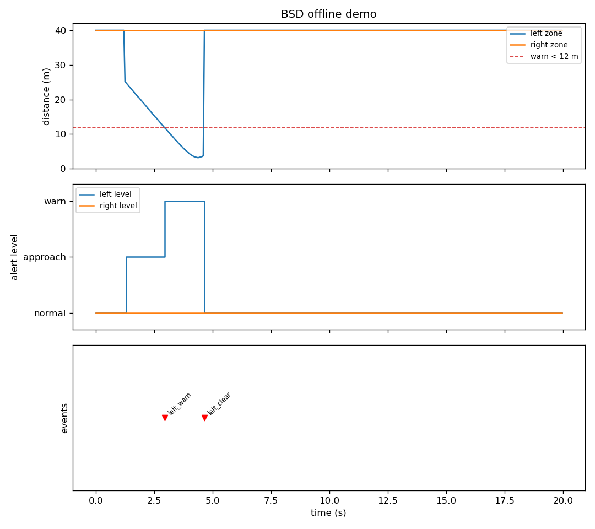
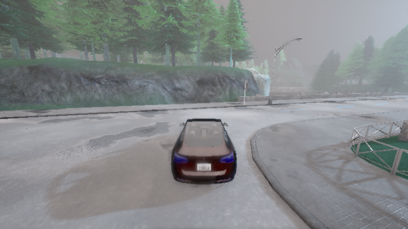
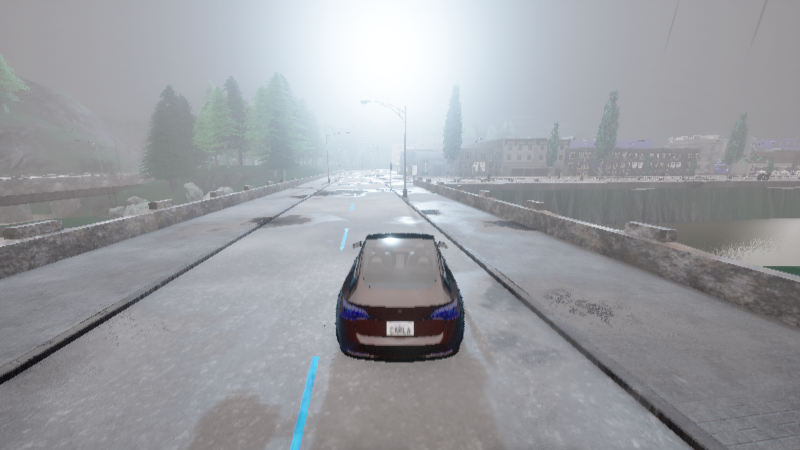
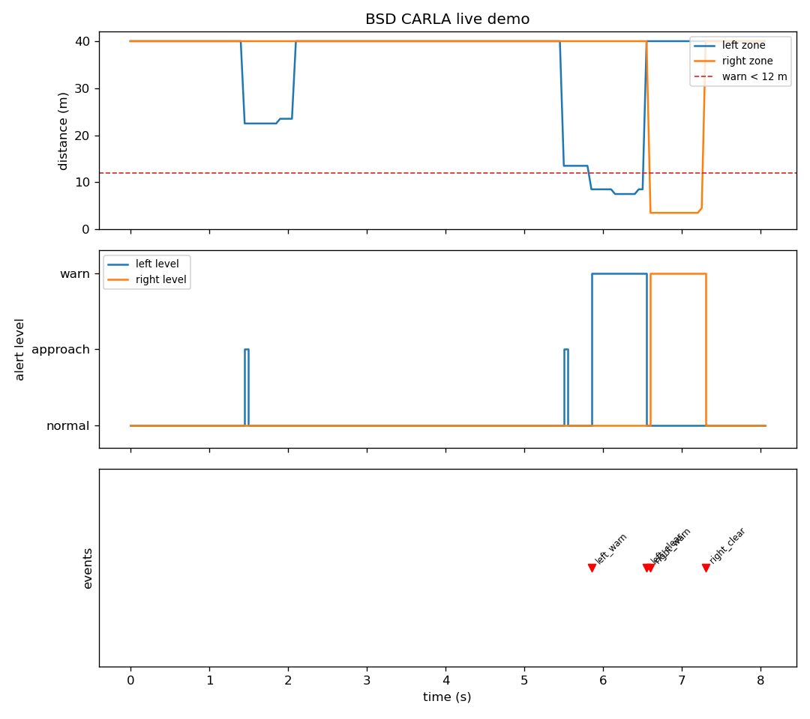

# CARLA 盲区监测（BSD）

> 使用顶置激光雷达按侧别窗口监测相邻车道来车，接近速度差分估计 +
> 滞回状态机输出分级预警（normal → approach → warn），完整覆盖邻车
> 从斜后方逼近、穿越盲区、超越离开的全过程。只预警不干预驾驶，
> 与前向 AEB 模块（`carla_aeb_braking`）构成前向制动 + 侧向预警的安全互补。

## 1. 概述与目标

本模块实现乘用车 **BSD（Blind Spot Detection，盲区监测）** 功能的完整闭环，
在 CARLA 0.9.16 中可一键复现：

| 环节 | 实现 |
|---|---|
| 感知 | 顶置 64 线 LiDAR → 侧别横向窗口 + 车身高度带滤波 + 径向距离直方图聚类 → 盲区目标距离 |
| 决策 | 左右两条独立滞回状态线（normal/warn）+ approach 提前预警位（与状态解耦） |
| 输出 | 分级预警话题（/bsd/alert）+ 跃迁事件（/bsd/event），只预警不控车 |

代码位于 `src/ground/carla_bsd_blind_spot/`。

### 1.1 与仓库中其它地面载具模块的区分

| 模块 | 感知区域 | 算法 | 是否控车 |
|---|---|---|---|
| 自动紧急制动（`carla_aeb_braking`） | 前向 | 滞回状态机 + 全力制动 | 是（制动） |
| 神经网络自适应跟车 ACC（`carla_nn_car_following`） | 前向相机 | NN 回归油门 | 是（油门） |
| **本模块** | **侧向（左右盲区）** | **规则式滞回状态机 + 分级预警** | **否（纯预警）** |

BSD 是典型的**驾驶员辅助件**：只负责把"盲区有车 / 有车正在逼近"及时、
可解释地告知上层，不代替任何驾驶决策。因此本模块的输出是分级预警
（normal/approach/warn）与跃迁事件，而非控制指令——预警阈值全部是显式
参数，40 个离线测试完整覆盖决策逻辑。

### 1.2 分级预警设计

单一"有车/没车"二值报警在真实场景里有两种失败模式：目标还很远时提前
报警造成骚扰，或目标一进窗口就突然报警失去预判。本模块分两级：

* **approach**（提前预警）：目标尚在盲区外（d < 25 m）但正以 > 0.5 m/s
  快速接近——"有车正在逼近盲区"，变道前提前注意；
* **warn**（盲区报警）：目标已进入盲区（d < 12 m）——"不建议变道"。

approach 与滞回状态解耦（见 2.2），上层可分别消费：比如 approach 用于
仪表提示、warn 用于方向盘振动或后视镜警示灯。

## 2. 计算原理

### 2.1 盲区测距

输入为 CARLA `sensor.lidar.ray_cast` 的原始点云，解析为 (N,4) 数组
（传感器系：x 前、y 左、z 上），经过三层几何滤波后按径向距离聚类：

```
原始点云 (N,4)
  │  ① 侧别横向窗口：左 y ∈ [2.9, 4.2]（右 y 取负对称）
  │  ② 纵向窗口：x ∈ [-25, 2]（斜后方 25 m 到斜前方 2 m）
  │  ③ 车身高度带：z ∈ [-1.7, -0.4]（世界高度约 0.3~1.6 m）
  ▼
按径向距离 r = hypot(x, y) 分 1 m 一箱计数
  │  ④ 取"点数 ≥ 6 的最近一箱"的中心作为盲区目标距离
  ▼
盲区目标距离 d（无目标时返回 40 m 哨兵值）
```

各层过滤的实测依据（Town01_Opt，LiDAR 装高 2.0 m，探针逐层定位）：

| 过滤层 | 滤掉的杂波 | 实测现象 |
|---|---|---|
| 近界 y ≥ 2.9 | 路缘与路侧灌木 | 路缘 y≈2.4~2.5、灌木 y≈1.8~2.5；不滤会把左侧路缘绿化当成 2.5~12.5 m 盲区目标，自车静止时即假报警 |
| 远界 y ≤ 4.2 | 更外侧低矮植被 | 实测 y≈4.6~4.9、世界高 0.3~0.6 m 的植被带（48+32+32 点连续簇，会被聚类判定为有效目标）；邻车道车身 y≈2.4~4.0 完整保留 |
| 高度带 z ∈ [-1.7, -0.4] | 地面 + 高杆物 | 地面世界 z=0 → 传感器 z≈-2.0；路侧 2 m 标志 → 传感器 z≈0（与 AEB 模块实测一致） |
| 径向聚类 ≥6 点 | 孤立杂波点 | 车身是连续表面（同径向距离多点），杂波是孤立点 |

* **纵向窗口 [-25, 2]**：覆盖邻车从斜后方逼近的接近段，与实车 BSD 角雷达
  25~60 m 后向探测范围一致；也为 approach 提前预警提供探测纵深。
* **8 帧时间融合**：与 AEB 模块相同——64 线雷达对 20 m 外轿车单帧采样
  过疏，滑动融合最近 8 帧后稳定可聚类。

### 2.2 滞回状态机与接近预警

左右盲区各一条独立状态线（滞回防临界抖动）：

$$
\text{normal} \xrightarrow{d < 12\,\text{m}} \text{warn}
\xrightarrow{d > 15\,\text{m}} \text{normal}
$$

| 状态 | 进入条件 | 退出条件 |
|---|---|---|
| normal | — | — |
| warn | d < 12 m | d > 15 m（滞回带 12~15 m 内保持原状态） |

approach 是独立于状态的布尔位：`d < 25 m 且 接近速度 > 0.5 m/s`。
接近速度由帧间差分估计 \(\dot d = (d_{k-1}-d_k)/\Delta t\)，
首帧无历史时按 0 处理（保守，不提前误报）。

三个设计要点：

1. **滞回带**：进入 12 m / 退出 15 m——邻车与自车并行时距离在临界值附近
   波动，滞回避免报警反复横跳；
2. **接近速度门限 0.5 m/s**：旁车低速并行时（相对速度≈0）不触发 approach，
   只有真正快速逼近才提前预警；
3. **左右完全独立**：两条状态线、两份测距缓存、事件按侧别命名
   （left_warn / right_warn / left_clear / right_clear），同拍多事件合并为
   一条逗号分隔消息发布。

### 2.3 演示场景

`demo --live` 构造的场景：自车在 Town01 直道定速巡航（内置简单巡航 +
航点跟随车道保持），邻车从左后方 45 m 处以更高速度同向超越——

```
t≈1.4s  邻车进入 25m 探测纵深，approach 提前预警
t≈5.9s  邻车穿越盲区窗口，left_warn
t≈6.4s  邻车车尾越过自车车头，left_clear
t≈7.0s  道路转弯段，同向邻车变为"右侧逼近"，right_warn
```

结尾的 right_warn 不是缺陷：道路微弯后，同一辆邻车相对自车的方位从左侧
自然过渡到右侧，恰好完整演示了左右两侧的独立监测。报警瞬间自动截图，
全程导出 CSV 与三行曲线图。

## 3. 算法流程

```
离线演示（无需 CARLA）：
  合成邻车逼近场景：x_rel(t) = -35 + 8t，落在窗口内时测得径向距离
  → 每 tick：盲区测距 + 接近速度 → BSDController.tick
  → 记录 (t, left_d, right_d, level_left, level_right, event)
  → 导出 CSV + 三行曲线 PNG（距离/分级/事件）

真实场景演示（--live，需 CARLA）：
  连 CARLA（同步模式 20 Hz）→ 清理残留 actor → 生成自车 + 顶置 LiDAR
  → 生成邻车（左后方 45 m，油门全开）→ 双车航点跟随车道保持
  → 每 tick：8 帧融合点云 → 左右盲区测距 → 状态机 → 记录 + 截图
  → 导出 CSV + 曲线 PNG（退出前恢复异步模式、销毁 actor）

ROS 2 节点（live 阶段）：
  桥接节点：CARLA → /bsd/left_distance、/bsd/right_distance、/bsd/ego_speed
  预警节点：订阅距离 → 定时器统一推进左右状态机
            → /bsd/alert（分级 JSON）+ /bsd/event（跃迁事件）
```

## 4. 源码解析

| 文件 | 关键符号 | 职责 |
|---|---|---|
| `bsd_core.py` | `parse_lidar_points` / `blind_zone_distance` | 点云解析 + 三层滤波径向聚类测距 |
| | `estimate_closing` | 帧间差分接近速度 |
| | `bsd_decide` / `BSDController` | 滞回状态机单步决策 / 左右独立有状态封装（warn/clear 事件） |
| `carla_common.py` | `connect` / `restore_async` | 连 CARLA 并开同步模式 / 退出前恢复异步 |
| | `cleanup_actors` / `spawn_vehicle` / `make_lidar` | 清理残留 actor / 生成自车 / 顶置雷达 |
| `bridge_node.py` | `BSDBridgeNode` | CARLA↔ROS 桥接：8 帧融合，左右侧别测距发布 |
| `bsd_node.py` | `BSDAlertNode` | 纯 ROS 决策节点：定时器统一推进状态机，发布分级预警与事件 |
| `demo.py` | `run_offline` / `run_live` | 离线逼近场景 / 真实邻车超越场景（双车车道保持） |
| | `_lane_keep_steer` / `_screenshot` | 航点跟随转向（自车邻车共用）/ 报警瞬间截图 |
| `main.py` | `doctor` / `test` / `build` / `demo` | 统一入口四个阶段 |

话题一览（ROS 2 模式）：

| 名称 | 类型 | 方向 | 含义 |
|---|---|---|---|
| `/bsd/left_distance` | `std_msgs/Float32` | 桥接 → 预警 | 左盲区目标距离（m，无目标 40） |
| `/bsd/right_distance` | `std_msgs/Float32` | 桥接 → 预警 | 右盲区目标距离（m，无目标 40） |
| `/bsd/ego_speed` | `std_msgs/Float32` | 桥接 → 外部 | 自车速度（m/s） |
| `/bsd/alert` | `std_msgs/String` | 预警 → 外部 | 分级 JSON：`{"left": "normal/approach/warn", "right": ...}`（每拍发布） |
| `/bsd/event` | `std_msgs/String` | 预警 → 外部 | 跃迁事件：left_warn / right_warn / left_clear / right_clear（仅变化时，同拍合并逗号分隔） |

## 5. 仿真运行步骤

### 5.1 支持与测试环境

| 组件 | 版本 / 说明 |
|---|---|
| 操作系统 | Ubuntu 22.04（ROS 2 Humble，虚拟机）实测；其它 ROS 2 发行版理论可用 |
| 仿真器 | CARLA 0.9.16（服务端运行于有 GPU 的宿主机，`-RenderOffScreen` 即可） |
| Python | 3.10+（单元测试与离线演示兼容 3.10~3.13，无 ROS 环境自动打桩） |
| 依赖 | `numpy`；绘图需 `matplotlib`（缺失时跳过出图，不影响数据导出） |

### 5.2 从零复现（四步）

```bash
# ① 依赖体检 + 离线单元测试（不需要 CARLA 与 ROS）
python3 src/ground/carla_bsd_blind_spot/main.py doctor
python3 src/ground/carla_bsd_blind_spot/main.py test

# ② 离线演示：邻车从左后方 35m 逼近穿越盲区（导出 artifacts/ PNG + CSV）
python3 src/ground/carla_bsd_blind_spot/main.py demo

# ③ 真实 CARLA 演示（--host 填 CARLA 所在机器 IP；邻车自动生成并超越）
python3 src/ground/carla_bsd_blind_spot/main.py demo --live --host 192.168.122.1

# ④ ROS 2 节点方式（colcon 构建后 launch 启动桥接 + 预警两节点）
cd <ros2 工作空间根目录>
colcon build --packages-select carla_bsd_blind_spot
source install/setup.bash
ros2 launch carla_bsd_blind_spot main.launch.py host:=192.168.122.1
# 另开终端观察分级预警：
ros2 topic echo /bsd/alert
```

`demo --live` 结束会打印预警拍数与事件时间线，并把截图/CSV/曲线写入
模块 `artifacts/` 目录；退出前自动把 CARLA 世界恢复异步模式并清理车辆。

## 6. 运行效果与性能评价

### 6.1 离线演示（无需 CARLA）

邻车从左后方 35 m 以 8 m/s 相对速度逼近（x_rel(t) = −35 + 8t），
approach（22.5 m）→ warn（12 m 内）→ clear（超越离窗）完整状态链，
全周期 20 s：



### 6.2 真实 CARLA 场景（Town01_Opt 实测）

Ubuntu 22.04 虚拟机（ROS 2 Humble）连宿主机 CARLA 0.9.16（offscreen），
自车 (299.4, 133.2) 定速巡航，邻车左后方 45 m 起步加速超越（双车航点跟随）：







事件时间线实测（CSV 逐帧数据，见 `bsd_live_data.csv`）：

| 时刻 | 事件 | 左盲区距离 | 说明 |
|---|---|---|---|
| t=0~1.2s | — | 40 m（无目标） | 自车起步，左侧窗口干净（无植被假报警） |
| t=1.45s | approach | 22.5 m | 邻车进入 25 m 探测纵深，提前预警 |
| t=5.85s | **left_warn** | 8.5 m | 邻车穿越盲区窗口 |
| t=6.55s | **left_clear** | — | 邻车超越通过，恢复 normal |
| t=6.6s | **right_warn** | —（右 4.5 m） | 道路转弯段，同向邻车变为右侧逼近 |
| t=7.3s | **right_clear** | — | 邻车驶离右侧窗口，双侧恢复 normal |

### 6.3 指标汇总

| 指标 | 离线演示 | CARLA 实测 |
|---|---|---|
| approach 预警 | 22.5 m @ 1.55s | 22.5 m @ 1.45s |
| 盲区报警 | warn 34 拍（1.7s） | left_warn 0.7s → clear |
| 恢复事件 | left_clear @ 4.65s | left_clear @ 6.55s、right_clear @ 7.3s |
| 交叉验证 | — | right_warn（转弯段右侧独立监测） |
| 假报警 | 0（40 拍静止段干净） | 0（静止段与超越段均干净） |

### 6.4 调优过程记录（实测踩坑）

| 问题 | 现象 | 修正 |
|---|---|---|
| 路缘植被假报警（第一轮） | 自车静止时左侧即报 6.5~12.5 m 目标，真邻车信号被淹没 | 近界 y_near 1.8→2.9，排除 y≈1.8~2.5 的路缘灌木 |
| 外侧植被假报警（第二轮） | y≈4.6~4.9、世界高 0.3~0.6 m 的植被带 48+32+32 点连续簇，仍被聚类为目标 | 远界 y_far 5.0→4.2（探针定位植被带后收缩），邻车道车身完整保留 |
| 自车漂出车道 | 无转向控制时直道缓慢漂移，撞路侧物体后 v=0 | 航点跟随比例转向（瞄向前方 6 m 路点） |
| 邻车跟踪断续 | 邻车 steer=0 在微弯道路漂出侧向窗口，22.5 m 处信号丢失 3 s | 车道保持器泛化，自车邻车共用 |
| approach 永不出现 | 旧窗口纵深仅 10 m，邻车一进窗就已在 warn 区 | 纵向窗口扩到 x∈[-25,2]，与实车 BSD 角雷达探测范围一致 |
| VM 测试失败 | Python 3.10 无 unittest enterContext（3.11 才有） | 改 setUpClass 共享临时目录写法 |
| 事件只报 warn 不报 clear | 核心控制器缺恢复事件 | 补对称的 *_clear 事件，与预警节点语义对齐 |
