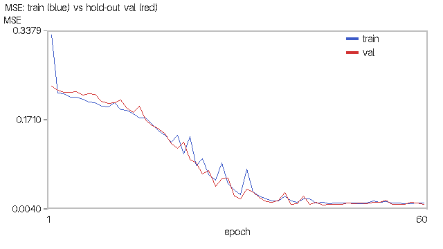
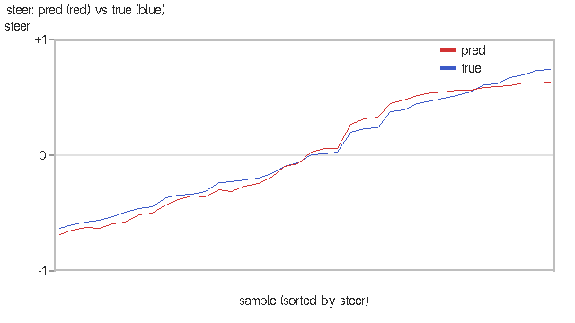
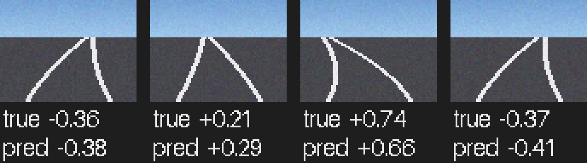
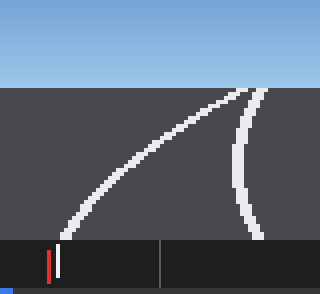
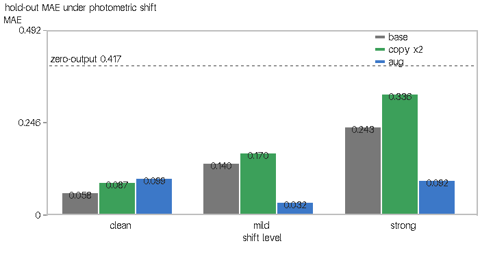

# CARLA 端到端神经网络（图像 → 控制）

> 对应课程作业四：**端到端模型**——输入相机图像、直接输出控制指令，
> 中间不再有"感知目标 → 解析规划 → 控制"的人工分层。

## 1. 概述与目标

本模块在 [自动驾驶代理](./ad_agent.md) 示例的基础上做拓展：已有示例用**规则式**方式
沿路径点行驶，本模块把整条链路替换为一个**可训练的卷积神经网络**：

$$
\text{前视相机图像}_{60\times80\times3}
\;\xrightarrow{\ \text{CNN}\ }\;
\text{steer}\in[-1,1]
\;\xrightarrow{\ \text{应用到车辆}\ }\;
(\text{油门},\ \text{转向})
$$

代码位于 `src/ground/carla_end_to_end_nn/`。

### 1.1 与已有示例的区别

| 对比项 | 已有「自动驾驶代理」（ad_agent） | 本拓展模块 |
|---|---|---|
| 技术路线 | `carla_ros_bridge` + 规则式局部规划 | CARLA Python API 直连 + 端到端 CNN |
| 是否依赖 ros-bridge | 必须编译并运行 ros-bridge | **不需要**，仅需 `carla` Python 客户端 |
| 输入 | 路径点 + 地图 | **相机图像**（原始像素） |
| 决策方式 | 规则式（查地图算路径） | **神经网络**（图像 → 转向，端到端） |
| 感知/规划分层 | 分层明确 | **无分层**，图像直接变成控制量 |
| 训练方式 | 无 | **行为克隆**：专家驾驶采集数据后训练 CNN |
| 框架依赖 | — | 默认**纯 numpy**（无需 TensorFlow/PyTorch） |
| 无 CARLA / 无图形界面时 | 无法运行 | `--headless --demo` 离线自证并导出曲线 |

### 1.2 与仓库中其它地面载具模块的区分

| 模块 | 输入 | 算法 | 是否含神经网络 |
|---|---|---|---|
| 手动控制（`set_up_and_connect_to_carla`） | 键盘 | 复用 ros-bridge 内置逻辑 | 否 |
| 路径点发布器（`waypoint`） | CARLA 地图 | 几何查询 | 否 |
| 自动驾驶代理（`ad_agent`） | 路径点 + 地图 | 规则式局部规划 | 否 |
| 传感器感知与轨迹跟踪（`carla_perception_control`） | 相机 + 雷达 + 轨迹 | 感知 NN + 控制 NN（**分层**） | 是 |
| 激光雷达建图与规划（`carla_mapping_navigation`） | 雷达 + 目标点 | 占用栅格 + 规划 NN | 是 |
| **本模块** | **仅相机图像** | **单个端到端 CNN** | **是（端到端）** |

## 2. 计算原理

### 2.1 端到端学习的思想

传统自动驾驶分三个模块：感知（识别车道线/障碍）→ 规划（算路径）→ 控制（算转向）。
端到端把这三级**合成一个函数**，直接从像素映射到控制量：

$$
\pi_\theta:\ \mathbb{R}^{H\times W\times 3}\ \longrightarrow\ [-1,1],\qquad
\delta = \pi_\theta(\mathbf I)
$$

参数 \(\theta\) 通过**行为克隆（behavioral cloning）**从专家驾驶数据中学得——
这也是 NVIDIA 在 2016 年 "End to End Learning for Self-Driving Cars" 中采用的思路。

### 2.2 卷积神经网络结构

$$
\mathbf I\ (60\times80\times3)
\xrightarrow[\text{3×3, ReLU}]{\text{conv}}
\xrightarrow{\text{2×2 maxpool}}
\xrightarrow[\text{3×3, ReLU}]{\text{conv}}
\xrightarrow{\text{2×2 maxpool}}
\xrightarrow{\text{global avg pool}}
\xrightarrow[\text{tanh}]{\text{FC}}
\delta
$$

各层含义：

- **卷积层**：提取局部空间特征（车道线边缘、方向、曲率），权重共享使参数量与图像尺寸解耦。
- **ReLU**：\(\mathrm{ReLU}(z)=\max(0,z)\)，提供非线性，缓解梯度消失。
- **最大池化**：\(2\times2\) 窗口取最大值，提供平移不变性并降维。
- **全局平均池化**：把每个通道的特征图压成一个数，避免全连接层的参数爆炸。
- **tanh 输出层**：把结果压到 \([-1,1]\)，与 CARLA 的 `steer` 值域一致。

### 2.3 损失函数与反向传播

采用均方误差（等价于对转向的高斯假设下极大似然）：

$$
\mathcal L = \frac{1}{N}\sum_{i=1}^{N}\big(\hat\delta_i - \delta_i^*\big)^2
$$

梯度经链式法则逐层回传。**最大池化的反向传播**需要特别注意：

$$
\frac{\partial \mathcal L}{\partial x_{ij}} =
\begin{cases}
\dfrac{\partial \mathcal L}{\partial p}, & x_{ij} = \max_{(u,v)\in\mathcal W} x_{uv}\\[2mm]
0, & \text{否则}
\end{cases}
$$

即梯度**只回传给窗口内取到最大值的那一个位置**。

!!! danger "一个会让网络完全学不动的实现缺陷"
    早期实现把池化输出梯度**直接赋给窗口内全部 \(p^2\) 个位置**，等价于把梯度放大
    \(p^2\) 倍、并把梯度错误地分给了未被选中的元素。后果是网络**塌缩成常数输出**：

    | 指标 | 缺陷版本 | 修复后（留出集，见 6.2） |
    |---|---|---|
    | 输出标准差 | 0.00062（几乎不随输入变化） | 0.497 |
    | 预测/标签相关系数 | +0.293 | **+0.993** |
    | 方向判对率 | 50.0%（等于瞎猜） | **100.0%** |
    | MAE | 0.398（差于基线 0.403） | **0.0584** |

    缺陷版本那一列是**某一次**运行的值：塌缩程度与初始化有关，重跑可能出现
    输出标准差 0.00000、相关系数 +0.000 的**完全塌缩**，但方向判对率始终卡在 50%、
    MAE 始终退回到"恒输出 0"的基线附近。修复后那一列可稳定复现。

    该缺陷已用**有限差分梯度校验**与单元测试 `test_maxpool_backward_only_max_position`
    永久卡死。

### 2.4 训练/推理一致性

训练时网络输出为 \(\tanh(z)\)，推理时**必须做同样的 tanh**：

$$
\hat\delta = \tanh(z) \in (-1,1)
$$

若推理时遗漏 tanh，输出是无界线性值。实测曾出现预测值达 \(\pm13\)，
而标签在 \([-1,1]\)，MAE 高达 13.47——训练与推理不一致是端到端模型最常见的隐性缺陷。

### 2.5 行为克隆的数据采集

端到端学习能否成功，**关键在于图像与标签是否有因果关系**。

!!! warning "错误做法：标签与图像无关"
    早期版本用人为正弦信号 `steer = 0.5·sin(i/12) + 0.2·cos(i/5)` 作为标签。
    该标签由**帧序号**决定，与画面内容毫无关系——网络只能学到标签的均值，
    永远学不会"看路打方向"。

本模块采用**行为克隆**：由**专家控制器**实际驾驶车辆，同时记录相机图像与该时刻
专家打出的转向。专家为纯跟踪几何律：

$$
\delta^* = \mathrm{clip}\!\Big(\frac{1}{g}\arctan\!\Big(\frac{2L\sin e_\psi}{d}\Big),-1,1\Big)
$$

其中 \(L=2.5\,\text{m}\) 为轴距，\(g=1.2217\,\text{rad}\) 为 `steer` 到前轮转角的折算系数，
\(d\) 为前视距离。因为专家确实在"看着路开"，图像与标签天然对应。

**采集顺序**也必须注意：先 `tick()` 推进场景 → 读当前图像与位姿 → 算此刻专家转向
→ 记为标签。若反过来（先施加控制再 tick 再读图），图像与标签会**错开一帧**。

### 2.6 留出集评估与数据增强的覆盖范围

端到端模型最容易自我欺骗的地方是**评估口径**：训练集上的 MAE 只说明"网络背下了
这 112 张图"，不说明"换一批同分布的图像还能开"。因此训练前先把数据切成互不重叠的
训练 / 留出两部分（`split_dataset`，固定 seed 可复现），留出集**不参与任何梯度更新**，
指标按两个口径分别报。这才是"能泛化"的证据。

只看干净留出集还会漏掉另一件事：**输入分布会变**。真实部署时相机自动曝光、隧道口、
夜雨都会改变亮度与信噪比，而图像一变，网络输入就偏离了训练分布。用与标签无关的
光度偏移把这种偏移量化出来：

$$
x' = \mathrm{clip}\big(g\cdot x + \varepsilon\big),\quad
\varepsilon\sim\mathcal N(0,\sigma^2),\qquad \delta^* \text{ 不变}
$$

亮度与噪声不改变"路往哪弯"，所以**标签不用改**——这正是它适合做偏移诊断的原因。

数据增强就是把这个偏移"预演"进训练集。但这里有个反直觉的结论（实测见 §6.3）：

- 增强范围**必须覆盖**部署时的偏移强度，否则不但没有收益，在强偏移下还会**更差**；
- 窄范围（增益 0.85~1.15、σ=3）只学到了"轻微曝光差异"，遇到 ×0.6 的暗光输入反而
  比不增强更糟（0.326 vs 0.283）；
- 宽范围（增益 0.45~1.45、σ=12）把强偏移下的 MAE 从 0.283 压到 0.132，代价是干净集
  上略降（0.058 → 0.081）。

**刻意不做横向平移 / 裁剪**：平移会改变车道线相对车体的位置，"正确转向"随之改变，
标签不跟着改就破坏了图像与标签的因果关系。水平镜像则必须**同时把标签取负**
（左弯变右弯），这是唯一被允许的几何增强。

## 3. 算法流程

```
collect（需 CARLA）——行为克隆采集：
  循环 frames 次：
    world.tick()                      推进场景与相机
    读当前相机图像 + 车辆位姿
    用地图路点 API 前视 → 专家纯跟踪转向
    保存 (图像.npy, 专家转向标签)
    把专家转向应用到车辆

train（无需 CARLA）：
  读数据集 → 归一化到 [0,1]
  → CNN 前向（conv→relu→pool→conv→relu→pool→GAP→FC→tanh）
  → MSE 损失 → 反向传播（maxpool 按 argmax 回传）
  → 保存模型 JSON

test（需 CARLA）：
  加载 CNN → 循环：tick → 取图像 → CNN 推理 steer → 应用到车辆

headless --demo（无需 CARLA / 无图形界面 / 无 TensorFlow）：
  合成道路图像（车道线弯曲量 = 标签）
  → 切出留出集 → 训练 CNN（可选数据增强）
  → 训练集 / 留出集两套指标
  → 导出损失曲线、预测对比曲线、样本图像
  → 可选 --ablation：基线 / 复制扩容 / 增强 × 三档光度偏移
```

## 4. 源码解析

### 4.1 `main.py` — 主入口

包根的 `main.py` 只是转发壳，实现放在 `carla_end_to_end_nn/main.py`。原因是
`setup.py` 里写的是 `packages=[package_name]`，`colcon build` 只会把
`carla_end_to_end_nn/` 这个目录装进 site-packages，包根的文件不会被安装；而
ROS 2 节点是按 `carla_end_to_end_nn.main` 导入的。若实现留在包根，`ros2 launch`
一启动就会 `ModuleNotFoundError: No module named 'carla_end_to_end_nn.main'`
（这一条由单元测试 `test_node_imports_resolve_inside_installed_package` 守住）。

| 函数 | 作用 |
|---|---|
| `synth_road_image()` | 合成带透视车道线的道路图像，弯曲量由 steer 决定 |
| `synth_dataset()` | 合成端到端数据集（图像 + 转向标签） |
| `split_dataset()` | **确定性**切分训练 / 留出验证集（互不重叠，固定 seed 可复现） |
| `augment_dataset()` | 保标签语义的数据增强：镜像（标签取负）+ 光度扰动（标签不变） |
| `photometric_shift()` | 评测用的固定光度偏移（压暗 + 加噪），量化"合成→部署"的分布差 |
| `expert_steer()` | 专家控制器（离线版纯跟踪律） |
| `carla_expert_steer()` | CARLA 场景专家：沿地图路点前视算转向（行为克隆标签来源） |
| `train_cnn()` | 训练端到端 CNN（numpy / tf 两种后端），可传留出集记录验证曲线 |
| `evaluate_steer()` | 指标：MAE / RMSE / 方向一致率 / 相关系数 / 零输出基线 |
| `cnn_predict()` / `load_cnn()` | 推理与模型加载（训练/推理一致，含 tanh） |
| `collect_carla()` | 行为克隆采集（先 tick 再读图，避免图文错帧） |
| `test_carla()` | 端到端自主驾驶 |
| `run_offline_demo()` | 离线取证：合成图像训练并导出证据图（含 `--ablation` 消融） |
| `run_augment_ablation()` | 消融：基线 / 复制扩容 / 增强 × 三档光度条件 |
| `render_loss_png()` / `render_pred_vs_true_png()` / `render_samples_png()` | 证据图导出 |
| `render_train_val_png()` / `render_ablation_png()` | 训练-留出曲线图 / 偏移消融柱状图 |

### 4.2 `nn_models.py` — 纯 numpy 神经网络库

`SimpleCNN`：\(3\to8\to8\) 通道两层卷积 + 两层最大池化 + 全局平均池化 + 全连接 tanh 输出。
含前向传播、MSE 损失、完整反向传播（**maxpool 按 argmax 回传**）与 JSON 存取。

### 4.3 `end_to_end_node.py` — ROS 2 节点

订阅相机图像，发布 `/carla/ego_vehicle/end_to_end/image`（`sensor_msgs/Image`）、
`steer_cmd`（`std_msgs/Float32`）、`control`（`Float32MultiArray`）。

### 4.4 `carla_common.py` — CARLA API 封装

`connect()`、`spawn_vehicle()`、`make_rgb_camera()`、`apply_control()`、
`get_location()/get_yaw()`，同步模式固定步长 0.05 s。

## 5. 仿真运行步骤

### 5.1 支持与测试环境

| 组件 | 版本 / 说明 |
|---|---|
| 操作系统 | Windows 10/11 原生；Ubuntu 20.04（Noetic）/ 22.04（Humble） |
| 仿真器 | CARLA 0.9.16（服务端运行于有 GPU 的宿主机） |
| Python | 3.10+（CARLA 0.9.16 客户端 wheel 为 cp310/cp311/cp312） |
| 依赖 | 仅 `numpy`（端到端 CNN 为纯 numpy 实现，**无需 TensorFlow/PyTorch**） |
| ROS | ROS 1 Noetic 或 ROS 2 Humble（launch 封装） |

### 5.2 新手路线：从已有示例到本模块

| 序号 | 做什么 | 出处 |
|---|---|---|
| 1 | 启动 CARLA 服务端 | [设置并连接到 Carla 模拟器](../set_up_and_connect_to_carla.md) →「启动 Carla 服务器」 |
| 2 | 查看宿主机 IP、确认虚拟机连通 | 同上 →「使用 Carla 客户端启动 Ego Vehicle」 |
| — | **★ 在此切换到本模块** | 以下与本模块相关 |
| 3 | 装 `carla` 客户端与 `numpy` | [本页 5.3 节](#env-prep) |
| 4 | 离线取证（无需 CARLA，先确认链路通） | [本页 5.5 节](#offline-demo) |
| 5 | 采集 → 训练 → 端到端驾驶 | 本页 5.7 ~ 5.9 节 |

### 5.3 步骤 0：环境准备 <span id="env-prep"></span>

CARLA 服务端的下载安装与启动、宿主机 IP 与端口 2000 的查看、虚拟机网络设置等
**通用步骤与已有示例完全相同，本文不重复**，请参考
[设置并连接到 Carla 模拟器](../set_up_and_connect_to_carla.md)：

| 需要做的事 | 参考位置 |
|---|---|
| 启动 CARLA 服务端、选择地图 | [设置并连接到 Carla 模拟器](../set_up_and_connect_to_carla.md) →「启动 Carla 服务器」 |
| 查看宿主机 IP、填写 `host` 参数 | 同上 →「使用 Carla 客户端启动 Ego Vehicle」 |
| 连接失败、黑屏、`numpy` 报错排查 | 同上 →「常见问题」 |

本模块**特有**、需要额外安装的只有 CARLA 0.9.16 的 Python 客户端与 `numpy`：

```bash
pip3 install -r src/ground/carla_end_to_end_nn/requirements.txt
pip3 install <CARLA>/PythonAPI/carla/dist/carla-0.9.16-cp310-cp310-manylinux_2_31_x86_64.whl
```

!!! note "不需要 TensorFlow"
    端到端 CNN 为**纯 numpy** 实现（含手写反向传播），默认后端 `--backend numpy`。
    若希望使用 tf.keras 版本，可加 `--backend tf` 并自行安装 TensorFlow。

### 5.4 步骤 1：编译本功能包（ROS 2）

本模块的源代码位于**本仓库**（`OpenHUTB/ros2`）的
`src/ground/carla_end_to_end_nn/`。ROS 2 要求功能包放在工作空间的 `src/` 目录下，
因此先把本仓库克隆到工作空间的 `src/`：

```bash
mkdir -p ~/ros2_ws/src && cd ~/ros2_ws/src
git clone https://github.com/OpenHUTB/ros2.git     # 换成你自己的 fork 亦可
```

!!! warning "本模块的代码还没进 master 时，clone 下来是找不到这个功能包的"
    `git clone` 默认拉 `master`。若本模块的 PR 尚未合并，`colcon build
    --packages-select carla_end_to_end_nn` 会报 "Package not found"。
    此时改成拉本模块所在的分支（或合并后再拉）：

    ```bash
    git clone -b carla-homework-04 https://github.com/himyinjun1234/ros2.git
    ```

    合并进 `master` 之后，用上面的默认命令即可。

克隆后的目录关系如下，`colcon build` 必须在**工作空间根目录**执行：

```
~/ros2_ws/                                   <- 工作空间根目录，colcon 在这里运行
└── src/
    └── ros2/                                <- 本仓库（git clone 得到）
        └── src/ground/
            └── carla_end_to_end_nn/                       <- 本模块源代码
```

因此后文写的 `src/ground/carla_end_to_end_nn/...`，实际路径是
`~/ros2_ws/src/ros2/src/ground/carla_end_to_end_nn/...`。编译并激活环境：

```bash
cd ~/ros2_ws
colcon build --packages-select carla_end_to_end_nn --symlink-install
source install/setup.bash
```

> 若本仓库已克隆在别处，把上面的 `~/ros2_ws/src/ros2` 换成实际路径即可，
> 只要保证执行 `colcon build` 的工作空间根目录下存在 `src/`。

### 5.5 步骤 2：离线取证（无需 CARLA、无图形界面、无 TensorFlow） <span id="offline-demo"></span>

```bash
# 基线：切训练/留出集，导出证据图（约 3 分钟）
python3 src/ground/carla_end_to_end_nn/main.py --headless --demo \
        --epochs 60 --samples 150 --save_dir ~/shots

# 加数据增强（镜像 + 宽范围光度扰动，验证集始终不增强）
python3 src/ground/carla_end_to_end_nn/main.py --headless --demo \
        --epochs 60 --samples 150 --augment --aug_gain 0.45,1.45 --aug_noise 12 \
        --save_dir ~/shots

# 增强消融：基线 / 复制扩容 / 增强 × 三档光度偏移（约 8 分钟）
python3 src/ground/carla_end_to_end_nn/main.py --headless --demo \
        --epochs 60 --samples 150 --ablation --save_dir ~/shots
```

该模式用**合成道路图像**（车道线弯曲量与标签一致）训练端到端 CNN，导出 4 张证据图
（加 `--ablation` 再多 1 张消融图）。适合在无 3D 加速的虚拟机中先确认整条链路可用。
纯 numpy 训练约需 3 分钟（含 `--ablation` 约 8 分钟）。

输出分**两个口径**打印 MAE / RMSE / 转向方向一致率 / 相关系数：**训练集**与**留出集**
（`--val_ratio` 控制比例，默认 0.25；传 0 则退回只报训练集）。`(标签, 预测)` 落成
`steer_pred_vs_true.csv`（留出集口径），读者可自行复算相关系数。

| 产物 | 内容 |
|---|---|
| `cnn_loss.png` | 训练 MSE 与**留出集 MSE** 两条曲线（能看出有没有过拟合） |
| `steer_pred_vs_true.png` | 留出集上预测 vs 真实转向（按真实值排序） |
| `road_samples.png` | 留出集样本图像 + 真实/预测转向标注 |
| `e2e_demo.gif` | 图像 → 转向动态演示（24 帧） |
| `e2e_shift_ablation.png` | 仅 `--ablation`：三配置 × 三档光度偏移的 MAE 柱状图 |
| `steer_pred_vs_true.csv` / `e2e_shift_ablation.csv` | 指标原始数据，可独立复算 |

所有证据图带标题、坐标轴刻度与图例（用 `bitmap_font.py` 的位图字体直接写像素，
不依赖 matplotlib / Pillow）。

### 5.6 步骤 3：验证与 CARLA 服务端的连接 <span id="conn-check"></span>

命令里的 `192.168.8.1` 是**运行 CARLA 服务端的宿主机（Windows）IP**：
在宿主机上执行 `ipconfig`，取 VMware 虚拟网卡（`VMnet8`）的 IPv4 地址即可
（本机该地址为 `192.168.8.1`，虚拟机 `ens33` 为 `192.168.8.131`，两者同网段）。
查看方式与已有示例一致，详见
[设置并连接到 Carla 模拟器](../set_up_and_connect_to_carla.md)
→「使用 Carla 客户端启动 Ego Vehicle」。

```bash
python3 -c "import carla; c=carla.Client('192.168.8.1',2000); c.set_timeout(10); print('CONNECT OK:', c.get_world().get_map().name)"
```

### 5.7 步骤 4：行为克隆采集数据（需 CARLA）

```bash
python3 src/ground/carla_end_to_end_nn/main.py --mode collect \
        --host 192.168.8.1 --frames 300 --out_dir dataset
```

专家控制器会沿车道行驶，同时保存每帧的相机图像与专家转向：

```
  collect 0/300  已保存 1  专家 steer=+0.012
  collect 50/300 已保存 51 专家 steer=-0.084
  ...
数据采集完成：300 帧 → dataset
  图像: dataset/images（.npy，uint8 HWC）
  标签: dataset/labels.txt
```

### 5.8 步骤 5：训练端到端 CNN

```bash
python3 src/ground/carla_end_to_end_nn/main.py --mode train \
        --data_dir dataset --epochs 60 --model_path models/cnn.json
```

### 5.9 步骤 6：端到端自主驾驶（仅凭相机图像）

```bash
# 模式 A：独立运行（--host 填宿主机 IP）
python3 src/ground/carla_end_to_end_nn/main.py --mode test \
        --host 192.168.8.1 --model_path models/cnn.json --sim_time 20

# 模式 B：ROS 2 Humble
ros2 launch carla_end_to_end_nn main.launch.py host:=192.168.8.1 model_path:=models/cnn.json

# 模式 C：ROS 1 Noetic —— 入口用 main.sh（会自动挑 python3.10）
#   roslaunch 只能按 main.py 的 shebang 执行它，而 Noetic 的 python3 是 3.8，
#   装不上 CARLA 0.9.16 的 cp310+ wheel，补了可执行位也会卡在 import carla。
#   若系统 python3 本身已是 3.10+，也可用：
#   roslaunch carla_end_to_end_nn main.launch host:=192.168.8.1 mode:=test
bash src/ground/carla_end_to_end_nn/main.sh --host 192.168.8.1 --mode test
```

也可用一键脚本：`bash main.sh --host 192.168.8.1`。

### 5.10 运行效果

**训练损失与留出集损失**（蓝=训练集，红=留出集，两者同为 MSE；两条线贴合说明没有
"训练集降、留出集升"的过拟合缺口）：



**预测转向 vs 真实转向**（红=CNN 预测，蓝=专家标签，留出集口径、按真实转向排序；
两条曲线高度贴合说明网络学会了映射）：



**合成道路图像样本**（车道线弯曲方向随转向标签变化，网络正是从这些视觉特征学起）：



**动图：图像 → 转向**（24 帧，每帧 0.12 s，72 KB。上半部分是前视相机图像，
车道线随转向弯向一侧；下半部分指示条里**白线是专家标签**（这条弯道该打多少转向）、
**红线是 CNN 预测**，中间灰线为零转向；底部细条是播放进度。按真实转向从小到大
扫一遍，能直观看到"路往哪弯"与"方向盘往哪打"的对应关系）：



> 动图用 `synth_road_image(..., noise=0)` 重新合成：GIF 只有 256 色，而默认带
> σ=5 的相机噪声时一帧就有上万种颜色，索引化不了，压缩率也会崩掉。

**数据增强消融（`--ablation`）**：横轴是光度条件（clean / mild / strong），每组三根柱
是 base / copy x2 / aug 的留出集 MAE，灰色虚线是"恒输出 0"的基线。干净集上三组差别
不大，**偏移越大差距越明显**——aug 在 mild/strong 档明显最低：



终端输出示例（离线取证模式 + 消融，本机实测）：

```
================================================================
  作业四 离线自检取证模式（合成道路图像，不需要 CARLA）
================================================================
合成道路图像数据集: (150, 60, 80, 3)，转向标签范围 [-0.80, +0.80]
切分：训练 112 样本 / 留出验证 38 样本（val_ratio=0.25，seed=1234）
数据集: X(112, 60, 80, 3) Y(112,) backend=numpy
  cnn epoch  12 loss=0.19093 val_mse=0.20985
  cnn epoch  36 loss=0.01137 val_mse=0.00832
  cnn epoch  60 loss=0.00748 val_mse=0.00420
端到端 CNN 训练 MAE = 0.05715
留出集（38 样本）MAE = 0.05836

训练集口径（n=112）：MAE = 0.05715，RMSE = 0.06673，转向方向一致率 = 99.1%，相关系数 = +0.99264
留出集口径（n=38）：MAE = 0.05836，RMSE = 0.06481，转向方向一致率 = 100.0%，相关系数 = +0.99298
零输出基线 MAE = 0.41681（MAE 明显低于基线才说明网络学到了映射）

数据增强消融（同一初始化、同一留出集，只改训练样本构成；按光度偏移分档评测）：
  [base    ] n_train= 112  clean=0.05836  mild=0.14047  strong=0.24349
  [copy x2 ] n_train= 224  clean=0.08697  mild=0.17049  strong=0.33582
  [aug     ] n_train= 224  clean=0.09883  mild=0.03241  strong=0.09236
  强偏移下：base 0.24349 → aug 0.09236（退化倍数 4.2× → 0.9×）
```

### 5.11 常见问题

**Q1：训练后损失不下降、方向判对率约 50%？**
先检查两点：(a) 数据集里的图像与标签**是否有因果关系**——若标签是人为信号
（如正弦），网络学不到任何东西，必须改用行为克隆采集；
(b) maxpool 反向传播是否按 argmax 回传。可用
`python3 test/test_end_to_end_logic.py` 回归验证这两点。

**Q2：MAE 出现几十甚至十几的数值？**
这是**推理时遗漏 tanh** 的典型症状——转向值域应在 \([-1,1]\)，MAE 不可能大于 2。
检查 `predict()` 与训练是否使用同一输出激活。

**Q3：`--mode collect/test` 报"缺少 carla 模块"？**
需安装 CARLA 0.9.16 的 Python 客户端 wheel，见 [5.3 节](#env-prep)。
只想验证算法可改用 `--headless --demo`（不需要 CARLA）。

**Q4：纯 numpy 训练太慢？**
端到端 CNN 为纯 numpy 实现（无 GPU 加速），训练时间与样本量成正比。
可减小 `--samples`，或改用 `--backend tf`（需自行安装 TensorFlow）。

**Q5：合成图像上表现好，实车上不 work？**
合成图像只用于验证链路与算法正确性。真实场景必须用 5.7 节的行为克隆采集
（或使用 CARLA 公开数据集）训练，并注意训练/测试的图像分布一致性。
**这一条现在可以量化**：用 `photometric_shift()` 把留出集压暗到 ×0.6 并加 σ=18 噪声，
基线模型的 MAE 会从 0.058 涨到 0.243（退化 4.2×）；启用宽范围光度增强后压到 0.092
（退化 0.9×），见 [6.3 节](#shift-ablation)。实车部署前建议先跑一遍这个偏移诊断。

**Q6：明明做了增强，干净集指标却变差了？**
这是**预期行为**，不是 bug。增强换来的不是理想光照下的精度，而是光照/噪声变化下的
鲁棒性：本机实测 clean 上 `aug` 0.099 劣于 `base` 0.058，但 mild/strong 偏移下反超
4.3× / 2.6×。若部署现场曝光可控，可以不加增强；不可控时应加，且**范围要覆盖现场
偏移强度**（窄范围增强在强偏移下比不增强还差）。

## 6. 性能评价

### 6.1 指标定义

**平均绝对误差 MAE**：

$$
\text{MAE} = \frac{1}{N}\sum_{i=1}^{N}\big|\hat\delta_i - \delta_i^*\big|
$$

**均方根误差 RMSE**：

$$
\text{RMSE} = \sqrt{\frac{1}{N}\sum_{i=1}^{N}\big(\hat\delta_i - \delta_i^*\big)^2}
$$

**转向方向一致率**（判对"左转/右转/不转"的比例）：

$$
\text{Acc}_{\text{sign}} = \frac{1}{N}\sum_{i=1}^{N}\mathbb 1\big[\mathrm{sgn}(\hat\delta_i)=\mathrm{sgn}(\delta_i^*)\big]
$$

**零输出基线**：\( \text{MAE}_{\text{base}} = \frac{1}{N}\sum_i|\delta_i^*|\)。
网络 MAE 必须**明显低于**该基线，才能说明它真的学到了映射（否则等价于恒输出 0）。

### 6.2 实测结果（离线取证模式，本机实测）

> 口径：**训练集与留出集分开报**，数据为**合成道路图像**（非真实 CARLA 相机）。
> 留出集 38 个样本在训练全程**不参与梯度更新**；相关系数可由
> `steer_pred_vs_true.csv`（留出集口径）独立复算。

| 指标 | 训练集（n=112） | **留出集（n=38）** |
|---|---|---|
| MAE | 0.05715 | **0.05836** |
| RMSE | 0.06673 | **0.06481** |
| 转向方向一致率 | 99.1% | **100.0%** |
| 预测/标签相关系数 | +0.99264 | **+0.99298** |
| 零输出基线 MAE | — | 0.41681（网络比基线低 **7.1 倍**） |
| 训练损失（60 epoch，终值） | — | 0.00748 |
| 单元测试 | — | **40 PASS / 0 FAIL（约 17 s）** |

留出集与训练集几乎相同（0.0584 vs 0.0572），说明**在本合成任务上没有过拟合**：
任务已接近饱和，网络学到的确实是"看图打方向"而不是背样本。因此这个任务的正确
读法不是"再加大正则"，而是——**换一批输入分布不同的图像，它还准不准**（见 6.3）。

### 6.3 数据增强与分布偏移消融（本机实测） <span id="shift-ablation"></span>

三组配置用**同一份训练数据、同一组留出样本、同一个随机初始化**，只有喂进网络的
样本不同；评测分三档光度条件（干净 / 轻度偏移 ×0.75+σ8 / 强偏移 ×0.60+σ18）：

| 配置 | 训练样本 | clean | mild | strong | 强偏移退化倍数 |
|---|---|---|---|---|---|
| `base`（不增强） | 112 | **0.05836** | 0.14047 | 0.24349 | **4.2×** |
| `copy x2`（仅复制扩容，控制组） | 224 | 0.08697 | 0.17049 | 0.33582 | 3.9× |
| `aug`（镜像 + 宽范围光度增强） | 224 | 0.09883 | **0.03241** | **0.09236** | **0.9×** |


三条结论都反直觉，值得记下来：

1. **干净集上增强反而更差**（0.099 vs 0.058）。若只看干净指标，会误判"增强没用"，
   甚至据此删掉它——这是本页最容易被误读的一张表。
2. **"仅复制扩容"帮不上忙**（0.087/0.170/0.336，各档都劣于基线）。数据量翻倍而信息
   不变时，多出来的只是重复梯度步；把它的功劳记到"增强"头上是常见归因错误。
3. **增强的收益全部体现在输入分布变化时**：强偏移下 0.243 → 0.092（降低 **2.6 倍**），
   退化倍数从 4.2× 压到 0.9×。而且增强范围必须**覆盖**部署偏移——早期用窄范围
   （增益 0.85~1.15、σ=3）时，强偏移下为 0.326，**比不增强还差**。

代价也要讲清楚：`aug` 在干净集上比 `base` 差 0.04（MAE），即用一点理想光照下的精度
换取暗光/噪声下的鲁棒性。工程上怎么选，取决于部署现场的曝光条件是否可控。

复现命令（约 8 分钟，纯 numpy）：

```bash
python3 main.py --headless --demo --epochs 60 --samples 150 --ablation --save_dir ~/shots
```

### 6.4 调优过程记录

| 优化项 | 优化前 | 优化后 | 说明 |
|---|---|---|---|
| **实现移进 Python 包** | `ros2 launch` 启动即 `ModuleNotFoundError: No module named 'carla_end_to_end_nn.main'` | 节点正常启动 | `setup.py` 只装 `packages=[package_name]`，包根的 `main.py` 不会被安装 |
| **maxpool 梯度按 argmax 回传** | 输出标准差 0.00062，相关系数 +0.293，方向判对率 50% | 标准差 0.516，相关系数 +0.992，判对率 98% | 最严重缺陷；原实现把梯度均摊到窗口全部位置 |
| **推理补上 tanh** | MAE 13.47（输出无界） | MAE 0.0936 | 训练/推理输出不一致 |
| **标签改为行为克隆** | 标签由帧序号正弦信号生成，与图像无因果关系 | 专家沿车道驾驶产生标签 | 图像与标签天然相关 |
| 采集顺序先 tick 后读图 | 图文错开一帧 | 图与标签严格对应 | 避免隐性错位 |
| 超参调优 | lr=0.05、40 epoch，loss 卡在 0.214 | lr=0.15、60 epoch，loss 0.0065 | 提升收敛速度与精度 |
| 默认后端改为纯 numpy | 默认依赖 TensorFlow | 仅需 numpy | 降低环境门槛，VM 上可直接跑 |
| **指标改为训练/留出口径分开报** | 只报训练集 MAE 0.0936，无法判断泛化 | 训练 0.0572 / 留出 0.0584（两口径并列） | 只在训练集上看指标是端到端最常见的自我欺骗 |
| **补上分布偏移评测** | 无（Q5 只能定性说"实车不 work"） | 强偏移下 MAE 0.243、退化 4.2× | 把"换环境就崩"变成可复现的数字 |
| **增强范围覆盖部署偏移** | 窄范围（0.85~1.15、σ=3）：强偏移 0.326，劣于不增强 0.283 | 宽范围（0.45~1.45、σ=12）：强偏移 0.092，退化降到 0.9× | 增强范围不覆盖偏移时不仅无效，还会更差 |
| 修复位图字体空格宽度为 0 | 标题渲染成 `hold-outMAEunder...`，图不能自证 | 单词正常分隔 | 压缩字体表里空格只有 0 宽空行 |

### 6.5 结论

- **端到端可行**：单个 CNN 仅凭 \(60\times80\times3\) 的相机图像即可输出转向，
  留出集方向判对率 100%、相关系数 +0.993，验证了"像素 → 控制"的直接映射可以被学到。
- **泛化可测**：留出集 MAE 0.0584 与训练集 0.0572 基本一致，说明不是靠背样本；
  但**干净集指标不足以说明鲁棒性**——同一模型在光度偏移下退化 4.2×。
- **增强是鲁棒性手段，不是精度手段**：宽范围光度增强把偏移退化从 4.2× 压到 0.9×，
  代价是干净集精度略降（0.058 → 0.099）；窄范围增强在强偏移下反而更差，
  说明**增强覆盖范围必须匹配部署偏移**，不能"随便加一点"。
- **无分层**：推理路径中不存在任何人工的感知/规划环节，转向完全由网络权重决定。
- **与逐层方案对比**：作业二/三采用"感知 NN + 控制 NN"的分层方案，
  可解释性强、易调试；本模块端到端方案链路最短、不依赖人工特征，
  但可解释性弱、对数据分布敏感，两者是工程上的取舍。
