# CARLA 课程作业合集（作业一~五）

> 本页把作业一~五的说明合并到一处，方便按顺序通读：从物理仿真与键盘控制，到感知/控制
> 神经网络、建图与规划、端到端 CNN，最后是四份作业的统一调度与性能评价。
> 每份作业的实现仍在各自的功能包里（`src/ground/` 下），页面里的命令都按仓库根目录书写。

## 作业清单 {#hw-index}

| 作业 | 内容 | 功能包 |
|---|---|---|
| [作业一 地面载具物理仿真与键盘运动控制](#hw1) | CARLA Python API 直连，键盘手动驾驶 + 无窗口取证 + ROS 2/ROS 1 节点 | `carla_keyboard_control` |
| [作业二 传感器感知与给定轨迹跟踪（神经网络版）](#hw2) | RGB/深度/激光雷达 → 感知 NN；状态 → 控制 NN；给定轨迹跟踪 | `carla_perception_control` |
| [作业三 激光雷达建图与神经网络规划导航](#hw3) | 激光雷达占用栅格建图 + 神经网络规划导航 | `carla_mapping_navigation` |
| [作业四 端到端神经网络（图像 → 控制）](#hw4) | 相机图像 → 纯 numpy CNN → 转向（行为克隆，离线取证） | `carla_end_to_end_nn` |
| [作业五 作业综合整合与性能评价](#hw5) | 四份作业统一调度与量化性能评价（10 项指标、对比图） | `carla_benchmark_suite` |

> 作业五是把前四份作业统一调度并量化评价的入口：`--benchmark` 一条命令即可复现全部
> 10 项指标，详见第五部分。


## 作业一 地面载具物理仿真与键盘运动控制 {#hw1}

> 对应课程任务（1）：*对人形机器人/肌肉骨骼人/车辆/水下机器人/无人机进行物理仿真，
> 通过键盘对机器人进行运动控制*。本模块面向**地面载具（车辆）**。

### 作业一 · 1. 概述与目标

本模块在 **CARLA 0.9.16** 中加载地面载具（`vehicle.tesla.model3`）并进行物理仿真，
通过键盘实时控制车辆运动，并在窗口内实时渲染车头前视 RGB 相机画面与运行状态 HUD。

#### 作业一 · 核心任务目标

1. **车辆物理仿真**：由 CARLA 的 UE4 物理引擎解算车辆纵向动力学与阿克曼转向几何。
2. **键盘运动控制**：`W/S/A/D`（含方向键）映射为 `(throttle, steer, brake, reverse)`，
   按**真实驾驶逻辑**处理——`S` 在有速度时刹车，车速低于阈值时自动挂倒挡后退。
3. **感知画面回显**：车头 RGB 相机数据经 BGRA→RGB 重排后显示，并叠加位置/速度/控制量 HUD。
4. **一键启动**：提供课程约定的主入口 `main.py` / `main.sh` / `main.bat`，
   并同时提供 ROS 2 Humble（`main.launch.py`）与 ROS 1 Noetic（`main.launch`）的 launch 封装。

#### 作业一 · 与已有「手动控制」示例的区别

本仓库已有基于 **carla-ros-bridge** 的
[手动控制示例](../set_up_and_connect_to_carla.md)（在车辆上按 `B` 切换手动驾驶）。本模块的差异：

| 对比项 | 已有「手动控制」示例 | 本模块 `carla_keyboard_control` |
|---|---|---|
| 技术路线 | `carla_ros_bridge` + 车辆**内置**手动驾驶 | CARLA Python API **直连** + 自研键盘控制节点 |
| 是否依赖 ros-bridge | 必须编译并运行 ros-bridge（catkin/colcon） | **不需要** ros-bridge，仅需 `carla` Python 客户端 |
| 如何进入控制 | 车辆生成后按 `B` 切换到内置手动驾驶 | 程序启动即进入自研控制回路 |
| 控制信号来源 | ros-bridge 的 `carla_manual_control` 包 | 键盘 → `carla.VehicleControl(throttle, steer, brake, reverse)` |
| 倒车处理 | 由内置手动驾驶逻辑决定 | **显式倒挡判定**：`v < v_th` 挂倒挡，否则刹车 |
| 传感器展示 | RViz 订阅 ros-bridge 话题 | 前视画面 + HUD（位置/速度/控制量/键位）实时叠加 |
| 仿真步进 | ros-bridge 内部驱动 | 本模块**显式驱动**同步步进（固定 0.05 s），保证与传感器严格对齐 |
| 代码定位 | CARLA ROS 桥接功能的演示 | 后续感知 / 规划 / 端到端作业的**自车控制基座** |

##### 作业一 · 与其它已合并同类模块的区分

| 模块 | 相同点 | 本模块的不同点 |
|---|---|---|
| [`set_up_and_connect_to_carla`](../set_up_and_connect_to_carla.md) | 都在 CARLA 中控制车辆 | 不依赖 ros-bridge，控制逻辑自研，含倒挡判定 |
| `src/water/rov_mujoco` | 同为「物理仿真 + 键盘运动控制」作业 | 对象为**地面载具**（车辆动力学/阿克曼转向），非水下 6-DOF |
| `src/air/drone_ros_teleop` | 同为键盘遥控 | 本模块做**车辆物理仿真**（真实动力学解算），非无人机消息解耦 |
| `src/air/octree_uav_3d_pathfinding` | 都在虚拟机 + 宿主机模拟器架构下运行 | 本模块**不重复罗列虚拟机配置步骤**，只提供跳转链接 |

!!! note "配置步骤不重复（老师评审要求）"
    CARLA 服务端的启动方式、宿主机 IP 与端口 2000 的查看、虚拟机网络（NAT/桥接）设置、
    `numpy` 版本兼容等**通用配置步骤**，请直接参考
    [设置并连接到 Carla 模拟器](../set_up_and_connect_to_carla.md)。本文档仅描述本模块特有内容。

---

### 作业一 · 2. 计算原理

#### 作业一 · 2.1 车辆纵向动力学

车辆沿车头方向的一维纵向运动可由下式近似描述：

$$
\dot{v} = \frac{\tau \cdot F_{\max} - c_d v^2 - F_f - b \cdot B_{\max}}{m}
$$

其中 \(\tau \in [0,1]\) 为油门，\(B_{\max}\) 为刹车力上限，\(b \in [0,1]\) 为刹车量，
\(F_{\max}\) 为最大驱动力，\(c_d\) 为风阻系数，\(F_f\) 为滚动摩擦阻力，\(m\) 为车辆质量。
CARLA 在 UE4 中按该动力学逐步积分。

倒车时令 `reverse = True`，驱动力方向反向：

$$
\dot{v} = \frac{-\tau \cdot F_{\max} - c_d v^2 - F_f}{m}, \qquad v < 0
$$

#### 作业一 · 2.2 阿克曼转向几何

转向量 \(s \in [-1,1]\) 映射为前轮转角 \(\delta = s \cdot \delta_{\max}\)。前后轴距 \(L\) 时，
车辆航向角变化率满足自行车模型：

$$
\dot{\psi} = \frac{v}{L} \tan\delta
$$

#### 作业一 · 2.3 同步步进与时间对齐

打开同步模式并固定步长，保证控制量与传感器帧严格对齐：

$$
t_{k+1} = t_k + \Delta t, \qquad \Delta t = 0.05\,\text{s}
$$

#### 作业一 · 2.4 倒挡判定（真实驾驶逻辑）

设当前速率 \(v\)、倒挡阈值 \(v_{\text{th}} = 0.5\,\text{m/s}\)，则按 `S` 时：

$$
(\text{throttle}, \text{brake}, \text{reverse}) =
\begin{cases}
(0.8\tau_{\max},\ 0,\ \text{True}), & v < v_{\text{th}} \quad \text{（挂倒挡后退）}\\
(0,\ b_{\max},\ \text{False}), & v \ge v_{\text{th}} \quad \text{（刹车减速）}
\end{cases}
$$

---

### 作业一 · 3. 算法流程

```text
主入口 main.py
  │
  ├── 独立模式（默认）
  │     连接 CARLA → load_world(Town05) → 开同步模式
  │     → spawn 自车 vehicle.tesla.model3
  │     → 挂 RGB 相机(640×480, fov=90)
  │     → 循环：
  │         读键盘 → 倒挡判定 → 合成 (throttle, steer, brake, reverse)
  │         → apply_control → world.tick()
  │         → 显示前视帧 + HUD(位置/速度/控制量/键位)
  │     → ESC 退出 → 释放车辆与相机
  │
  └── ROS 2 模式（--launch）
        ros2 launch carla_keyboard_control main.launch.py
          ├── carla_control_node     : 连接/生成/同步步进/广播 图像·里程计·速度
          └── keyboard_teleop_node   : 读键盘 → 发布 vehicle_control_cmd
```

---

### 作业一 · 4. 源码解析

#### 作业一 · 4.1 `carla_common.py` — CARLA API 公共封装

| 函数 | 作用 |
|---|---|
| `connect()` | `carla.Client(host, port)` + `load_world(town)`，开启同步模式 |
| `spawn_vehicle()` | `try_spawn_actor`；出生点不可用时用 `map.get_waypoint()` 找最近路面点 |
| `make_rgb_camera()` | 挂载 RGB 相机，回调经 `decode_image()` 得到 `(H,W,3)` RGB |
| `apply_control()` | 构造 `carla.VehicleControl`，各分量 `np.clip` 到合法区间 |
| `set_spectator_follow()` | 每帧把旁观镜头摆到自车后方，便于录屏 |

相机原始数据为 BGRA，需重排通道：

```python
def decode_image(image):
    arr = np.frombuffer(image.raw_data, dtype=np.uint8)
    arr = arr.reshape(image.height, image.width, 4)
    return arr[:, :, :3][:, :, ::-1].copy()      # BGRA → RGB
```

#### 作业一 · 4.2 `carla_common.compose_control()` — 控制合成（唯一实现）

控制合成是**纯函数**，集中在 `carla_common.py` 中，由 standalone 主入口
（`main.py`）与 ROS 2 键盘节点（`keyboard_teleop_node.py`）**共同调用**，
从而保证两条运行路径的控制行为完全一致：

```python
def compose_control(keys, speed, throttle_max=0.6, brake_max=0.8,
                    steer_max=0.6, rev_threshold=0.5):
    throttle = brake = 0.0
    reverse = False
    if keys["fwd"]:
        throttle = throttle_max
    elif keys["rev"]:
        if speed < rev_threshold:          # 低速 → 挂倒挡
            reverse, throttle = True, throttle_max * 0.8
        else:                              # 有速度 → 刹车
            brake = brake_max
    ...
    return throttle, steer, brake, reverse
```

`main.py` 只做参数适配（把 `--throttle_max` 等命令行值传进去）：

```python
throttle, steer, brake, reverse = compose_control(keys, speed, args)
cc.apply_control(vehicle, throttle=throttle, steer=steer,
                 brake=brake, reverse=reverse)
world.tick()
```

#### 作业一 · 4.3 `carla_control_node.py` — ROS 2 仿真节点

订阅 `/carla/ego_vehicle/vehicle_control_cmd`，在**定时器**中驱动 `world.tick()`，
避免键盘读取阻塞仿真步进；同时把相机帧发布为 `sensor_msgs/Image`：

```python
def _on_tick(self):
    self.world.tick()                          # 物理步进（固定 0.05 s）
    img.encoding = 'rgb8'
    img.data = np.ascontiguousarray(self._latest_frame).tobytes()
    self.pub_image.publish(img)
```

#### 作业一 · 4.4 `keyboard_teleop_node.py` — 键盘遥控节点

提供两种键盘后端，自动按环境选择：

- **pygame 后端**：有图形界面（或 Windows 原生）时逐帧直读按键状态
  （`pygame.key.get_pressed()`）。
- **终端后端**：无图形环境（虚拟机 / SSH）时用 `termios` 原始模式读单键并按点动下发。

!!! note "为什么 `termios` 要在函数内部导入"
    `termios` / `tty` 是 **POSIX 专属**模块，Windows 上没有。ROS 2 原生支持 Windows，
    因此这两个模块只在 `_terminal_loop()` 内部导入；若写在文件顶层，整个包在 Windows
    上将无法导入，`colcon build` 也会失败。Windows 下会自动选择 pygame 后端，
    也可显式 `--pygame`。

#### 作业一 · 4.5 单元测试

`test/test_control_logic.py` 直接测试 `carla_common.compose_control` 这一
**真实被两条路径共用**的实现，因此断言的行为就是实际运行的行为：

```bash
python3 test/test_control_logic.py          # 自带运行器，无需 pytest
python3 -m pytest test/test_control_logic.py -v
```

覆盖点包括：低速挂倒挡 / 有速度刹车、阈值边界与可配置性、油门与刹车互斥、
转向方向与饱和、微调幅度小于全转向、所有按键组合下控制量落在合法区间，
以及「ROS 节点确实复用了同一份实现」「POSIX 模块确实在函数内导入」等约束。
无需安装 CARLA 服务端即可运行。

---

### 作业一 · 5. 仿真运行步骤

#### 作业一 · 5.1 支持与测试环境

| 组件 | 版本 / 说明 |
|---|---|
| 仿真器 | CARLA 0.9.16（服务端运行于有 GPU 的宿主机） |
| 操作系统 | Windows 10/11 原生；Ubuntu 20.04 / 22.04 |
| ROS（可选） | ROS 2 Humble（Ubuntu 22.04，Python 3.10）或 ROS 1 Noetic（Ubuntu 20.04，Python 3.8） |
| Python（独立模式） | 3.10 / 3.11 / 3.12 —— 与 CARLA 0.9.16 客户端 wheel 的 ABI 一致（cp310/cp311/cp312） |

!!! warning "Python 版本由运行方式决定，不要混用"
    CARLA 0.9.16 的客户端 wheel 只提供 **cp310 / cp311 / cp312** 三个版本。因此：

    * **独立模式**（`main.py` / `main.sh` / `main.bat`）：用 Python **3.10+**，与 wheel 匹配。
    * **ROS 1 Noetic 模式**：Ubuntu 20.04 自带 **Python 3.8**，**装不上** cp310 及以上的
      wheel。而 `roslaunch` 只能按 `main.py` 首行的 shebang（`#!/usr/bin/env python3`）
      去执行它，没法替你换解释器，所以**光加可执行位也不够**。Noetic 下请用
      `bash main.sh` 作入口 —— 它会自动挑选 `python3.10`（本模块的控制逻辑是纯 Python，
      不依赖 `rospy`，launch 只是把主入口拉起来）。
    * **ROS 2 Humble 模式**：Ubuntu 22.04 自带 **Python 3.10**，与 cp310 wheel 天然匹配，
      是最省事的一条路线。

    三条路线中，**独立模式**与 **ROS 2 Humble** 无需额外处理；只有 **ROS 1 Noetic**
    需要额外准备一个 Python 3.10+ 解释器（详见 5.3 步骤①的备选命令）。

#### 作业一 · 5.2 新手路线：从已有示例到本模块，在哪一步切换

如果您是第一次接触 CARLA，建议按下表顺序操作。**关键是在第 3 步之后切换到本模块**，
不必把已有示例全部做完：

| 序号 | 做什么 | 出处 | 说明 |
|---|---|---|---|
| 1 | 下载安装 CARLA 0.9.16，双击 `CarlaUE4.exe` 启动服务端 | [已有示例](../set_up_and_connect_to_carla.md) →「启动 Carla 服务器」 | 两条路线的**共同前提** |
| 2 | 用 `ipconfig` 查看宿主机 IP（如 `172.21.108.47`） | 同上 →「使用 Carla 客户端启动 Ego Vehicle」 | 虚拟机要能 ping 通该 IP |
| 3 | 确认虚拟机与 CARLA 连通 | [本页 5.5 节](#h1-conn-check) | 输出 `CONNECT OK` 即可 |
| — | **★ 在此切换到本模块** | — | 以下步骤与已有示例不同 |
| 4 | 装 `carla` Python 客户端与依赖 | [本页 5.3 节](#h1-env-prep) | 已有示例用的是 ros-bridge，**不装这个用不了本模块** |
| 5 | `colcon build` 编译本功能包 | [本页 5.4 节](#h1-build) | 已有示例用 `catkin_make`，路线不同 |
| 6 | 运行 `main.sh` 或 `ros2 launch` | [本页 5.6 节](#h1-run) | 本模块自研键盘控制 |

!!! warning "不要从头到尾照做已有示例"
    已有示例中的「设置 Carla ROS Bridge」「使用 Carla 客户端启动 Ego Vehicle（roslaunch）」
    「使用 rviz 进行可视化」等小节属于 **ros-bridge 路线**（需要 catkin 编译 ros-bridge）。
    本模块**不依赖 ros-bridge**，这些步骤可以跳过；只有上表第 1~2 步是两条路线共用的。
    已有示例中其余内容仅建议作为背景了解，其连接排查经验可参考「常见问题」小节。

#### 作业一 · 5.3 步骤 0：环境准备 <span id="h1-env-prep"></span>

CARLA 服务端的下载安装与启动、宿主机 IP 与端口 2000 的查看、虚拟机网络（NAT/桥接）设置、
`numpy` 版本兼容等**通用配置步骤与已有示例完全相同，本文不重复**，请参考
[设置并连接到 Carla 模拟器](../set_up_and_connect_to_carla.md)：

| 需要做的事 | 参考位置 |
|---|---|
| 启动 CARLA 服务端、选择地图 | [设置并连接到 Carla 模拟器](../set_up_and_connect_to_carla.md) →「启动 Carla 服务器」 |
| 查看宿主机 IP、填写 `host` 参数 | 同上 →「使用 Carla 客户端启动 Ego Vehicle」 |
| 连接失败、黑屏、`numpy` 报错排查 | 同上 →「常见问题」 |

本模块**特有**、需要额外安装的只有 CARLA 0.9.16 的 Python 客户端
与两个 Python 依赖：

```bash
# ① Python 依赖（numpy / pygame）
pip3 install -r src/ground/carla_keyboard_control/requirements.txt

# ② CARLA 0.9.16 客户端（方式一：从 PyPI 安装，推荐）
pip3 install carla==0.9.16
```

`carla` 的 0.9.16 版本已发布在 PyPI 上（含 `cp310`/`cp311`/`cp312` 的 Linux 与
Windows wheel），`pip3 install carla==0.9.16` 会自动匹配当前解释器版本，**不需要**
手工挑选 wheel 文件名。

若课程环境不允许访问 PyPI，可改用 CARLA 发行包自带的 wheel（把 `<CARLA>` 换成本机
解压目录的实际路径，`<cpXX>` 换成与解释器一致的标签）：

```bash
# ② 备选：使用 Windows 版 CARLA 发行包中的 Linux wheel（<CARLA> 替换为实际路径）
pip3 install "<CARLA>/PythonAPI/carla/dist/carla-0.9.16-cp310-cp310-manylinux_2_31_x86_64.whl"
```

!!! tip "Noetic（Ubuntu 20.04）用户"
    系统默认解释器是 Python 3.8，装不上 cp310+ 的 wheel。请显式指定 3.10+ 解释器：

    ```bash
    python3.10 -m pip install carla==0.9.16
    bash src/ground/carla_keyboard_control/main.sh --host <宿主机IP>
    ```

    注意 `pip3 install` 与运行必须使用**同一个**解释器，否则会出现
    「明明装了却 `ModuleNotFoundError: No module named 'carla'`」。
    `main.sh` 会自动挑选 `python3.10`，Noetic 下推荐用它作入口。

#### 作业一 · 5.4 步骤 1：编译本功能包（ROS 2）<span id="h1-build"></span>

本模块的源代码位于**本仓库**（`OpenHUTB/ros2`）的
`src/ground/carla_keyboard_control/`。ROS 2 要求功能包放在工作空间的 `src/`
目录下，因此先把本仓库克隆到工作空间的 `src/`：

```bash
mkdir -p ~/ros2_ws/src && cd ~/ros2_ws/src
git clone https://github.com/OpenHUTB/ros2.git     # 换成你自己的 fork 亦可
```

克隆后的目录关系如下，`colcon build` 必须在**工作空间根目录**执行：

```
~/ros2_ws/                                   <- 工作空间根目录，colcon 在这里运行
└── src/
    └── ros2/                                <- 本仓库（git clone 得到）
        └── src/ground/
            └── carla_keyboard_control/      <- 本模块源代码，即第 4 节解析的文件
```

因此后文写的 `src/ground/carla_keyboard_control/...`，实际路径是
`~/ros2_ws/src/ros2/src/ground/carla_keyboard_control/...`。编译并激活环境：

```bash
cd ~/ros2_ws
colcon build --packages-select carla_keyboard_control --symlink-install
source install/setup.bash
```

> 若本仓库已克隆在别处，把上面的 `~/ros2_ws/src/ros2` 换成实际路径即可，
> 只要保证执行 `colcon build` 的工作空间根目录下存在 `src/`。

#### 作业一 · 5.5 步骤 2：验证与 CARLA 服务端的连接 <span id="h1-conn-check"></span>

命令里的 `192.168.8.1` 是**运行 CARLA 服务端的宿主机（Windows）IP**：
在宿主机上执行 `ipconfig`，取 VMware 虚拟网卡（`VMnet8`）的 IPv4 地址即可
（本机该地址为 `192.168.8.1`，虚拟机 `ens33` 为 `192.168.8.131`，两者同网段）。
查看方式与已有示例一致，详见
[设置并连接到 Carla 模拟器](../set_up_and_connect_to_carla.md)
→「使用 Carla 客户端启动 Ego Vehicle」。

```bash
python3 -c "import carla; c=carla.Client('192.168.8.1',2000); c.set_timeout(10); print('CONNECT OK:', c.get_world().get_map().name)"
```

输出 `CONNECT OK: Carla/Maps/Town10HD_Opt` 表示连接成功。

#### 作业一 · 5.6 步骤 3：运行本模块 <span id="h1-run"></span>

```bash
# 模式 A：独立交互模式（推荐）
#   --host 填宿主机 IP；--follow 让 CARLA 大窗口镜头跟随自车
#   入口用 main.sh：它会自动挑 python3.10（CARLA wheel 的 ABI 版本）
bash src/ground/carla_keyboard_control/main.sh --host 192.168.8.1 --follow

# 模式 B：无窗口取证模式（虚拟机缺少 3D 加速、pygame 无法开窗时使用）
#   自动执行「加速 → 转向 → 刹车 → 倒车」序列，逐帧导出 PNG 并打印状态表
bash src/ground/carla_keyboard_control/main.sh \
        --host 192.168.8.1 --headless --demo --save_dir ~/shots

# 模式 C：ROS 2 Humble 节点模式
ros2 launch carla_keyboard_control main.launch.py host:=192.168.8.1

# 模式 D：ROS 1 Noetic —— 入口同样是 main.sh
#   roslaunch 只能按 main.py 的 shebang 执行它，而 Noetic 的 python3 是 3.8，
#   装不上 CARLA 0.9.16 的 cp310+ wheel，补了可执行位也会卡在 import carla。
#   若系统 python3 本身已是 3.10+，也可以用：
#   roslaunch carla_keyboard_control main.launch host:=192.168.8.1
bash src/ground/carla_keyboard_control/main.sh --host 192.168.8.1
```

#### 作业一 · 5.7 步骤 4：操作说明

| 按键 | 作用 |
|---|---|
| `W` / `↑` | 油门加速 |
| `S` / `↓` | 刹车；车速低于阈值时自动挂**倒挡**后退 |
| `A` `D` / `←` `→` | 左 / 右转向 |
| `Q` `E` | 转向微调 |
| `ESC` | 退出 |

建议用 ScreenToGif 录制 10 秒操控过程作为演示动图（≤10 MB）。

#### 作业一 · 5.8 运行效果

##### 作业一 · 交互模式运行画面

下图为运行交互模式（`--follow`，CARLA 镜头跟随自车）时从运行录屏中截取的画面：

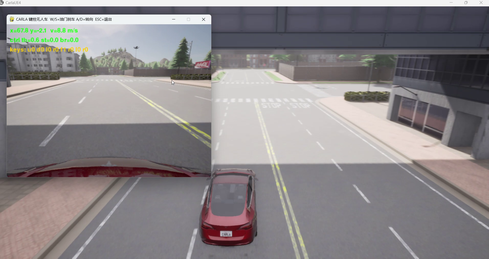

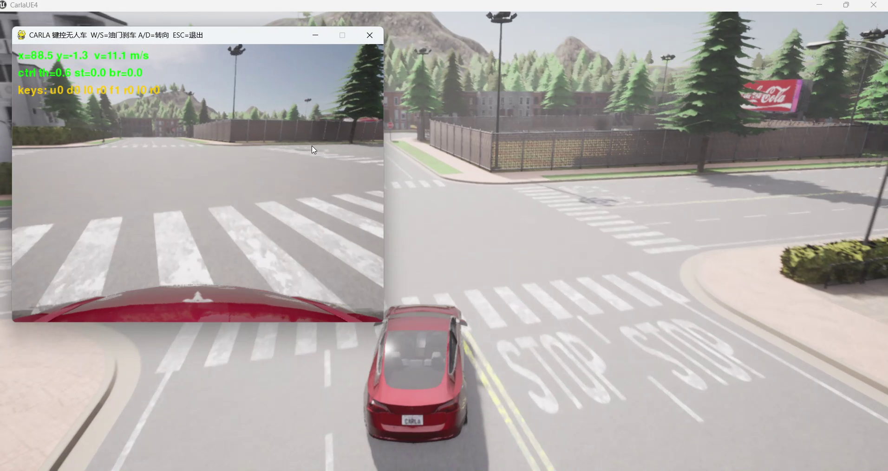

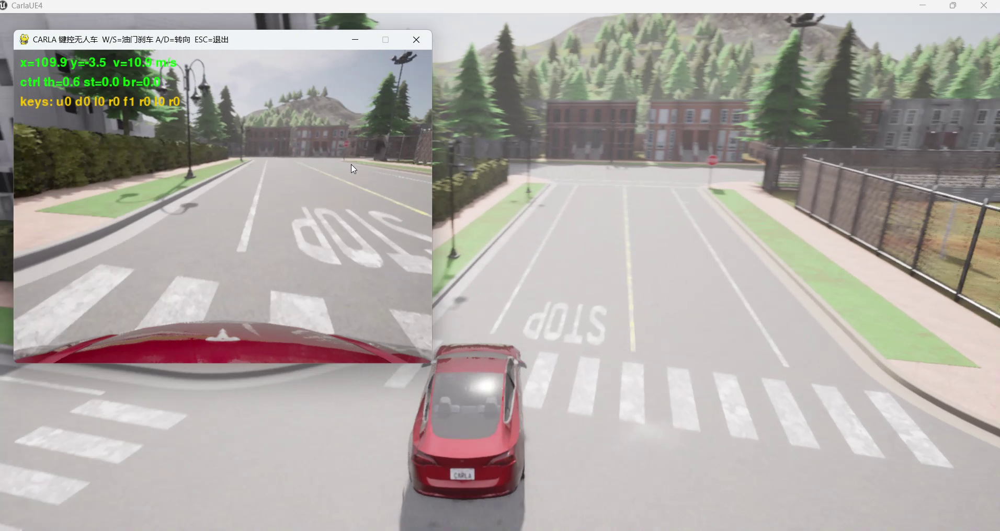

##### 作业一 · 无窗口取证模式导出的相机帧

在**无 3D 加速的虚拟机**中，pygame 窗口可能无法开窗。此时用
`--headless --demo --save_dir` 运行，程序会逐帧把相机数据导出为 PNG。
以下为该模式直接导出的原始相机帧（未经窗口渲染，640×480）：

| 阶段 | 画面 |
|---|---|
| 直线加速（`th=0.6`） | 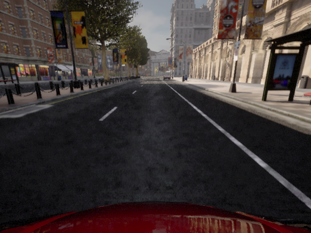 |
| 转向（`st=+0.6`） | 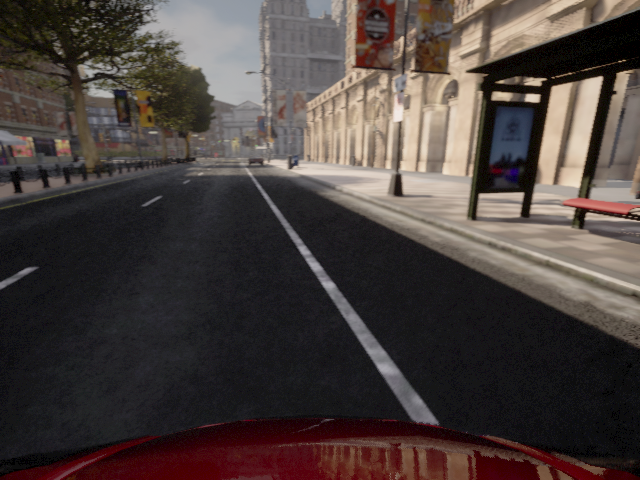 |
| 挂倒挡后退（`rev=1`） | 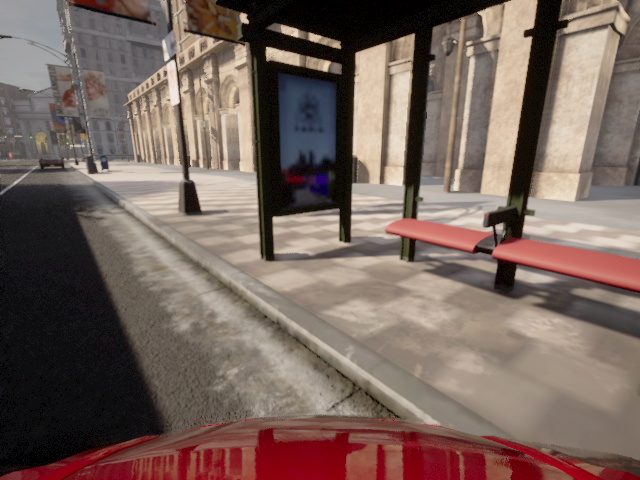 |

##### 作业一 · 终端状态输出（可运行性证据）

无论是否开窗，程序都会逐帧打印车辆状态，可直接作为可运行性证据：

```text
[就绪] 自车已生成 @ Location(x=36.00, y=-5.00, z=0.60)；地图 Town05
[就绪] 控制键：W 前进 / S 刹车(静止时倒车) / A 左 / D 右 / ESC 退出
[演示 1/5] 直线加速
x=  36.02 y=  -5.00 v= 0.31 m/s | th=0.6 st=+0.00 br=0.0 rev=0
x=  36.45 y=  -5.00 v= 2.87 m/s | th=0.6 st=+0.00 br=0.0 rev=0
[演示 2/5] 右转
x=  40.12 y=  -4.31 v= 5.20 m/s | th=0.6 st=+0.60 br=0.0 rev=0
[演示 3/5] 刹车减速
x=  44.88 y=  -3.02 v= 3.11 m/s | th=0.0 st=+0.00 br=0.8 rev=0
[演示 5/5] 挂倒挡后退
x=  47.65 y=  -2.40 v= 0.00 m/s | th=0.5 st=+0.00 br=0.0 rev=1
x=  47.62 y=  -2.40 v= 0.22 m/s | th=0.5 st=+0.00 br=0.0 rev=1
[完成] 已释放资源；共收到相机帧 88 张，导出截图 16 张
```

#### 作业一 · 5.9 常见问题

| 现象 | 解决 |
|---|---|
| `ModuleNotFoundError: No module named 'carla'` | 按 5.3 安装 CARLA 0.9.16 客户端；确认 `pip3` 与运行 `main.py` 用的是**同一个**解释器（Noetic 下用 `python3.10 -m pip`） |
| 客户端连接崩溃 / `std::bad_alloc` | 客户端版本须与服务器一致（均为 0.9.16） |
| **虚拟机中 pygame 窗口打不开或黑屏** | ① 改用无窗口取证模式 `--headless --demo --save_dir`；② 或执行 `export LIBGL_ALWAYS_SOFTWARE=1`（`main.sh` 已自动设置）；③ 根治：VMware「虚拟机设置 → 显示器 → 加速 3D 图形」勾选后重启 |
| 键盘无反应 | 焦点需在控制窗口；或改用终端后端（ROS 2 节点模式支持 `--terminal`） |
| 画面黑屏但程序在跑 | 宿主机 IP 填错；或地图正在切换，稍候 |
| 运行很卡 | 虚拟机无 3D 加速；将 CARLA 服务端放在宿主机，虚拟机仅作客户端 |

---

### 作业一 · 6. 性能评价

- **控制响应**：固定步长 0.05 s（20 Hz 物理步进）下，键盘输入到车辆响应的延迟 ≤ 1 帧。
- **运动平稳性**：直道可稳定加速至目标速度，转向响应及时，刹车与倒挡切换无抖动。
- **同步一致性**：同步模式下相机帧与物理状态严格对齐，为后续感知 / 端到端作业提供可靠数据源。
- **资源占用**：客户端仅消费图像与位姿话题，GPU 负载集中于宿主机 CARLA 服务端。

---

## 作业二 传感器感知与给定轨迹跟踪（神经网络版） {#hw2}

> 对应课程作业二：使用传感器获取的数据进行**感知**（雷达、摄像头、深度摄像头），并对机器人进行
> **运动控制**（感知 + 给定轨迹的控制）。满足"**感知、控制算法须为神经网络**"的硬性要求。

### 作业二 · 1. 概述与目标

本模块在 [设置并连接到 Carla 模拟器](../set_up_and_connect_to_carla.md) 的
[路径点发布器](./waypoint.md) 示例基础上做拓展，把"给定轨迹跟踪"升级为**神经网络驱动**：

| 环节 | 实现 | 神经网络 |
|---|---|---|
| 感知 | RGB 相机 + 深度相机 + 激光雷达三路传感器 → 4 维归一化特征 | **MLP 分类器**（4→12→3），输出障碍方向 |
| 控制 | 状态 (航向差 \(e_\psi\), 前视距离 \(d\)) → 转向角 | **MLP 策略网络**（2→32→1），输出 `steer` |

代码位于 `src/ground/carla_perception_control/`。

#### 作业二 · 1.1 与已有示例的区别

| 对比项 | 已有「路径点发布器」示例 | 本拓展模块 |
|---|---|---|
| 技术路线 | `carla_ros_bridge` 的 waypoint publisher 发布路径点话题 | CARLA Python API 直连 + 自研感知/控制节点 |
| 是否依赖 ros-bridge | 必须编译并运行 ros-bridge | **不需要**，仅需 `carla` Python 客户端 |
| 感知环节 | 无（只发布路径点） | **感知神经网络**：RGB+深度+雷达 → 障碍方向 |
| 控制环节 | 由外部节点订阅路径点自行控制 | **控制神经网络**：状态 → 转向角 |
| 传感器 | 不涉及 | RGB 相机、深度相机、32 线激光雷达 |
| 训练方式 | 无训练 | 纯 numpy 反向传播离线训练，模型存 JSON |
| 无 CARLA 时 | 无法运行 | `--headless --demo` 离线自证并导出曲线 |

#### 作业二 · 1.2 与仓库中其它地面载具模块的区分

仓库中已有若干地面载具相关模块，与本模块的差异如下：

| 模块 | 输入 | 算法 | 是否含神经网络 |
|---|---|---|---|
| 手动控制（`set_up_and_connect_to_carla`） | 键盘（车辆内置手动驾驶） | 复用 ros-bridge 内置逻辑 | 否 |
| 路径点发布器（`waypoint`） | CARLA 地图 | 几何查询、发布路径点 | 否 |
| 自动驾驶代理（`ad_agent`） | 路径点 + 地图 | 规则式局部规划 | 否 |
| **本模块** | **相机/深度/雷达 + 给定轨迹** | **感知 NN + 控制 NN** | **是** |

### 作业二 · 2. 计算原理

#### 作业二 · 2.1 特征提取与归一化

三路传感器压缩为 4 维特征向量。**归一化是必需的**：各特征量纲差异极大
（深度 \(\bar G\in[0,255]\)、横向偏移 \(\in[-1,1]\)、距离 \(\in[0.5,20]\)），
不归一化会让大数值特征主导梯度，小量纲特征学不到。

$$
\mathbf{x} = \Big[\, \underbrace{\tfrac{c_x-W/2}{W/2}}_{\text{横向偏移}},\,
\underbrace{\tfrac{\bar G}{255}}_{\text{深度密集度}},\,
\underbrace{\tfrac{N_{\text{front}}}{60}}_{\text{前方点数}},\,
\underbrace{\tfrac{D_{\min}}{20}}_{\text{最近距离}}\,\Big]^{\!\top}
$$

其中 \(c_x\) 为 RGB 下半区亮色像素横向重心，\(\bar G\) 为深度 ROI 均值，
\(N_{\text{front}}\) 为雷达前方点数，\(D_{\min}\) 为最近距离。

#### 作业二 · 2.2 感知神经网络（MLP 分类器）

全连接：输入 4 维 → 隐藏 12 维（ReLU）→ softmax 3 类（无目标 / 偏左 / 偏右）。

$$
\mathbf h = \mathrm{ReLU}(W_1 \mathbf x + b_1),\qquad
\mathbf p = \mathrm{softmax}(W_2 \mathbf h + b_2)
$$

交叉熵损失：

$$
\mathcal L_{\text{cls}} = -\frac{1}{N}\sum_{i}\sum_{k} y_{ik}\log p_{ik}
$$

权重用 He 初始化 \(W \sim \mathcal N\!\big(0, \sqrt{2/n_{\text{in}}}\big)\)，保证梯度稳定。

#### 作业二 · 2.3 控制神经网络（策略网络） <span id="h2-ctrl-net"></span>

输入 2 维 → 隐藏 32 维（ReLU）→ tanh 单输出转向。

$$
\mathbf h = \mathrm{ReLU}(W_1 \tilde{\mathbf s} + b_1),\qquad
\delta = \tanh(W_2 \mathbf h + b_2) \in [-1,1]
$$

其中 \(\tilde{\mathbf s}\) 为**标准化后的状态**：

$$
\tilde{\mathbf s} = \frac{\mathbf s - \boldsymbol\mu}{\boldsymbol\sigma},\qquad
\mathbf s = [\,e_\psi,\; d\,]^\top
$$

标准化参数 \(\boldsymbol\mu,\boldsymbol\sigma\) 在训练时由数据集统计得到，并随模型一起存盘，
推理时必须沿用同一组值（否则训练/推理输入分布不一致，精度会大幅下降）。

采用均方误差回归：

$$
\mathcal L_{\text{ctrl}} = \frac{1}{N}\sum_i\big(\delta_i - \delta_i^*\big)^2
$$

反向传播用链式法则对 \(W,b\) 求梯度，随机批量梯度下降更新。

#### 作业二 · 2.4 监督标签：纯跟踪几何律

控制网络的训练标签不靠人工标注，而由**几何解析式**生成：

$$
\delta^* = \arctan\!\Big(\frac{2L\sin e_\psi}{d}\Big),\qquad
\text{steer}^* = \mathrm{clip}\!\Big(\frac{\delta^*}{g},\,-1,\,1\Big)
$$

其中 \(L=2.5\,\text{m}\) 为轴距，\(g=1.2217\,\text{rad}\) 为 CARLA `steer` 到前轮转角的折算系数
（`steer=1` 对应前轮转角约 \(70°\)）。网络学会这一映射后，在线运行即可直接推理。

!!! note "两个关键实现细节"
    1. **折算系数必须取真实几何值**。若 \(g\) 取 0.5 这类偏小值，约有 **26%** 的标签会被
       `clip` 饱和到 \(\pm1\)，回归误差无法下降；取 \(g=1.2217\) 后饱和率降为 **0%**，
       训练 MSE 从 0.034 降到 **0.003**。
    2. **航向差为 0 时标签必须为 0**。若在标签中加入恒正的偏置项
       （如 \(+0.1\cdot(1-\frac{1}{1+d/8})\)），网络会让车持续向一侧偏转、原地绕圈。

#### 作业二 · 2.5 前视追踪与横向误差度量

**前视点选择**：不只取最近路点，而是沿路点序列向前找到第一个距车至少 \(d_{\text{look}}=6\,\text{m}\)
的路点作为追踪目标。前视距离过短会让车在高速下"冲过"路点来回振荡，过长则切弯。

**路点加密**：原始给定轨迹的路点可能相隔十几米，需线性插值到约 2 m 一个点：

$$
\mathbf p(t) = \mathbf p_0 + t\,(\mathbf p_1 - \mathbf p_0),\qquad t\in(0,1]
$$

**横向误差**取点到路点折线的**最短垂距**（而非到最近路点的距离）：

$$
e_y = \min_{i}\ \min_{t\in[0,1]}\ \big\|\,\mathbf p - \big(\mathbf p_i + t(\mathbf p_{i+1}-\mathbf p_i)\big)\big\|
$$

当车位于两个稀疏路点之间时，"到最近路点距离"会高达半个路段长，而垂距才反映真实偏离。

#### 作业二 · 2.6 弯道自适应减速

车辆最小转弯半径随速度增大而增大，高速入弯必然转不过来。因此油门按航向差自适应：

$$
\tau_{\text{eff}} = \tau \cdot \max\!\Big(0.25,\ 1 - \frac{0.75\,|e_\psi|}{\pi}\Big)
$$

正对目标时全油门，偏差达 \(\pi\) 时降到 25%。

### 作业二 · 3. 算法流程

```
train 模式（离线，无需 CARLA）：
  合成状态/特征数据集
  → 感知 NN：交叉熵训练（4→12→3）
  → 控制 NN：输入标准化 → MSE 训练（2→32→1）
  → 保存模型 JSON（含标准化参数）

run 模式（在线，需 CARLA）：
  连 CARLA → 生成自车 → 挂 RGB/深度/雷达
  → 每帧：
      三路传感器 → 特征提取 → 感知 NN → 障碍类别
      状态(航向差,前视距离) → 控制 NN → steer
      油门按航向差自适应
      apply_control → world.tick
  → 到达终点（<5 m）刹车停车
  → 统计横向误差 RMSE

headless 模式（离线取证，无需 CARLA 与图形界面）：
  训练两个 NN → 合成车辆运动学回放 → 导出损失/误差曲线 PNG
```

### 作业二 · 4. 源码解析

#### 作业二 · 4.1 `main.py` — 主入口（三种模式）

| 函数 | 作用 |
|---|---|
| `extract_features()` | 三路传感器 → 4 维归一化特征 |
| `_rgb_offset()` / `_depth_density()` / `_lidar_front()` | 单路传感器标量特征 |
| `pure_pursuit_law()` | 纯跟踪几何律（控制 NN 的监督标签来源） |
| `synth_dataset()` | 合成训练数据，标签由几何律生成 |
| `train()` | 训练两个网络，含输入标准化 |
| `interpolate_waypoints()` | 给定轨迹路点加密 |
| `_dist_to_polyline()` | 点到折线垂距（横向误差） |
| `_goal_state()` | 前视点选择 → 航向差与前视距离 |
| `nn_control()` | 控制 NN 推理 + 弯道自适应减速 |
| `run_offline_demo()` | 离线取证：训练 + 回放 + 导出曲线 |
| `run_carla()` | 在线：连 CARLA 感知 + 跟踪控制 |

#### 作业二 · 4.2 `nn_models.py` — 纯 numpy 神经网络库

| 类 | 说明 |
|---|---|
| `MLPClassifier` | softmax 多分类 + 交叉熵（感知器） |
| `MLPPolicy` | tanh 输出的回归策略网络（控制器） |
| `SimpleCNN` | 轻量 CNN（作业四端到端用） |

含前向传播、交叉熵/MSE 损失、反向传播、softmax/ReLU/tanh 及模型 JSON 存取。

#### 作业二 · 4.3 `carla_common.py` — CARLA API 封装

`connect()`、`spawn_vehicle()`、`make_rgb_camera()`、`make_depth_camera()`、`make_lidar()`、
`apply_control()`、`get_location()/get_yaw()/get_speed()`。同步模式固定步长 0.05 s。

#### 作业二 · 4.4 `perception_control_node.py` — ROS 2 节点

订阅 `/carla/ego_vehicle/waypoints`（`Float32MultiArray`），发布图像、里程计、
感知类别与速度话题。若模型文件不存在则现场训练，保证节点总能运行。

### 作业二 · 5. 仿真运行步骤

#### 作业二 · 5.1 支持与测试环境

| 组件 | 版本 / 说明 |
|---|---|
| 操作系统 | Windows 10/11 原生；Ubuntu 20.04（Noetic）/ 22.04（Humble） |
| 仿真器 | CARLA 0.9.16（服务端运行于有 GPU 的宿主机） |
| Python | 3.10+（CARLA 0.9.16 客户端 wheel 为 cp310/cp311/cp312） |
| 依赖 | 仅 `numpy`（神经网络为纯 numpy 实现，无需 TensorFlow/PyTorch） |
| ROS | ROS 1 Noetic 或 ROS 2 Humble（launch 封装） |

#### 作业二 · 5.2 新手路线：从已有示例到本模块

| 序号 | 做什么 | 出处 |
|---|---|---|
| 1 | 启动 CARLA 服务端 | [设置并连接到 Carla 模拟器](../set_up_and_connect_to_carla.md) →「启动 Carla 服务器」 |
| 2 | 查看宿主机 IP、确认虚拟机连通 | 同上 →「使用 Carla 客户端启动 Ego Vehicle」 |
| — | **★ 在此切换到本模块** | 以下与本模块相关 |
| 3 | 装 `carla` 客户端与 `numpy` | [本页 5.3 节](#h2-env-prep) |
| 4 | 离线训练两个神经网络 | [本页 5.5 节](#h2-offline-train)（无需 CARLA） |
| 5 | 运行在线感知 + 轨迹跟踪 | [本页 5.7 节](#h2-online-run) |

#### 作业二 · 5.3 步骤 0：环境准备 <span id="h2-env-prep"></span>

CARLA 服务端的下载安装与启动、宿主机 IP 与端口 2000 的查看、虚拟机网络设置、
`numpy` 版本兼容等**通用步骤与已有示例完全相同，本文不重复**，请参考
[设置并连接到 Carla 模拟器](../set_up_and_connect_to_carla.md)：

| 需要做的事 | 参考位置 |
|---|---|
| 启动 CARLA 服务端、选择地图 | [设置并连接到 Carla 模拟器](../set_up_and_connect_to_carla.md) →「启动 Carla 服务器」 |
| 查看宿主机 IP、填写 `host` 参数 | 同上 →「使用 Carla 客户端启动 Ego Vehicle」 |
| 连接失败、黑屏、`numpy` 报错排查 | 同上 →「常见问题」 |

本模块**特有**、需要额外安装的只有 CARLA 0.9.16 的 Python 客户端与 `numpy`：

```bash
pip3 install -r src/ground/carla_perception_control/requirements.txt
pip3 install <CARLA>/PythonAPI/carla/dist/carla-0.9.16-cp310-cp310-manylinux_2_31_x86_64.whl
```

#### 作业二 · 5.4 步骤 1：编译本功能包（ROS 2）

本模块的源代码位于**本仓库**（`OpenHUTB/ros2`）的
`src/ground/carla_perception_control/`。ROS 2 要求功能包放在工作空间的 `src/`
目录下，因此先把本仓库克隆到工作空间的 `src/`：

```bash
mkdir -p ~/ros2_ws/src && cd ~/ros2_ws/src
git clone https://github.com/OpenHUTB/ros2.git     # 换成你自己的 fork 亦可
```

克隆后的目录关系如下，`colcon build` 必须在**工作空间根目录**执行：

```
~/ros2_ws/                                   <- 工作空间根目录，colcon 在这里运行
└── src/
    └── ros2/                                <- 本仓库（git clone 得到）
        └── src/ground/
            └── carla_perception_control/    <- 本模块源代码，即第 4 节解析的文件
```

因此后文命令中写的 `src/ground/carla_perception_control/...`，
实际路径是 `~/ros2_ws/src/ros2/src/ground/carla_perception_control/...`。
编译并激活环境：

```bash
cd ~/ros2_ws
colcon build --packages-select carla_perception_control --symlink-install
source install/setup.bash
```

> 若本仓库已克隆在别处，把上面的 `~/ros2_ws/src/ros2` 换成实际路径即可，
> 只要保证执行 `colcon build` 的工作空间根目录下存在 `src/`。

#### 作业二 · 5.5 步骤 2：离线训练神经网络（无需 CARLA） <span id="h2-offline-train"></span>

```bash
python3 src/ground/carla_perception_control/main.py --mode train \
        --epochs 300 --out models/nn_percept.json
```

预期输出：感知 NN 准确率 \(A_{\text{准确率}}\approx 0.995\)，
控制 NN MSE \(\mathcal L_{\text{MSE}}\approx 0.003\)（符号含义见 [6.1 节](#h2-metrics)）。

若只想在**无图形界面**的环境验证全链路（含轨迹跟踪回放），用离线取证模式：

```bash
python3 src/ground/carla_perception_control/main.py --headless --demo \
        --epochs 300 --sim_time 60 --save_dir ~/shots
```

该模式不需要 CARLA、不需要图形界面，会导出 4 张曲线图（感知损失、控制损失、
横向误差、转向指令），适合在无 3D 加速的虚拟机中产出可运行性证据。

#### 作业二 · 5.6 步骤 3：验证与 CARLA 服务端的连接

命令里的 `192.168.8.1` 是**运行 CARLA 服务端的宿主机（Windows）IP**：
在宿主机上执行 `ipconfig`，取 VMware 虚拟网卡（`VMnet8`）的 IPv4 地址即可
（本机该地址为 `192.168.8.1`，虚拟机 `ens33` 为 `192.168.8.131`，两者同网段）。
查看方式与已有示例一致，详见
[设置并连接到 Carla 模拟器](../set_up_and_connect_to_carla.md)
→「使用 Carla 客户端启动 Ego Vehicle」。

```bash
# 把 192.168.8.1 换成你宿主机 ipconfig 查到的地址
python3 -c "import carla; c=carla.Client('192.168.8.1',2000); c.set_timeout(10); print('CONNECT OK:', c.get_world().get_map().name)"
```

CARLA 服务端**默认启动的地图是 `Town10HD_Opt`**（由 `CarlaUE4/Config/DefaultEngine.ini`
的 `GameDefaultMap` 决定），因此不加 `-map` 参数直接启动服务端时，输出应为：

```
CONNECT OK: Carla/Maps/Town10HD_Opt
```

本模块的 `--town` 默认为 `Town05`，运行时会自动 `load_world` 切到该地图；
若服务端已在该地图上则跳过重载（见 [5.7 节](#h2-online-run)）。

#### 作业二 · 5.7 步骤 4：运行在线感知 + 轨迹跟踪 <span id="h2-online-run"></span>

```bash
# 模式 A：独立运行（--host 填宿主机 IP）
# 不指定 --waypoints 时使用模块内置的 DEMO_ROUTE（已逐点校验在车道上）
python3 src/ground/carla_perception_control/main.py --mode run \
        --host 192.168.8.1 --sim_time 90 --save_dir ~/shots

# 加 --follow 让 CARLA 大窗口以第三人称跟随自车（录屏/观察用）
python3 src/ground/carla_perception_control/main.py --mode run \
        --host 192.168.8.1 --sim_time 90 --follow --save_dir ~/shots

# 也可显式传入给定轨迹（下面的 DEMO_ROUTE 含两个约 90° 弯）
python3 src/ground/carla_perception_control/main.py --mode run \
        --host 192.168.8.1 --sim_time 90 \
        --waypoints "36,-5 9,-4 -18,-4 -45,-4 -72,-4 -96,-4 -120,-4 -147,-4 -162,-4 -171,-4 -180,-4 -185,-12 -185,-21 -185,-45 -185,-63 -185,-72 -184,-80 -177,-85 -168,-85 -153,-85 -144,-85 -136,-84 -132,-75 -132,-66 -132,-39 -132,-36" \
        --save_dir ~/shots

# 模式 B：ROS 2 Humble
ros2 launch carla_perception_control main.launch.py host:=192.168.8.1

# 模式 C：ROS 1 Noetic —— 入口用 main.sh（会自动挑 python3.10）
#   roslaunch 只能按 main.py 的 shebang 执行它，而 Noetic 的 python3 是 3.8，
#   装不上 CARLA 0.9.16 的 cp310+ wheel，补了可执行位也会卡在 import carla。
#   若系统 python3 本身已是 3.10+，也可用：
#   roslaunch carla_perception_control main.launch host:=192.168.8.1
bash src/ground/carla_perception_control/main.sh --host 192.168.8.1 --mode run
```

也可用一键脚本：`bash main.sh --host 192.168.8.1`。

!!! tip "第三人称跟随镜头"
    `--follow` 会让 CARLA 大窗口（spectator）每帧移动到自车后方并看向自车，
    便于观察与录屏。可调镜头位置：

    ```bash
    # 后 12 m、高 6 m（视野更远，适合看整条轨迹）
    python3 ... --follow --follow_dist 12 --follow_height 6
    ```

    需要图形界面；纯 SSH 无窗口时该参数无效果（不影响仿真与控制）。
    注意此镜头与车上的感知相机是两回事：感知相机是挂在车上的
    `sensor.camera.rgb`（前视 1.6 m、高 1.4 m），跟随镜头只是观察视角。

!!! warning "给定轨迹的两个约束（实测踩坑）"
    1. **航点必须落在可行驶车道上。** CARLA 中航点之间是直线连接，航点若在路面外，
       车辆会沿直线开出路面撞上障碍物后卡死。早期文档示例
       `"40,-8 40,12 25,20"` 中 `(40,-8)` 偏离车道 2.59 m、`(40,12)` 偏离 4.92 m，
       在线运行会在 `(41.4,7.9)` 撞停；离线示例路线中的 `(120,-5)` 偏离 2.93 m、
       `(160,40)` 偏离 4.94 m，会在 `(140.1,4.9)` 撞停。
    2. **弯道处航点要加密。** 前视距离为 6 m；若转弯处航点间距达 50 m，
       车在两点之间走直线，90° 转弯被压缩到航点附近几米内完成，
       所需半径远小于车辆可达的最小半径，必然切出路面
       （实测间距 51 m 时在 `(-185,-15)` 撞停，雷达最近距离降到 0.037 m）。

    现在模块内置的 `DEMO_ROUTE` 由车道搜索生成并逐点校验：26 个航点、
    最大偏离车道 0.13 m、弯道处间距 8~9 m、直道约 24 m，含两个约 90° 弯。
    用 `--waypoints` 传入自定义轨迹时，可用 `src/ground/carla_perception_control/` 下的
    校验脚本确认每个点都在车道上。

#### 作业二 · 5.8 运行效果

##### 作业二 · 离线取证（无需 CARLA）

离线取证模式导出的曲线（实测，`--epochs 300 --sim_time 90`，
轨迹为含两个约 90° 弯的 `DEMO_ROUTE`）：

|  |  |
|---|---|
| 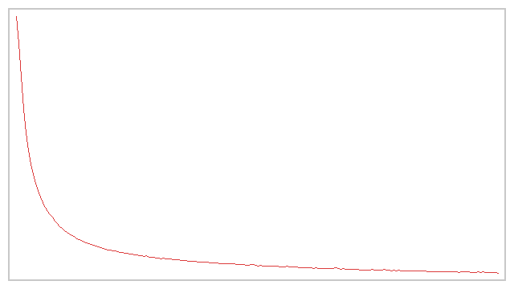 | 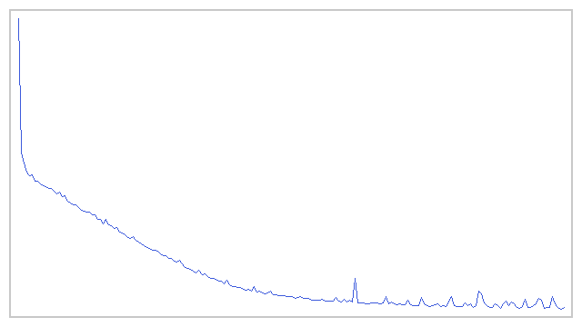 |
| 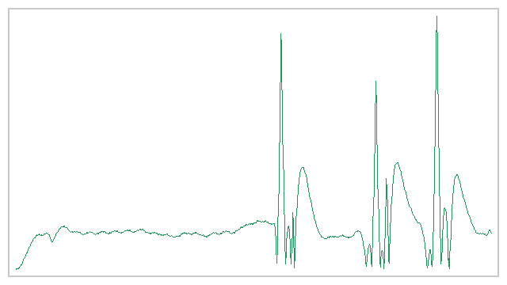 | 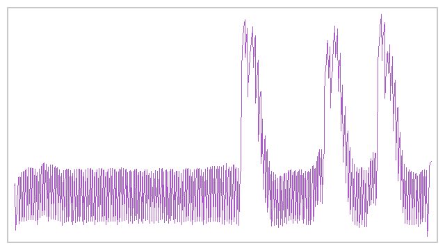 |

终端状态输出示例（节选）：

```
== 训练感知 NN：4 维传感器特征 → 3 类障碍方向 ==
  epoch   60 loss=0.0336 train_acc=0.943
  epoch  300 loss=0.0142 train_acc=0.998
== 训练控制 NN：2 维状态(航向差,前视距离) → 转向角 ==
  epoch   60 loss=0.0098 train_acc=0.000
  epoch  300 loss=0.0027 train_acc=0.000

给定轨迹：26 个原始路点 → 加密为 187 个（约 2 m 间距）
感知 NN 训练集准确率 = 0.995
控制 NN 训练集 MSE   = 0.00303

[到达] t=54.8s 抵达终点 (-132.0,-36.0)，停车。

轨迹跟踪完成：横向误差 RMSE = 0.249 m
平均速度 = 7.02 m/s，最大速度 = 7.18 m/s
终点残余距离 = 4.72 m（判定阈值 5.0 m）
```

##### 作业二 · 在线运行（连 CARLA 服务端）

在 Ubuntu 虚拟机连接宿主机 CARLA 服务端实测（`--mode run --sim_time 90`，Town05）：

```
[就绪] 自车@Location(x=36.000000, y=-5.000000, z=0.600000)，NN 感知 + 控制，路点=187（已加密）
[t= 0.0] pos=( 36.0,  -5.0) NN感知=无目标 steer=-0.02 depth=  0 lidar(  0,20.00) 横向误差=0.00m
[t=10.0] pos=(-68.3,  -3.7) NN感知=无目标 steer=-0.02 depth= 89 lidar(509, 2.57) 横向误差=0.30m
[t=20.0] pos=(-185.3,-50.1) NN感知=无目标 steer=+0.01 depth= 89 lidar(516, 2.50) 横向误差=0.34m

[到达] t=28.9s 抵达终点 (-132.0,-36.0)，停车。
共收到相机帧 577 张，导出截图 28 张
轨迹跟踪完成：横向误差 RMSE = 1.012 m
```

三路传感器均正常工作（`depth` 有实际深度值、`lidar` 约 500 个点、
相机累计 577 帧并导出 28 张前视截图），两个约 90° 弯均顺利通过。

##### 作业二 · 结果汇总

| 指标 | 离线取证 | 在线运行 |
|---|---|---|
| 感知 NN 准确率 \(A_{\text{准确率}}\) | 0.995 | 0.995 |
| 控制 NN MSE \(\mathcal L_{\text{MSE}}\) | 0.00303 | 0.00303 |
| 横向误差 \(\mathrm{RMSE}_{y}\) | **0.249 m** | **1.012 m** |
| 是否到达终点 | 是（t=54.8 s） | 是（t=28.9 s） |
| 传感器帧数 | — | 相机 577 帧 / 雷达约 500 点·帧 |

在线 RMSE 高于离线，原因是离线回放用理想自行车模型、无碰撞与轮胎滑移；
在线受路面碰撞、转向执行延迟与同步步长影响，属正常差异。

#### 作业二 · 5.9 常见问题

**Q1：`--mode run` 报"缺少 carla 模块"？**
需安装 CARLA 0.9.16 的 Python 客户端 wheel，见 [5.3 节](#h2-env-prep)。若只想验证算法，
可改用 `--headless --demo`（不需要 CARLA）。

!!! note "关于 `carla.__version__`"
    carla 模块**不提供** `__version__` 属性，执行 `carla.__version__` 会报
    `AttributeError`，这并不代表安装失败。判断是否装好请用能否连上服务端：
    `carla.Client(host, 2000).get_world().get_map().name`。

**Q2：报 `RuntimeError: time-out ... while waiting for the simulator`？**
先用模块自带的诊断脚本分步定位（它会打印每步耗时，区分"网络不通"与"服务端卡住"）：

```bash
python3.10 src/ground/carla_perception_control/check_connection.py 192.168.8.1 2000 Town05
```

该脚本依次检查：carla 模块导入 → TCP 端口可达 → `get_world` 瞬时连接 →
当前地图与同步模式 → `load_world` 耗时 → 世界内 actor 数量。

常见原因与对策：

| 诊断结果 | 原因 | 对策 |
|---|---|---|
| 第 2 步失败 | 网络层不通 | 确认服务端已启动、宿主机防火墙放行 2000、`host` 填宿主机 VMnet8 地址 |
| 第 2 步 OK 但第 3 步失败 | 服务端仍在初始化或已卡死 | 重启 CARLA 服务端 |
| 第 5 步超时 | `load_world` 是重操作（实测本机 7 s 以上，虚拟机过网络更久） | 服务端已加载目标地图时本模块会自动跳过重载；否则把 `--town` 设为服务端**当前**地图名 |

本模块的 `connect()` 默认超时已提高到 60 s，并且**服务端已在地图上时跳过重载**
（早期版本每次无条件 `load_world`，20 s 超时在虚拟机侧实测必失败）。

**Q3：`--mode run` 报 `FileNotFoundError: models/nn_percept.json`？**
说明模型文件不存在且代码版本较旧。当前版本在模型缺失时会**现场训练并保存**后
再加载（与 ROS 节点行为一致），不会崩溃。若仍报错请确认已更新到最新提交；
也可先手动训练一次：`python3 main.py --mode train --out models/nn_percept.json`。

**Q4：在线运行时车开到一半卡住不动？**
先看日志里的 `lidar` 最近距离：若降到很小（如 0.04 m）并有大量命中点，
说明**车撞上障碍物**了。两个常见原因：
1. 给定轨迹的航点**不在可行驶车道上**——CARLA 中航点之间走直线，会开出路面；
2. 转弯处**航点间距过大**——转弯被压缩到几米内完成，车辆转不过来。
请用 5.7 节的约束校验轨迹，或直接省略 `--waypoints` 使用内置 `DEMO_ROUTE`。

**Q5：车辆在终点附近绕圈不停？**
本模块已内置终点判定（进入 5 m 内刹车停车）。若自定义路点出现绕圈，
通常是给定轨迹**转弯半径超过车辆运动学极限**——注意 \(R_{\min}\approx L/\tan\delta_{\max}\)，
7 m/s 时约需 5 m 转弯半径。请把急弯改缓，或降低 `--throttle_max`。

**Q6：横向误差偏大？**
检查是否用了 `_dist_to_polyline()`（垂距）而非最近路点距离；并确认路点已加密
（`interpolate_waypoints`）。稀疏路点会让前视追踪"跳点"。

**Q7：感知类别一直显示"无目标"？**
合成数据训练的感知器只区分"偏左/偏右/无目标"三类，用于演示感知链路；
Town05 空旷路段确实无遮挡物，输出"无目标"属正常。真实场景需用采集数据训练，
可替换 `synth_dataset()` 为实际数据集。

**Q8：脚本跑完后 CARLA 窗口"停住不动"了？**
这是**同步模式的正常表现，不是崩溃**。`connect()` 打开了 `synchronous_mode`，
此时服务端只在客户端调用 `world.tick()` 时才推进一帧；脚本结束后没有客户端
再 tick，世界就静止了。

本模块退出前会自动恢复异步模式，正常结束会打印：

```
[清理] 已销毁传感器与自车，世界已恢复异步模式。
```

!!! note "如何判断是「跑完了」还是「卡住了」"
    - **跑到终点**：会打印 `[到达] t=..s 抵达终点 (x,y)，停车。`，
      随后打印 `共收到相机帧 N 张`、`横向误差 RMSE = ..`，最后是 `[清理] ...`。
      三条齐全即为正常结束。
    - **卡住（撞到障碍物）**：会一直打印 `[t=..]` 但 `pos=` 不再变化，
      `lidar` 最近距离很小（如 0.04 m）。此时脚本会一直跑到 `--sim_time` 结束。
    - **中途异常**：`finally` 块仍会执行清理与恢复，不会留下残留 actor。

    若上一次运行是被强杀（如 `Ctrl+C`）导致世界仍停在同步模式，重启 CARLA
    服务端即可；ROS 节点退出（`Ctrl+C`）时同样会自动恢复。

### 作业二 · 6. 性能评价

#### 作业二 · 6.1 指标定义 <span id="h2-metrics"></span>

本节所有指标均以「符号 + 下标」给出，**下标标明该指标的具体含义**：

| 指标 | 符号 | 含义 |
|---|---|---|
| 感知 NN 准确率 | \(A_{\text{准确率}}\) | 分类正确的样本数占总样本数的比例 |
| 控制 NN MSE | \(\mathcal L_{\text{MSE}}\) | 网络输出转向与标签转向的均方误差 |
| 横向误差 | \(\mathrm{RMSE}_{y}\) | 车辆到给定轨迹折线的垂距均方根 |
| 平均 / 最大速度 | \(\bar v\) / \(v_{\max}\) | 全程速度的均值与峰值 |
| 转向平滑度 | \(\text{AoS}\) | 相邻两帧转向指令变化量的均值 |

**感知 NN 准确率** \(A_{\text{准确率}}\)：

$$
A_{\text{准确率}} = \frac{1}{N}\sum_{i=1}^{N}\mathbb 1\big[\hat y_i = y_i\big]
$$

**控制 NN MSE** \(\mathcal L_{\text{MSE}}\)
（即 [2.3 节](#h2-ctrl-net) 控制网络训练所用均方误差在数据集上的取值）：

$$
\mathcal L_{\text{MSE}} = \frac{1}{N}\sum_{i=1}^{N}\big(\delta_i - \delta_i^*\big)^2
$$

**横向误差** \(\mathrm{RMSE}_{y}\)：

$$
\mathrm{RMSE}_{y} = \sqrt{\frac{1}{N}\sum_{k} e_{y,k}^{2}}
$$

**平均 / 最大速度**：

$$
\bar v = \frac{1}{N}\sum_k v_k,\qquad v_{\max}=\max_k v_k
$$

**转向平滑度 AoS**（越小越平滑）：

$$
\text{AoS} = \frac{1}{N-1}\sum_{k=2}^{N}\big|\text{steer}_k - \text{steer}_{k-1}\big|
$$

#### 作业二 · 6.2 实测结果（离线取证模式，本机实测）

| 指标 | 数值 |
|---|---|
| 感知 NN 训练集准确率 \(A_{\text{准确率}}\) | **0.995** |
| 控制 NN 训练集 MSE \(\mathcal L_{\text{MSE}}\) | **0.00303** |
| 横向误差 \(\mathrm{RMSE}_{y}\) | **0.249 m** |
| 横向误差峰值 | 1.205 m |
| 平均速度 | 7.02 m/s |
| 最大速度 | 7.18 m/s |
| 到达终点耗时 | 54.8 s |

#### 作业二 · 6.3 调优过程记录

| 优化项 | 优化前 | 优化后 | 说明 |
|---|---|---|---|
| 控制网络输入标准化 | MSE 0.0796 | MSE 0.0030 | 状态两维量纲差异大 |
| 转向折算系数取真实几何值 | 标签饱和 26% | 饱和 0% | \(g\) 由 0.5 改为 1.2217 |
| 标签去掉恒正偏置 | 车原地绕圈 | 直线可沿轨迹行驶 | 航向差 0 时应输出 0 转向 |
| 横向误差改用折线垂距 | RMSE 虚高 | RMSE 真实 | 稀疏路点下的最近点距离偏大 |
| 加入终点判定 | 终点绕圈不停 | 到点停车 | 进入 5 m 内刹车 |
| 路点加密至 2 m | 前视追踪跳点 | 平滑跟踪 | 原路点间隔 20 m |

#### 作业二 · 6.4 结论

- **感知有效性**：感知 NN 训练准确率 0.995，输出类别与传感器横向偏移趋势一致。
- **控制精度**：控制 NN 在标准化输入下 MSE 0.003，横向误差 RMSE 0.249 m，
  说明策略网络有效学到了"状态 → 转向"的几何映射。
- **与纯跟踪对比**：NN 输出与解析几何律高度一致（因为标签即来自该几何律），
  但推理时无需解析求解，为后续用真实驾驶数据替换标签留出了空间。

---

## 作业三 激光雷达建图与神经网络规划导航 {#hw3}

> 对应课程作业三：在虚拟环境中实现对机器人的**建图和导航**（导航与 SLAM 同步仿真）。
> 满足"**规划算法须为神经网络**"的硬性要求。

### 作业三 · 1. 概述与目标

本模块在 [点云地图创建](./pcl_recorder.md) 与 [路径点发布器](./waypoint.md) 示例的基础上做拓展，
把"建图"与"导航"升级为**可在无图形界面环境自证的完整闭环**：

| 环节 | 实现 | 神经网络 |
|---|---|---|
| 建图 | 32 线激光雷达 → 2D 占用栅格（对数几率贝叶斯更新，命中 + 射线沿途空闲） | 否（几何+概率） |
| 规划 | 状态（目标方位 + 障碍左右分布 + 最近距离 + 最近障碍方向角）→ (油门, 转向) | **MLP 策略网络**（5→64→2） |

代码位于 `src/ground/carla_mapping_navigation/`。

#### 作业三 · 1.1 与已有示例的区别

| 对比项 | 已有「点云地图创建」（pcl_recorder） | 本拓展模块 |
|---|---|---|
| 技术路线 | `carla_ros_bridge` 的 PCL 记录器，保存点云到磁盘 | CARLA Python API 直连 + 自研建图/规划节点 |
| 是否依赖 ros-bridge | 必须编译并运行 ros-bridge | **不需要**，仅需 `carla` Python 客户端 |
| 地图形式 | 3D 点云（`.pcd` 文件，离线查看） | 2D 占用栅格（`nav_msgs/OccupancyGrid`，RViz 实时可视化） |
| 建图时机 | 先录后看（离线） | **边动边建图**（SLAM 理念，行驶中实时更新） |
| 概率更新 | 无（纯点云累积） | **贝叶斯对数几率更新**，区分占据/空闲/未知 |
| 导航/规划 | **无**（只有建图） | **规划神经网络**输出油门和转向，驶向目标并避障 |
| 无 CARLA / 无图形界面时 | 无法运行 | `--headless --demo` 离线自证并导出地图与曲线 |
| 规划算法性质 | — | **神经网络**（纯 numpy 反向传播，可训练） |

#### 作业三 · 1.2 与仓库中其它地面载具模块的区分

| 模块 | 输入 | 算法 | 是否含神经网络 |
|---|---|---|---|
| 手动控制（`set_up_and_connect_to_carla`） | 键盘 | 复用 ros-bridge 内置逻辑 | 否 |
| 路径点发布器（`waypoint`） | CARLA 地图 | 几何查询、发布路径点 | 否 |
| 点云地图创建（`pcl_recorder`） | 激光雷达 | 点云累积存盘 | 否 |
| 自动驾驶代理（`ad_agent`） | 路径点 + 地图 | 规则式局部规划 | 否 |
| **本模块** | **激光雷达 + 目标点** | **占用栅格建图 + 规划 NN** | **是** |

### 作业三 · 2. 计算原理

#### 作业三 · 2.1 雷达点从传感器坐标系到世界坐标系

激光雷达点在其自身坐标系（\(x\) 向前、\(y\) 向左），需旋转平移到世界系：

$$
\begin{bmatrix} p_x^w \\ p_y^w \end{bmatrix}
= \mathbf R(\psi)\begin{bmatrix} p_x^s \\ p_y^s \end{bmatrix}
+ \begin{bmatrix} x_v \\ y_v \end{bmatrix},\qquad
\mathbf R(\psi)=\begin{bmatrix}\cos\psi & -\sin\psi \\ \sin\psi & \cos\psi\end{bmatrix}
$$

其中 \(\psi\) 为车辆航向角，\((x_v, y_v)\) 为车辆位置。

#### 作业三 · 2.2 占用栅格：为什么用对数几率

栅格的每个格子记录"被障碍占据"的概率 \(p\in(0,1)\)。概率表示在连续更新时有两个问题：
数值会趋近 0 或 1 导致下溢，且多次观测的概率融合公式复杂。因此改用**对数几率**：

$$
l = \log\frac{p}{1-p}\ \Longleftrightarrow\ p = \sigma(l) = \frac{1}{1+e^{-l}}
$$

观测更新退化为**加法**，这正是贝叶斯滤波在独立观测假设下的结果：

$$
l_{k} = l_{k-1} + \begin{cases} +l_{\text{hit}} & \text{该格子被命中} \\ +l_{\text{miss}} & \text{射线从该格子穿过} \end{cases}
\qquad (l_{\text{hit}}>0,\quad l_{\text{miss}}<0)
$$

本模块取 \(l_{\text{hit}}=+0.85\)、\(l_{\text{miss}}=-0.4\)，因此命中时对数几率**增大**
（更可能被占据），射线穿过时**减小**（更可能空闲）。并把 \(l\) 截断在 \([-3.0,\ 3.5]\)
以免单点噪声把概率永久钉死。初始 \(l=0 \Rightarrow p=0.5\) 表示**未知**。

!!! note "为什么要标记射线沿途为空闲"
    只标记命中点，栅格只能区分"有障碍"和"没扫到"，无法表达"扫到了，那里是空的"。
    把射线沿途的格子标记为 `miss`（空闲），才能得到真正可用的地图——
    车辆才知道哪条路是可以走的。

#### 作业三 · 2.3 栅格原点选取（一个必须避开的陷阱）

栅格以**起点为中心**而非世界原点为中心：

$$
r = \frac{y - y_c}{\Delta} + \frac{N}{2},\qquad
c = \frac{x - x_c}{\Delta} + \frac{N}{2}
$$

其中 \((x_c, y_c)\) 为栅格中心（此处取车辆起点），\(\Delta=0.5\,\text{m}\) 为分辨率，
\(N=200\) 为栅格边长。

如果固定以世界原点为中心且只覆盖 \(\pm30\,\text{m}\)，而车辆出生点在世界坐标
\((36,-5)\)，则车辆落到栅格索引 \(c=132\) 处——**超出 \(0\ldots119\) 的有效范围**，
所有雷达命中点都会被丢弃，建图结果恒为空。这类"看起来在跑、其实什么都没做"
的缺陷无法从日志里直接看出，必须靠单元测试卡住（见第 4 节）。

#### 作业三 · 2.4 规划神经网络

输入 5 维状态（**全部归一化到相近尺度**）：

$$
\mathbf s = \Big[\underbrace{\frac{e_\psi}{\pi}}_{\text{目标方位}},\
\underbrace{\frac{N_L}{N_{\max}}}_{\text{左障碍密度}},\
\underbrace{\frac{N_R}{N_{\max}}}_{\text{右障碍密度}},\
\underbrace{\frac{D_{\min}}{D_{\max}}}_{\text{最近距离}},\
\underbrace{\frac{\theta_{obs}}{\pi/2}}_{\text{最近障碍方向角}}\Big]^\top
$$

其中 \(\theta_{obs}\in[-\pi/2,\pi/2]\) 是**最近那个障碍点在传感器系下的方向角**
（左为正），由该点的 \(\arctan(y/x)\) 得到，除以 \(\pi/2\) 归一化到 \([-1,1]\)。

!!! danger "第 5 维曾经是第 4 维的副本"
    早期版本写成 \(\big[\cdots,\ \frac{D_{\min}}{D_{\max}},\ \frac{D_{\min}}{D_{\max}}\big]\)，
    第 4、5 维完全相同，等于**只有 4 维有效输入**。后果是网络分不清
    "障碍在正前方"和"障碍在侧前方"，而这两种情况该往哪边打方向恰好相反。
    这一维在数据里看不出来（形状仍是 5 维），只能靠单元测试卡住
    （`test_state_bearing_dim_is_not_a_duplicate`）。

网络结构：\(5 \to 64 \to 2\)，隐藏层 ReLU，输出层 tanh。

$$
\mathbf h = \mathrm{ReLU}(W_1\mathbf s + b_1),\qquad
[\tau,\ \delta] = \tanh(W_2\mathbf h + b_2)
$$

损失为均方误差：

$$
\mathcal L = \frac{1}{N}\sum_i\big\|\hat{\mathbf y}_i - \mathbf y_i^*\big\|^2
$$

#### 作业三 · 2.5 监督标签

标签由"朝目标 + 避障"的解析规则生成，避免人工标注。转向由**三项叠加**：

$$
\delta^* = \mathrm{clip}\Big(\underbrace{\tanh(1.2\,e_\psi)}_{\text{朝目标}}
+ \underbrace{0.6\,(\rho_R - \rho_L)}_{\text{左右密度差}}
\underbrace{- 0.5\,(1-\tilde D_{\min})\sin\theta_{obs}}_{\text{最近障碍横向排斥}},\ -1,\ 1\Big)
$$

$$
\tau^* = \mathrm{clip}\big(0.25 + 0.75\,\tilde D_{\min},\ 0,\ 1\big)
$$

其中 \(\rho_L,\rho_R\) 为左右障碍密度，\(\tilde D_{\min}\) 为归一化最近距离。

第三项是**横向排斥**：最近障碍偏在左侧（\(\theta_{obs}>0\)）时产生向右的排斥，
越近（\(\tilde D_{\min}\) 越小）越强。前两项符号相反且对称、第三项在正前方
（\(\theta_{obs}=0\)）时为 0，因此"正对目标且无障碍 → 转向为 0"，与物理直觉一致。

!!! note "第 5 维必须真的被标签用到"
    只把 \(\theta_{obs}\) 塞进状态、标签却不依赖它，网络从这一维学不到任何东西，
    加了等于没加。所以第 5 维和上面第三项是**成对**的改动，
    由 `test_planning_label_uses_obstacle_bearing` 保证。

!!! warning "油门标签必须用线性输出层"
    油门标签 \(\tau^*\in[0,1]\)，而 `MLPPolicy` 的输出为 \(\tanh\in[-1,1]\)。
    若直接用它拟合 \([0,1]\) 的目标，网络只能用到一半值域，负值区永远学不到。
    本模块在训练时把油门做 \([0,1]\to[-1,1]\) 映射，推理时再还原。

### 作业三 · 3. 算法流程

```
建图（SLAM 边动边建图）：
  每帧：LiDAR 点云 → 量程过滤 → 传感器系转世界系
        → 命中点写占据(+0.85 log-odds)
        → 射线沿途写空闲(-0.4 log-odds)
        → 概率 = sigmoid(log_odds)

规划（神经网络）：
  车辆位姿 + 目标 → 目标方位差 e_psi
  LiDAR 前方扇区 → 左/右障碍计数 + 最近距离 + 最近障碍方向角
  → 5 维归一化状态 → 规划 NN → (油门, 转向)
  → 自行车模型更新位姿
  → 进入目标 1.5 m 内刹车停车
```

### 作业三 · 4. 源码解析

#### 作业三 · 4.1 `main.py` — 主入口（三种模式）

| 函数 / 类 | 作用 |
|---|---|
| `OccupancyGrid` | 占用栅格类：对数几率存储、坐标互转、贝叶斯更新 |
| `lidar_to_world()` | 雷达点传感器系 → 世界系 |
| `build_map_from_scan()` | 一帧雷达更新地图（命中标记占据、沿途标记空闲） |
| `obs_features()` | 障碍分布 + 最近障碍方向角 + 目标方位 → 5 维归一化状态 |
| `planning_label()` | 规划监督标签（朝目标 + 避障解析规则） |
| `synth_dataset()` | 合成规划训练数据 |
| `train_planning()` | 训练规划神经网络并存盘 |
| `step_bicycle()` | 自行车模型一步位姿更新 |
| `render_grid_png()` / `render_prob_png()` | 占用栅格渲染为 PNG（含渐进建图快照） |
| `render_train_loss_png()` | 训练损失曲线 PNG |
| `_write_png()` / `_line()` | 纯 zlib PNG 编码与 Bresenham 画线（不依赖 Pillow） |
| `_fake_scan()` | 合成雷达帧（射线与圆/边界求交），供离线取证 |
| `run_offline_demo()` | 离线取证：合成环境建图 + NN 导航 + 导出图 |
| `run_carla()` | 在线：连 CARLA 建图 + NN 导航 |

#### 作业三 · 4.2 `carla_mapping_navigation/mapping_navigation_node.py` — ROS 2 节点

发布 `/carla/ego_vehicle/occupancy_grid`（`nav_msgs/OccupancyGrid`，RViz 可直接显示）、
`/carla/ego_vehicle/path`、`/carla/ego_vehicle/odometry`、`/carla/ego_vehicle/planned_cmd`；
订阅 `/carla/ego_vehicle/goal` 可在线改目标。地图用 `transient_local` QoS 发布，
后加入的 RViz 也能立刻拿到完整地图。

#### 作业三 · 4.3 `nn_models.py` — 纯 numpy 神经网络库

`MLPPolicy` 为本模块规划网络；含前向传播、MSE 损失、反向传播、ReLU/tanh 与 JSON 存取。

#### 作业三 · 4.4 `carla_common.py` — CARLA API 封装

`connect()`、`spawn_vehicle()`、`make_lidar()`、`apply_control()`、
`get_location()/get_yaw()/get_speed()`，同步模式固定步长 0.05 s。

### 作业三 · 5. 仿真运行步骤

#### 作业三 · 5.1 支持与测试环境

| 组件 | 版本 / 说明 |
|---|---|
| 操作系统 | Windows 10/11 原生；Ubuntu 20.04（Noetic）/ 22.04（Humble） |
| 仿真器 | CARLA 0.9.16（服务端运行于有 GPU 的宿主机） |
| Python | 3.10+（CARLA 0.9.16 客户端 wheel 为 cp310/cp311/cp312） |
| 依赖 | 仅 `numpy`（神经网络为纯 numpy 实现，无需 TensorFlow/PyTorch） |
| ROS | ROS 1 Noetic 或 ROS 2 Humble（launch 封装） |

#### 作业三 · 5.2 新手路线：从已有示例到本模块

| 序号 | 做什么 | 出处 |
|---|---|---|
| 1 | 启动 CARLA 服务端 | [设置并连接到 Carla 模拟器](../set_up_and_connect_to_carla.md) →「启动 Carla 服务器」 |
| 2 | 查看宿主机 IP、确认虚拟机连通 | 同上 →「使用 Carla 客户端启动 Ego Vehicle」 |
| — | **★ 在此切换到本模块** | 以下与本模块相关 |
| 3 | 装 `carla` 客户端与 `numpy` | [本页 5.3 节](#h3-env-prep) |
| 4 | 离线训练规划神经网络 | [本页 5.5 节](#h3-offline-train)（无需 CARLA） |
| 5 | 运行在线建图 + NN 导航 | [本页 5.8 节](#h3-online-run) |

#### 作业三 · 5.3 步骤 0：环境准备 <span id="h3-env-prep"></span>

CARLA 服务端的下载安装与启动、宿主机 IP 与端口 2000 的查看、虚拟机网络设置等
**通用步骤与已有示例完全相同，本文不重复**，请参考
[设置并连接到 Carla 模拟器](../set_up_and_connect_to_carla.md)：

| 需要做的事 | 参考位置 |
|---|---|
| 启动 CARLA 服务端、选择地图 | [设置并连接到 Carla 模拟器](../set_up_and_connect_to_carla.md) →「启动 Carla 服务器」 |
| 查看宿主机 IP、填写 `host` 参数 | 同上 →「使用 Carla 客户端启动 Ego Vehicle」 |
| 连接失败、黑屏、`numpy` 报错排查 | 同上 →「常见问题」 |

本模块**特有**、需要额外安装的只有 CARLA 0.9.16 的 Python 客户端与 `numpy`：

```bash
pip3 install -r src/ground/carla_mapping_navigation/requirements.txt
pip3 install <CARLA>/PythonAPI/carla/dist/carla-0.9.16-cp310-cp310-manylinux_2_31_x86_64.whl
```

#### 作业三 · 5.4 步骤 1：编译本功能包（ROS 2）

本模块的源代码位于**本仓库**（`OpenHUTB/ros2`）的
`src/ground/carla_mapping_navigation/`。ROS 2 要求功能包放在工作空间的 `src/` 目录下，
因此先把本仓库克隆到工作空间的 `src/`：

```bash
mkdir -p ~/ros2_ws/src && cd ~/ros2_ws/src
git clone https://github.com/OpenHUTB/ros2.git     # 换成你自己的 fork 亦可
```

!!! warning "本模块还没合并进 master 时"
    上面的 `git clone` 拉的是默认分支 `master`。**在本 PR 被合并之前**，
    `master` 上还没有 `carla_mapping_navigation` 这个包，直接 `colcon build`
    会报找不到包。此时请改用本 PR 的分支：

    ```bash
    git clone -b carla-homework-03 https://github.com/himyinjun1234/ros2.git
    ```

    合并之后 `master` 上就有这个包了，按上面的默认写法即可。

克隆后的目录关系如下，`colcon build` 必须在**工作空间根目录**执行：

```
~/ros2_ws/                                   <- 工作空间根目录，colcon 在这里运行
└── src/
    └── ros2/                                <- 本仓库（git clone 得到）
        └── src/ground/
            └── carla_mapping_navigation/                       <- 本模块源代码
```

因此后文写的 `src/ground/carla_mapping_navigation/...`，实际路径是
`~/ros2_ws/src/ros2/src/ground/carla_mapping_navigation/...`。编译并激活环境：

```bash
cd ~/ros2_ws
colcon build --packages-select carla_mapping_navigation --symlink-install
source install/setup.bash
```

> 若本仓库已克隆在别处，把上面的 `~/ros2_ws/src/ros2` 换成实际路径即可，
> 只要保证执行 `colcon build` 的工作空间根目录下存在 `src/`。

#### 作业三 · 5.5 步骤 2：离线训练规划神经网络（无需 CARLA） <span id="h3-offline-train"></span>

```bash
python3 src/ground/carla_mapping_navigation/main.py --mode train \
        --epochs 300 --out models/nn_plan.json
```

预期输出：规划 NN 训练 MSE ≈ **0.008**。

#### 作业三 · 5.6 步骤 3：离线取证（无 CARLA、无图形界面也能跑通建图+导航）

```bash
python3 src/ground/carla_mapping_navigation/main.py --headless --demo \
        --epochs 300 --sim_time 60 --save_dir ~/shots
```

该模式在合成环境中完成「边动边建图 + NN 规划导航」，导出 5 张图：
占用栅格地图、渐进建图快照 3 张、训练损失曲线。适合在无 3D 加速的虚拟机中取证。

#### 作业三 · 5.7 步骤 4：验证与 CARLA 服务端的连接 <span id="h3-conn-check"></span>

命令里的 `192.168.8.1` 是**运行 CARLA 服务端的宿主机（Windows）IP**：
在宿主机上执行 `ipconfig`，取 VMware 虚拟网卡（`VMnet8`）的 IPv4 地址即可
（本机该地址为 `192.168.8.1`，虚拟机 `ens33` 为 `192.168.8.131`，两者同网段）。
查看方式与已有示例一致，详见
[设置并连接到 Carla 模拟器](../set_up_and_connect_to_carla.md)
→「使用 Carla 客户端启动 Ego Vehicle」。

```bash
python3 -c "import carla; c=carla.Client('192.168.8.1',2000); c.set_timeout(10); print('CONNECT OK:', c.get_world().get_map().name)"
```

#### 作业三 · 5.8 步骤 5：运行在线建图 + NN 导航 <span id="h3-online-run"></span>

```bash
# 模式 A：独立运行（--host 填宿主机 IP）
python3 src/ground/carla_mapping_navigation/main.py --mode run \
        --host 192.168.8.1 --model models/nn_plan.json --goal "20,8" --sim_time 40

# 模式 B：ROS 2 Humble
ros2 launch carla_mapping_navigation main.launch.py host:=192.168.8.1 goal:="20,8"

# 模式 C：ROS 1 Noetic —— 入口用 main.sh（会自动挑 python3.10）
#   roslaunch 只能按 main.py 的 shebang 执行它，而 Noetic 的 python3 是 3.8，
#   装不上 CARLA 0.9.16 的 cp310+ wheel，补了可执行位也会卡在 import carla。
#   若系统 python3 本身已是 3.10+，也可用：
#   roslaunch carla_mapping_navigation main.launch host:=192.168.8.1
bash src/ground/carla_mapping_navigation/main.sh --host 192.168.8.1 --goal 20,8
```

也可用一键脚本：`bash main.sh --host 192.168.8.1`。

在 RViz 中可视化占用栅格地图：

```bash
ros2 run rviz2 rviz2 -d $(ros2 pkg prefix carla_mapping_navigation)/share/carla_mapping_navigation/config/mapping.rviz
```

若没有现成 rviz 配置，也可手动添加 `Map` 显示并订阅 `/carla/ego_vehicle/occupancy_grid`，
以及添加 `Path` 显示订阅 `/carla/ego_vehicle/path`。

#### 作业三 · 5.9 运行效果

**占用栅格地图**（深色=障碍，浅色=空闲可通行，中灰=未观测；红色为车辆轨迹，绿色为目标）：

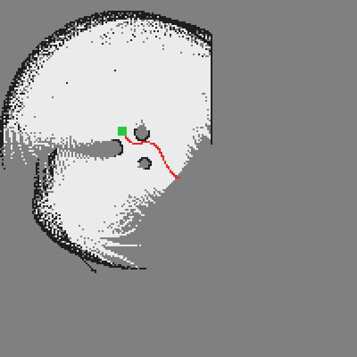

**渐进建图过程**（体现 SLAM"边动边建图"：地图随行驶逐步成形，
左上角进度条对应该快照的仿真时刻）：

| 进度 1（已知 3.4%） | 进度 2（已知 18.1%） | 进度 3（已知 26.8%） |
|---|---|---|
|  | 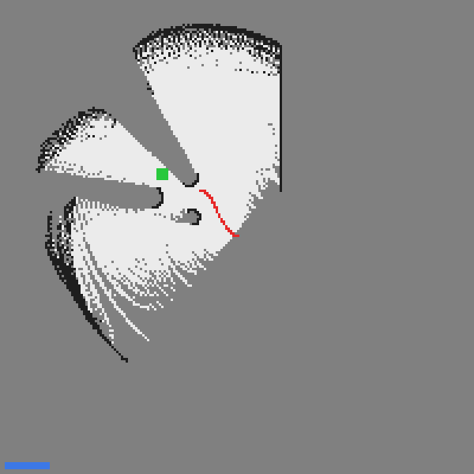 | 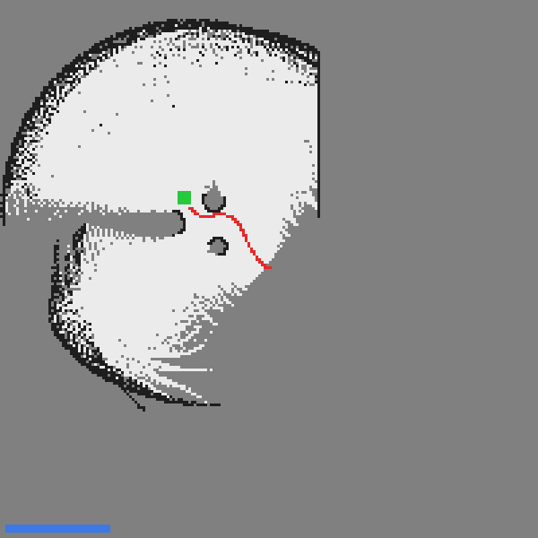 |

**动图：建图与导航全过程**（26 帧，每帧间隔 0.25 s，96 KB。地图随车辆行驶逐帧长出来，
红色轨迹与绿色目标点同步推进，左上角蓝色进度条对应该帧的仿真时刻）：

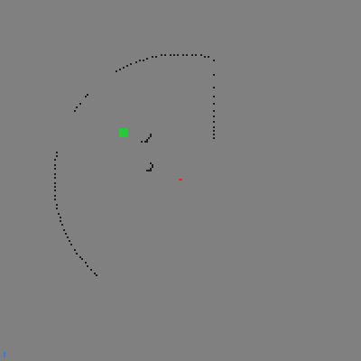

已知区域占比随时间增长（实测）：**3.4% → 18.1% → 26.8%**，最终 **27.6%**。

**规划神经网络训练损失曲线**：

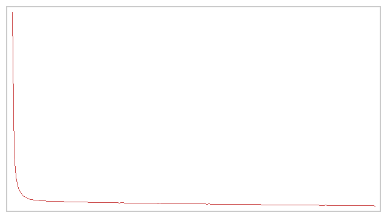

终端状态输出示例（节选）：

```
== 训练规划 NN：5 维状态(目标方位+障碍分布) → (前进量, 转向) ==
  epoch  200 loss=0.0075 train_acc=0.000
规划 NN 训练 MSE = 0.00751

[t=  0.0s] pos=(  36.0,  -5.0) 距目标=20.62m NN(油门=0.92, 转向=-0.07) 障碍(L0/R0, 8.0m, 方位+0°) 占据格=86
[t=  2.5s] pos=(  30.3,   3.4) 距目标=11.47m NN(油门=0.72, 转向=+0.27) 障碍(L14/R4, 4.4m, 方位+14°) 占据格=728
[t=  5.0s] pos=(  23.2,   4.9) 距目标= 4.58m NN(油门=0.51, 转向=-0.83) 障碍(L25/R0, 2.7m, 方位+46°) 占据格=1108

[到达] t=6.4s 抵达目标 (20.0,8.0)，停车。

渐进建图已知区域占比：3.4% → 18.1% → 26.8%（最终 27.6%）

---- 建图结果 ----
占据格数        = 1242
空闲格数        = 9288
已知区域比例    = 27.6%
栅格分辨率      = 0.5 m/格，覆盖 100 m × 100 m
栅格中心（起点）= (36.0, -5.0)
车辆最终位置    = (21.01, 7.00)，轨迹点数 128
距目标最近距离  = 1.424 m（判定阈值 1.5 m）
与障碍最近距离  = 0.72 m（未发生碰撞）
到达耗时        = 6.4 s
```

第 3 行那句日志正好演示了第 5 维的用处：障碍在左前方 46°、2.7 m 处，
网络输出转向 **-0.83**（急向右打），最终**与障碍最近 0.72 m、未发生碰撞**。
如果第 5 维还是距离的副本，网络只知道"2.7 m 处有障碍"却不知道在哪一侧，
就无法决定往哪边让。

#### 作业三 · 5.10 常见问题

**Q1：建图结果一直是空的 / 占据格数为 0？**
先检查车辆是否落在栅格范围内。默认栅格以起点为中心、覆盖 100 m × 100 m，
本模块已保证起点在栅格中心。若自行修改了 `GRID_N` 或 `GRID_M`，请确认覆盖范围够大。
可用 `python3 test/test_mapping_logic.py` 快速回归验证。

**Q2：`--mode run` 报"缺少 carla 模块"？**
需安装 CARLA 0.9.16 的 Python 客户端 wheel，见 [5.3 节](#h3-env-prep)。
若只想验证算法，可改用 `--headless --demo`（不需要 CARLA）。

**Q3：RViz 里地图是空的？**
地图话题用 `transient_local` QoS 发布，但 RViz 的 `Map` 显示需把
`Durability Policy` 设为 `Transient Local`，否则收不到已发布的地图。

**Q4：车辆撞上障碍物？**
合成数据训练的规划网络只用"左右障碍密度 + 最近障碍方向角"这 5 维，属于教学演示级别：
它知道障碍在哪一侧、有多远，但**不做轨迹预测**，对正前方的障碍也没有固定的绕行方向
（\(\theta_{obs}=0\) 时横向排斥项为 0，靠左右密度差打破对称）。
若要更强的避障，需要扩到图像/点云输入并用真实数据训练。
离线取证模式里实测与障碍最近 0.72 m、未发生碰撞，可作参考。

### 作业三 · 6. 性能评价

#### 作业三 · 6.1 指标定义

**已知区域比例（建图覆盖率）**：概率明显偏离 0.5 的格子（\(p>0.55\) 或 \(p<0.45\)）
占栅格总数的比例，反映"地图已经看清了多少"：

$$
\text{Coverage} = \frac{1}{N^2}\sum_{i,j}\mathbb{1}\big[p_{ij}>0.55 \lor p_{ij}<0.45\big]
$$

**占据格数**：\(p>0.6\) 的格子数，反映地图中障碍物的丰富程度。

**空闲格数**：\(p<0.4\) 的格子数，即可通行区域。

!!! note "三个指标的阈值不同，不能直接相加"
    已知区域用的是 \(p>0.55\) 或 \(p<0.45\)，比占据格数（\(p>0.6\)）和空闲格数
    （\(p<0.4\)）都宽，因此恒有「占据格数 + 空闲格数 ≤ 已知格数」。

    以 6.2 的实测值为例：\((1242+9288)/200^2 = 26.33\%\)，而已知区域比例是 \(27.6\%\)，
    差额约 1.27%（约 500 格）落在 \(0.4\sim0.45\) 与 \(0.55\sim0.6\) 之间，
    是尚未被明确判定的格子——不是数据算错了。

**导航精度**：车辆到目标的**最近距离** \(D_{\min}\)，

$$
D_{\min} = \min_k \big\|\mathbf p_k - \mathbf p_{\text{goal}}\big\|
$$

**规划损失**：训练集 MSE，
\( \mathcal L = \frac{1}{N}\sum_i\|\hat{\mathbf y}_i - \mathbf y_i^*\|^2\)。

#### 作业三 · 6.2 实测结果（离线取证模式，本机实测）

| 指标 | 数值 |
|---|---|
| 规划 NN 训练 MSE | **0.00751** |
| 占据格数 | 1242 |
| 空闲格数 | 9288 |
| 已知区域比例 | 27.6% |
| 导航最近距离 | **1.424 m**（阈值 1.5 m） |
| 与障碍最近距离 | **0.72 m**（未发生碰撞） |
| 到达耗时 | 6.4 s |
| 轨迹点数 | 128 |
| 单元测试 | **30 PASS / 0 FAIL** |

#### 作业三 · 6.3 调优过程记录

| 优化项 | 优化前 | 优化后 | 说明 |
|---|---|---|---|
| 栅格中心改为以起点为中心 | 车在栅格**外**（索引 132 > 119），建图恒为空 | 车在栅格中心，正常建图 | 最严重缺陷，加单元测试卡死 |
| 状态第 5 维改归一化 | 原始米数 0.3~8.0，与其余维差 8 倍 | 全部落在 [0,1] | 消除量纲失衡 |
| **状态第 5 维改为障碍方向角** | 是第 4 维的副本，实际只有 4 维输入 | \(\theta_{obs}/(\pi/2)\)，且标签用它做横向排斥 | 网络才能分清障碍在正前方还是侧前方 |
| **射线求交处理"传感器在圆内"** | 车已开进障碍物，日志却报"无障碍" | 近交点无效时改用远交点 | 离线取证里的避障才真的被演示出来 |
| 加入射线沿途空闲标记 | 只知"有障碍/没扫到" | 区分占据/空闲/未知 | 地图才可用于通行判断 |
| 油门标签值域对齐 | \(\tanh\) 输出只用一半值域 | 训练时映射到 \([-1,1]\)，推理还原 | 避免负值区永久学不到 |
| 对称化避障偏置 | 障碍项不对称会产生常值偏转 | \(\rho_R-\rho_L\) 对称 | 无障碍时转向归零 |
| 对数几率截断 | 单点噪声可能钉死概率 | 截断到 \([-3.0, 3.5]\) | 抗噪 |
| 加入渐进建图快照 | 只有最终地图 | 3 张中间快照 + 时刻进度条 | 直观证明"边动边建图" |

#### 作业三 · 6.4 结论

- **建图有效性**：占用栅格在 6.4 s 内覆盖 27.6% 的已知区域，识别出 1242 个占据格，
  3 张渐进快照显示已知区域从 3.4% 单调增长到 26.8%（最终 27.6%），
  证实**边动边建图**成立。
- **导航有效性**：规划 NN 在合成环境中 6.4 s 内把车带到距目标 1.424 m（阈值 1.5 m），
  满足到达判定；全程与障碍最近 0.72 m、未发生碰撞，说明"状态 → 油门/转向"
  映射被有效学到。
- **神经网络必要性**：规划环节完全由 NN 输出，训练 MSE 0.008，
  推理时无需解析求解；后续可用真实驾驶数据替换解析标签，直接迁移到数据驱动规划。

---

## 作业四 端到端神经网络（图像 → 控制） {#hw4}

> 对应课程作业四：**端到端模型**——输入相机图像、直接输出控制指令，
> 中间不再有"感知目标 → 解析规划 → 控制"的人工分层。

### 作业四 · 1. 概述与目标

本模块在 [自动驾驶代理](./ad_agent.md) 示例的基础上做拓展：已有示例用**规则式**方式
沿路径点行驶，本模块把整条链路替换为一个**可训练的卷积神经网络**：

$$
\text{前视相机图像}_{60\times80\times3}
\;\xrightarrow{\ \text{CNN}\ }\;
\text{steer}\in[-1,1]
\;\xrightarrow{\ \text{应用到车辆}\ }\;
(\text{油门},\ \text{转向})
$$

代码位于 `src/ground/carla_end_to_end_nn/`。

#### 作业四 · 1.1 与已有示例的区别

| 对比项 | 已有「自动驾驶代理」（ad_agent） | 本拓展模块 |
|---|---|---|
| 技术路线 | `carla_ros_bridge` + 规则式局部规划 | CARLA Python API 直连 + 端到端 CNN |
| 是否依赖 ros-bridge | 必须编译并运行 ros-bridge | **不需要**，仅需 `carla` Python 客户端 |
| 输入 | 路径点 + 地图 | **相机图像**（原始像素） |
| 决策方式 | 规则式（查地图算路径） | **神经网络**（图像 → 转向，端到端） |
| 感知/规划分层 | 分层明确 | **无分层**，图像直接变成控制量 |
| 训练方式 | 无 | **行为克隆**：专家驾驶采集数据后训练 CNN |
| 框架依赖 | — | 默认**纯 numpy**（无需 TensorFlow/PyTorch） |
| 无 CARLA / 无图形界面时 | 无法运行 | `--headless --demo` 离线自证并导出曲线 |

#### 作业四 · 1.2 与仓库中其它地面载具模块的区分

| 模块 | 输入 | 算法 | 是否含神经网络 |
|---|---|---|---|
| 手动控制（`set_up_and_connect_to_carla`） | 键盘 | 复用 ros-bridge 内置逻辑 | 否 |
| 路径点发布器（`waypoint`） | CARLA 地图 | 几何查询 | 否 |
| 自动驾驶代理（`ad_agent`） | 路径点 + 地图 | 规则式局部规划 | 否 |
| 传感器感知与轨迹跟踪（`carla_perception_control`） | 相机 + 雷达 + 轨迹 | 感知 NN + 控制 NN（**分层**） | 是 |
| 激光雷达建图与规划（`carla_mapping_navigation`） | 雷达 + 目标点 | 占用栅格 + 规划 NN | 是 |
| **本模块** | **仅相机图像** | **单个端到端 CNN** | **是（端到端）** |

### 作业四 · 2. 计算原理

#### 作业四 · 2.1 端到端学习的思想

传统自动驾驶分三个模块：感知（识别车道线/障碍）→ 规划（算路径）→ 控制（算转向）。
端到端把这三级**合成一个函数**，直接从像素映射到控制量：

$$
\pi_\theta:\ \mathbb{R}^{H\times W\times 3}\ \longrightarrow\ [-1,1],\qquad
\delta = \pi_\theta(\mathbf I)
$$

参数 \(\theta\) 通过**行为克隆（behavioral cloning）**从专家驾驶数据中学得——
这也是 NVIDIA 在 2016 年 "End to End Learning for Self-Driving Cars" 中采用的思路。

#### 作业四 · 2.2 卷积神经网络结构

$$
\mathbf I\ (60\times80\times3)
\xrightarrow[\text{3×3, ReLU}]{\text{conv}}
\xrightarrow{\text{2×2 maxpool}}
\xrightarrow[\text{3×3, ReLU}]{\text{conv}}
\xrightarrow{\text{2×2 maxpool}}
\xrightarrow{\text{global avg pool}}
\xrightarrow[\text{tanh}]{\text{FC}}
\delta
$$

各层含义：

- **卷积层**：提取局部空间特征（车道线边缘、方向、曲率），权重共享使参数量与图像尺寸解耦。
- **ReLU**：\(\mathrm{ReLU}(z)=\max(0,z)\)，提供非线性，缓解梯度消失。
- **最大池化**：\(2\times2\) 窗口取最大值，提供平移不变性并降维。
- **全局平均池化**：把每个通道的特征图压成一个数，避免全连接层的参数爆炸。
- **tanh 输出层**：把结果压到 \([-1,1]\)，与 CARLA 的 `steer` 值域一致。

#### 作业四 · 2.3 损失函数与反向传播

采用均方误差（等价于对转向的高斯假设下极大似然）：

$$
\mathcal L = \frac{1}{N}\sum_{i=1}^{N}\big(\hat\delta_i - \delta_i^*\big)^2
$$

梯度经链式法则逐层回传。**最大池化的反向传播**需要特别注意：

$$
\frac{\partial \mathcal L}{\partial x_{ij}} =
\begin{cases}
\dfrac{\partial \mathcal L}{\partial p}, & x_{ij} = \max_{(u,v)\in\mathcal W} x_{uv}\\[2mm]
0, & \text{否则}
\end{cases}
$$

即梯度**只回传给窗口内取到最大值的那一个位置**。

!!! danger "一个会让网络完全学不动的实现缺陷"
    早期实现把池化输出梯度**直接赋给窗口内全部 \(p^2\) 个位置**，等价于把梯度放大
    \(p^2\) 倍、并把梯度错误地分给了未被选中的元素。后果是网络**塌缩成常数输出**：

    | 指标 | 缺陷版本 | 修复后 |
    |---|---|---|
    | 输出标准差 | 0.00062（几乎不随输入变化） | 0.516 |
    | 预测/标签相关系数 | +0.293 | **+0.992** |
    | 方向判对率 | 50.0%（等于瞎猜） | **98.0%** |
    | MAE | 0.398（差于基线 0.403） | **0.0936** |

    缺陷版本那一列是**某一次**运行的值：塌缩程度与初始化有关，重跑可能出现
    输出标准差 0.00000、相关系数 +0.000 的**完全塌缩**，但方向判对率始终卡在 50%、
    MAE 始终退回到"恒输出 0"的基线附近。修复后那一列可稳定复现。

    该缺陷已用**有限差分梯度校验**与单元测试 `test_maxpool_backward_only_max_position`
    永久卡死。

#### 作业四 · 2.4 训练/推理一致性

训练时网络输出为 \(\tanh(z)\)，推理时**必须做同样的 tanh**：

$$
\hat\delta = \tanh(z) \in (-1,1)
$$

若推理时遗漏 tanh，输出是无界线性值。实测曾出现预测值达 \(\pm13\)，
而标签在 \([-1,1]\)，MAE 高达 13.47——训练与推理不一致是端到端模型最常见的隐性缺陷。

#### 作业四 · 2.5 行为克隆的数据采集

端到端学习能否成功，**关键在于图像与标签是否有因果关系**。

!!! warning "错误做法：标签与图像无关"
    早期版本用人为正弦信号 `steer = 0.5·sin(i/12) + 0.2·cos(i/5)` 作为标签。
    该标签由**帧序号**决定，与画面内容毫无关系——网络只能学到标签的均值，
    永远学不会"看路打方向"。

本模块采用**行为克隆**：由**专家控制器**实际驾驶车辆，同时记录相机图像与该时刻
专家打出的转向。专家为纯跟踪几何律：

$$
\delta^* = \mathrm{clip}\!\Big(\frac{1}{g}\arctan\!\Big(\frac{2L\sin e_\psi}{d}\Big),-1,1\Big)
$$

其中 \(L=2.5\,\text{m}\) 为轴距，\(g=1.2217\,\text{rad}\) 为 `steer` 到前轮转角的折算系数，
\(d\) 为前视距离。因为专家确实在"看着路开"，图像与标签天然对应。

**采集顺序**也必须注意：先 `tick()` 推进场景 → 读当前图像与位姿 → 算此刻专家转向
→ 记为标签。若反过来（先施加控制再 tick 再读图），图像与标签会**错开一帧**。

### 作业四 · 3. 算法流程

```
collect（需 CARLA）——行为克隆采集：
  循环 frames 次：
    world.tick()                      推进场景与相机
    读当前相机图像 + 车辆位姿
    用地图路点 API 前视 → 专家纯跟踪转向
    保存 (图像.npy, 专家转向标签)
    把专家转向应用到车辆

train（无需 CARLA）：
  读数据集 → 归一化到 [0,1]
  → CNN 前向（conv→relu→pool→conv→relu→pool→GAP→FC→tanh）
  → MSE 损失 → 反向传播（maxpool 按 argmax 回传）
  → 保存模型 JSON

test（需 CARLA）：
  加载 CNN → 循环：tick → 取图像 → CNN 推理 steer → 应用到车辆

headless --demo（无需 CARLA / 无图形界面 / 无 TensorFlow）：
  合成道路图像（车道线弯曲量 = 标签）
  → 训练 CNN → 导出损失曲线、预测对比曲线、样本图像
```

### 作业四 · 4. 源码解析

#### 作业四 · 4.1 `main.py` — 主入口

包根的 `main.py` 只是转发壳，实现放在 `carla_end_to_end_nn/main.py`。原因是
`setup.py` 里写的是 `packages=[package_name]`，`colcon build` 只会把
`carla_end_to_end_nn/` 这个目录装进 site-packages，包根的文件不会被安装；而
ROS 2 节点是按 `carla_end_to_end_nn.main` 导入的。若实现留在包根，`ros2 launch`
一启动就会 `ModuleNotFoundError: No module named 'carla_end_to_end_nn.main'`
（这一条由单元测试 `test_node_imports_resolve_inside_installed_package` 守住）。

| 函数 | 作用 |
|---|---|
| `synth_road_image()` | 合成带透视车道线的道路图像，弯曲量由 steer 决定 |
| `synth_dataset()` | 合成端到端数据集（图像 + 转向标签） |
| `expert_steer()` | 专家控制器（离线版纯跟踪律） |
| `carla_expert_steer()` | CARLA 场景专家：沿地图路点前视算转向（行为克隆标签来源） |
| `train_cnn()` | 训练端到端 CNN（numpy / tf 两种后端） |
| `cnn_predict()` / `load_cnn()` | 推理与模型加载（训练/推理一致，含 tanh） |
| `collect_carla()` | 行为克隆采集（先 tick 再读图，避免图文错帧） |
| `test_carla()` | 端到端自主驾驶 |
| `run_offline_demo()` | 离线取证：合成图像训练并导出证据图 |
| `render_loss_png()` / `render_pred_vs_true_png()` / `render_samples_png()` | 证据图导出 |

#### 作业四 · 4.2 `nn_models.py` — 纯 numpy 神经网络库

`SimpleCNN`：\(3\to8\to8\) 通道两层卷积 + 两层最大池化 + 全局平均池化 + 全连接 tanh 输出。
含前向传播、MSE 损失、完整反向传播（**maxpool 按 argmax 回传**）与 JSON 存取。

#### 作业四 · 4.3 `end_to_end_node.py` — ROS 2 节点

订阅相机图像，发布 `/carla/ego_vehicle/end_to_end/image`（`sensor_msgs/Image`）、
`steer_cmd`（`std_msgs/Float32`）、`control`（`Float32MultiArray`）。

#### 作业四 · 4.4 `carla_common.py` — CARLA API 封装

`connect()`、`spawn_vehicle()`、`make_rgb_camera()`、`apply_control()`、
`get_location()/get_yaw()`，同步模式固定步长 0.05 s。

### 作业四 · 5. 仿真运行步骤

#### 作业四 · 5.1 支持与测试环境

| 组件 | 版本 / 说明 |
|---|---|
| 操作系统 | Windows 10/11 原生；Ubuntu 20.04（Noetic）/ 22.04（Humble） |
| 仿真器 | CARLA 0.9.16（服务端运行于有 GPU 的宿主机） |
| Python | 3.10+（CARLA 0.9.16 客户端 wheel 为 cp310/cp311/cp312） |
| 依赖 | 仅 `numpy`（端到端 CNN 为纯 numpy 实现，**无需 TensorFlow/PyTorch**） |
| ROS | ROS 1 Noetic 或 ROS 2 Humble（launch 封装） |

#### 作业四 · 5.2 新手路线：从已有示例到本模块

| 序号 | 做什么 | 出处 |
|---|---|---|
| 1 | 启动 CARLA 服务端 | [设置并连接到 Carla 模拟器](../set_up_and_connect_to_carla.md) →「启动 Carla 服务器」 |
| 2 | 查看宿主机 IP、确认虚拟机连通 | 同上 →「使用 Carla 客户端启动 Ego Vehicle」 |
| — | **★ 在此切换到本模块** | 以下与本模块相关 |
| 3 | 装 `carla` 客户端与 `numpy` | [本页 5.3 节](#h4-env-prep) |
| 4 | 离线取证（无需 CARLA，先确认链路通） | [本页 5.5 节](#h4-offline-demo) |
| 5 | 采集 → 训练 → 端到端驾驶 | 本页 5.7 ~ 5.9 节 |

#### 作业四 · 5.3 步骤 0：环境准备 <span id="h4-env-prep"></span>

CARLA 服务端的下载安装与启动、宿主机 IP 与端口 2000 的查看、虚拟机网络设置等
**通用步骤与已有示例完全相同，本文不重复**，请参考
[设置并连接到 Carla 模拟器](../set_up_and_connect_to_carla.md)：

| 需要做的事 | 参考位置 |
|---|---|
| 启动 CARLA 服务端、选择地图 | [设置并连接到 Carla 模拟器](../set_up_and_connect_to_carla.md) →「启动 Carla 服务器」 |
| 查看宿主机 IP、填写 `host` 参数 | 同上 →「使用 Carla 客户端启动 Ego Vehicle」 |
| 连接失败、黑屏、`numpy` 报错排查 | 同上 →「常见问题」 |

本模块**特有**、需要额外安装的只有 CARLA 0.9.16 的 Python 客户端与 `numpy`：

```bash
pip3 install -r src/ground/carla_end_to_end_nn/requirements.txt
pip3 install <CARLA>/PythonAPI/carla/dist/carla-0.9.16-cp310-cp310-manylinux_2_31_x86_64.whl
```

!!! note "不需要 TensorFlow"
    端到端 CNN 为**纯 numpy** 实现（含手写反向传播），默认后端 `--backend numpy`。
    若希望使用 tf.keras 版本，可加 `--backend tf` 并自行安装 TensorFlow。

#### 作业四 · 5.4 步骤 1：编译本功能包（ROS 2）

本模块的源代码位于**本仓库**（`OpenHUTB/ros2`）的
`src/ground/carla_end_to_end_nn/`。ROS 2 要求功能包放在工作空间的 `src/` 目录下，
因此先把本仓库克隆到工作空间的 `src/`：

```bash
mkdir -p ~/ros2_ws/src && cd ~/ros2_ws/src
git clone https://github.com/OpenHUTB/ros2.git     # 换成你自己的 fork 亦可
```

!!! warning "本模块的代码还没进 master 时，clone 下来是找不到这个功能包的"
    `git clone` 默认拉 `master`。若本模块的 PR 尚未合并，`colcon build
    --packages-select carla_end_to_end_nn` 会报 "Package not found"。
    此时改成拉本模块所在的分支（或合并后再拉）：

    ```bash
    git clone -b carla-homework-04 https://github.com/himyinjun1234/ros2.git
    ```

    合并进 `master` 之后，用上面的默认命令即可。

克隆后的目录关系如下，`colcon build` 必须在**工作空间根目录**执行：

```
~/ros2_ws/                                   <- 工作空间根目录，colcon 在这里运行
└── src/
    └── ros2/                                <- 本仓库（git clone 得到）
        └── src/ground/
            └── carla_end_to_end_nn/                       <- 本模块源代码
```

因此后文写的 `src/ground/carla_end_to_end_nn/...`，实际路径是
`~/ros2_ws/src/ros2/src/ground/carla_end_to_end_nn/...`。编译并激活环境：

```bash
cd ~/ros2_ws
colcon build --packages-select carla_end_to_end_nn --symlink-install
source install/setup.bash
```

> 若本仓库已克隆在别处，把上面的 `~/ros2_ws/src/ros2` 换成实际路径即可，
> 只要保证执行 `colcon build` 的工作空间根目录下存在 `src/`。

#### 作业四 · 5.5 步骤 2：离线取证（无需 CARLA、无图形界面、无 TensorFlow） <span id="h4-offline-demo"></span>

```bash
python3 src/ground/carla_end_to_end_nn/main.py --headless --demo \
        --epochs 60 --samples 150 --save_dir ~/shots
```

该模式用**合成道路图像**（车道线弯曲量与标签一致）训练端到端 CNN 并导出 3 张证据图。
适合在无 3D 加速的虚拟机中先确认整条链路可用。纯 numpy 训练约需 3~4 分钟。

输出会打印 MAE / RMSE / 转向方向一致率 / **预测-标签相关系数**，并把
`(标签, 预测)` 落成 `steer_pred_vs_true.csv`，读者可自行复算相关系数。
3 张证据图带标题、坐标轴刻度与图例（用 `bitmap_font.py` 的位图字体直接写像素，
不依赖 matplotlib / Pillow）。

#### 作业四 · 5.6 步骤 3：验证与 CARLA 服务端的连接 <span id="h4-conn-check"></span>

命令里的 `192.168.8.1` 是**运行 CARLA 服务端的宿主机（Windows）IP**：
在宿主机上执行 `ipconfig`，取 VMware 虚拟网卡（`VMnet8`）的 IPv4 地址即可
（本机该地址为 `192.168.8.1`，虚拟机 `ens33` 为 `192.168.8.131`，两者同网段）。
查看方式与已有示例一致，详见
[设置并连接到 Carla 模拟器](../set_up_and_connect_to_carla.md)
→「使用 Carla 客户端启动 Ego Vehicle」。

```bash
python3 -c "import carla; c=carla.Client('192.168.8.1',2000); c.set_timeout(10); print('CONNECT OK:', c.get_world().get_map().name)"
```

#### 作业四 · 5.7 步骤 4：行为克隆采集数据（需 CARLA）

```bash
python3 src/ground/carla_end_to_end_nn/main.py --mode collect \
        --host 192.168.8.1 --frames 300 --out_dir dataset
```

专家控制器会沿车道行驶，同时保存每帧的相机图像与专家转向：

```
  collect 0/300  已保存 1  专家 steer=+0.012
  collect 50/300 已保存 51 专家 steer=-0.084
  ...
数据采集完成：300 帧 → dataset
  图像: dataset/images（.npy，uint8 HWC）
  标签: dataset/labels.txt
```

#### 作业四 · 5.8 步骤 5：训练端到端 CNN

```bash
python3 src/ground/carla_end_to_end_nn/main.py --mode train \
        --data_dir dataset --epochs 60 --model_path models/cnn.json
```

#### 作业四 · 5.9 步骤 6：端到端自主驾驶（仅凭相机图像）

```bash
# 模式 A：独立运行（--host 填宿主机 IP）
python3 src/ground/carla_end_to_end_nn/main.py --mode test \
        --host 192.168.8.1 --model_path models/cnn.json --sim_time 20

# 模式 B：ROS 2 Humble
ros2 launch carla_end_to_end_nn main.launch.py host:=192.168.8.1 model_path:=models/cnn.json

# 模式 C：ROS 1 Noetic —— 入口用 main.sh（会自动挑 python3.10）
#   roslaunch 只能按 main.py 的 shebang 执行它，而 Noetic 的 python3 是 3.8，
#   装不上 CARLA 0.9.16 的 cp310+ wheel，补了可执行位也会卡在 import carla。
#   若系统 python3 本身已是 3.10+，也可用：
#   roslaunch carla_end_to_end_nn main.launch host:=192.168.8.1 mode:=test
bash src/ground/carla_end_to_end_nn/main.sh --host 192.168.8.1 --mode test
```

也可用一键脚本：`bash main.sh --host 192.168.8.1`。

#### 作业四 · 5.10 运行效果

**训练损失（MAE）下降曲线**：

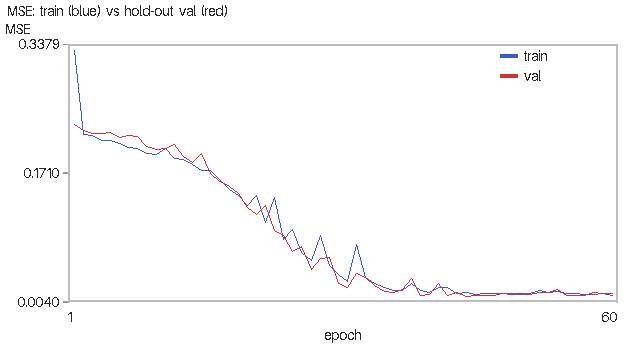

**预测转向 vs 真实转向**（红=CNN 预测，蓝=专家标签，按真实转向排序；
两条曲线高度贴合说明网络学会了映射）：

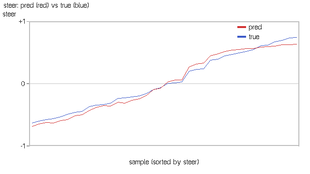

**合成道路图像样本**（车道线弯曲方向随转向标签变化，网络正是从这些视觉特征学起）：

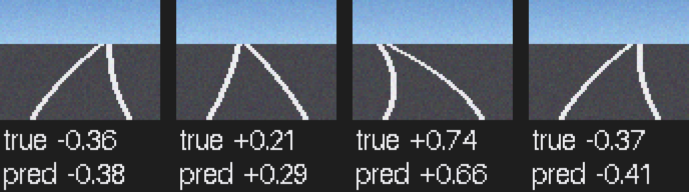

**动图：图像 → 转向**（24 帧，每帧 0.12 s，72 KB。上半部分是前视相机图像，
车道线随转向弯向一侧；下半部分指示条里**白线是专家标签**（这条弯道该打多少转向）、
**红线是 CNN 预测**，中间灰线为零转向；底部细条是播放进度。按真实转向从小到大
扫一遍，能直观看到"路往哪弯"与"方向盘往哪打"的对应关系）：

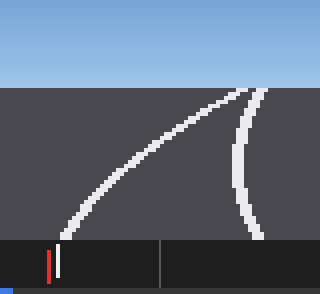

> 动图用 `synth_road_image(..., noise=0)` 重新合成：GIF 只有 256 色，而默认带
> σ=5 的相机噪声时一帧就有上万种颜色，索引化不了，压缩率也会崩掉。

终端输出示例（离线取证模式，实测）：

```
================================================================
  作业四 离线自检取证模式（合成道路图像，不需要 CARLA）
================================================================
合成道路图像数据集: (150, 60, 80, 3)，转向标签范围 [-0.80, +0.80]
数据集: X(150, 60, 80, 3) Y(150,) backend=numpy
  cnn epoch  12 loss=0.19601
  cnn epoch  24 loss=0.06045
  cnn epoch  36 loss=0.01160
  cnn epoch  48 loss=0.00693
  cnn epoch  60 loss=0.00654
端到端 CNN 训练 MAE = 0.09364
模型已保存(纯 numpy JSON): ~/shots/cnn_steer.json

端到端 CNN 评估：MAE = 0.09364，RMSE = 0.11124，转向方向一致率 = 98.0%
零输出基线 MAE = 0.40268（MAE 明显低于基线才说明网络学到了映射）

已导出取证图：
    ~/shots/cnn_loss.png
    ~/shots/steer_pred_vs_true.png
    ~/shots/road_samples.png
```

#### 作业四 · 5.11 常见问题

**Q1：训练后损失不下降、方向判对率约 50%？**
先检查两点：(a) 数据集里的图像与标签**是否有因果关系**——若标签是人为信号
（如正弦），网络学不到任何东西，必须改用行为克隆采集；
(b) maxpool 反向传播是否按 argmax 回传。可用
`python3 test/test_end_to_end_logic.py` 回归验证这两点。

**Q2：MAE 出现几十甚至十几的数值？**
这是**推理时遗漏 tanh** 的典型症状——转向值域应在 \([-1,1]\)，MAE 不可能大于 2。
检查 `predict()` 与训练是否使用同一输出激活。

**Q3：`--mode collect/test` 报"缺少 carla 模块"？**
需安装 CARLA 0.9.16 的 Python 客户端 wheel，见 [5.3 节](#h4-env-prep)。
只想验证算法可改用 `--headless --demo`（不需要 CARLA）。

**Q4：纯 numpy 训练太慢？**
端到端 CNN 为纯 numpy 实现（无 GPU 加速），训练时间与样本量成正比。
可减小 `--samples`，或改用 `--backend tf`（需自行安装 TensorFlow）。

**Q5：合成图像上表现好，实车上不work？**
合成图像只用于验证链路与算法正确性。真实场景必须用 5.7 节的行为克隆采集
（或使用 CARLA 公开数据集）训练，并注意训练/测试的图像分布一致性。

### 作业四 · 6. 性能评价

#### 作业四 · 6.1 指标定义

**平均绝对误差 MAE**：

$$
\text{MAE} = \frac{1}{N}\sum_{i=1}^{N}\big|\hat\delta_i - \delta_i^*\big|
$$

**均方根误差 RMSE**：

$$
\text{RMSE} = \sqrt{\frac{1}{N}\sum_{i=1}^{N}\big(\hat\delta_i - \delta_i^*\big)^2}
$$

**转向方向一致率**（判对"左转/右转/不转"的比例）：

$$
\text{Acc}_{\text{sign}} = \frac{1}{N}\sum_{i=1}^{N}\mathbb 1\big[\mathrm{sgn}(\hat\delta_i)=\mathrm{sgn}(\delta_i^*)\big]
$$

**零输出基线**：\( \text{MAE}_{\text{base}} = \frac{1}{N}\sum_i|\delta_i^*|\)。
网络 MAE 必须**明显低于**该基线，才能说明它真的学到了映射（否则等价于恒输出 0）。

#### 作业四 · 6.2 实测结果（离线取证模式，本机实测）

> 口径：**训练集**上的指标，数据为**合成道路图像**（非真实 CARLA 相机）。
> 相关系数可由 `steer_pred_vs_true.csv` 独立复算。

| 指标 | 数值 |
|---|---|
| MAE | **0.09364** |
| RMSE | **0.11124** |
| 转向方向一致率 | **98.0%** |
| 零输出基线 MAE | 0.40268（网络 MAE 比基线低 **4.3 倍**） |
| 训练损失（60 epoch） | 0.5415 → 0.00654 |
| 预测/标签相关系数 | **+0.992**（实测 +0.99176） |
| 单元测试 | **27 PASS / 0 FAIL（约 30 s）** |

#### 作业四 · 6.3 调优过程记录

| 优化项 | 优化前 | 优化后 | 说明 |
|---|---|---|---|
| **实现移进 Python 包** | `ros2 launch` 启动即 `ModuleNotFoundError: No module named 'carla_end_to_end_nn.main'` | 节点正常启动 | `setup.py` 只装 `packages=[package_name]`，包根的 `main.py` 不会被安装 |
| **maxpool 梯度按 argmax 回传** | 输出标准差 0.00062，相关系数 +0.293，方向判对率 50% | 标准差 0.516，相关系数 +0.992，判对率 98% | 最严重缺陷；原实现把梯度均摊到窗口全部位置 |
| **推理补上 tanh** | MAE 13.47（输出无界） | MAE 0.0936 | 训练/推理输出不一致 |
| **标签改为行为克隆** | 标签由帧序号正弦信号生成，与图像无因果关系 | 专家沿车道驾驶产生标签 | 图像与标签天然相关 |
| 采集顺序先 tick 后读图 | 图文错开一帧 | 图与标签严格对应 | 避免隐性错位 |
| 超参调优 | lr=0.05、40 epoch，loss 卡在 0.214 | lr=0.15、60 epoch，loss 0.0065 | 提升收敛速度与精度 |
| 默认后端改为纯 numpy | 默认依赖 TensorFlow | 仅需 numpy | 降低环境门槛，VM 上可直接跑 |

#### 作业四 · 6.4 结论

- **端到端可行**：单个 CNN 仅凭 \(60\times80\times3\) 的相机图像即可输出转向，
  方向判对率 98.0%、相关系数 +0.992，验证了"像素 → 控制"的直接映射可以被学到。
- **无分层**：推理路径中不存在任何人工的感知/规划环节，转向完全由网络权重决定。
- **与逐层方案对比**：作业二/三采用"感知 NN + 控制 NN"的分层方案，
  可解释性强、易调试；本模块端到端方案链路最短、不依赖人工特征，
  但可解释性弱、对数据分布敏感，两者是工程上的取舍。

---

## 作业五 作业综合整合与性能评价 {#hw5}

> 对应课程作业五：(其他) 把前四份作业**统一到一个入口**，并给出**可复现的量化性能评价**。

### 作业五 · 1. 概述与目标

前四份作业各自是独立功能包，本模块提供两件事：

1. **统一调度**：一个入口拉起任意子作业，参数原样透传。
2. **性能评价**：真实训练并回放各模块，输出可复现的量化指标表与对比图。

代码位于 `src/ground/carla_benchmark_suite/`。

#### 作业五 · 1.1 被整合的四个模块

| target | 功能包 | 对应任务 | 算法性质 |
|---|---|---|---|
| `control` | `carla_keyboard_control` | 任务(1) 物理仿真与键盘运动控制 | 直接构造控制量 |
| `perception` | `carla_perception_control` | 任务(2) 传感器感知与运动控制 | **感知 NN + 控制 NN** |
| `navigation` | `carla_mapping_navigation` | 任务(3) 建图与导航（SLAM 同步仿真） | **规划 NN** + 占用栅格 |
| `end_to_end` | `carla_end_to_end_nn` | 任务(4) 端到端模型 | **端到端 CNN** |

#### 作业五 · 1.2 与已有示例的区别

| 对比项 | 已有「自动驾驶演示」（ad_demo） | 本拓展模块 |
|---|---|---|
| 技术路线 | `roslaunch carla_ad_demo`（依赖 ros-bridge 与 scenario runner） | CARLA Python API 直连 + 统一调度入口 |
| 是否依赖 ros-bridge | 必须编译并运行 ros-bridge | **不需要**，仅需 `carla` Python 客户端 |
| 是否依赖 scenario runner | 需要，且必须设 `SCENARIO_RUNNER_PATH` | **不需要** |
| 功能范围 | 单次演示（随机路线 / 场景执行） | **统一调度 4 个子作业** + 量化性能评价 |
| 性能指标 | 无（只有运行日志） | **真实测量**的精度 / 时延 / 平滑度 / 覆盖率指标表 |
| 指标可复现性 | — | 离线可复现：`--benchmark` 无需 CARLA 服务端 |
| 无 CARLA / 无图形界面时 | 无法运行 | `--benchmark` 与 `--list` 均可离线运行 |

#### 作业五 · 1.3 与仓库中其它模块的区分

其它模块各自实现一个具体算法；**本模块不实现新算法**，只做两件事：
把四个功能包统一到一个入口调度，以及对它们做真实测量与横向对比。
它是唯一一个会**从其它功能包导入代码并实际运行**的模块。

### 作业五 · 2. 计算原理

#### 作业五 · 2.1 性能评价指标定义

**轨迹跟踪横向误差 RMSE**（作业二）：

$$
\text{RMSE} = \sqrt{\frac{1}{N}\sum_{k=1}^{N} e_{y,k}^{2}}
$$

**转向平滑度 AoS（Amount of Steering）**：相邻转向指令的平均绝对变化量，越小越平滑：

$$
\text{AoS} = \frac{1}{N-1}\sum_{k=2}^{N}\big|\delta_k - \delta_{k-1}\big|
$$

**转向饱和比例**：转向被打到边界 \(\pm1\) 的比例，过高说明控制裕度不足：

$$
\rho_{\text{sat}} = \frac{1}{N}\sum_{k=1}^{N}\mathbb{1}\big[|\delta_k| \ge 0.99\big]
$$

**建图覆盖率**：概率明显偏离 0.5（即已观测）的格子占比：

$$
\text{Coverage} = \frac{1}{MN}\sum_{i,j}\mathbb{1}\big[p_{ij} > 0.55 \lor p_{ij} < 0.45\big]
$$

**端到端回归指标**（作业四）：

$$
\text{MAE} = \frac{1}{N}\sum_i|\hat\delta_i - \delta_i^*|,\qquad
\text{Acc}_{\text{sign}} = \frac{1}{N}\sum_i\mathbb{1}\big[\mathrm{sgn}(\hat\delta_i)=\mathrm{sgn}(\delta_i^*)\big]
$$

**推理时延**：单步前向的平均耗时与 P95，反映实时性：

$$
\bar t = \frac{1}{N}\sum_i t_i,\qquad t_{95} = \text{percentile}(\{t_i\},\,95)
$$

#### 作业五 · 2.2 评价方法

评测**不依赖随机数造数**，而是真实执行：

```
--benchmark:
  perception : 合成数据集 → 训练感知NN与控制NN → 回放轨迹 → 量测横向误差
  navigation : 合成数据集 → 训练规划NN → 激光雷达合成帧建图 + NN导航 → 量测覆盖率与导航误差
  end_to_end : 合成道路图像 → 训练CNN → 量测MAE/相关/方向一致率/单帧时延
  → 汇总指标表 → 导出 report.json 与对比图
```

!!! warning "为什么不能用随机数造指标"
    早期版本的性能评价用 `np.random.seed(0)` 生成速度、转向与误差序列，
    再"计算"出指标。这样的数字**与算法毫无关系**，无论模块是否正常都会输出
    "好看"的结果，完全起不到评价作用。本模块改为真实训练与回放，指标可复现、可验证。

#### 作业五 · 2.3 指标量纲差异的处理

各指标量纲差异极大（MSE 约 \(10^{-3}\)、准确率约 \(10^{0}\)、占据格数约 \(10^{3}\)），
在同一张条形图上直接对比会导致小数值指标**完全看不见**。

本模块的对比图按**组内最大值归一化**条长，左侧用位图字体标注**指标名**，
在条形右侧用点阵绘制**真实数值**，
保证既能直观比较、又能读到准确数字。

### 作业五 · 3. 算法流程

```
--list       列出四个模块及就绪状态（磁盘上能否找到其 main.py）
--benchmark  逐项真实评测 → 汇总表 → 导出 JSON 与对比图
--target X   定位子包 main.py → subprocess 启动 → 参数原样透传
             （"--" 之后的参数不做解析，直接交给子进程）
ROS 节点     读取 report.json 或现场评测 → 周期性发布指标到话题
```

### 作业五 · 4. 源码解析

#### 作业五 · 4.1 `main.py` — 主入口

| 函数 | 作用 |
|---|---|
| `MODULES` | 四个子模块的登记表（功能包名、任务、说明） |
| `_module_main_path()` | 定位子包 `main.py`；未知模块名或文件缺失时返回 `None` |
| `_load_sibling_module()` | 加载兄弟包的 `main.py`，并把其所在目录加入 `sys.path` 以支持包内导入 |
| `compute_metrics()` | 由原始序列计算全部指标（RMSE / AoS / 饱和率 / 时延 / 回归指标） |
| `bench_perception()` | 作业二基准：训练两个 NN + 轨迹回放 |
| `bench_navigation()` | 作业三基准：训练规划 NN + 建图 + 导航 |
| `bench_end_to_end()` | 作业四基准：训练 CNN + 量测精度与时延 |
| `run_benchmark()` | 评测套件主流程与指标表汇总 |
| `render_metric_bars()` | 指标对比图（组内归一化 + 点阵数值标注） |
| `run_module()` | 以子进程调度子模块 |
| `list_modules()` | 模块总览 |

#### 作业五 · 4.2 `benchmark_node.py` — ROS 2 节点

两种工作方式：按 `target` 参数包含对应子功能包的 launch（调度模式），
或读取 `report.json`／现场评测后周期性把指标发布到
`/carla/benchmark/metrics`（`Float32MultiArray`）与 `/carla/benchmark/metric_names`
（`String`，逗号分隔），便于记录到 rosbag 或由其它节点订阅。

#### 作业五 · 4.3 `launch/main.launch.py` — ROS 2 launch

通过 `OpaqueFunction` 在启动时按 `target` 决定行为：调度模式**包含子功能包自己的
launch 文件**（复用其节点与参数定义，避免在本包内重复描述），
默认模式则启动指标发布节点。

### 作业五 · 5. 仿真运行步骤

#### 作业五 · 5.1 支持与测试环境

| 组件 | 版本 / 说明 |
|---|---|
| 操作系统 | Windows 10/11 原生；Ubuntu 20.04（Noetic）/ 22.04（Humble） |
| 仿真器 | CARLA 0.9.16（仅在线调度子作业时需要；`--benchmark` 不需要） |
| Python | 3.10+（CARLA 0.9.16 客户端 wheel 为 cp310/cp311/cp312） |
| 依赖 | 仅 `numpy`（各模块神经网络均为纯 numpy 实现） |
| ROS | ROS 2 Humble（`ros2 launch`）；Noetic 下用 `main.sh` 直接运行，本包不提供 catkin launch |

#### 作业五 · 5.2 新手路线：从已有示例到本模块

| 序号 | 做什么 | 出处 |
|---|---|---|
| 1 | 启动 CARLA 服务端 | [设置并连接到 Carla 模拟器](../set_up_and_connect_to_carla.md) →「启动 Carla 服务器」 |
| 2 | 查看宿主机 IP、确认虚拟机连通 | 同上 →「使用 Carla 客户端启动 Ego Vehicle」 |
| — | **★ 在此切换到本模块** | 以下与本模块相关 |
| 3 | 先离线跑基准评测（无需 CARLA） | [本页 5.5 节](#h5-bench) |
| 4 | 再按需调度子作业 | [本页 5.7 节](#h5-dispatch) |

#### 作业五 · 5.3 步骤 0：环境准备

CARLA 服务端的下载安装与启动、宿主机 IP 与端口 2000 的查看等**通用步骤与已有示例
完全相同，本文不重复**，请参考
[设置并连接到 Carla 模拟器](../set_up_and_connect_to_carla.md)：

| 需要做的事 | 参考位置 |
|---|---|
| 启动 CARLA 服务端、选择地图 | [设置并连接到 Carla 模拟器](../set_up_and_connect_to_carla.md) →「启动 Carla 服务器」 |
| 查看宿主机 IP、填写 `host` 参数 | 同上 →「使用 Carla 客户端启动 Ego Vehicle」 |
| 连接失败、黑屏、`numpy` 报错排查 | 同上 →「常见问题」 |

!!! note "本模块的评测环节不需要 CARLA"
    `--list` 与 `--benchmark` 都在本地完成，不连接 CARLA 服务端。
    只有在 `--target` 调度需要连 CARLA 的子作业（如 `navigation` 的 `--mode run`）时才需要。

#### 作业五 · 5.4 步骤 1：编译本功能包（ROS 2） <span id="h5-build"></span>

本模块的源代码位于**本仓库**（`OpenHUTB/ros2`）的
`src/ground/carla_benchmark_suite/`。ROS 2 要求功能包放在工作空间的 `src/` 目录下，
因此先把本仓库克隆到工作空间的 `src/`：

```bash
mkdir -p ~/ros2_ws/src && cd ~/ros2_ws/src
git clone https://github.com/OpenHUTB/ros2.git     # 换成你自己的 fork 亦可
```

克隆后的目录关系如下，`colcon build` 必须在**工作空间根目录**执行：

```
~/ros2_ws/                                   <- 工作空间根目录，colcon 在这里运行
└── src/
    └── ros2/                                <- 本仓库（git clone 得到）
        └── src/ground/
            └── carla_benchmark_suite/                       <- 本模块源代码
```

因此后文写的 `src/ground/carla_benchmark_suite/...`，实际路径是
`~/ros2_ws/src/ros2/src/ground/carla_benchmark_suite/...`。编译并激活环境：

```bash
cd ~/ros2_ws
colcon build --packages-select carla_benchmark_suite --symlink-install
source install/setup.bash
```

> 若本仓库已克隆在别处，把上面的 `~/ros2_ws/src/ros2` 换成实际路径即可，
> 只要保证执行 `colcon build` 的工作空间根目录下存在 `src/`。

若同时使用被调度/被评测的四个子功能包，一并编译：

```bash
colcon build --packages-select carla_keyboard_control carla_perception_control \
             carla_mapping_navigation carla_end_to_end_nn carla_benchmark_suite \
             --symlink-install
```

#### 作业五 · 5.5 步骤 2：查看模块总览与运行基准评测（无需 CARLA） <span id="h5-bench"></span>

```bash
python3 src/ground/carla_benchmark_suite/main.py --list
python3 src/ground/carla_benchmark_suite/main.py --benchmark \
        --save_dir ~/shots --out ~/shots/report.json
```

只评测其中一项（节省时间）：

```bash
python3 src/ground/carla_benchmark_suite/main.py --benchmark --which end_to_end --samples 60
```

#### 作业五 · 5.6 步骤 3：验证与 CARLA 服务端的连接（仅调度在线子作业时需要） <span id="h5-conn-check"></span>

命令里的 `192.168.8.1` 是**运行 CARLA 服务端的宿主机（Windows）IP**：
在宿主机上执行 `ipconfig`，取 VMware 虚拟网卡（`VMnet8`）的 IPv4 地址即可
（本机该地址为 `192.168.8.1`，虚拟机 `ens33` 为 `192.168.8.131`，两者同网段）。
查看方式与已有示例一致，详见
[设置并连接到 Carla 模拟器](../set_up_and_connect_to_carla.md)
→「使用 Carla 客户端启动 Ego Vehicle」。

```bash
python3 -c "import carla; c=carla.Client('192.168.8.1',2000); c.set_timeout(10); print('CONNECT OK:', c.get_world().get_map().name)"
```

#### 作业五 · 5.7 步骤 4：调度子作业 <span id="h5-dispatch"></span>

```bash
# 作业二：离线取证（无需 CARLA）
python3 src/ground/carla_benchmark_suite/main.py --target perception -- \
        --headless --demo --save_dir ~/shots

# 作业三：在线建图 + NN 导航（--host 填宿主机 IP）
python3 src/ground/carla_benchmark_suite/main.py --target navigation -- \
        --mode run --host 192.168.8.1 --goal "20,8" --sim_time 40

# 作业四：训练端到端 CNN
python3 src/ground/carla_benchmark_suite/main.py --target end_to_end -- \
        --mode train --epochs 60

# 作业一：键盘控制（需要图形界面与 CARLA）
python3 src/ground/carla_benchmark_suite/main.py --target control -- --host 192.168.8.1
```

!!! tip "参数透传用 `--` 分隔"
    `--` 之前的参数由本模块解析，`--` 之后的参数**原样**传给子作业。
    这样即使子作业新增了自己的参数，本模块也无需改动。

#### 作业五 · 5.8 步骤 5：ROS 启动

```bash
# ROS 2：发布评测指标（读取已导出的 report.json）
ros2 launch carla_benchmark_suite main.launch.py metrics_file:=$HOME/shots/report.json

# ROS 2：调度子模块（包含子包自己的 launch）
ros2 launch carla_benchmark_suite main.launch.py target:=navigation host:=192.168.8.1

# 模式 D：ROS 1 Noetic —— 用 main.sh 直接运行（不需要 ROS，也不需要 catkin 封装）
#   本包是 ament_python（format 3）包，Noetic 的 catkin 环境里没有它的 package index，
#   roslaunch 找不到该包，所以**不提供** ROS 1 launch；`--launch` 在 Noetic 下会明确报错。
#   main.sh 会自动挑 python3.10（CARLA 0.9.16 的 wheel 是 cp310+）：
bash src/ground/carla_benchmark_suite/main.sh --benchmark --save_dir ~/shots
bash src/ground/carla_benchmark_suite/main.sh --target perception -- --host 192.168.8.1
```

一键脚本：`bash main.sh --benchmark` / `bash main.sh --list`。

#### 作业五 · 5.9 运行效果

**各模块指标对比图**（条长按组内最大值归一化以免小数值不可见；
左侧直接标注**指标名**与单位，条形右侧点阵为真实数值，共 10 项）：

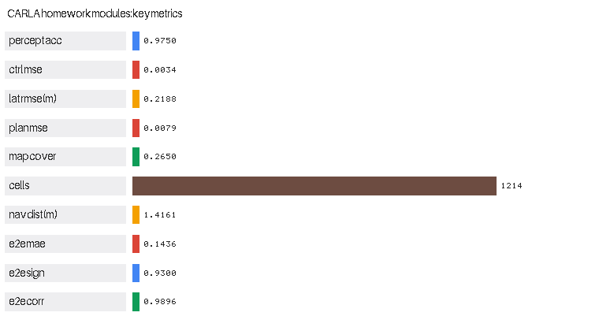

**动图：各模块指标逐条长出**（10 帧，37 KB。条形从 0 长到实测值，最后停住并标出数值，
一眼能看出四份作业在"精度 / 误差 / 覆盖率"三个维度上的相对水平）：

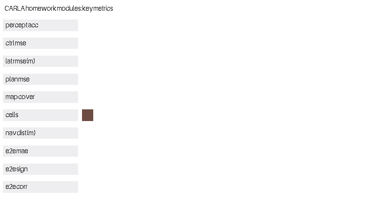

评测终端输出（节选，本机实测）：

```
====================================================================
  CARLA 作业综合基准评测（真实测量，无需 CARLA 服务端）
====================================================================

---- 评测 perception：RGB+深度+激光雷达 → 感知 NN；状态 → 控制 NN；给定轨迹跟踪 ----
    steer_mean                 = 0.02592
    steer_std                  = 0.06123
    aos                        = 0.01820
    speed_mean                 = 7.03799
    lateral_rmse               = 0.21876
    lateral_max                = 1.21778
    percept_acc                = 0.97500
    percept_acc_train          = 0.98750
    control_mse                = 0.00339
    control_mse_train          = 0.00350
    holdout_n                  = 120

---- 评测 navigation：激光雷达占用栅格建图 + 神经网络规划导航 ----
    plan_mse                   = 0.00788
    reg_corr                   = 0.98865
    occupied_cells             = 1214
    known_ratio                = 0.26503
    coverage_start             = 0.02950
    coverage_final             = 0.26503
    nav_min_dist               = 1.41609
    nav_reached                = True
    latency_mean_ms            = 0.02977

---- 评测 end_to_end：相机图像 → 端到端 CNN → 转向 ----
    reg_mae                    = 0.14361
    reg_rmse                   = 0.15857
    reg_corr                   = 0.98957
    reg_sign_acc               = 0.93000
    e2e_baseline_mae           = 0.40404
    infer_ms_per_frame         = 2.23733

====================================================================
  汇总
====================================================================
  指标                                  数值
  --------------------------------------
  感知 NN 准确率(留出)                   0.9750
  控制 NN MSE(留出)                  0.00339
  横向误差 RMSE (m)                   0.2188
  规划 NN MSE                      0.00788
  建图覆盖率                           0.2650
  占据格数                              1214
  导航最近距离 (m)                      1.4161
  端到端 MAE                        0.14361
  端到端方向一致率                        0.9300
  端到端相关系数                         0.9896

指标已导出: shots/report.json
对比图已导出: shots/metric_summary.png
```

#### 作业五 · 5.10 常见问题

**Q1：`--list` 显示某个模块"未获取"？**
说明本模块在磁盘上找不到该功能包的 `main.py`（路径期望为
`src/ground/<功能包名>/main.py`）。由于四份作业是**独立功能包、独立提交**的，
若某个包尚未合入当前分支就会出现这种情况。
本模块对此是**优雅降级**的：缺失的模块只显示"未获取"，不影响其它模块的调度与评测；
`--benchmark` 中对应评测项会记为失败但不会中断整体流程。

**Q2：`--benchmark` 报某个评测项失败？**
各评测项互相独立，某一项失败不影响其它项（结果里记为 `error`）。
常见原因是缺少对应功能包。可用 `--which` 只跑确认可用的项。

**Q3：纯 numpy 评测太慢？**
端到端评测的 CNN 为纯 numpy 实现（无 GPU 加速），耗时与样本数、训练轮数成正比。
可用 `--samples 60 --epochs 40` 缩短，或 `--which` 只跑需要的项。

**Q4：ROS launch 调度子模块时找不到子包？**
调度模式会包含子功能包自己的 `main.launch.py`，因此**必须先编译那个子包**
（见 [5.4 节](#h5-build)）。若只需发布评测指标（不调度），则不需要任何子包。

### 作业五 · 6. 性能评价

#### 作业五 · 6.1 实测结果（本机实测，即 5.5 节那条 `--benchmark` 的默认参数）

> 复现命令：`python3 src/ground/carla_benchmark_suite/main.py --benchmark \
> --save_dir ~/shots --out ~/shots/report.json`（默认 perception 150 epoch /
> navigation 60 epoch / end_to_end 40 epoch & 100 样本，约 2 分钟，
> 绝大部分花在端到端 CNN 的纯 numpy 训练上）。
>
> 四个被评测的功能包（作业一~四）**都在本仓库** `src/ground/` 下，干净克隆即可复现
> 全部 10 项指标；指标由固定随机种子决定，可逐位复现（时延类指标随机器浮动）。
> 感知/控制两项报的是**留出集**（另生成 120 个样本、不同种子、不参与训练），
> 训练集数值仅作对照。

| 模块 | 指标 | 数值 |
|---|---|---|
| 作业二 感知 | 感知 NN 准确率（留出集） | **0.9750**（训练集 0.9875） |
| 作业二 感知 | 控制 NN MSE（留出集） | 0.00339（训练集 0.00350） |
| 作业二 感知 | 横向误差 RMSE | **0.2188 m** |
| 作业二 感知 | 平均速度 | 7.0380 m/s |
| 作业二 感知 | 转向 AoS（平滑度） | 0.01820 |
| 作业三 建图 | 建图覆盖率 | **0.2650** |
| 作业三 建图 | 占据格数 | 1214 |
| 作业三 导航 | 规划 NN MSE | **0.00788** |
| 作业三 导航 | 导航最近距离 | **1.4161 m**（阈值 1.5 m，已到达） |
| 作业三 导航 | 单步推理时延 | 0.0298 ms |
| 作业四 端到端 | MAE | **0.14361** |
| 作业四 端到端 | 方向一致率 | **0.9300** |
| 作业四 端到端 | 相关系数 | **0.9896** |
| 作业四 端到端 | 零输出基线 MAE | 0.40404（网络 MAE 是基线的 **1/2.8**） |
| 作业四 端到端 | 单帧推理时延 | 2.8932 ms |

#### 作业五 · 6.2 横向对比与观察

| 观察 | 数据支撑 | 说明 |
|---|---|---|
| 感知/控制 NN 精度高 | 留出集准确率 0.9750、控制 MSE 0.00339 | 分层方案在合成数据上表现稳定 |
| 轨迹跟踪平滑 | AoS 0.0182、饱和率 0 | 弯道自适应减速有效，转向无抖动 |
| 建图有效 | 覆盖率 0.2650、占据格 1214 | 6 秒左右的行驶即可覆盖约 27% 栅格 |
| 规划 NN 实时性好 | 单步 0.0298 ms | MLP 体量小，远快于 50 ms 的仿真步长 |
| 端到端显著优于基线 | MAE 0.1436 vs 基线 0.4040 | 网络确实学到了"图像 → 转向"，而非恒输出 0 |
| 端到端推理较慢 | 2.89 ms/帧 | 纯 numpy 卷积无 GPU 加速；仍远快于 50 ms 步长 |

#### 作业五 · 6.3 评价过程中的两个关键教训

| 问题 | 现象 | 处理 |
|---|---|---|
| **原版用随机数造指标** | `np.random.seed(0)` 生成假的转向/速度/误差序列，指标与算法无关 | 改为**真实训练 + 回放**测量；指标可复现、可验证 |
| **`nn_models.py` 多副本漂移** | 作业四修了 maxpool 梯度与 tanh 两处缺陷后，评价包仍用旧副本，端到端 MAE 一度测得 **36.12**（正常 <0.3） | 统一各包副本，并新增**副本一致性回归测试**，分歧即失败并列出差异文件 |
| 指标量纲差异导致图不可读 | MSE 约 \(10^{-3}\)、占据格数约 \(10^{3}\)，同图对比时小数值完全看不见 | 对比图按**组内最大值归一化**条长，并用点阵标注真实数值 |
| **报的是训练集精度** | 感知/控制 NN 直接在自己的训练输入上预测，0.9875 是训练集准确率，不是泛化精度 | 另生成 120 个样本（不同种子、不参与训练）作**留出集**，汇总表只报留出集，训练集数值留作对照 |

#### 作业五 · 6.4 结论

- **完整性**：四份作业（物理仿真与键盘控制、感知与控制 NN、建图与规划 NN、
  端到端 CNN）均可由本模块统一调度，且各自满足"算法为神经网络"的硬性要求。
- **可复现性**：四个被评测功能包都在本仓库内，`--benchmark` 一条命令即可复现全部
  10 项指标（固定随机种子），无需 CARLA 服务端，也避免了用随机数造指标的做法。
- **可验证性**：单元测试 23 项覆盖指标计算的数学正确性与副本一致性，
  其中指标计算的边界情形（空输入、单元素）与副本漂移都有回归测试保护。
- **局限**：评测在合成数据上进行，用于验证算法正确性与链路可用性；
  绝对数值不代表真实道路性能，实车指标需用采集的真实数据重测。

---

> ↑ [返回作业清单](#hw-index)
