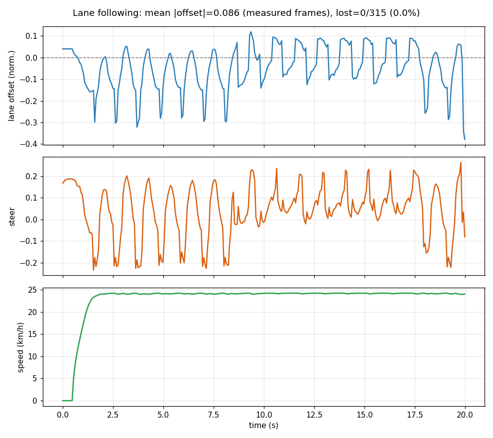
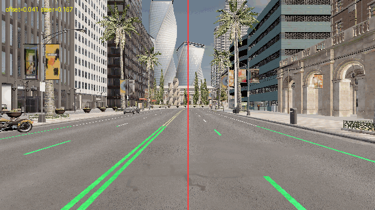
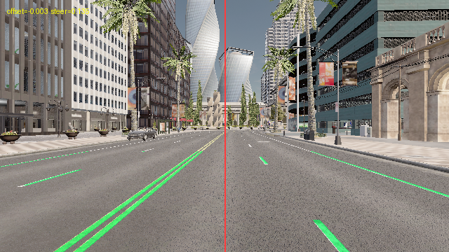
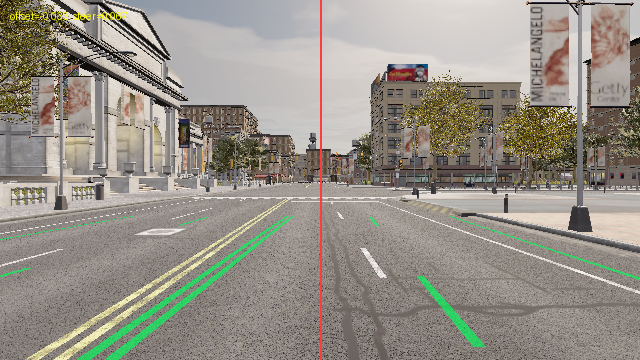

# 车道线巡线（语义分割 + PID）

> 模块路径：`src/ground/carla_lane_following` ｜ 载体：地面车 ｜ 地图：Town10HD_Opt

## 1. 实验目的

验证纯视觉的横向控制链路：只用一台语义分割相机，不加任何高精地图先验，
让车辆在车道内稳定行驶，并用横向偏移量量化"稳不稳"。

## 2. 计算原理

### 2.1 语义分割取车道线

相机输出 640×360 的语义分割图，每个像素的类别号存在 `R` 通道（`arr[..., 2]`）。
车道线类别 `tag = 24 (RoadLines)`，只保留画面下部 ROI（`y > roi_top·H`，`roi_top = 0.60`）。

对 ROI 内的每一列统计车道线像素数，列内像素数 ≥ `min_col_pixels = 10` 才视为一段有效车道线。
左右半屏各取"离画面中心最近"的那一列：

$$
x_L = \max\{x < W/2 \mid \text{cols}(x) \ge 10\},\qquad
x_R = \min\{x \ge W/2 \mid \text{cols}(x) \ge 10\}
$$

两条线靠得太近（`0 < x_R - x_L < 0.15W`）时判为"同一条线被劈成两半"，只保留右侧。

### 2.2 横向偏移与航向误差

设画面宽 `W`，中心 `x_c = W/2`，近场（ROI 下半）与远场（ROI 上半）各算一次车道中心
`x_near`、`x_far`，则**归一化**偏移与航向误差为：

$$
e = \frac{x_{\text{near}} - x_c}{W/2},
\qquad
\psi = \frac{x_{\text{far}} - x_{\text{near}}}{W/2}
$$

`e > 0` 表示车偏右（车道中心在画面右侧），`ψ` 反映车头相对车道的夹角——用"远场减近场"而不是只看单点，
能提前感知车头偏转，抑制来回画龙。

### 2.3 单侧估计

城市地图上车道线常是虚线，很多帧只能看到一侧。此时用**历史车道宽度** `w` 补另一侧：

$$
x_{\text{center}} =
\begin{cases}
x_L + w/2, & \text{只有左侧线}\\
x_R - w/2, & \text{只有右侧线}
\end{cases}
$$
`w` 只在两侧都可见时更新（0.1W ≤ w ≤ 0.9W）。
只有一侧、且还没有历史宽度时（`source = single`），中点估计会偏半个车道宽，
**不参与统计、也不用于控制**（按丢线处理），避免污染均值。

### 2.4 PID 横向控制 + 速度环

误差先做 EMA 平滑：`e_s(k) = 0.6·e(k) + 0.4·e_s(k−1)`，再进 PID：

$$
u = k_p e_s + k_i \int e_s\,dt + k_d \psi,
\qquad k_p = 1.2,\; k_i = 0.02,\; k_d = 1.0
$$

积分项限幅 `∫e ∈ [−1, 1]`，输出限幅 `|u| ≤ max_steer = 0.6`。速度用比例环：

$$
\text{throttle} = \operatorname{clamp}\left(k_v (v^\* - v),\, 0,\, 0.85\right),
\qquad k_v = 0.25,\; v^\* = 8\ \mathrm{m/s}
$$

`v − v* < −2 m/s` 时轻踩刹车（`brake = 0.4`）。丢线时转向按上一帧 ×0.85 柔性保持，油门上限降到 `lost_throttle = 0.3`。

## 3. 算法流程

```text
1. 起点筛选：按 (是否同路 0/100 + 航向偏差) 给出生点打分，逐个试看左右车道线是否都可见
2. 起车后每个控制周期（20 Hz）：
3.     语义分割帧 -> ROI(tag=24) -> 左右车道线列
4.     两侧都有 -> 中点；只有一侧 -> 用历史宽度补（否则标记 single，不用于控制）
5.     近场偏移 e、远场减近场得航向 ψ
6.     e_s = 0.6*e + 0.4*e_s_prev
7.     steer = clamp(kp*e_s + ki*∫e + kd*ψ, ±max_steer)
8.     throttle = clamp(0.25*(v* - v), 0, 0.85)；丢线时 0.3
9.     记录 (t, offset, offset_used, steer, speed_kmh, lost, source) 到 run_log.csv
10.    每 2 s 存一张带标注的 RGB 帧
11. 结束后统计：只对真实测量帧求平均/最大偏移，丢线占比、感知来源分布、是否跑满时长
```

## 4. 代码解析

| 文件 / 函数 | 作用 | 关键点 |
|---|---|---|
| `app.py::rank_spawns` | 候选起点打分 | 按"同路 + 航向偏差"排序，逐个用语义相机确认左右线可见 |
| `app.py::_band_positions` | 单条横带里找左右线 | 每侧取离中心最近的列；两线过近判为同一条线被劈开 |
| `app.py::_band_center` | 算车道中心 | 两侧齐全取中点；单侧用历史宽度补；不可靠时返回 `single` |
| `app.py::semantic_lane_offset` | 分割图 → (偏移, 航向, 掩码, 来源) | 近场/远场两次调用，返回来源以便统计口径 |
| `app.py::annotate` | 标注帧 | 车道线高亮 + 画面中心线 + offset/steer 文本 |
| `app.py::run` | 主循环 | 20 Hz 控制、丢线保护、速度环、逐帧落盘、证据输出 |
| `test/test_carla_lane_following.py` | 8 项单测 | 双侧/缺右侧/双线劈开/单侧宽度补全/全无线/错 tag + 判据配置断言 |

参数全部在 `config/params.yaml`：`perception`（tag、ROI、最小列像素）、`control`（kp/ki/kd、限幅、时长）、
`evaluation`（平均偏移上限、丢线占比上限、是否要求跑满）。

## 5. 仿真步骤与终端输出

```bash
# 1) 安装依赖（Windows / Linux 通用）
pip install -r requirements.txt          # numpy / matplotlib / PyYAML / pillow
# 仿真器客户端（不是 pip 包）：Windows 用 OpenHUTB 配套 hutb wheel，Linux 需自编译 libcarla

# 2) 启动仿真器（示例路径：%HUTB_ROOT% 或 ${HUTB_ROOT}，按实际安装位置替换）
%HUTB_ROOT%\CarlaUE4.exe Town10HD_Opt -windowed -carla-rpc-port=2000

# 3) 运行实验
cd src/ground/carla_lane_following
python main.py --host 127.0.0.1 --port 2000 --map Town10HD_Opt

# 4) 单测
python -m pytest test -q
```

实际输出（2026-11-11 本机运行，Python 3.10 + hutb 客户端）：

```text
[lane] 已连接 127.0.0.1:2000 | 服务端版本 3ea2130ed | 地图 Carla/Maps/Town10HD_Opt
[lane] 选定起点 spawn[61]（score=0.0，初始偏移 0.041）
[lane] 开始巡线：目标车速 8.0 m/s
[lane] 标注帧 -> lane_000.0s.png（offset=0.021 steer=0.030）
...
[lane] 达到设定时长 20.0s，正常结束
[lane] 平均偏移 0.0858（315/315 帧测到，丢线 0.0%），时长 20.0s/20.0s，结论：PASS
```

## 6. 实验结果

| 指标 | 数值 |
|---|---|
| 起点 | spawn[61]，初始偏移 0.041 |
| 目标车速 / 实测 | 8 m/s（29 km/h）/ 平均 23.1、最大 24.2 km/h |
| 总帧数 / 时长 | 315 帧 / 20.0 s（跑满设定时长） |
| 丢线帧（source=none） | 0 帧（0.0%）；单侧估计 66 帧 |
| 感知来源 | dual 249 / left_only 66 / right_only 0 / none 0 |
| 平均 \|横向偏移\|（归一化） | **0.086**（只统计真实测到的帧） |
| 判定 | PASS（平均偏移 0.086 ≤ 0.25，丢线 0% ≤ 20%，跑满 20 s） |

横向偏移、转向角与车速曲线：



### 运行证据文件

| 文件 | 内容 | 说明 |
|---|---|---|
| `docs/run_log.csv` | 315 行逐帧 `t/offset/offset_used/steer/speed_kmh/lost/source` | `offset` 只记真实测量值，`offset_used` 是控制用的平滑值 |
| `docs/result.png` | 偏移/转向/车速三联曲线 | 由 CSV 直接绘制 |
| `docs/lane_*.png` | 每 2 s 一张标注帧 | 车道线高亮 + offset/steer |
| `docs/summary.md` | 帧数、丢线占比、来源分布、PASS 判据 | 运行时生成 |

> 这些是 **tracked 的运行证据**，重跑 `python main.py` 会覆盖它们。

## 7. 结论

在车道线清晰的路段，纯视觉巡线可以把归一化横向偏移稳定在 0.09 以内（约等于车道宽度的 4.5%），
PID + 航向项的组合能有效抑制"来回画龙"；丢线时用历史宽度做单侧估计，能把虚线造成的漏检压到 0。

## 8. 局限与改进

1. 车道线缺失路段（贴砖、磨损、路口）会丢线，长距离运行需要叠加地图先验或历史车道估计。
2. 偏移是归一化量，没有做相机内参标定到米（已知 `fov=95°`、`640×360`，理论上可按针孔模型反推，留给后续）。
3. 只在 Town10HD_Opt 上验证，换地图需要重新确认 tag=24 的覆盖率。
4. 实验时长定为 20 s：这条路线约 20 s 后进入无标线路段，40 s 版本丢线率 45%，不适合作为车道保持验证。

## 运行效果（截图 / 动图）







> 动图由本次实际运行产生的帧合成（GIF < 5 MB，PNG < 3 MB）。
