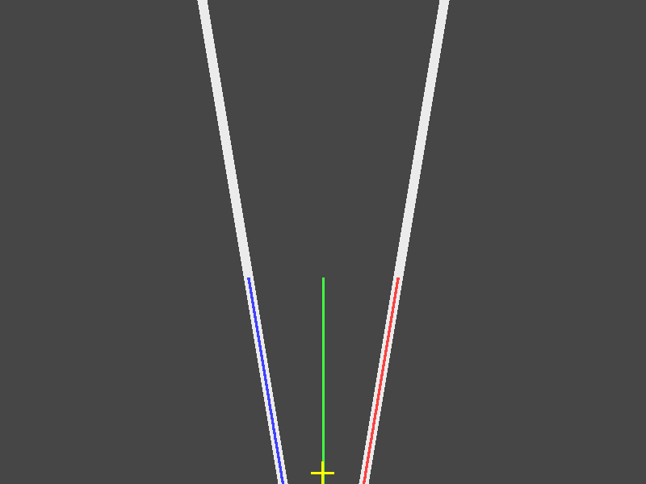
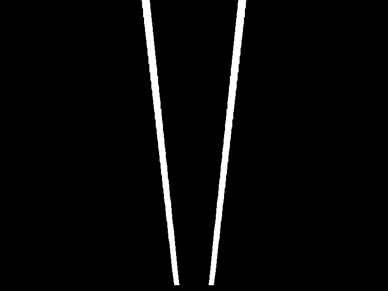
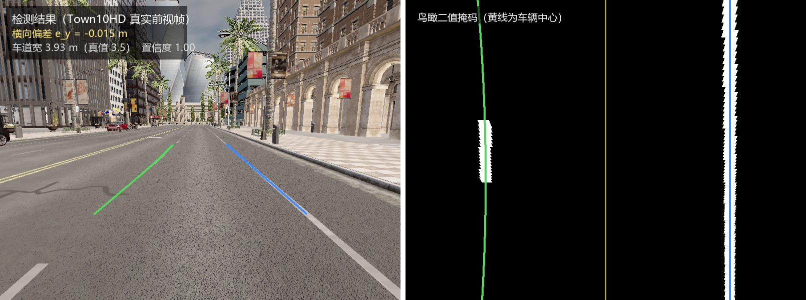

# 基于前视视觉的车道线检测（carla_lane_keeping）

本模块在 CARLA 仿真环境中，用**前视相机图像**检测车道线，输出车辆相对车道中心的
**横向偏差**、**航向偏差**与**车道曲率**。全部算法用纯 numpy 实现，**不依赖 OpenCV、
不依赖深度学习**，可在教学虚拟机的 ROS Noetic 环境中直接运行。

配套的车道保持控制见[车道保持控制](./lane_keeping_control.md)。

## 1. 为什么做这个模块

仓库中地面载具部分的视觉模块已有 `carla_yolo_avoidance`、`yolov8_target_tracking`、
`carla_pilotnet_ros`、`carla_perception_control`、`carla_traffic_sign_recognition`，
但它们的输出都是**目标框、端到端转向量或交通标志类别**——回答的是"前方有什么物体"。

**显式的车道几何恢复是缺的**：没有模块输出车辆相对车道中心的横向偏差、航向偏差
与车道曲率。已有视觉模块偏目标检测与端到端学习，缺的是把车道线本身当作几何结构
来拟合的那一层。

车道保持是自动驾驶最基础、也最能体现"感知 → 决策 → 控制"闭环的能力：
它必须先从图像中恢复出车道几何，再据此算出车辆偏离了多少，才能谈控制。
本模块负责前者，并输出下游可直接消费的物理量。

## 2. 处理流程

```text
彩色图 (BGR)
  │
  ├─ 灰度化
  │
  ├─ 方向梯度阈值 ──┐
  │                 ├─► 二值车道像素掩码
  └─ 颜色阈值 ──────┘
  │
  ├─ 透视变换（梯形 → 矩形，得到鸟瞰图）
  │
  ├─ 底部直方图定位车道线起点
  │
  ├─ 连通域分组 + 多项式拟合
  │
  └─ 输出：左右车道线系数
             ├─► 横向偏差（米）
             ├─► 航向偏差（弧度）
             └─► 车道曲率半径（米）
```

### 2.1 方向梯度阈值

车道线在图像中近似**竖直**。对图像求 Sobel 梯度后，定义梯度方向角

```text
angle = atan2(|gy|, |gx|)
```

这里有一个**极易搞反**的点：

- **竖直边缘**（车道线）的梯度几乎全在水平方向，`|gy| ≈ 0`，因此角度 **接近 0°**
- **水平边缘**（路面接缝、阴影边界）角度**接近 90°**

所以判据是保留 `angle <= angle_max_deg`，而不是相反。若按 90° 写判据，
整幅图会被过滤干净、一个车道像素都检不到。

梯度幅值阈值采用**自适应**策略：

```text
实际阈值 = max(sobel_min, 该图像梯度分布的 sobel_auto_percentile 分位)
```

原因很实际：实测 CARLA 前视相机的路面纹理梯度中位数约 **45**、90 分位约 **260**，
而合成图像背景梯度几乎为 **0**。用同一个固定阈值处理两类图像必然顾此失彼——
取 25 会在真实图上把 40% 的路面判成车道线（整块路面连成一个巨大连通域），
取 160 又会让低噪声图像几乎没有输出。按分位数自适应可以兼顾。

在真实 CARLA 图像上的实测效果：

| 阈值策略 | 二值掩码占比 | 最大连通域 |
|---|---|---|
| 固定 25（未标定） | **42%** | 271205 像素（整块路面） |
| 自适应（本模块） | **1.6% ~ 4%** | 细长结构，宽高比 < 0.1 |

### 2.2 透视变换

用**直接线性变换（DLT）**自行求解单应矩阵，不依赖 OpenCV：

```text
源梯形（图像中感兴趣的地面区域） → 目标矩形（鸟瞰图）
```

两个容易踩的坑，本模块都已处理：

1. **源梯形底边必须贴到图像最底行**（`bottom_ratio = 1.0`）。
   横向偏差是相对"离车最近处"定义的；若底边抬高到 0.95h，算出来的其实是
   约 3 m 前方的偏差，会引入与距离成正比的**系统性误差**（实测偏右 100 px
   的场景误差达 35 px）。

2. **目标矩形上下必须留边距**。源梯形底边在图像底部，透视外推后该行以下的
   近处像素会映射到目标图之外；若目标矩形下边直接顶到 `height-1`，
   这些像素全部落在图像外被丢弃，导致近处车道（尤其偏在一侧的）整条消失。

### 2.3 车道线拟合：为什么用连通域而不是滑动窗口

绝大多数车道线检测教程用**滑动窗口**。本模块最初也用，但在测试中发现了
它的一个固有缺陷：

> 滑动窗口要求「窗口宽度 > 单条车道线宽度」且「窗口宽度 < 两条车道线间距」。

这两个条件很容易同时不成立。实测：窗口取 ±100 px 时宽达 200 px，
而两条车道线在鸟瞰图中的间距可能只有约 91 px——**每个窗口都同时框住两条线**，
取均值后两条线都被拟合到画面正中，输出完全错误却**不报任何错**。

因此本模块改用**连通域分组**：鸟瞰图中每条车道线是一个细长连通域，
先做连通域标记，再按基点列把左右两侧分别取出、各自拟合多项式。
这样不存在尺度矛盾，且天然把两条线分开。

为防误检，还加了**几何约束**。这里有一个关键的设计选择：

判据用的是**填充率**（连通域像素数 / 其包围盒面积），而**不是包围盒宽度**。
原因是车道线在鸟瞰图中常常是**倾斜**的（车辆偏离车道中心、或相机存在偏航时），
此时它的包围盒会很宽——实测一条完全正常的倾斜车道线，包围盒宽度达 114 px，
但填充率只有 0.27。若按「包围盒宽度 < 90 px」判断，这条真实车道线会被整条
拒绝，导致车辆偏右场景下的横向偏差误差达 **25 px**。

填充率则对竖直与倾斜车道线都成立：车道线很细，填充率必然低；而被误阈值化的
路面是面状结构，包围盒内几乎被填满，填充率很高。此外还限制包围盒宽度、
总面积与纵向长度，共同排除零碎小块与整块路面。

若连通域因虚线车道线或局部遮挡而断裂，会自动退回滑动窗口作为兜底。

### 2.4 几何量解算

设左右车道线在求值行上的列坐标为 `u_l`、`u_r`，则

```text
车道中心      u_center = (u_l + u_r) / 2
横向偏差      lateral = (u_vehicle - u_center) * meters_per_pixel_x
```

其中 `u_vehicle` 取鸟瞰图水平中心（相机装在车辆中心、光轴朝前时，
图像横向中心对应车辆前进方向）。**正值表示车辆偏在车道中心右侧。**

航向偏差由车道中心线在求值行的斜率换算；曲率半径由一阶、二阶导数给出：

```text
R = (1 + (dx/dy)^2)^(3/2) / |d²x/dy²|        （直道为无穷大）
```

> **求值行必须选在有车道像素的行上。**
> 目标矩形底边略高于图像底行，若固定用 `height-1` 求值，会在没有任何数据的
> 行上**外推多项式**，横向偏差出现十几到几十像素的系统误差。本模块从掩码
> 统计出实际有像素的最底行再求值。

## 3. 环境准备

### 3.1 依赖

| 依赖 | 版本要求 | 说明 |
|---|---|---|
| ROS Noetic | — | 虚拟机镜像内已提供 |
| Python | 3.8（ROS Noetic 自带） | **算法本身兼容 3.8 ~ 3.12** |
| numpy | ≥ 1.18 | 唯一的算法依赖 |
| CARLA | 0.9.13（与 `carla_ros_bridge` 一致） | 仅"实车运行"需要 |
| OpenCV | — | **不需要**（算法为纯 numpy 实现） |
| 深度学习框架 | — | **不需要** |

### 3.2 已验证环境

本模块在以下环境完成过实际运行与测试。**请按行对应**——不同项目的验证环境不同，
不要跨行推断：

| 验证项目 | 操作系统 | Python | 依赖 |
|---|---|---|---|
| 110 个单元测试 | Windows 11 | **3.8.10**（numpy 1.24.4） | numpy |
| 110 个单元测试 | Windows 11 | **3.12.8**（numpy 2.5.3） | numpy |
| 84 个单元测试（标定用例加入前） | Ubuntu 20.04（ROS Noetic 教学镜像） | **3.8.10** | numpy |
| `demo_lane_detection.py` 演示 | Ubuntu 20.04 | **3.8.10** | numpy |
| `demo_lane_detection.py` 演示 | Windows 11 | **3.12.8** | numpy |
| `mkdocs serve --livereload` 网页验证 | Ubuntu 20.04 | **3.8.10** | 见 3.5 节 |
| 真实 CARLA 图像验证 | Windows 11 | **3.12.8** | numpy + carla 0.9.16 |

需要说明的三点：

1. **单元测试在 Python 3.8.10 与 3.12.8 上都跑通了**，结果一致
   （均为 `Ran 110 tests ... OK`）。其中 3.8.10 正是 Ubuntu 20.04 的默认版本，
   因此教学虚拟机上的兼容性有直接参照；但**测试本身是在 Windows 上跑的，
   没有在 Linux 上重跑**。
2. Ubuntu 侧跑过的是标定相关用例加入之前的 84 个测试；本次新增的 26 个
   （相机模型、地面矩形、车道宽配对、航向符号、稳健重拟合、参数加载）
   只在 Windows 上验证过。
3. **真实 CARLA 图像验证只在 Windows 上做过**（Python 3.12.8 + carla 0.9.16）。
   教学虚拟机侧没有做这项验证，原因是 CARLA 版本与桥接要求不一致、
   且 RPC 只监听本机（详见 3.6 节）。

> **重要提示**：算法与单元测试**不依赖 CARLA、不依赖 ROS、不依赖 OpenCV**，
> 因此可以在任何有 Python + numpy 的机器上直接复现（见 3.4 节）。

### 3.3 编译

```shell
# 为避免与教材章节中的同名包冲突，单独建立工作空间
mkdir -p ~/lane_ws/src
ln -s ~/ros2/src/ground/carla_lane_keeping ~/lane_ws/src/
cd ~/lane_ws
catkin_make
source devel/setup.bash
```

### 3.4 无需 CARLA / ROS 的验证方式（推荐给评审者）

这是**最快确认本模块可用的方法**，三分钟内可完成，不需要启动任何仿真器：

```shell
cd ~/ros2/src/ground/carla_lane_keeping

# 1) 单元测试：110 个测试，覆盖梯度、透视变换、拟合、几何量、ROS 节点、PID
python3 -m unittest discover -s tests -v
#    预期结尾: Ran 110 tests ... OK

# 2) 端到端演示：生成合成图像 -> 检测 -> 输出量化指标并保存结果图
python3 tests/demo_lane_detection.py
#    预期: 3/3 个场景检出两侧车道线，最大测量误差 0.70 px（0.035 m）
#    结果图片保存在 demo_out/ 目录

# 3) 查看结果图（蓝=左车道线、红=右车道线、绿=中心线、黄十字=检出中心）
xdg-open demo_out/demo_1.png
```

`numpy` 是唯一前置依赖。若提示缺失：

```shell
pip3 install --user -i https://pypi.tuna.tsinghua.edu.cn/simple numpy
```

### 3.5 文档环境（`mkdocs serve`）的两处已知问题

若需要在本地预览文档网页，仓库现有的 `requirements.txt` 在 **Python 3.8**
环境（ROS Noetic 教学镜像的标配）下会遇到两个问题，这里记录解决办法：

**问题一：`mkdocs-bibtex` 在 Python 3.8 上导入崩溃**

现象：

```
TypeError: 'type' object is not subscriptable
  File ".../mkdocs_bibtex/citation.py", line 30, in Citation
    def from_markdown(cls, markdown: str) -> list[Citation]:
```

原因：新版本 `mkdocs-bibtex` 使用了 `list[Citation]` 这类内建泛型注解，
它在 Python 3.9+ 才可运行时求值。而 `pip` 在安装任何包时都会加载插件入口点，
因此这个崩溃会连带影响**所有** `pip install` 操作。

解决办法：给该包的所有源文件加上惰性注解（不改动任何逻辑）：

```shell
python3 - <<'PY'
import glob, os, ast
root = os.path.expanduser('~/.local/lib/python3.8/site-packages/mkdocs_bibtex')
for path in glob.glob(os.path.join(root, '**', '*.py'), recursive=True):
    src = open(path, encoding='utf-8').read()
    if 'from __future__ import annotations' in src:
        continue
    lines = src.splitlines(keepends=True)
    i = 0
    while i < len(lines) and (lines[i].startswith('#!') or 'coding' in lines[i][:40]):
        i += 1
    lines.insert(i, 'from __future__ import annotations\n')
    open(path, 'w', encoding='utf-8').write(''.join(lines))
    print('已修补', os.path.relpath(path, root))
PY
```

**问题二：`mkdocs-mermaid2-plugin` 需要 Node.js，但 `requirements.txt` 未声明**

现象：`Error: cannot find module 'mermaid2'`，装好后变成
`ModuleNotFoundError: No module named 'typing_extensions'`，
再之后是 `Cannot find node executable`。

原因：该插件依赖 `beautifulsoup4`（它又依赖 `typing_extensions`），
并在渲染时调用外部 `node` 进程，而 `requirements.txt` 里没有体现这些依赖。

解决办法：

```shell
sudo apt install -y nodejs npm
pip3 install --user -i https://pypi.tuna.tsinghua.edu.cn/simple \
    beautifulsoup4 typing_extensions soupsieve
pip3 install --user --no-deps -i https://pypi.tuna.tsinghua.edu.cn/simple \
    mkdocs-mermaid2-plugin
```

> 建议向仓库反馈：在 `requirements.txt` 中补充 Node.js 说明，并为
> `mkdocs-bibtex` 固定一个兼容 Python 3.8 的版本（例如 `mkdocs-bibtex<2.13`）。

### 3.6 实车运行的限制说明

若要与 CARLA 实车联调，需要注意：

1. **CARLA 版本必须与桥接一致**：仓库内 `carla_ros_bridge` 声明要求
   **CARLA 0.9.13**（其 `CARLA_VERSION` 文件值为 `0.9.13`，
   README 亦写明 "This version requires CARLA 0.9.13"）。
   使用 0.9.16 会因 API 差异导致连接异常。
2. **CARLA 的 RPC 默认只监听本机**（`127.0.0.1:2000` / `41451`），
   虚拟机不能直接连宿主机的 CARLA。需按
   [设置并连接到 Carla 模拟器](../../set_up_and_connect_to_carla.md)
   的方式通过 `carla_ros_bridge` 转发图像话题。
3. **CARLA 0.9.16 在中文 Windows 下偶发字符串导出缺陷**：
   `world.get_map()`、`client.get_trafficmanager()` 与车道侵入传感器
   可能抛 `UnicodeDecodeError`，导致拿不到标准生成点。
   本次实跑（2026-10-29）该接口已恢复正常，可以正常取到 155 个生成点；
   若再次遇到，重启 CARLA 服务器通常即恢复，否则改用 0.9.13。

## 4. 运行

> **只想快速验证能不能跑？** 请直接看 3.4 节——不需要 CARLA、不需要 ROS，
> 三分钟内即可复现全部结果。

### 4.1 前置条件

需要一个正在运行、且有车辆的 CARLA 环境，且能提供前视相机图像。
两种方式任选：

- **方式一（推荐）**：先启动 CARLA 与桥接，图像话题为
  `/carla/ego_vehicle/rgb_front/image`
  参见[设置并连接到 Carla 模拟器](../../set_up_and_connect_to_carla.md)

- **方式二**：用本模块自带的独立采集脚本（不需要 ROS 桥接），
  直接连接 CARLA 的 Python API 抓图并跑检测，适合快速验证算法

  该方式依赖版本与桥接一致的 CARLA（0.9.13），限制见 3.6 节。

### 4.2 启动检测

```shell
# 方式一：一键启动（推荐）
roslaunch carla_lane_keeping main.launch

# 如果图像话题不同，用参数覆盖
roslaunch carla_lane_keeping main.launch image_topic:=/camera/image_raw

# 方式二：直接运行入口脚本
rosrun carla_lane_keeping main.py --mode detect

# 方式三：只启动检测节点
rosrun carla_lane_keeping lane_detector.py
```

### 4.3 查看结果

```shell
# 横向偏差（米，正 = 车辆偏右）
rostopic echo /lane/lateral_offset

# 航向偏差（弧度）
rostopic echo /lane/heading_error

# 是否偏离车道
rostopic echo /lane/departure

# 置信度
rostopic echo /lane/confidence
```

在 RViz 中可视化鸟瞰掩码：

```shell
rosrun rviz rviz
# Add -> Image -> Topic: /lane/mask
```

还可以用 `rqt_image_view` 查看实时画面。

## 5. 话题接口

| 方向 | 话题 | 类型 | 说明 |
|---|---|---|---|
| 订阅 | `/carla/ego_vehicle/rgb_front/image` | `sensor_msgs/Image` | 前视彩色图（bgr8 / rgb8 / bgra8 / rgba8 / mono8 均支持） |
| 发布 | `lane/lateral_offset` | `std_msgs/Float32` | 横向偏差（米），正 = 车辆偏右 |
| 发布 | `lane/heading_error` | `std_msgs/Float32` | 航向偏差（弧度） |
| 发布 | `lane/curvature` | `std_msgs/Float32` | 车道曲率半径（米），直道发 0 |
| 发布 | `lane/confidence` | `std_msgs/Float32` | 置信度 0~1 |
| 发布 | `lane/departure` | `std_msgs/Bool` | 横向偏差是否超过阈值 |
| 发布 | `lane/lane_width` | `std_msgs/Float32` | 本帧实测车道宽（米），标定自检用 |
| 发布 | `lane/mask` | `sensor_msgs/Image` | 鸟瞰二值掩码（调试，默认 5 帧发一次） |

`lane/lane_width` 值得单独说一句：它是**相机标定是否正确的直接指标**。
这条通路里米/像素完全由相机高度与俯角决定，因此车道宽的测量值应与真实
车道宽（本仓库测试地图为 3.5 m）吻合。在 48 张真实 CARLA 帧（覆盖多个生成点
与扰动过程）上实测均值 3.80 m、中位数 3.87 m、范围 3.07~3.97 m；若它系统性
偏大 20%，说明 `camera_height_m` 填小了，此时横向偏差也会同比例失真——这比
"看横向偏差像不像"要可靠得多。

> **未检出时不发布横向偏差。**
> 这一点很重要：如果感知失效时发布 0，下游控制器会误以为"车辆正好居中"而
> 继续直行，这在真实车辆上是危险的。本模块在未稳定检出时只更新置信度，
> 由控制器依据置信度与超时来决定停止输出。

## 6. 参数说明

完整参数见 `config/lane_params.yaml`，参数名与代码字段一一对应。
几个关键参数的标定方法：

标定模式（传入 `CameraModel`）下真正需要填的是**相机安装参数**，
鸟瞰图的「米/像素」由它们算出来，不需要手工量。`lane_params.yaml` 里
对应的 ROS 参数带 `camera_` 前缀，`use_calibration: true` 时生效：

| ROS 参数 | 代码字段 | 含义 | 怎么得到 |
|---|---|---|---|
| `use_calibration` | — | 是否启用标定模式 | 真机保持 true；跑合成图可设 false |
| `camera_height_m` | `mount_height_m` | 相机光心**离地**高度 | 卷尺量，默认 1.70 |
| `camera_pitch_deg` | `pitch_deg` | 光轴俯角（向下为正） | 量相机安装角，默认 8.0；CARLA 里 `pitch=-8` |
| `camera_hfov_deg` | `hfov_deg` | 水平视场角 | 相机规格，默认 90.0 |
| `d_near_m` / `d_far_m` | 同名 | 鸟瞰图覆盖的前向距离区间 | 默认 3.5~15 m，受视场限制（见 7.2 节） |
| `bev_half_width_m` | 同名 | 鸟瞰图横向半宽 | 默认 3.2 m，近端再宽就超出 45° 半视场 |
| `lane_width_m` / `lane_width_tol_m` | 同名 | 车道宽先验与容差 | 默认 3.5 m ± 0.6 m |
| `hist_band_m` | 同名 | 统计直方图用的距离段 | 默认 `[5.0, 13.0]`，两端各避噪声 |
| `max_stale_frames` | 同名 | 检出失败时沿用上一帧的最大帧数 | 默认 10（20 Hz 下 0.5 s） |

`camera_height_m`、`camera_pitch_deg` 也可以在 launch 里临时覆盖，不必改文件：

```shell
roslaunch carla_lane_keeping main.launch camera_height:=2.10 camera_pitch:=12.0
```

其余影响鲁棒性的参数：

| 参数 | 含义 | 调整方向 |
|---|---|---|
| `white_min` | 白漆的三通道最小值阈值 | 漏检白线调小，误检路面调大（默认 160） |
| `sobel_auto_percentile` | 梯度自适应阈值分位数 | 越大越严格 |
| `angle_max_deg` | 允许的最大梯度方向角 | 弯道多则调大 |
| `min_lane_pixels` | 单侧最少车道像素数 | 随分辨率与线宽调整 |
| `refine_tol_px` | 稳健重拟合的取点半宽 | 线宽、噪声大时调大 |

比例模式（不传 `CameraModel`，仅用于合成图像与单元测试）仍按
`bottom_half_width_ratio` 等比例参数圈梯形，此时横向偏差没有物理意义，
必须手工给出 `meters_per_pixel_x`（量出鸟瞰图中左右线间距再除以真实车道宽）。

## 7. 实测结果

### 7.1 合成图像（真值已知）

合成图像中车道线位置是解析给定的，因此可以直接算出测量误差：

| 场景 | 车道中心测量误差 |
|---|---|
| 车辆位于车道正中 | **−0.5 px**（−0.025 m） |
| 车辆偏右 100 px（车道线在鸟瞰图中倾斜） | **+0.7 px**（+0.035 m） |
| 叠加高斯噪声 σ=12 | **−0.5 px**（−0.026 m） |

误差均在 **0.1 m 以内**。第二个场景是倾斜车道线，早期版本因几何判据设计缺陷
在此处误差达 25 px，修正后降到 0.7 px。



对应上表第一行（车辆位于车道正中）：蓝线拟合左车道线，红线拟合右车道线，
绿色竖线是拟合出的车道中心，黄色十字是车辆位置。



同一帧经过透视变换与方向梯度筛选后的鸟瞰二值掩码。两条车道线被分离成互不连通的
细长区域，后续在这一步上做连通域分组与多项式拟合。

### 7.2 真实 CARLA 前视图像

真实图像和合成图像之间隔着一整类问题。早期版本在合成图上误差 0.035 m，
但接到 CARLA 前视相机上完全不能用——一帧里报出的横向偏差能到 13~33 m，
而车其实好端端在车道中间。把这一帧拆开看，原因有三层：

| 层 | 现象 | 根因 |
|---|---|---|
| 视野 | 梯形只覆盖车前 **1.7~6.4 m**、横向 ±2 m | 用手工比例（0.42/0.58）圈区域，与地面距离没有确定关系 |
| 掩码 | 二值掩码占全图 **18.15%** | 颜色阈值 `white_min=190` 把天空、白墙一起算了进去；梯度通道只占 0.47% |
| 配对 | 车道宽报出 0.92 m / 8.84 m | 只要求「两峰分开 40 px」，于是把双黄线的两条线、或相邻车道的线配成了左右边界 |

对应的三处修改：

1. **相机标定取代手工梯形**（`CameraModel` + `ground_region_homography`）。
   由针孔投影把「地面矩形 `d ∈ [3.5, 15] m`、`y ∈ [-3.2, 3.2] m`」的四角
   算成像素，再求单应矩阵。鸟瞰图从此有确定的标度：**0.008 m/像素（横向）**。
   区域上界不能再远：FOV 90°、离地 1.7 m、俯角 8° 时地平线在第 244 行，
   车前 15 m 已经到第 289 行，再远竖向分辨率就退化到 1 m/像素以上。
2. **白色阈值降到 160**。实测白漆的三通道最小值是 170~189，沥青路面是
   128~135，取 160 能干净分开；原来的 190 会把真实白线整条漏掉（合成图上
   白漆是 255，所以这个问题一直没暴露）。
3. **按车道宽先验配对**（`find_lane_pair`）。鸟瞰图是地面正视图，左右边界的
   列距恒等于车道宽，于是直接穷举 `|Δ − 3.5 m| ≤ 0.6 m` 的所有列对，
   取两侧都够强、且中心最靠近车辆中心线的那一对。双黄线（间距 0.25 m）
   和相邻车道（间距 7 m）都自动被排除。

验证方法：用地图的**标准生成点**放车，这些点位于车道中心，真值 `e_y ≈ 0`。
5 个位置各取 6 帧，共 30 帧：

| 指标 | 数值 |
|---|---|
| 检出率 | **30 / 30** |
| \|e_y\| 中位数 | **0.019 m**（车在车道中心，真值 0） |
| \|e_y\| 均值 / 90 分位 | 0.084 m / 0.289 m |
| 实测车道宽 | 均值 **3.71 m**（范围 2.77~4.39） |



左：真实前视帧上叠加拟合结果，绿线为左车道线、蓝线为右车道线；该帧报出
`e_y = -0.015 m`、车道宽 3.93 m、置信度 1.00。右：同一帧的鸟瞰二值掩码，
黄线是车辆所在列——两条车道边界对称地落在它两侧，这正是"车在车道中间"的
视觉形态，也是本模块判定偏差的依据。

实测车道宽这一项可以做独立交叉验证：把左双黄线与右侧白线在图像里的位置
逐行反投影到地面，得到的横向间距是 **3.72 m**，与检测器给出的 3.71 m
只差 1 cm。两条完全不同的计算路径得到同一个数，说明标定与拟合是自洽的。

误差的 90 分位偏大主要来自两处：每个位置的第 1 帧（车辆刚生成，悬架还在
下沉），以及一段 4.3 m 宽的宽车道——那里车辆本身就不在几何中心。

> 本节替换了早期基于**俯视相机**的验证。俯视视角下车道线又粗又规整，
> 测出来好看，但它不代表车载前视相机的真实难度；现在这套结果是在与
> 实际部署一致的前视视角下得到的。检测进入闭环后与地图真值的逐帧对比
> 见 [车道保持控制 §9](./lane_keeping_control.md#9-闭环实跑验证carla)。

### 7.3 正确性校验

本模块的自动化测试覆盖了从像素到物理量的完整链路，共 **110 个测试**：

- 图形变换：Sobel 梯度、方向阈值、颜色阈值
- 单应矩阵：四点映射精度、透视变换往返一致性、越界处理
- 车道像素：直方图定基点、连通域拟合、填充率约束、像素不足时的拒绝
- 几何量：与解析曲率公式对照、横向偏差符号、外推保护
- 端到端：合成图像往返验证、噪声鲁棒性、倾斜车道线不被误杀、
  只检出一侧时的行为
- 相机标定：投影↔反投影互逆、地平线位置、地面矩形四角映射、标度换算、
  区域越界时拒绝构造
- 车道宽先验配对：能挑出间距等于车道宽的列对、拒绝双黄线那种窄间距、
  中心先验在两组候选中生效
- 航向符号：车道向远处右偏时 `e_psi` 必须为负、左偏时为正，且幅值与
  `atan(du/dv · mx/my)` 一致
- 稳健重拟合：混入 120 px 外的杂散像素后，残差仍能收敛到 3 px 以内
- ROS 节点：图像编解码（含行填充）、参数加载（含 rosparam 二元组还原）、
  相机内参加载与投影互逆、PID 限幅与符号约定

### 7.4 如何复现以上结果

| 结果 | 复现命令 | 预期输出 |
|---|---|---|
| 7.1 合成图像精度 | `python3 tests/demo_lane_detection.py` | 3/3 场景检出，最大误差 0.70 px |
| 7.3 单元测试 | `python3 -m unittest discover -s tests -v` | `Ran 110 tests ... OK` |
| 结果图片 | 同上（演示脚本会自动生成） | `demo_out/demo_1.png` 等 |

两条命令都**只需要 numpy**，不需要 CARLA、ROS 或 OpenCV，
可在任意 Linux / Windows 机器上复现。详细步骤见 3.4 节。

## 8. 常见问题

**Q: 一直提示"未稳定检出车道线"**

按顺序排查：

1. 确认相机图像正常：`rostopic echo /carla/ego_vehicle/rgb_front/image/height`
2. 用 `rqt_image_view` 看画面，确认**确实拍到车道标线**——
   这是最常见的原因：车辆停在广场/停车场而不是车道上
3. 检查相机俯仰角：太低会只看到天空与远处，太高会看到大量车头
4. 调小 `sobel_auto_percentile` 与 `sobel_min` 提高灵敏度

**Q: 横向偏差的数值明显偏大或偏小**

先看 `lane/lane_width`。标定模式下的比例尺完全由相机参数决定，若车道宽测得
3.9 m 而实际 3.5 m（偏大 11%），横向偏差也会同比偏大 11%，此时该调的是
`camera_height_m` 与 `camera_pitch_deg`，而不是别的阈值。只有把 `use_calibration`
关掉退回比例模式时，才需要手工标定 `meters_per_pixel_x`。

**Q: 横向偏差符号相反**

本模块的符号由地面坐标系定义：y 轴向右为正，因此"正 = 车辆偏右"。
相机若正装（朝车头方向），符号不会反；若控制器收到偏差后打错方向，
改控制器的 `invert_steering` 参数即可，不必动感知。

**Q: 曲率半径一直是很大的值**

直道时曲率半径理论上是无穷大，本模块发 0 表示直道。若数值在几千到几万米
之间波动，属于正常的数值噪声（多项式二阶导很小）。

## 9. 后续改进方向

- **时序滤波**：检测器已有"检出失败沿用上一帧"的保持机制，但每帧仍是独立
  重检测；可加入卡尔曼滤波，把曲率也纳入状态量
- **车道线跟踪**：用上一帧的拟合曲线直接约束本帧的搜索带，进一步提速并
  提升遮挡场景的连续性
- **多车道识别**：当前只识别左右两条，可扩展为识别全部车道
- **在线自标定**：用车道宽先验反解相机高度与俯角，容忍安装误差

## 参考文献

- [CARLA 官方文档](https://carla.readthedocs.io/)
- [设置并连接到 Carla 模拟器](../../set_up_and_connect_to_carla.md)
- 车道保持控制见[车道保持控制](./lane_keeping_control.md)
