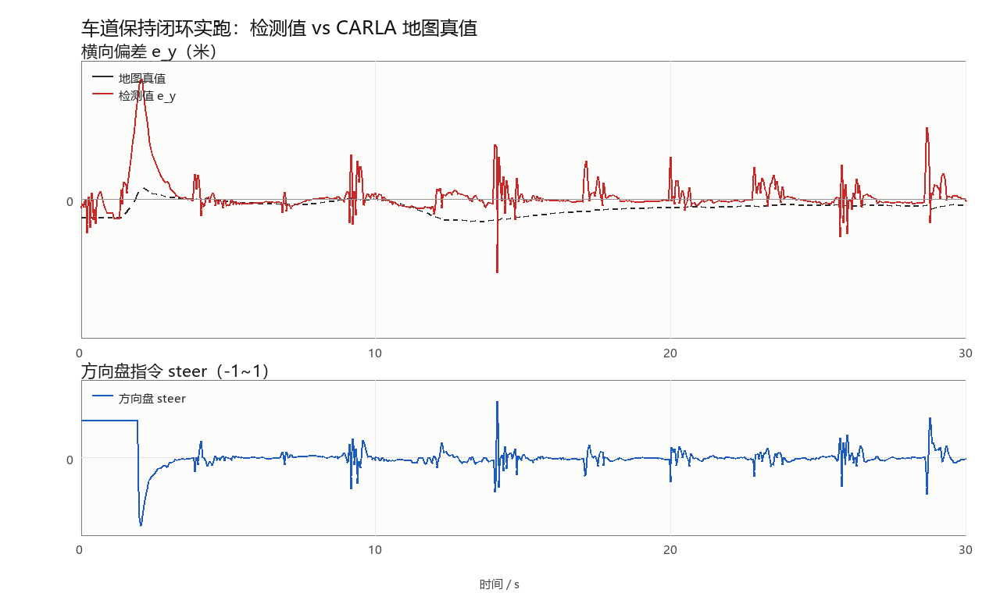

# 车道保持控制（carla_lane_keeping）

本模块在车道线检测的基础上，把**横向偏差**与**航向偏差**闭环成车辆转向指令，
实现车辆自动保持在车道中央行驶。检测部分的原理见[车道线检测](./lane_detection.md)。

## 1. 控制结构

采用自动驾驶中最常见的**级联式横向控制**：

```text
横向偏差 e_y  ──┐
                ├─► PID ──┐
                │         ├─► 转向角 delta ──► 车辆
航向偏差 e_psi ─────────── ┘
```

控制律：

```text
delta = -(Kp·e_y + Ki·∫e_y dt + Kd·de_y/dt) - K_psi·e_psi
```

### 1.1 为什么偏差项要取负号

约定（两个符号都在 CARLA 里实测确认过）：

- `e_y > 0` 表示**车辆在车道中心右侧**，此时应该**向左**修正
- `e_psi > 0` 表示**车头相对车道方向偏右**，同样应该向左修正
- 控制输出 `steering > 0` 表示**向右**打方向（`carla_msgs/CarlaEgoVehicleControl`
  的约定，实测 `steer=+0.3` 会让车辆向右偏移）

因此两项前面都带负号。若实测发现方向相反（不同相机的安装朝向、
或不同的控制接口符号约定），把参数 `invert_steering` 置为 `true` 即可，
**不需要改代码**。

> 航向项的符号早期是反的：检测输出把 `e_psi` 的符号搞反了，
> 与地图真值的相关系数只有 **−0.97**。加上符号后变为 +0.97，
> 这个坑在 `lane_detection.py` 的 `lane_geometry_with_width` 里留了完整推导。

### 1.2 纵向速度策略

纵向是**速度闭环**，不是开环给一个固定油门：

```text
v_err    = target_speed - v_now
throttle = clip(Kv · v_err, 0, 1)
brake    = clip(-0.25 · v_err, 0, 0.6)     当 v_err < -0.3 m/s
```

`Kv` 对应参数 `speed_gain`（默认 0.35），`v_now` 取自里程计
（`/carla/ego_vehicle/odometry`）；取不到时退化为原来的开环油门，
保证没有里程计的场合也能跑。

> 早期版本是 `throttle = throttle_gain · target_speed` 的开环式，
> 实跑时车会一路加速到 **14 m/s**——那时 4.5 m 的预瞄距离已经不够，
> 任何横向增益都救不回来，车辆很快冲出路面。改成速度闭环后
> 车速稳定在 2.5 m/s，横向控制才谈得上收敛。
>
> 同时横向量与航向量各做一次一阶低通（`filter_alpha`，默认 0.35）。
> 单帧检测本身有 ±0.05~0.1 m 抖动，直接进 PID 会被 `kd` 放大成
> 方向盘打摆（实测 steer 在 ±0.3 之间来回）；加低通后压到 ±0.1 以内。

## 2. 与车辆控制的对接

CARLA 的转向指令有两种传递方式，本模块**同时支持**，以便适配不同环境：

| 方式 | 话题 | 消息类型 | 适用场景 |
|---|---|---|---|
| 直接控制 | `/carla/ego_vehicle/vehicle_control_cmd` | `carla_msgs/CarlaEgoVehicleControl` | 已装 `carla_msgs`（推荐） |
| 间接控制 | `/carla/ego_vehicle/twist` | `geometry_msgs/Twist` | 缺少 `carla_msgs` 时，配合 `carla_twist_to_control` 节点 |

节点启动时会检测 `carla_msgs` 是否可用并自动选择，无需手工配置。

## 3. 安全设计

横向控制直接操纵车辆转向，因此做了三层保护：

### 3.1 感知失效保护

控制器以固定频率（默认 20 Hz）输出指令，但只有当感知数据**新鲜**
（最近 `perception_timeout` 秒内更新过）且**置信度达标**时才输出转向。

感知失效时：

- 停止转向输出（避免用过期数据持续打方向）
- **同时复位 PID 积分项**——否则偏差累积会在感知恢复瞬间造成转向突变
- 若同时判定为偏离车道，可选择主动刹车（`brake_on_departure`）

### 3.2 PID 积分限幅

积分项被限制在 `integral_limit` 之内，防止长时间同向偏差导致积分饱和
（积分饱和的典型表现是：偏差反向时车辆需要很长时间才回正）。

### 3.3 输出限幅

转向输出被限制在 `steering_limit` 之内，避免极端指令。

此外，检测节点在未稳定检出时**不发布横向偏差**，从源头避免下游把
误检当成有效测量。这两层是配合关系，缺一不可。

## 4. 运行

### 4.1 一键启动检测 + 控制

```shell
roslaunch carla_lane_keeping main.launch mode:=both
```

### 4.2 单独启动控制器

```shell
rosrun carla_lane_keeping lane_keeping_controller.py
```

### 4.3 观察控制效果

```shell
# 转向量（调试用）
rostopic echo /lane/steering

# 横向偏差，应逐渐收敛到 0 附近
rostopic echo /lane/lateral_offset

# 看实际下发的控制指令
rostopic echo /carla/ego_vehicle/vehicle_control_cmd
```

## 5. 话题接口

| 方向 | 话题 | 类型 | 说明 |
|---|---|---|---|
| 订阅 | `lane/lateral_offset` | `std_msgs/Float32` | 横向偏差（米） |
| 订阅 | `lane/heading_error` | `std_msgs/Float32` | 航向偏差（弧度） |
| 订阅 | `lane/confidence` | `std_msgs/Float32` | 置信度 |
| 订阅 | `lane/departure` | `std_msgs/Bool` | 是否偏离车道 |
| 订阅 | `/carla/ego_vehicle/odometry` | `nav_msgs/Odometry` | 当前车速（速度闭环用，可关） |
| 发布 | `/carla/ego_vehicle/vehicle_control_cmd` | `carla_msgs/CarlaEgoVehicleControl` | 车辆控制指令 |
| 发布 | `/carla/ego_vehicle/twist` | `geometry_msgs/Twist` | 备用控制通道 |
| 发布 | `lane/steering` | `std_msgs/Float32` | 转向量（调试） |

## 6. 参数整定

参数见 `config/lane_params.yaml` 的控制段：

| 参数 | 默认 | 作用 |
|---|---|---|
| `kp` / `ki` / `kd` | 0.28 / 0.02 / 0.06 | 横向偏差 PID |
| `k_psi` | 0.9 | 航向偏差比例项 |
| `steering_limit` | 0.7 | 转向限幅（CARLA 的 steer 范围 ±1） |
| `integral_limit` | 2.0 | 积分限幅，防饱和 |
| `filter_alpha` | 0.35 | 偏差一阶低通系数，越小越平滑 |
| `target_speed` | 6.0 | 目标车速（m/s） |
| `speed_gain` | 0.35 | 速度闭环增益 `throttle = speed_gain·(v_target − v)` |
| `speed_topic` | `/carla/ego_vehicle/odometry` | 车速来源；置空则退化为开环油门 |
| `throttle_gain` | 0.18 | 开环退化时的油门增益 |
| `control_rate` | 20.0 | 控制输出频率（Hz） |
| `perception_timeout` | 0.5 | 感知超时（s），超时后停止转向 |
| `invert_steering` | false | 实测转向方向相反时置 true |

整定顺序建议：

| 步骤 | 操作 | 观察 |
|---|---|---|
| 1 | 先只开检测（`mode:=detect`），把车开到车道中央 | `lateral_offset` 应接近 0 |
| 2 | 只调 `kp`，从小到大，先让车能回到中心 | 车辆出现缓慢来回摆动说明 `kp` 已够大 |
| 3 | 加入 `kd` 抑制摆动 | 摆动幅度减小、收敛加快 |
| 4 | 最后加很小的 `ki`（约 kp 的 1/10）消除稳态误差 | 不再有固定偏差 |
| 5 | 调 `k_psi` 让车头与车道方向对齐 | 车辆不再斜着走 |
| 6 | 若方向盘仍在抖，把 `filter_alpha` 调小 | `lane/steering` 的摆幅收窄 |

**整定注意**：

- `ki` 过大是横向控制最常见的问题，会造成低频摆动，建议从 0 开始
- 若车辆持续来回大幅摆动，先降低 `kp` 而不是加 `kd`
- 转向方向相反时，先检查 `invert_steering`，不要用负的 `kp`
- 先把 `speed_gain` 调对再调横向参数：车速不稳时横向表现会一直变

## 7. 控制安全提示

- 首次测试请把 `target_speed` 设小（如 2.0 m/s），确认方向正确后再提高
- 建议在 `brake_on_departure:=true` 下先跑一轮，确认偏离判定有效
- 控制器的输出频率（`control_rate`）不要低于车桥接收指令的期望频率，
  否则桥接层可能因超时而自动接管

## 8. 后续改进方向

- **前馈控制**：利用车道曲率直接给出前馈转角，减少弯道上的跟踪误差
- **模型预测控制（MPC）**：显式处理转向速率约束与预测时域
- **速度自适应**：按曲率自动限速，弯道减速
- **驾驶员接管检测**：检测到人工输入时自动让出控制权

## 9. 闭环实跑验证（CARLA）

前面几节讲的是控制律本身，这一节给出**在真实 CARLA 里跑出来的闭环结果**——
检测不再是单独跑一遍，而是每帧把 `e_y / e_psi` 送进控制律，再把
`steer / throttle` 下发给车辆。

### 9.1 怎么得到「真值」

自洽检查（比如「左右线必须分居画面两侧」）只能排除荒谬值，证明不了偏差量本身
对不对。所以验证脚本每帧额外做一件事：向 CARLA 地图查询车辆所在车道的中心线，

```python
wp = world.get_map().get_waypoint(vehicle.get_location(),
                                  project_to_road=True,
                                  lane_type=carla.LaneType.Driving)
```

再由车道朝向算出车辆相对车道中心的横向距离 `e_y` 与航向夹角 `e_psi`。
这个值**完全来自地图，不经过任何检测环节**，因此可以作为独立真值。

### 9.2 实验设置

| 项目 | 取值 |
|---|---|
| 仿真器 | CARLA 0.9.16，Town10HD |
| 相机 | 前视 RGB，800×600，水平 FOV 90°，离地 1.70 m，俯角 8° |
| 起点 | 标准生成点 #10（位于路段中部，非路口） |
| 初始扰动 | 前 2 s 开环 `steer=+0.06`，把车推出车道中心 |
| 目标车速 | 3 m/s |
| 时长 | 30 s（20 Hz，600 帧） |
| 控制参数 | `kp=0.28, ki=0.02, kd=0.06, k_psi=0.9, filter_alpha=0.35` |

### 9.3 结果

| 指标 | 数值 |
|---|---|
| 闭环帧 / 总帧 | 556 / 600（其余是 2 s 扰动段与 5 帧短时感知失效） |
| **检测值与真值的偏差** | 平均绝对误差 **0.025 m**，均值偏差 +0.022 m，最大 0.233 m |
| 稳定后 \|e_y\| | 0.014 m（取最后 111 帧） |
| 扰动结束后回到 ±0.25 m 内 | 0.15 s |
| 落在 ±0.25 m 内的帧占比 | **99.6%** |
| 转向指令范围 | [-0.107, +0.090]（归一化，满量程 ±1） |
| 平均车速 | 2.53 m/s |



上：红色是检测输出的横向偏差，黑色虚线是地图真值；下：对应的方向盘指令。

从图里能看出三件事：

1. 第 2 秒扰动结束、闭环接管的瞬间，偏差被推到 0.26 m，随后 0.15 s 内回到
   ±0.25 m 以内，之后一直贴着真值走，稳态误差 1.4 cm；
2. 检测曲线有若干 2~3 帧的短促尖峰（幅度 0.1~0.15 m），来源是双黄线的两条线
   在鸟瞰图里相距仅 0.25 m，个别帧的拟合落到了外侧那条上。这类尖峰被低通
   挡在控制环之外——下图的转向指令全程没有超过 0.11；
3. 转向指令平缓且没有持续偏向一侧，说明既没有稳态偏差，也没有积分饱和。

### 9.4 已知限制（如实记录）

- **闭环没有在 ROS 话题链路下跑过**。本机 CARLA 0.9.16 与仓库内桥接要求的
  0.9.13 不兼容，验证走的是不需要 ROS 的 `tools/run_on_carla.py`
  （见 9.5 节）。感知→控制的数据流、控制律、参数都与 ROS 节点相同，
  但"经 rospy 收发、由 `carla_ros_bridge` 下发"这一段尚未联调。
- **车身俯仰/侧倾未建模**。相机模型假设俯仰角恒为 8°，实际车辆在大油门或
  急打方向时车身会抬头/侧倾 1°~2°，这段时间 `e_y` 会有 0.1~0.4 m 的短时偏差。
  如果要做更高精度的验证，应当用 TF 把相机相对车体的实时姿态喂进模型。
- **只验证了城市直道与缓弯**，没有做高速（>8 m/s）与急弯的工况。
- **控制器没有前馈项**，弯道上靠反馈硬纠，速度一高就会出现稳态偏差；
  这也是下一节的第一条改进方向。

### 9.5 复现方式

验证脚本在包的 `tools/` 下，只依赖 `numpy` 与 `carla` Python 包，**不需要 ROS**。

有一点需要说清楚：这次闭环**没有走 `carla_ros_bridge`**。原因是本机 CARLA 是
0.9.16，而仓库内桥接声明要求 0.9.13（见检测文档 3.6 节），直连会报 API 不兼容。
所以 `run_on_carla.py` 把控制律按 ROS 控制器里的同一套公式（PID + 航向项 +
一阶低通 + 速度闭环）重写了一遍，直接用 CARLA 的 `VehicleControl` 下发，
绕开桥接。**这意味着验证的是控制律与感知的配合，而不是 ROS 话题链路**；
后者需要 0.9.13 环境，9.4 节把它列为未完成项。

```bash
# 1) 启动 CARLA 服务器（另开一个终端）
./CarlaUE4.sh -quality-level=Low

# 2) 跑闭环，结果图与逐帧 CSV 落在 --outdir 指定的目录
cd src/ground/carla_lane_keeping
python3 tools/run_on_carla.py --closed-loop --duration 30 --spawn-index 10 \
    --target-speed 3 --disturbance 0.06 --disturbance-sec 2.0 \
    --outdir out_final

# 3) 画收敛曲线（可选，需要 Pillow）
python3 tools/plot_trace.py out_final/lateral_trace.csv closed_loop.png
```

终端会逐秒打印检测值、真值、转向量与车速，结束时给出 9.3 节的统计量；
`out_final/lateral_trace.csv` 保留了每一帧的原始数据，可以自行复核。

## 参考文献

- [CARLA 官方文档](https://carla.readthedocs.io/)
- 检测部分见[车道线检测](./lane_detection.md)
- [设置并连接到 Carla 模拟器](../../set_up_and_connect_to_carla.md)
