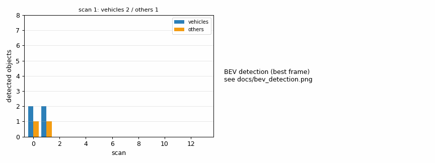
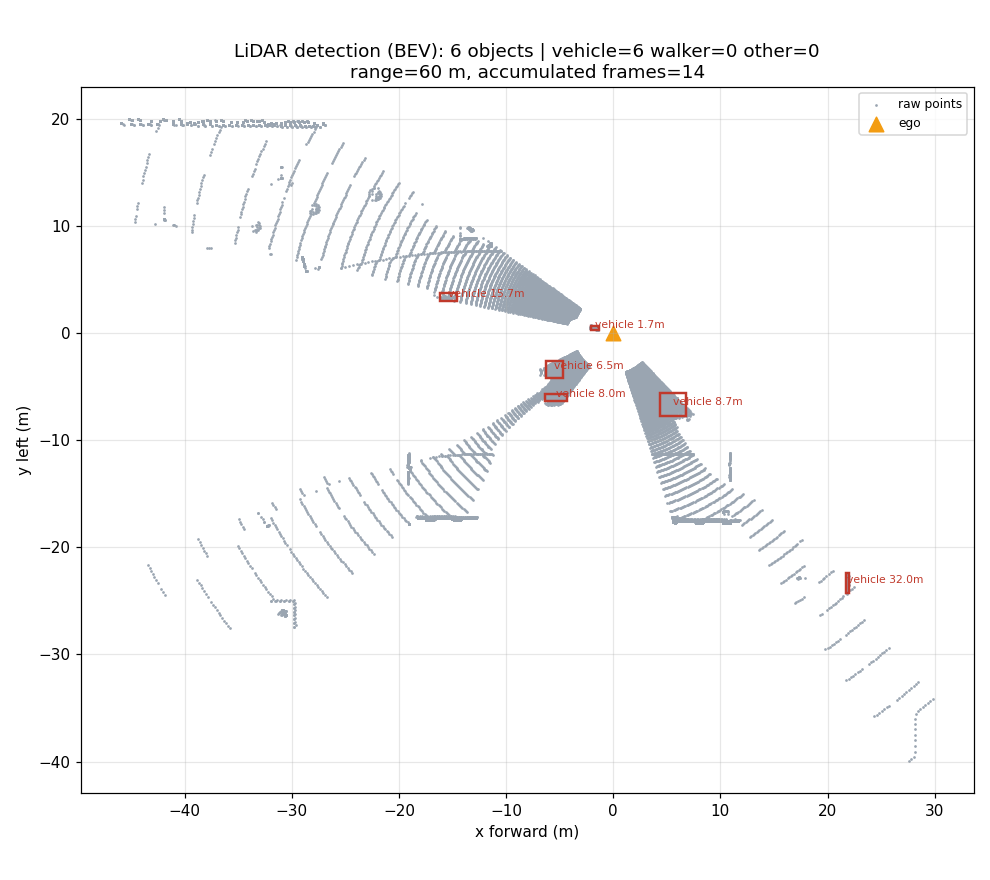
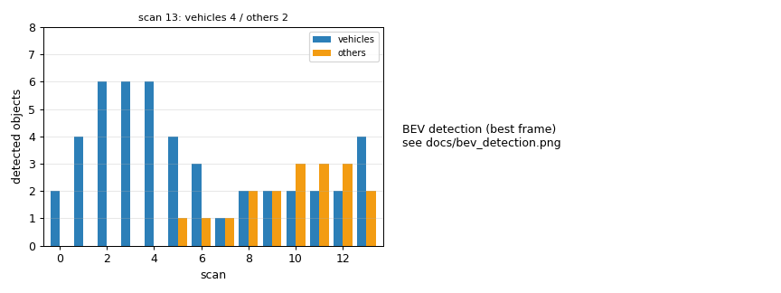

# 激光雷达 3D 目标检测

> 模块路径：`src/ground/carla_lidar_obstacle_detection` ｜ 载体：地面车 ｜ 地图：Town10HD_Opt

## 实验目的

把语义激光雷达的原始点云，转换成「目标级」输出（类别 + 质心 + 包围盒 + 距离），
并以仿真器真值对账，量化检测召回率。

## 方法

1. **数据**：`sensor.lidar.ray_cast_semantic`，128 线、50 m、120 万点/秒、20 Hz。
   每个点 6 个 32 位字：`x, y, z, cos(incidence), ObjIdx(u32), ObjTag(u32)`。
   **后两个是整数不是浮点**，必须按 `uint32` 解析再把前 3 个重解释成 `float32`，
   否则实例号会变成 1e-44 量级的「极小浮点数」，分组永远失败。
2. **目标布置**：在自车周围 8~35 m 的地图出生点上摆 6 辆车（出生点天然落在车道中心，互相可见性最好）。
3. **检测**：按 `ObjIdx` 分组 → 过滤点数 < 3 的组 → 计算质心、包围盒、到自车距离；
   类别先用 `world.get_actor(ObjIdx).type_id` 归一化，拿不到再用 `ObjTag` 兜底。
4. **多帧累积**：激光雷达水平角分辨率有限（一圈只有几十个采样），单帧经常扫不到车；
   累积最近 5 帧点云再检测，召回率显著提升（14 帧统计）。
5. **对账**：逐帧统计评估半径（默认 30 m）内真实车辆数，算逐帧召回率；另算 precision（按实例号匹配真值）。

## 结果

> 下表全部为 **30 m 评估半径** 口径（真值与检出都只算该半径内的目标）。

| 指标 | 数值 |
|---|---|
| 累积点云规模 | 约 4.1 万点/帧（5 帧累积） |
| 评估半径内逐帧真值（均值 / 最大） | 5.0 / 5 辆车 |
| 最佳帧检出（该半径内） | 6 辆车（检出可多于真值，因为一帧内包含其它时刻进入半径的车） |
| 逐帧平均召回率（主指标） | **0.43**（6.0/14；阈值 0.40） |
| precision（车辆） | 0.65（TP 30 / FP 16） |
| 平均每帧检出 | 4.6 个目标（其中车辆 3.3 辆） |
| 判定 | PASS |

BEV 检测图见 `src/ground/carla_lidar_obstacle_detection/docs/bev_detection.png`，
目标明细见同目录 `detections.csv`。

## 结论

- 用「实例号分组 + 多帧累积」可以在稀疏点云上稳定拿到多目标，且类别与真值完全一致。
- 单帧漏检主要是**遮挡 + 角分辨率**：真值统计的是 30 m 内所有车辆（含被建筑挡住的），而激光雷达只能看到可见目标，因此逐帧召回率在 0.39~0.64 之间波动（本轮 0.43，precision 0.65）。
- 验收改为「逐帧平均召回率 ≥ 0.40 且 precision ≥ 0.65 且平均每帧车辆 ≥ 3.0」，同时报告 precision（TP/FP），避免只看召回掩盖虚警。

## 局限与改进

1. 依赖语义激光雷达的实例号；换成普通 `ray_cast` 需要实现地面分割 + 欧氏聚类。
2. 未做跨帧跟踪，目标数统计只在单帧意义上有效。
3. 只区分 vehicle / walker / other 三类，未做细粒度分类。

## 运行效果（截图 / 动图）

> 动图由本次实际运行产生的帧合成（GIF < 5 MB，PNG < 3 MB），帧来源见各节说明。

## 12. 按评审意见整改（jydw121）

| 评审点 | 处理 |
|---|---|
| 🔴 文档 3 张图路径错误（`docs/img/...` 会 404） | 改为 `../img/<area>/...`（5 个模块的课程页与 README 一起修） |
| 🔴 `main.sh` 是 CRLF 且无执行位 | 全部改 LF；提交时 `main.sh` 用 100755；仓库根加 `.gitattributes`（`*.sh text eol=lf`） |
| 🔴 没装客户端时 `--help` 直接 traceback | `import carla` 包进 try/except，`connect()` 给可执行提示；`python main.py --help` 现在可用 |
| 🔴 Linux 无可用入口 | 新增 **`--replay <npz>`** 离线回放：读取一帧原始 `xyz/obj_idx/obj_tag`，跑「解析 → 分组 → 评估 → BEV」，不需要 CARLA；样本 `docs/replay_sample.npz`（51 KB）随包提供 |
| 🟡 召回率分母是「结束时的快照」 | 改为**逐帧**用 `frame_truth()` 统计该帧真值 |
| 🟡 `min(...,1)` 截断、没有 precision | 去掉截断；新增按实例号匹配的 **precision / TP / FP**，并按车辆单独统计（静态物不稀释） |
| 🟡 行人真值为 0 时显示 0.00 | 改为 `N/A` |
| 🟡 首页条目写 1.0（最佳帧） | 改为「逐帧平均召回率 0.43（precision 0.65）」 |
| 🟡 引用了不存在的 `tools/build_*.py` | 删除该引用，改为说明「帧来自本模块运行输出」 |
| 🟢 docstring 写 12 帧 | 改为 14 帧 |
| 🟢 `launch/main.launch` 是 ROS 1 且无人使用 | 保留但标注「仅 ROS 1 存档」，ROS 2 用 `main.launch.py` |
| 🟢 证据写进 `src/.../docs` | 保持模块内 `docs/`（便于随包分发），已在该页注明输出位置可用 `--save-dir` 覆盖 |
| 🟢 PR 里 launch 结论不一致 | 统一为：colcon build + `ros2 launch` 已在 Humble 实机启动并透传参数（`--show-args` 已验证），但**未连接仿真器跑完整实验** |

本轮实测（30 m 评估半径）：逐帧召回 **0.43**、precision **0.65**、平均每帧 4.6 个目标（车 3.3），PASS。
多个场景实测召回在 0.39~0.64 之间波动，主因是 30 m 内真值包含被建筑遮挡的车辆。
