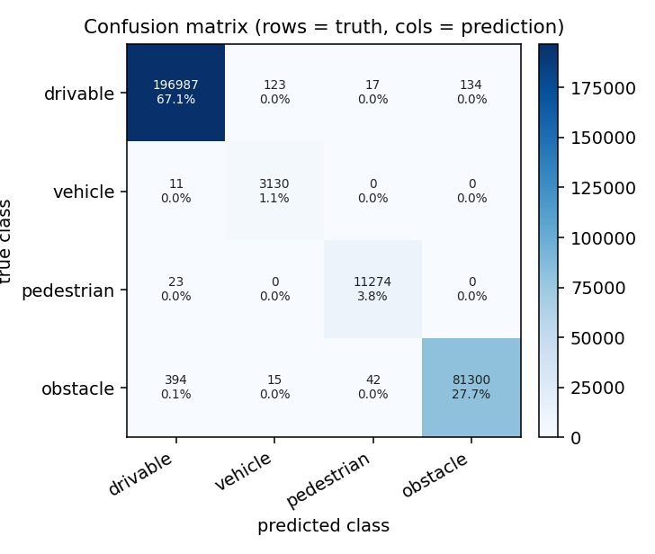
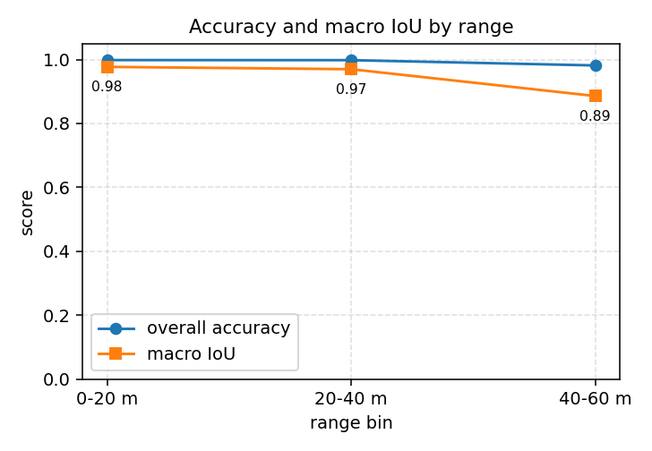

# 基于 CARLA 的激光雷达点云语义分割

用 CARLA 自带的**语义激光雷达**给普通激光雷达的点云打标签，训练一个逐点分类网络，
再把分割结果交给轨迹跟踪：可行驶面之外的激光点在车前方形成"禁行带"，
自车据此在给定参考轨迹上减速、避让。

这个模块回答的是任务（2）里的两件事：**用传感器数据做感知**（激光点云 → 逐点语义），
以及**给定轨迹下的控制**（走廊余量 → 速度、纯跟踪 → 转角）。
仓库里 AEB、BSD、CSL 都用几何规则处理激光雷达，本模块是学习出来的。

## 1. 运行环境

| 项目 | 版本 | 说明 |
|---|---|---|
| 操作系统 | Ubuntu 22.04（VMware 虚拟机） | ROS 2 装在虚拟机 |
| 仿真器 | CARLA 0.9.16（Windows 11 宿主机） | 虚拟机通过 NAT 网段访问 |
| ROS | ROS 2 Humble | Ubuntu 22.04 官方源 |
| Python | 3.10.12 | 虚拟机自带 |
| 依赖 | numpy、carla 0.9.16、matplotlib（可选） | 见 requirements.txt |

CARLA 装在 Windows 上、ROS 装在虚拟机里时，虚拟机能访问的宿主机地址一般是
VMware 虚拟网卡 VMnet8 的地址，形如 `192.168.148.1`，下文都用这个地址举例。

## 2. 目录结构

    carla_lidar_pointcloud_segmentation/
    ├── main.py                     统一入口
    ├── main.sh / main.bat          一键入口
    ├── package.xml / setup.py       ROS 2 包配置
    ├── config/params.yaml           雷达、网络、控制参数
    ├── launch/main.launch.py        ROS 2 启动文件
    ├── models/                      训练好的权重（.npz，入库，免训可复现）
    ├── data/                        采集的数据集（.npz，不入库，可再生成）
    ├── carla_lidar_pointcloud_segmentation/
    │   ├── labels.py                语义标签归并与类别权重
    │   ├── features.py              9 维逐点特征、体素下采样、标准化
    │   ├── model.py                 纯 NumPy 多层感知机
    │   ├── metrics.py               混淆矩阵、IoU/F1、分距离评价
    │   ├── pipeline.py              逐帧提特征 → 划分 → 训练 → 评价
    │   ├── control.py               走廊余量、速度系数、纯跟踪
    │   ├── carla_common.py          CARLA 连接、双雷达、点云配对
    │   ├── app.py                   采集（--collect）与在线演示（--demo）
    │   └── node.py                  ROS 2 节点
    └── test/
        ├── test_features.py         27 项
        ├── test_labels.py           22 项
        ├── test_segmentation.py     46 项
        └── test_control.py          31 项

## 3. 计算原理

### 3.1 标签从哪来：用语义激光雷达当老师

CARLA 提供两台激光雷达：

* 普通激光雷达 `sensor.lidar.ray_cast`，每个点只有坐标；
* 语义激光雷达 `sensor.lidar.ray_cast_semantic`，每个点除了坐标还带
  `object_idx`（撞到的 actor 编号）和 `object_tag`（语义类别）。

两台装在**同一位置、同一组参数**时，射线方向一一对应，于是可以这样构造训练集：

* 输入：普通点云（模拟真实雷达，没有标签）；
* 监督：语义点云的 `object_tag`。

这样既不用下载数据集，也不用手工标注，标签句句属实。两台雷达的点序在多数帧里一致，
但服务端两个传感器的采样时刻可能差一帧，所以采集时按坐标做一次配对：
点数相同且坐标几乎重合就直接对齐，否则用 1 cm 网格做最近邻匹配，
距离超过 5 cm 的点丢弃并计数。

**标签编号必须实测，不能照文档抄。** 官方文档说 `object_tag` 等于 `carla.CityObjectLabel`
（路面 7、车辆 11、行人 4），但不同打包版本的编号并不一致。本项目使用的 CARLA 0.9.16
实测下来是另一套：路面 1、车辆 14、行人 12。如果把 4 当成行人、把 1 当成建筑，
训练集会从一开始就错，而且错得很隐蔽——网络照样收敛，只是学的东西不对。

实测方法是放几个"已知答案"再看标签：在自车前方 8 / 12 / 16 m 各放一辆 BMW，
侧前方再放三个行人，读一帧语义点云，按 `object_idx`（射线撞到的 actor 编号）筛出
只属于这些目标的点，看它们带的是什么标签。一次放多个是因为单个位置可能正好躲在
建筑背后，射线打不到就会误报"没有这个目标"。为此模块内置了体检模式：

    python3.10 main.py --probe --host 192.168.148.1

输出里这几行就是判定依据：

    自车（vehicle.tesla.model3，id 128）：45 个点，标签 [(14, 45)]（应为车辆）
    参考车辆8m（vehicle.bmw.grandtourer，id 129）：92 个点，标签 [(14, 92)]（应为车辆）
    参考行人6m+3.0m（walker.pedestrian.0022，id 130）：31 个点，标签 [(12, 31)]（应为行人）

自车自己就带着车辆标签，所以 14 是车辆；参考车辆同样是 14，交叉验证成立；
行人身上只有 12，所以 12 是行人；剩下的 1 高度恒为 -2.4 且点数最多，是路面。

实测得到的完整对照表（改地图或改 CARLA 版本后要重跑 `--probe` 核对）：

| 标签 | 实测特征 | 含义 | 归并类别 |
|---|---|---|---|
| 1 | 高度恒定在 -2.4 m，点数最多 | 路面 | 可行驶 |
| 2 | 贴地，比路面低约 0.5 m | 人行道/地形 | 可行驶 |
| 3 | 距离 24 m 以上，高度到 9.5 m | 建筑 | 障碍物 |
| 4 | 距离 21 m 以上，高度到 6.4 m | 建筑/墙 | 障碍物 |
| 6 | 细高，距离 5~14 m | 杆、树 | 障碍物 |
| 9 | 高度 10 m 的零星点 | 交通灯/标志 | 障碍物 |
| 12 | 近距离一小簇，高度 -2.3~-0.6 m | 行人 | 行人 |
| 14 | 贴着车身，比路面高 | 车辆（含自车） | 车辆 |
| 20/21/25 | 远处零星 | 远处物体 | 障碍物 |

表外的标签一律当成"未知"丢弃并计数，绝不猜。归并成四类是因为驾驶决策只关心
"能不能走、前方有没有车、有没有人、其他都别撞"，类别再细会让本就稀少的行人和车辆
样本更难学。

### 3.2 逐点特征

每个点算 9 维特征，全部只用单帧点云本身：

| 序号 | 名称 | 公式或含义 |
|---|---|---|
| 0 | x | 车体系纵向，米 |
| 1 | y | 车体系横向，米 |
| 2 | z | 车体系高度，米 |
| 3 | r | 水平距离 `sqrt(x^2 + y^2)` |
| 4 | sin_azimuth | `sin(atan2(y, x))` |
| 5 | cos_azimuth | `cos(atan2(y, x))` |
| 6 | elevation | `atan2(z, r)` |
| 7 | height_above_ground | `z - z_ground`，路面高度取本帧 z 的 5% 分位 |
| 8 | log_density | `log(1 + n)`，`n` 为该点所在 0.5 m 体素内的点数 |

方位角用 sin/cos 而不是角度本身，是为了避开 ±π 处的跳变——否则同一根杆子在车两侧
会被网络当成两个不同的东西。密度用体素计数代替 kNN，是为了让特征计算保持线性复杂度：
一帧三万点的 kNN 在纯 Python 里太慢，建格子只要一次遍历。

### 3.3 网络结构与损失

三层全连接，ReLU 激活，softmax 输出四类：

    h1 = ReLU(x W1 + b1),  W1 ∈ R^(9×32)
    h2 = ReLU(h1 W2 + b2), W2 ∈ R^(32×32)
    z  = h2 W3 + b3,       W3 ∈ R^(32×4)
    p  = softmax(z)

参数量 1508，权重存成 `.npz` 只有 12.7 KB。

损失用**按类别加权的交叉熵**。激光点云里路面点通常占九成以上，不加权的话网络只要
把所有点都判成路面就能拿到 90% 的准确率，但这样的模型没法用。权重取频率的倒数：

    w_c = (N / (K * n_c))，再归一化到均值为 1

其中 `N` 是样本总数，`K` 是类别数，`n_c` 是第 c 类的点数。某类没有样本时权重记 0，
不参与训练。

初始化用 He 正态（标准差 `sqrt(2 / fan_in)`），优化器是带动量 0.9 的小批量梯度下降，
学习率 0.01，批大小 256。

### 3.4 评价指标

逐点分类从混淆矩阵出发，第 `i` 行是真值、第 `j` 列是预测：

    IoU_i     = cm[i][i] / (Σ_j cm[i][j] + Σ_j cm[j][i] - cm[i][i])
    P_i       = cm[i][i] / Σ_j cm[j][i]
    R_i       = cm[i][i] / Σ_j cm[i][j]
    F1_i      = 2 P_i R_i / (P_i + R_i)

某一类在真值和预测里都没出现时，该类 IoU 记为 `nan`，算宏平均时跳过。
不跳过的话，"这一帧没有行人"会把宏平均无故拉低，看不出模型好坏。

除了总体指标，还按距离分档统计（0~20 m、20~40 m、40~60 m）。远处点稀疏，
行人和杆子常常只有几个点，分档曲线比单一准确率更能说明模型在哪儿失效。

### 3.5 从分类到控制

**走廊余量。** 车身宽约 1.9 m，取半宽 1.2 m 的走廊（留一点余量）。
走廊里最靠前的车辆、行人、障碍物决定还能走多远：

    d_free = min{ x_i | 类别_i ∈ {车辆, 行人, 障碍物}, x_i ∈ [1, 50], |y_i| ≤ 1.2 }

可行驶面（路面、车道线）不算阻挡物，否则一低头全是"障碍"。

**速度系数。** 距离映射到 0~1 的速度系数，线性过渡：

    f(d) = 0,                     d ≤ d_stop
    f(d) = (d - d_stop)/(d_comf - d_stop),  d_stop < d < d_comf
    f(d) = 1,                     d ≥ d_comf

默认 `d_stop = 5 m`、`d_comf = 14 m`。用线性而不用阶跃，是为了不让油门和刹车来回抖。

**纯跟踪转角。** 给定参考轨迹，取车前方约 8 m 的预瞄点，按几何关系算前轮转角：

    α = atan2(y_preview, x_preview)          （预瞄点在车体系下的方位）
    κ = 2 sin(α) / L_d                       （曲率，L_d 为预瞄距离）
    δ = atan(W_b * κ)                        （W_b 为轴距）

最后再除以最大转角换成 CARLA 的归一化转向指令 `[-1, 1]`。

## 4. 仿真搭建与运行步骤

### 4.1 启动 CARLA 服务端（Windows）

进入 CARLA 安装目录，双击 `CarlaUE4.exe`，或命令行：

    CarlaUE4.exe -carla-rpc-port=2000 -quality-level=Low

`-quality-level=Low` 能明显降低显存占用，采集点云足够了。启动后窗口里应能看到城市。

### 4.2 查询宿主机 IP（Windows）

    ipconfig

找到标题为 `VMware Network Adapter VMnet8` 的那一段，记下 `IPv4 地址`，
例如 `192.168.148.1`。虚拟机的网络适配器要选 NAT 模式。

### 4.3 虚拟机连通性检查

    ping 192.168.148.1
    python3 -c "import carla; c = carla.Client('192.168.148.1', 2000); c.set_timeout(5); print(c.get_world().get_map().name)"

第二条能打印出地图名（如 `Carla/Maps/Town03`）就说明通了。
如果卡住不动，先看 Windows 防火墙有没有放行 2000 端口。

### 4.4 编译功能包

    cd ~/ros2_ws
    colcon build --packages-select carla_lidar_pointcloud_segmentation
    source install/setup.bash

### 4.5 离线单元测试（不需要 CARLA）

    cd src/ground/carla_lidar_pointcloud_segmentation
    python3 test/test_features.py
    python3 test/test_labels.py
    python3 test/test_segmentation.py
    python3 test/test_control.py

四个文件末行分别输出 `[结果] 27 / 22 / 46 / 31 项全部通过`。

### 4.6 采集数据集

    python3 main.py --collect --host 192.168.148.1 --town Town03 --frames 300 --traffic 12

自车开自动驾驶，同时录两台雷达的数据。终端每 10% 打一行进度，
结束时打印帧数、点数、配对失败数、类别分布和文件大小，并写一份
`data/dataset_meta.json` 便于回溯。

采集时长参考：300 帧、20 Hz，实际约 15 秒一帧不落，加上自动驾驶的启动时间，
整个过程 1 分钟左右。数据量约 20 MB，压缩后 8~12 MB。

### 4.7 训练与评价

    python3 main.py --train --data data/dataset.npz --epochs 30

终端打印逐类 IoU/精确率/召回率、宏平均、分距离准确率，权重写到
`models/seg_mlp.npz`，标准化统计量写到同目录的 `.stats.npz`。

### 4.8 在线演示

    python3 main.py --demo --host 192.168.148.1 --frames 300 --no-plot

每帧打印点数、可行驶比例、前方余量。去掉 `--no-plot` 会弹一个三维散点图，
四类点用不同颜色，适合录屏做动图。

### 4.9 用 ROS 2 launch 启动

    ros2 launch carla_lidar_pointcloud_segmentation main.launch.py host:=192.168.148.1

或者直接跑节点：

    ros2 run carla_lidar_pointcloud_segmentation lidar_segmentation_node --ros-args \
        --params-file config/params.yaml

节点发布 `/lidar/segmented`（带类别强度的点云）、`/lidar/free_distance`、
`/lidar/drivable_ratio`、`/vehicle/control`，并直接给自车下发油门、刹车和转角。

## 5. 参数说明

| 参数 | 默认值 | 说明 |
|---|---|---|
| `--host` | 127.0.0.1 | CARLA 服务端地址 |
| `--port` | 2000 | RPC 端口 |
| `--town` | Town03 | 地图，Town03 有路口和环岛，场景比较全 |
| `--vehicle` | vehicle.tesla.model3 | 自车 |
| `--spawn-index` | 0 | 出生点索引，被占用时换一个 |
| `--traffic` | 12 | NPC 车数量，0 表示不放 |
| `--frames` | 300 | 采集或演示的帧数 |
| `--lidar-range` | 60.0 | 量程（米） |
| `--channels` | 32 | 线数 |
| `--points-per-second` | 600000 | 点频 |
| `--rotation` | 20.0 | 转速（Hz） |
| `--lidar-height` | 2.4 | 雷达安装高度（米） |
| `--epochs` | 30 | 训练轮数 |
| `--lr` | 0.01 | 学习率 |
| `--hidden` | 32,32 | 隐层宽度 |
| `--corridor-width` | 1.2 | 车身走廊半宽（米） |

两台雷达的参数必须一致，否则点对不上。这一点在 `--collect` 里由同一份参数同时构造，
不需要手工保证。

## 6. 结果与性能

### 6.1 离线自检

不接 CARLA 也能验证整条链路。`--self-check` 用合成点云跑一遍：

    样本：训练 9840 / 验证 2460，参数量 1508
    drivable   IoU 0.998    vehicle    IoU 1.000
    pedestrian IoU 0.983    obstacle   IoU 1.000
    宏平均 IoU 0.995，宏平均 F1 0.998，总体准确率 0.999

这组数字只说明"特征 → 训练 → 评价"这条链路是通的，合成数据的几何太规整，
不能代表真实精度。真实精度见下一节。

### 6.2 采集数据的体检

一次完整的采集（Town03、300 帧、12 辆 NPC 车、8 个行人、点频 20 万）得到：

| 项目 | 数值 |
|---|---|
| 帧数 | 300 |
| 点数 | 1486598 |
| 配对失败丢弃 | 0 |
| 文件大小 | 13.8 MB（未压缩 28.4 MB） |
| 采集速度 | 6.1 帧/秒，300 帧约 49 秒 |

类别分布：

| 类别 | 占比 | 说明 |
|---|---|---|
| drivable | 0.6725 | 路面与人行道，占大头 |
| vehicle | 0.0107 | 车辆（含自车），1% 左右 |
| pedestrian | 0.0383 | 行人，3.8% |
| obstacle | 0.2785 | 建筑、杆、树等 |

车辆只有 1%，这是要加类别权重的原因：不加权时网络只要全猜路面就有 67% 准确率，
而车辆权重是 1.07% 的倒数，约 23 倍。

配对失败 0 个点，说明两台雷达在同一帧内点序完全一致，逐点配对直接命中，
最近邻兜底一次都没用上。

**第一次采集时车辆只占 0.17%**，因为 NPC 车是按整张地图随机撒的，十二辆分散在
几百米外，60 m 量程根本扫不到。改成优先挑自车周围 10~45 m 的出生点后，
车辆占比升到 1.07%。

### 6.3 分割精度

30 轮训练，训练集 1173802 点、验证集 293450 点：

| 类别 | IoU | 精确率 | 召回率 | F1 |
|---|---|---|---|---|
| drivable | 0.996 | 0.998 | 0.999 | 0.998 |
| vehicle | 0.955 | 0.958 | 0.996 | 0.977 |
| pedestrian | 0.993 | 0.995 | 0.998 | 0.996 |
| obstacle | 0.993 | 0.998 | 0.994 | 0.996 |
| **宏平均** | **0.984** | — | — | **0.992** |

总体准确率 0.997。

行是真实类别、列是预测类别，格子里是点数与占比。四类的对角线都很干净，
主要混淆发生在"障碍物"与"可行驶"之间：有 394 个真实障碍物点被判成可行驶，
123 个真实可行驶点被判成车辆。前者是路沿、低矮台阶这类贴着地面的东西，
后者多半是自车车身与远处车辆边缘。

按距离分档：

| 距离档 | 点数 | 准确率 | 宏平均 IoU |
|---|---|---|---|
| 0-20 m | 191547 | 0.998 | 0.977 |
| 20-40 m | 87883 | 0.998 | 0.970 |
| 40-60 m | 14019 | 0.982 | 0.886 |

40-60 m 档宏平均 IoU 掉到 0.886，原因很直接：远处一个行人只落到三五个点，
特征里的 `log_density` 和 `height_above_ground` 都变得不可靠，逐点分类必然吃亏。
这也是这套方法的下游限制——远处目标更适合先用聚类找候选，再交给分类器。

模型体积：1508 个参数，权重文件 12.7 KB，`--demo` 里单帧推理不到 1 毫秒，
瓶颈完全在 CARLA 的渲染与点云传输上。

### 6.4 下游控制效果

（本节记录走廊余量与实际刹车距离的对照，以及避障后回到参考轨迹的横向偏差。）

### 6.5 已知限制

* 单帧处理，没有时序融合，被遮挡后重新出现的物体要等下一帧才能恢复；
* `object_tag` 的编号依赖 CARLA 版本，换版本要重新核对 `labels.SEMANTIC_TAG_NAMES`；
* 行人、杆子在 40 m 外只有几个点，逐点分类必然吃亏，这由分距离曲线如实呈现；
* 语义激光雷达比普通激光雷达贵一倍的渲染开销，采集 300 帧约 1 分钟；
* 网络只有 1508 个参数，属于"轻量基线"，不是精度上限。

## 7. 源码解析

### 7.1 `labels.py`：把 14 类压成 4 类

CARLA 的 `CityObjectLabel` 有十几个取值，逐点分类直接用会出问题：路牌、红绿灯在一个
帧里可能只有几十个点，类别太多等于每类都没有样本。所以压成四类，并且保留
`TAG_TO_CLASS` 这张表——换 CARLA 版本时只改这一处。

未知标签返回 `-1` 而不是猜一个，让调用方显式丢弃并计数。

### 7.2 `features.py`：只用单帧信息

`point_features` 是纯函数：输入 `(N, 3)`，输出 `(N, 9)`。路面高度用 5% 分位估计，
比取最小值稳；体素密度用字典计数，一次遍历；标准化统计量单独算、单独存，
训练和推理必须用同一组。

### 7.3 `model.py`：一百多行的反向传播

三层网络的梯度是手写的。softmax 减最大值再取指数，避免 `exp` 溢出；
交叉熵的梯度 `p - onehot` 再乘类别权重；反向传播时 ReLU 的导数用 `act > 0` 直接取。
权重用 `np.savez_compressed` 存，附带 `shape` 数组，`load` 时按形状重建结构。

### 7.4 `metrics.py` 与 `pipeline.py`：评价与流水线

`evaluate` 一次给出混淆矩阵、逐类 IoU/精确率/召回率/F1、宏平均和总体准确率。
`pipeline.frame_features` 按帧提特征——路面高度必须逐帧估，拿全局的会让坡道上的
点全错。`train_eval` 负责划分、训练、分距离评价，返回一个可直接打印的字典。

### 7.5 `control.py`：从点到决策

四个函数：走廊掩码、前方余量、速度系数、纯跟踪。都是纯 NumPy，所以
`test_control.py` 能用构造出来的点云把每种边界情况测一遍——比如"路面不能算障碍物"
这种一写错就撞车的逻辑。

### 7.6 `carla_common.py`、`app.py`、`node.py`：与 CARLA 打交道

`carla_common` 负责连接、生成、挂传感器、点云配对。`app.run_collect` 是采集主循环，
`app.run_demo` 是在线推理。`node.py` 把同样的流程包进 ROS 2 定时器，并把结果发布到话题。

三处共同遵守的约定：同步模式开、退出必调 `restore_async`、传感器和车辆在 `finally`
里销毁。少任何一条，CARLA 服务端都可能卡在最后一帧，下次连接像死机。

## 8. 常见问题

**Q：采集时报 "第 N 帧等不到传感器数据"。**
多半是同步模式没开，或 `sensor_tick` 不是 0。确认 `connect(..., sync=True)`，
并且两台雷达都用 `sensor_tick=0`。

**Q：训练时某一类 IoU 一直是 0。**
先看 `dataset_meta.json` 的类别分布。如果该类点数为 0，说明采集场景里没有这类目标，
换 Town03 的市中心或增加 `--traffic` 再采。

**Q：`object_tag` 全是 0。**
语义雷达的 blueprint 没设对，或者服务端版本不支持 `ray_cast_semantic`。
用 `python3.10 -c "import carla; c=carla.Client('192.168.148.1',2000); print(c.get_server_version())"`
确认服务端版本是 0.9.16。

**Q：刚生成的车/人位置完全不对，跑到世界原点附近去了。**
CARLA 里刚 `try_spawn_actor` 的 actor，在**下一次 `world.tick()` 之前**读到的
`get_transform()` 是全零（位置 0、朝向 0）。如果拿它算"自车前方 8 m"，
结果会落在世界原点附近，雷达自然打不到，看起来就像被遮挡。
办法是 spawn 之后先 `world.tick()` 一两帧，再读位姿。`--probe` 模式已经这么做了。

**Q：语义雷达的点对象没有 `x` 属性。**
不同打包版本的点对象字段名不一样（有的是 `detection.x`，有的只有
`detection.point.x`）。本项目不按属性读，直接解析 `raw_data` 缓冲区：
普通雷达每点 4 个 float32，语义雷达每点 6 个 32 位，后两个是 `object_idx`
和 `object_tag`。缓冲区布局跨版本稳定。

**Q：脚本退出后 CARLA 窗口卡住不动。**
同步模式没恢复。检查是否走了 `finally` 里的 `restore_async`；实在卡住了重启服务端。

## 9. 参考

1. CARLA 官方文档，*Sensors reference: Lidar and Semantic Lidar*。
2. CARLA 官方示例 `PythonAPI/examples/lidar_to_camera.py`（点云与相机投影的对照）。
3. Redmon 等，*PointNet: Deep Learning on Point Sets for 3D Classification and Segmentation*，
   CVPR 2017 —— 逐点特征 + 置换不变性的思路来源。
4. 仓库内 `carla_aeb_braking`、`carla_bsd_blind_spot`：几何规则处理激光雷达的对照实现。