# 基于神经网络的无人小车自适应跟车（ACC）仿真

本模块在 CARLA 仿真环境中实现无人小车的**自适应巡航跟车（ACC）**：感知与控制两个环节**均由神经网络实现**，
感知网络从毫米波雷达的原始回波统计量中估计前车距离与相对速度，控制网络据此输出油门与刹车；作为对照，
模块同时保留了**经典 ACC 控制器**（它既是神经网络的训练标签来源，也是性能基线）。
横向（方向盘）由纯追踪法与"前车轨迹面包屑跟踪"完成。

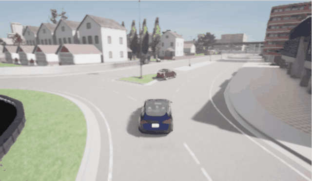

---

## 1. 运行环境

| 项目 | 版本 / 说明 |
|---|---|
| 宿主机操作系统 | Windows 11（CARLA 服务端运行于此） |
| CARLA 服务端 | 0.9.16，Windows 发行版，解压即用 |
| 虚拟机 | VMware Workstation + Ubuntu 22.04.5 LTS |
| ROS 2 | Humble（装于 `/opt/ros/humble`） |
| Python | 3.10.12（wheel 只提供 cp310/311/312） |
| Python 依赖 | `carla==0.9.16`、`numpy`、`matplotlib`（可选） |
| 神经网络实现 | 纯 NumPy 手写 MLP，不依赖 PyTorch / TensorFlow |
| 虚拟机网络 | VMware NAT，宿主机 IP 取 VMnet8 的地址 |
| 宿主机 IP（本机实测） | `192.168.148.1` |

> ⚠️ **关于 `192.168.148.1`**：这是本文档实测时宿主机的 VMware NAT 地址，**你的机器上几乎肯定不是这个**
> （通常是 `192.168.x.1` 里的另一个数）。文中所有命令请把它**替换成你自己查到的地址**，
> 查询方法见 4.2 节。代码里的该地址只是默认值，用 `--host` 或 launch 参数即可覆盖，无需改动源码。

**环境验证**（在虚拟机终端逐条执行，预期输出如下）：

```bash
python3 --version
ls /opt/ros/
python3 -c "import carla; print(carla.__version__)"
```

预期输出：

```text
Python 3.10.12
humble
0.9.16
```

---

## 2. 目录结构

```
src/ground/carla_nn_car_following/          # ROS 2 ament_python 功能包
├── main.py                                 # 统一入口：check / scene / collect / train / run / eval
├── check_env.py                            # 环境自检（6 项检查，汇总为 4 行结论）
├── diagnose_drive.py                       # 诊断工具：逐个出生点试验"车能不能开动"
├── main.sh / main.bat                      # 一键入口（仓库约定：入口为 main.*）
├── package.xml / setup.py / setup.cfg
├── carla_nn_car_following/
│   ├── __init__.py
│   ├── carla_client.py                     # 连接 CARLA、生成自车与前车、挂载雷达、出生点预检
│   ├── scenario.py                         # 四种前车工况 + 纯追踪/面包屑横向控制
│   ├── reference_acc.py                    # 经典 ACC 控制器（神经网络的标签来源与基线）
│   ├── nn_numpy.py                         # 纯 NumPy 的 MLP（前向、反向、Adam、存取）
│   ├── train.py                            # 训练感知网络与控制网络
│   ├── nn_controller.py                    # 神经网络控制器（感知 → 控制 级联）
│   └── acc_scene_node.py                   # ROS 2 节点：运行场景并发布 /acc/state
├── launch/main.launch.py                   # ROS 2 Humble 启动入口
├── config/params.yaml                      # 运行参数
├── models/                                 # 训练好的权重（perception.npz、control.npz）
├── data/                                   # 采集的数据与评测结果
├── test/test_reference_acc.py              # 24 项离线测试（经典 ACC 公式与四种工况）
├── test/test_nn_numpy.py                   # 17 项离线测试（MLP 与端到端训练流程）
└── README.md                               # 运行环境与运行步骤（简版）
docs/ground/carla_nn_car_following.md       # 本文件（模块介绍页）
docs/img/ground/carla_nn_car_following/     # 本模块所有图片与动图
```

---

## 3. 计算原理

### 3.1 跟车模型与评价指标

定义自车速度 \(v_e\)、前车速度 \(v_l\)、实际车距 \(d\)（自车到前车的直线距离），采用固定车头时距
（CTH）模型：

$$
d_{des} = d_0 + t_h \, v_e
$$

其中 \(d_0\) 为静止安全距离（本模块取 5 m），\(t_h\) 为车头时距（本模块取 1.2 s）。车距误差为

$$
e = d - d_{des}
$$

碰撞时间（仅在自车更快时有意义）：

$$
\mathrm{TTC} = \frac{d}{v_e - v_l}, \qquad v_e > v_l
$$

**评价指标**：车距误差均值 \(|e|\)、最小车距 \(\min d\)、最小 TTC、平均车速。
多场景评测在 4 种前车工况下各跑 1 次。

### 3.2 经典 ACC 控制器（神经网络的标签来源）

期望加速度由车距误差与相对速度（\(v_{rel} = v_l - v_e\)，逼近时为负值）线性组合得到：

$$
a_{cmd} = k_p e + k_v v_{rel}
$$

并将 \(a_{cmd}\) 映射为 CARLA 的油门 \(\theta\) 与刹车 \(b\)（两者互斥）：

$$
\theta = \mathrm{clip}(k_{\theta} a_{cmd},\ 0,\ 1), \qquad
b = \mathrm{clip}(-k_b a_{cmd},\ 0,\ 1)
$$

**设定车速限制**：前车很远或跟丢时，若没有限速项，自车会为了缩小车距而无限加速（实测飙到
143 km/h）。因此加入设定车速 \(v_{set}\)：

$$
a_{cmd} = \min\Big(k_p e + k_v v_{rel},\ \ k_{v\!s}\,(v_{set} - v_e)\Big)
$$

本模块参数：\(k_p = 0.35\)、\(k_v = 1.5\)、\(k_\theta = 0.25\)、\(k_b = 0.35\)、\(k_{v\!s} = 1.0\)。

### 3.3 感知网络（MLP，回归）

输入为雷达特征向量 \(x_p \in \mathbb{R}^{6}\)：

| 分量 | 含义 |
|---|---|
| \(d_{radar}\) | 正前方 ±8° 内最短回波距离（m） |
| \(\varphi\) | 该回波对应的方位角（rad） |
| \(\dot d\) | 接近速度（最短回波距离的差分，m/s，正值表示正在靠近） |
| \(\bar d\) | 全部回波的平均距离（m） |
| \(n\) | 回波点数量 |
| \(v_e\) | 自车速度（m/s） |

输出为 \(\hat y = [\hat d, \hat v_{rel}]\)，即车距与相对速度的估计：

$$
h_1 = \tanh(W_1 x_p + b_1), \quad
h_2 = \tanh(W_2 h_1 + b_2), \quad
\hat y = W_3 h_2 + b_3
$$

网络结构 \(6-24-16-2\)（参数量 602），损失函数为均方误差：

$$
L_p = \frac{1}{N}\sum_{i=1}^{N}\left\|\hat y_i - y_i\right\|^2
$$

> 为什么需要用网络而不是"直接减一个常数"：雷达测到的是**前车车身表面的最近回波**，与"车距"
> （两车参考点之间的距离）相差约半个车身长度，且随车型、遮挡与多径而变化。网络同时完成了
> **标定、去噪与差分测速**三件事。

### 3.4 控制网络（MLP，回归）

输入 \(x_c = [\hat d, \hat v_{rel}, v_e]\)，输出 \(y_c = [\theta, b]\)，损失函数：

$$
L_c = \frac{1}{N}\sum_{i=1}^{N}\left[(\theta_i - \theta_i^{*})^2 + (b_i - b_i^{*})^2\right]
$$

其中 \(\theta^{*}, b^{*}\) 为 3.2 节经典控制器给出的标签（即**模仿学习 / 行为克隆**）。
部署时控制网络的输入来自感知网络的输出，构成级联结构。

### 3.5 横向控制（方向盘）

纵向（油门/刹车）由上面的控制器负责，横向由两部分组成：

1. **纯追踪（Pure Pursuit）**：取车道中心线上车辆前方 \(L\) 米处的路点作为追踪目标，
   按目标点与车头方向的夹角 \(\alpha\) 计算转向量：

$$
\delta = \mathrm{clip}\!\left(k_\delta \alpha,\ -1,\ 1\right), \qquad
L = \max\left(6,\ 8 + 0.35 v_e\right)
$$

2. **前车轨迹面包屑跟踪**：记录前车最近 1.2 s 的轨迹，自车朝"前车 1.2 s 前所在的位置"行驶。
   这样前车在路口拐弯时自车会跟着拐，**从物理上避免跟丢**（实测初版在路口跟丢后车距被拉到 365 m）。

### 3.6 算法流程

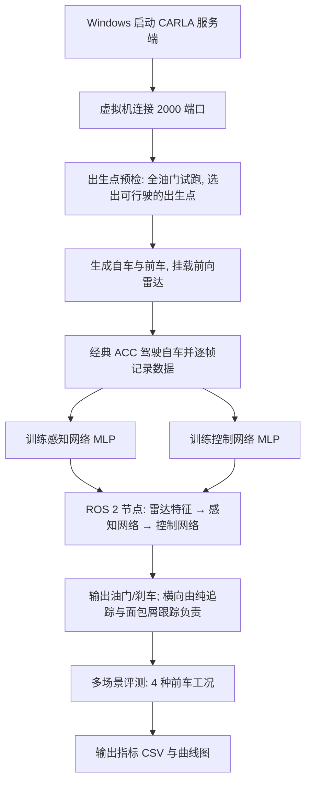

---

## 4. 仿真环境搭建（逐步操作 + 截图）

### 4.1 在 Windows 宿主机启动 CARLA 服务端

**执行位置**：Windows 宿主机。

1. 双击 CARLA 安装目录下的 `CarlaUE4.exe`（首次启动约 1~3 分钟）；
2. 等待出现城市第三人称视角窗口，窗口标题含 `CARLA 0.9.16`。

**预期现象**：窗口持续渲染（不是黑屏、不是白屏）。
**截图**：`01_windows_carla_window.png`、`02_windows_ipconfig.png`。

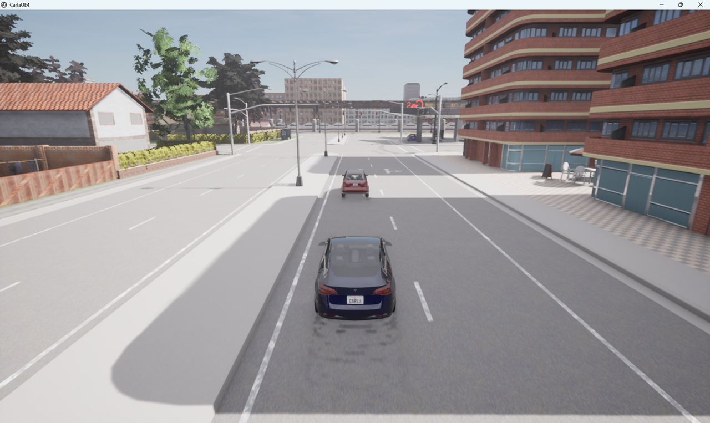
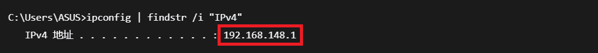

### 4.2 获取宿主机 IP 并确认虚拟机与宿主机连通

#### 4.2.1 在 Windows 上查出 IPv4 地址

**执行位置**：Windows 宿主机 `cmd`。

```cmd
ipconfig | findstr /i "IPv4"
```

**预期输出**（本机实测）：

```
   IPv4 地址 . . . . . . . . . . . . : 192.168.148.1     ← VMware Network Adapter VMnet8（NAT）
   IPv4 地址 . . . . . . . . . . . . : 192.168.104.1     ← VMware Network Adapter VMnet1
   IPv4 地址 . . . . . . . . . . . . : 10.3.219.137      ← 无线网卡（仅桥接模式使用）
```

#### 4.2.2 该抄哪一行？取决于 VMware 的网络模式

| VMware 网络模式 | 抄哪一行 | 典型特征 |
|---|---|---|
| **NAT**（默认，推荐） | VMware Network Adapter VMnet8 | 通常是 `192.168.x.1` |
| **桥接（Bridged）** | 物理网卡（WLAN / 以太网） | 与路由器同网段 |
| 仅主机（Host-only） | VMware Network Adapter VMnet1 | 通常是 `192.168.x.1` |

#### 4.2.3 不确定就挨个试

**执行位置**：Ubuntu 虚拟机终端。

```bash
sudo apt install -y netcat-openbsd        # 首次执行
for ip in 192.168.148.1 192.168.104.1 10.3.219.137; do
  echo -n "$ip -> "; nc -vz -w 2 "$ip" 2000 2>&1 | tail -n 1
done
```

**预期输出**：只有一行返回 `succeeded!`，那一行的 IP 就是宿主机 IP。

```
192.168.148.1 -> Connection to 192.168.148.1 2000 port [tcp/*] succeeded!
192.168.104.1 -> nc: connect to 192.168.104.1 port 2000 (tcp) failed: Connection refused
10.3.219.137 -> nc: connect to 10.3.219.137 port 2000 (tcp) timed out
```

**如果不通**：Windows 防火墙放行 `CarlaUE4.exe`（「专用网络」与「公用网络」都要勾选）。
**截图**：`03_vm_nc_success.png`。

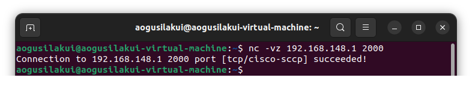

### 4.3 安装 CARLA Python 客户端

**执行位置**：Ubuntu 虚拟机终端。

```bash
python3 --version                                  # 应为 3.10 / 3.11 / 3.12
python3 -m pip install --user carla==0.9.16 -i https://pypi.tuna.tsinghua.edu.cn/simple
python3 -c "import carla; print(carla.__version__)"
```

**预期输出**：`0.9.16`。

> **为什么必须是 3.10+**：CARLA 0.9.16 在 PyPI 上只发布了 `cp310 / cp311 / cp312` 三种 ABI 的
> manylinux wheel（可在 PyPI 的 `carla/0.9.16/json` 中直接查到文件名）。Ubuntu 20.04 自带的
> Python 3.8 装不上，这也是本模块选用 Ubuntu 22.04 + Humble 的原因之一。
> **常见错误**：`ModuleNotFoundError: No module named 'carla'` —— 说明安装与运行用了不同解释器。

**截图**：`04_pip_install_carla.png`。

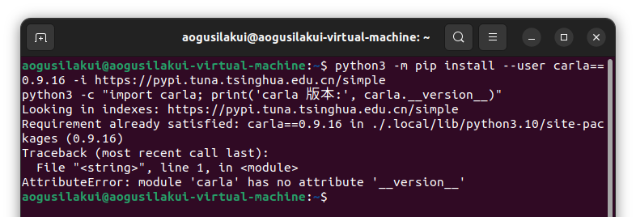

### 4.4 校验 ROS 2 Humble 环境

```bash
source /opt/ros/humble/setup.bash
ros2 pkg list | head -3
python3 -c "import rclpy; print(rclpy.__file__)"
```

**预期输出**：

```
action_msgs
action_tutorials_cpp
action_tutorials_interfaces
/opt/ros/humble/local/lib/python3.10/dist-packages/rclpy/__init__.py
```

> 提示：`ros2 --version` 在 Humble 中不是合法参数，会返回非零状态；
> 判断 ROS 2 是否可用请使用 `ros2 pkg list`。
> 另外 `ros2 pkg list | head -3` 会因为管道提前关闭而打印 `BrokenPipeError` 并弹出崩溃上报窗口，
> 这是正常现象，点「Don't send」关闭即可。

**截图**：`05_ros2_pkg_list.png`。

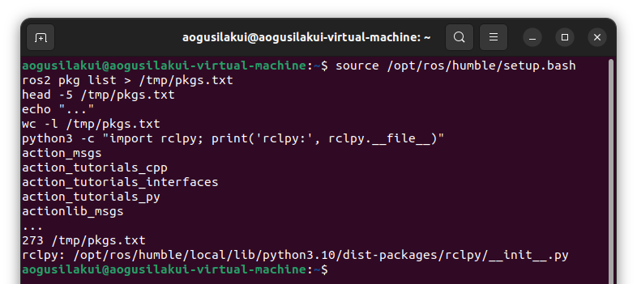

### 4.5 编译功能包

```bash
mkdir -p ~/ros2_ws/src && cd ~/ros2_ws/src
git clone --depth 1 https://github.com/OpenHUTB/ros2.git
cp -r ~/ros2_ws/src/ros2/src/ground/carla_nn_car_following ~/ros2_ws/src/
cd ~/ros2_ws
source /opt/ros/humble/setup.bash
colcon build --packages-select carla_nn_car_following --symlink-install
source install/setup.bash
ros2 pkg executables carla_nn_car_following
```

**预期输出**：`Summary: 1 package finished`，并列出 `carla_nn_car_following acc_scene_node`。
**截图**：`06_colcon_build.png`。

> **评审本 PR 时**：模块尚未合并进 `OpenHUTB/ros2` 的 master，请改为克隆 PR 所在分支
> （例如 `git clone -b master https://github.com/Aogusilakui/ros2.git`），或在 PR 页面
> 用「Code → Download ZIP」下载对应提交的源码。

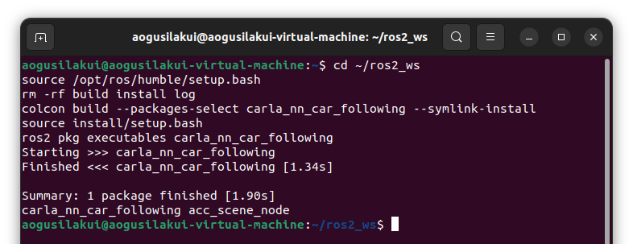

### 4.6 环境自检

```bash
cd ~/ros2_ws/src/carla_nn_car_following
python3 check_env.py --host 192.168.148.1 --town Town03
```

**预期输出**：

```
  Python / carla 包 ：PASS
  连接与生成自车    ：PASS
  雷达+相机数据     ：PASS
  ROS 2 Humble      ：PASS
```

**截图**：`07_env_check_pass.png`。

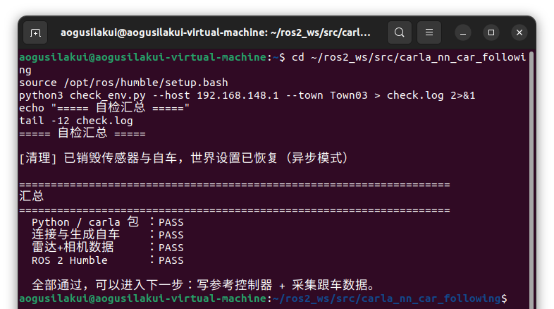

---

## 5. 运行步骤

> 下面所有命令里的 `192.168.148.1` 都要换成**你自己的宿主机 IP**（见 4.2 节）。

### 5.1 离线测试（不需要 CARLA，建议先跑）

```bash
cd ~/ros2_ws/src/carla_nn_car_following
python3 test/test_reference_acc.py      # 预期：[结果] 24 项全部通过
python3 test/test_nn_numpy.py           # 预期：[结果] 17 项全部通过
```

### 5.2 经典 ACC 跟车（基线，终端打印逐帧数据）

```bash
python3 main.py --mode scene --host 192.168.148.1 --scenario decelerate
```

**预期输出**（完整逐帧日志见 [run_classic.log](../evidence/carla_nn_car_following/run_classic.log)）：

```
[预检] 出生点 #0 可用（30 帧位移 5.3 m，末速 8.52 m/s），已重新就位
[自车] 已生成 @ (-6.4, -79.1, 0.3)
[前车] 已生成 @ (-6.1, -54.0, -0.0)，初始车距 25.0 m
[工况] decelerate —— 前车缓慢减速（-1.5 m/s^2）（经典 ACC，设定车速 18.7 m/s）
[起始] 自车与前车初始速度设为 16.7 m/s（60 km/h），进入稳态跟车
  t=  0.0s  雷达= 21.18m  真值= 24.98m  v_rel=+0.00 m/s  自车=16.30 m/s  前车=15.99 m/s  油门=0.53  刹车=0.00
  ...
[结果] 平均车距误差 2.97 m | 最小车距 11.66 m | 最小 TTC 5.50 s | 平均车速 7.30 m/s
```

### 5.3 采集训练数据

```bash
python3 main.py --mode collect --host 192.168.148.1 --scenario all
ls -lh data/
```

**预期输出**：四种工况各生成一个 `data/dataset_<工况>.npz`（每份约 600 帧）。

### 5.4 训练感知网络与控制网络（不需要 CARLA）

```bash
python3 main.py --mode train
```

**预期输出**（完整逐 epoch 日志见
[training_log.csv](../evidence/carla_nn_car_following/training_log.csv)）：

```
[数据] 载入 4 个文件：dataset_constant.npz, dataset_cutin.npz, dataset_decelerate.npz, dataset_emergency.npz
[数据质量] 按帧剔除异常样本：250 / 2400（10.4%），保留 4 个工况
[数据] 样本总数 2150（训练 1720 / 验证 430）
[感知网络] 6-24-16-2，参数量 602
  验证集：车距 RMSE = 0.415 m，相对速度 RMSE = 0.359 m/s
[控制网络] 3-24-16-2
  验证集：油门 RMSE = 0.0155，刹车 RMSE = 0.0014，总 MSE = 0.000121
[日志] 训练曲线数据已写入 data/training_log.csv
[完成] 模型已保存到 models/（perception.npz、control.npz）
```

> 本仓库**已随附训练好的** `models/perception.npz`、`models/control.npz`（体积很小，可直接入库），
> 因此可以**直接**跳到 5.5 节运行神经网络控制器；如需自行复现训练，按 5.3 / 5.4 节重跑即可
> （采集用的四个 `data/dataset_*.npz` 未入库，其中 `dataset_decelerate.npz` 作为样例随附）。

### 5.5 神经网络在线跟车

```bash
python3 main.py --mode run --host 192.168.148.1 --scenario decelerate --controller nn
```

**预期输出**（多出一列"估计"，是感知网络对车距的估计值；完整日志见
[run_nn.log](../evidence/carla_nn_car_following/run_nn.log)）：

```
[控制器] 神经网络（感知网络估计车距 → 控制网络输出油门/刹车）
  t=  0.0s  雷达= 21.16m  真值= 24.98m  ...  油门=0.00  刹车=0.14  估计= 24.85m(误差-0.13)
  ...
[结果] 平均车距误差 4.06 m | 最小车距 13.31 m | 最小 TTC 3.34 s | 平均车速 7.23 m/s
```

### 5.6 用 ROS 2 launch 启动

```bash
source /opt/ros/humble/setup.bash
source ~/ros2_ws/install/setup.bash

# 经典 ACC
ros2 launch carla_nn_car_following main.launch.py \
    host:=192.168.148.1 town:=Town03 scenario:=decelerate controller:=classic

# 神经网络控制器（需先完成 5.4 的训练）
ros2 launch carla_nn_car_following main.launch.py \
    host:=192.168.148.1 town:=Town03 scenario:=decelerate controller:=nn models_dir:=models
```

另开一个终端观察节点发布的状态：

```bash
source /opt/ros/humble/setup.bash
ros2 topic echo /acc/state
```

`/acc/state` 的字段顺序（消息类型 `std_msgs/Float32MultiArray`）：

```
[仿真时间, 真实车距, 相对速度, 自车速度, 油门, 刹车, 跟车状态]           # 经典 ACC：7 个字段
[仿真时间, 真实车距, 相对速度, 自车速度, 油门, 刹车, 跟车状态, 估计车距, 估计相对速度]   # 神经网络：9 个字段
```

**截图**：`08_ros2_launch.png`、`09_topic_echo.png`。

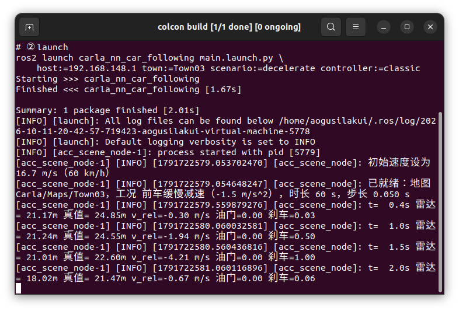
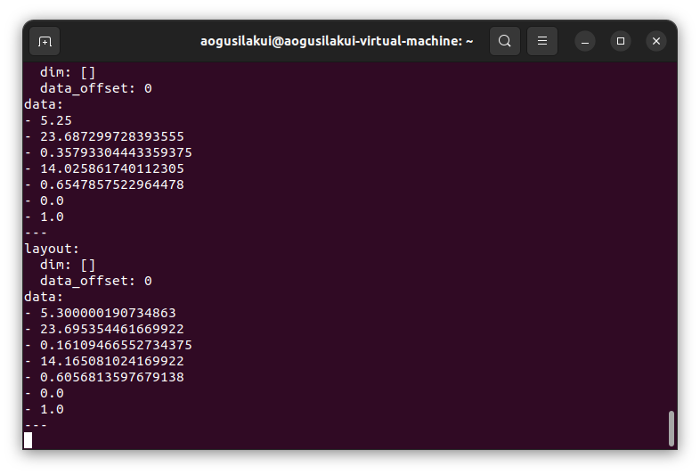

### 5.7 多场景性能评测

```bash
python3 main.py --mode eval --host 192.168.148.1 --scenario all
cat data/eval_classic.csv
```

**预期输出**：4 种前车工况的指标写入 `data/eval_<控制器>.csv`，可直接用于第 6 章表格。

---

## 6. 结果与性能评价

### 6.1 四种前车工况（经典 ACC，Town03 / ClearNoon / 30 s）

| 前车工况 | 误差均值 (m) | 最小车距 (m) | 最小 TTC (s) | 均速 (m/s) |
|---|---|---|---|---|
| 匀速 60 km/h | 1.87 | 21.82 | 5.50 | 15.42 |
| 缓慢减速 | 2.97 | 11.66 | 5.50 | 7.30 |
| 急刹（-6 m/s²） | 2.52 | 5.82 | 3.15 | 2.49 |
| 加塞 | 1.95 | 3.64 | 0.38 | 8.00 |

> **加塞工况说明**：加塞车辆出现后，"最近前车"由原始前车切换为加塞车，车距真值本身发生跳变
> （雷达跟踪目标也随之切换）。因此该工况的**最小 TTC 0.38 s 不能直接与其他工况比较**，
> 且其数据不纳入神经网络训练集（详见 6.3 与 9.2 节）。

### 6.2 神经网络控制器 vs 经典 ACC（缓慢减速工况）

| 控制器 | 误差均值 (m) | 最小车距 (m) | 最小 TTC (s) | 均速 (m/s) |
|---|---|---|---|---|
| 经典 ACC（基线） | 2.97 | 11.66 | 5.50 | 7.30 |
| 感知 + 控制神经网络 | 4.06 | 13.31 | 3.34 | 7.23 |

> **两个安全性指标必须分开看，不能由单一指标推断整体安全性**：
>
> | 安全性指标 | 经典 ACC | 神经网络 | 含义 |
> |---|---|---|---|
> | 最小车距 | 11.66 m | **13.31 m** | 网络在"最近靠到多近"上更宽裕 |
> | 最小 TTC | **5.50 s** | 3.34 s | 网络在"接近的相对速度"上更激进 |
>
> 最小车距只反映"靠得多近"；TTC $= d/(-v_{rel})$ 还包含**接近速度**，是更接近碰撞风险的度量。
> 本模块的结论是：神经网络控制器的**车距误差略大**（4.06 m vs 2.97 m，源自级联结构中感知误差的传递），
> 且**跟车风格与基线不同**（更早留出距离余量，但接近时的相对速度更大）。
> 因此**不能**用"最小车距更大"断言网络整体更安全；若要提升安全性，应把 TTC 约束显式加入控制目标
> （例如加入安全监督层）。
>
> 另：神经网络控制器的**感知估计误差**为车距平均误差约 0.9 m、最大 3.1 m（采样统计）。
>
> **长时闭环的局限**（上表为 30 s 实验；`ros2 launch` 节点默认 60 s）：
> 运行到 25 s 之后感知误差会明显增大——雷达长时间丢锁时航迹可能跳到远处杂波
> （实测读数一度到 69 m，而真值仍为 25 m），估计误差达 −10 m 量级。
> 同一工况下 60 s 节点运行的实测为：平均车距误差 6.70 m、最小车距 11.46 m、最小 TTC 5.00 s（无碰撞）。
> **长时闭环稳定性与丢锁后的重捕获**是后续改进方向；本节表格的指标只代表 30 s 短时闭环。

### 6.3 神经网络离线精度与数据质量（验证集）

| 项目 | 指标 | 数值 |
|---|---|---|
| 感知网络（602 参数） | 车距 RMSE | **0.415 m** |
| 感知网络 | 相对速度 RMSE | **0.359 m/s** |
| 控制网络 | 油门 / 刹车 RMSE | 0.0155 / 0.0014 |
| 控制网络 | 总 MSE | **0.000121** |
| 训练样本 | 训练 / 验证 | 1720 / 430 |
| 数据清洗 | 按帧剔除异常样本 | 250 / 2400（10.4%） |

感知网络结构 6-24-16-2、控制网络结构 3-24-16-2（详见 3.3 / 3.4 节）。

**各工况的雷达—真值一致性**（判据：偏差 = 真值 − 雷达，应约等于半个车身长度 2~4 m）：

| 工况 | 均值 (m) | 标准差 (m) | 超 5 m | 相关系数 | 结论 |
|---|---|---|---|---|---|
| 缓慢减速 | +3.51 | **0.42** | 1.8% | **0.996** | 合格 |
| 急刹 | +2.62 | **0.95** | 2.2% | 0.989 | 合格 |
| 匀速 | +3.14 | 2.47 | 11.2% | 0.554 | 一般 |
| 加塞 | −12.10 | 17.51 | 55.5% | −0.282 | 不合格，排除 |

> **为什么"加塞"不合格**：加塞车辆出现后真值目标切换，而雷达的航迹跟踪仍在原目标上，
> 两者不是同一个对象，偏差统计失去意义。这不是雷达故障，而是**场景定义与真值口径不一致**。
> 处理方式：该工况仍可通过 `--scenario cutin` 单独运行演示，但**不纳入训练集**。

### 6.4 曲线与动图

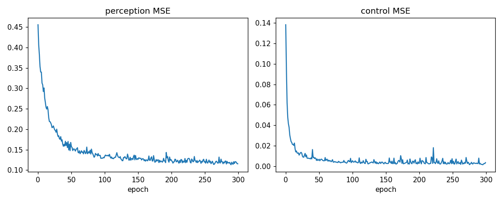
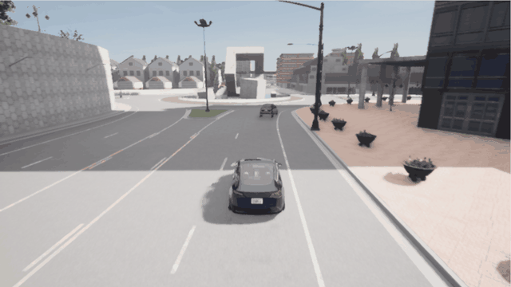


### 6.5 测试类型与可核验证据

本模块的测试分四类，**结论的可信度不同，请勿混为一谈**：

| # | 测试类型 | 命令 | 需要 CARLA | 验证什么 | 结果 |
|---|---|---|---|---|---|
| ① | 经典 ACC 逻辑（纯数学） | `python3 test/test_reference_acc.py` | 否 | 期望车距、加速度命令、油门/刹车标签、TTC 公式 | 24 项通过 |
| ② | NumPy 神经网络实现（**合成数据**） | `python3 test/test_nn_numpy.py` | 否 | 前向/反向传播与 Adam 的数值正确性 | 17 项通过 |
| ③ | 数据质量体检 | `python3 analyze_dataset.py` | 否（读已采集的 npz） | 雷达回波与真值的一致性 | 见下方证据文件 |
| ④ | **真实 CARLA 闭环实验** | `--mode collect` / `train` / `run` | **是** | 6.1~6.3 节的**全部性能指标** | 见下方证据文件 |

> ⚠️ **第 ② 类用的是合成数据**（`make_synthetic_dataset()` 生成"车距 − 2.3 m + 噪声"），
> 它只用来证明**实现正确**（梯度、优化器没写错），**不代表真实精度**。
> **6.1~6.3 节的所有指标都来自第 ④ 类真实 CARLA 闭环实验**，与 ② 无关。

第 ④ 类实验的原始日志/结果文件放在 `docs/evidence/carla_nn_car_following/`，可直接下载核验：

| 文件 | 内容 |
|---|---|
| [analyze_dataset.txt](../evidence/carla_nn_car_following/analyze_dataset.txt) | `analyze_dataset.py` 完整输出（各工况雷达—真值偏差均值/标准差/相关系数） |
| [training_log.csv](../evidence/carla_nn_car_following/training_log.csv) | 训练过程逐 epoch 损失（`main.py --mode train` 生成） |
| [run_classic.log](../evidence/carla_nn_car_following/run_classic.log) | 经典 ACC 在缓慢减速工况的逐帧输出与结尾 `[结果]` 行 |
| [run_nn.log](../evidence/carla_nn_car_following/run_nn.log) | 神经网络控制器在同一工况的逐帧输出（含 `估计=` 与 `误差`）与 `[结果]` 行 |

复现第 ④ 类实验的命令见 5.2~5.5 节，每一步的预期输出与截图见第 4、5 章。

**独立核验示例（不需要 CARLA、不需要训练）**：仓库已随附训练好的 `models/` 与一份真实采集样例
`data/dataset_decelerate.npz`，可直接复算感知网络在真实数据上的精度：

```bash
cd src/ground/carla_nn_car_following
python3 -c "
import numpy as np, sys; sys.path.insert(0, '.')
from carla_nn_car_following.nn_controller import NNController
nn = NNController.load('models')
d = np.load('data/dataset_decelerate.npz')
errs = []
for i in range(0, len(d['gap_true']), 20):
    f = {'d_radar': float(d['radar_d'][i]), 'azimuth': float(d['radar_azimuth'][i]),
         'closing_rate': float(d['radar_closing'][i]), 'mean_depth': float(d['radar_mean_depth'][i]),
         'n_points': float(d['radar_n_points'][i])}
    errs.append(nn.estimate(f, float(d['v_ego'][i]))[0] - float(d['gap_true'][i]))
errs = np.array(errs)
print('车距 RMSE = %.3f m, 最大 %.3f m' % (np.sqrt((errs**2).mean()), abs(errs).max()))
"
```

预期输出：`车距 RMSE = 0.428 m, 最大 0.930 m`（与训练报告的验证集 0.415 m 一致）。

---

## 7. 源代码解析

| 文件 | 关键函数 / 类 | 作用 | 对应公式 |
|---|---|---|---|
| `carla_client.py` | `settle()` | 生成 actor 后推进一步，等位置数据到达客户端 | — |
| | `spawn_ego()` | **出生点预检**：全油门试跑，达标后重新就位 | — |
| | `features()` | 从雷达回波统计出 6 维特征向量 | 3.3 节 \(x_p\) |
| `scenario.py` | `lane_steer()` | 纯追踪横向控制 | 3.5 节式(1) |
| | `steer_to_point()` | 面包屑跟踪的几何计算 | 3.5 节 |
| | `drive_to_speed()` | 前车速度控制（P + 前馈） | — |
| `reference_acc.py` | `acceleration()` | 计算 \(a_{cmd}\) 并施加设定车速限制 | 3.2 节式(3) |
| | `labels()` | 输出油门与刹车标签 | 3.2 节式(4) |
| `nn_numpy.py` | `forward()` | 前向传播 | 3.3 / 3.4 节 |
| | `_backward()` | 反向传播（tanh 导数、L2 正则） | 3.3 节损失函数 |
| | `_adam_update()` | Adam 优化器 | — |
| `train.py` | `train_models()` | 归一化、切分训练/验证集、训练两个网络 | 3.3 / 3.4 节 |
| `nn_controller.py` | `labels()` | 感知 → 控制级联推理 | 3.3 / 3.4 节 |
| `acc_scene_node.py` | `on_timer()` | ROS 2 主循环：场景推进、控制器切换、发布状态 | — |
| `analyze_dataset.py` | 逐工况体检 | 按"偏差 = 真值 − 雷达"的均值/标准差判断数据质量 | 6.3 节判据 |
| `diagnose_drive.py` | 逐出生点试车 | 每个出生点全油门试跑 5 秒，挑出能行驶的点 | — |
| `check_env.py` | 环境自检（6 项） | Python、carla 包、连接、自车、传感器、rclpy | — |

---

## 8. 常见问题（FAQ）

| 现象 | 原因 | 解决 |
|---|---|---|
| 连接超时 `time-out of 60000ms` | 宿主机 IP 填错 / 防火墙 / CARLA 未启动 | `ipconfig` 重新确认；宿主机浏览器访问 `http://<IP>:2000` 应返回 JSON |
| 雷达回调一次都不触发 | 传感器句柄被 Python 垃圾回收 | `sensor` 必须保存为对象属性或列表元素 |
| 生成的前车在几十米甚至几百米外 | 刚 `try_spawn_actor` 的 actor 在下一帧前 `get_location()` 返回 `(0,0,0)`，用它查车道点会算到地图原点 | 生成后调用 `settle()` 推进一步再计算（本模块已修复） |
| 车"全油门却越来越慢"，两车最后都停住 | 只控制纵向、方向盘恒为 0，车辆沿直线冲出弯道撞上障碍物 | 加入横向控制（纯追踪 + 面包屑跟踪） |
| 自车冲到前车跟前才急刹 / 追尾 | 相对速度符号写反：车距的导数本身就是 \(v_{rel}\)，再取负号会让阻尼项变成"催油门" | \(v_{rel} = (d_t - d_{t-1})/\Delta t\) |
| 前车速度在 10~16 m/s 之间来回摆 | 纯 P 控制器没有前馈项，到达目标速度后完全松油门 | 增加前馈项 `throttle_bias = 0.25` |
| 自车在路口跟丢前车，车距一路涨到 365 m | 两车在路口走了不同分支；且没有设定车速，自车为"追车距"无限加速（实测飙到 143 km/h） | 面包屑跟踪 + 设定车速限制 |
| 车辆一出生就往反方向开 | 出生点朝向与车道相反 | 用 `get_spawn_points()`，或按 `rotation.yaw` 设置朝向 |
| 退出后 CARLA 窗口"卡住不动" | 世界仍停留在同步模式 | 在 `finally` 中恢复 `apply_settings()` |
| AttributeError: module 'numpy' has no attribute 'bool' | numpy 版本过高（1.24+） | 安装 `numpy<1.24` |
| No module named 'carla' | 安装与运行用了不同解释器 | 统一使用 `python3`（3.10） |
| `BrokenPipeError` 且弹出 "ros2 has stopped unexpectedly" | 命令里的 `\| head -N` 提前关闭了管道 | 正常现象，可忽略 |
| `ros2 launch` 启动即退出，报参数类型不匹配（INTEGER / STRING） | launch_ros 按默认值字符串"猜"参数类型 | launch 中用 `value_type=str` 强制按字符串传递 |
| 场景跑满时长后 CARLA 窗口冻结不动、前车继续行驶撞墙 | 节点停止 tick 但世界仍在同步模式；且只给自车刹车 | 结束时统一刹停所有车辆并恢复异步模式；新版启动时会自动清除上次残留的同步模式 |
| 画面像 3 倍速快进 | 主循环未做实时节奏控制 | 默认按真实时间 \(\Delta t\) 推进；采集数据时可用 `--fast` 关闭 |
| 雷达读数比真实车距小 9~10 m 且几乎不变 | 垂直视场角过大，波束打到路面 | 见 3.3 节与世界坐标系下的高度过滤，及第 9 章第 8 条 |
| 动图超过 10 MB 被拒 | 录屏分辨率/帧率过高 | ScreenToGif 录制后降到 10 fps、宽 800 px（仓库约定：gif < 10 MB） |

---

## 9. 修复记录（自查）

本模块在 Ubuntu 虚拟机 + Windows CARLA 服务端联调过程中，共发现并修复 **16 个缺陷**。
每一项都记录"现象（修复前实测数据）→ 根因 → 修复方法"。**其中第 8~13 条是毫米波雷达的完整排障链路**，
也是本模块最有工程价值的部分。

### 9.1 场景与车辆控制

| # | 现象（修复前实测） | 根因 | 修复 |
|---|---|---|---|
| 1 | `[前车] 初始车距 0.0 m`，而真实车距 60.95 m | 新生成的 actor 在下一帧数据到达前 `get_location()` 返回 `(0,0,0)`，用它查车道点会算到地图原点 | 新增 `CarlaSession.settle()`，生成后先推进一步 |
| 2 | 自车平均车速 2.29 m/s、最小车距 23.91 m，两车最终都停住 | 出生点被墙挡住，给油门车也不动 | 出生点预检（全油门试跑）+ 自动换点 + `diagnose_drive.py` |
| 3 | 预检后自车以 9.00 m/s 冲进场景，2 秒内追尾 | 预检结束时自车带着残余速度 | 预检通过后销毁试驾车、在原出生点重新生成 |
| 4 | 前车"油门 0.8 却从 16 m/s 掉到 10.4 m/s" | 没有横向控制，直行撞路沿 | `lane_steer()` 纯追踪横向控制 |
| 5 | 自车全程 `油门=1.00` 顶上前车（最小 TTC 0.97 s） | \(v_{rel}\) 符号写反，阻尼项变成加速项 | 修正为 \(v_{rel} = (d_t - d_{t-1})/\Delta t\) |
| 6 | 前车速度在 10.4~15.9 m/s 之间持续振荡 | P 控制器无前馈项 | `throttle_bias = 0.25` |
| 7 | 路口跟丢前车，车距 25 → 365 m，自车飙到 39.83 m/s | 两车在路口走不同分支 + 无设定车速 | 面包屑跟踪 + `v_set` 限速项 |
| 16 | 画面像 3 倍速快进 | 主循环"能跑多快就跑多快"，30 s 仿真 10 s 就放完 | 实时节奏控制（每步睡够 \(\Delta t\)），可用 `--fast` 关闭 |

### 9.2 毫米波雷达排障链路（核心）

| # | 现象（修复前实测） | 根因 | 修复 |
|---|---|---|---|
| 8 | 雷达读数恒定 15 m（真值 25 m，差 9.7 m），雷达—真值相关系数 **−0.079** | 垂直视场角 10°（下沿 5°），波束打到路面：\(1.2/\tan 5° \approx 13.7\) m，比前车还近 | 垂直视场角改为 4°；并按回波高度过滤 \(h = h_{mount} + d\sin\theta\)，只保留 0.25~3 m 的回波 |
| 9 | 雷达在弯道跳到 **49.8 m**（先锁到护栏，再沿护栏一帧帧"走"出去） | 只做高度过滤仍会锁到静止杂波 | **多普勒速度过滤**：径向速度 > 8 m/s 的回波判为静止目标（护栏/墙面/路面） |
| 10 | 雷达读数从 21 m 突跳到 90 m | 车辆过弯时前车偏出 ±8° 方位角窗口，"最近回波"变成几十米外的建筑 | **门限跟踪**：用上一帧距离外推预测，只接受 ±3 m 内的回波 |
| 11 | 雷达长期冻结在 4.0 m（偏差均值 **+19.05 m**，87% 的帧偏差 > 5 m） | 丢锁时"保持上一次测量值"，航迹滑到近处杂波后，±3 m 门限永远接不到 20 多米外的真前车 → **永久失锁** | 外推距离限幅 ±5 m；超过 1.25 s 直接**重新捕获最近的有效回波** |
| 12 | 每个工况前 2~3 帧雷达输出 100 m（量程上限），并触发一次急刹 | 进入控制循环时雷达第一帧数据还没到 | 进循环前等待第一帧有效数据 |
| 13 | 在线闭环在弯道丢锁后直冲前车（最小 TTC **0.39 s**，估计误差 **−21 m**） | 感知网络在训练分布之外"外推"，MLP 输出完全失真 | 训练时记录各输入/输出的 min/max，部署时**裁剪回训练范围** |
| 14 | 雷达丢锁外推时出现 −780 m/s 的接近速度，航迹锁死到 1 m | 外推出的距离又被下一帧用来算接近速度，形成"外推 → 差分 → 再外推"正反馈 | 丢锁帧不更新接近速度；接近速度限幅 ±30 m/s |

### 9.3 工程与集成

| # | 现象 | 根因 | 修复 |
|---|---|---|---|
| 15a | `ros2 launch` 启动即退出，报参数类型不匹配（INTEGER / STRING） | `launch_ros` 按默认值字符串"猜"类型（`'2000'` → INTEGER），与节点声明的 STRING 冲突 | launch 中用 `value_type=str` 强制按字符串传递 |
| 15b | 场景跑满 60 s 后 CARLA 窗口冻结不动，前车继续行驶撞墙 | ①节点停止 tick 但世界仍在同步模式；②只给自车刹车，前车保留最后一条控制指令 | 结束时统一刹停所有车辆并**恢复异步模式**；启动时检测并自愈上一次残留的同步模式 |
| — | 数据质量不可见，脏数据会静默污染训练 | 缺少数据体检环节 | 新增 `analyze_dataset.py`（逐工况体检）与训练时的**按帧剔除**（本次剔除 10.4%） |

### 9.4 修复后的最终实测结果

**经典 ACC**（Town03 / ClearNoon / decelerate / 30 s）：

```
  t=  0.0s  雷达= 21.19m  真值= 24.98m  自车=16.30 m/s  前车=15.99 m/s
  t= 10.0s  雷达= 15.90m  真值= 19.43m  自车= 7.22 m/s  前车= 6.01 m/s
  t= 29.5s  雷达=  8.03m  真值= 11.68m  自车= 4.48 m/s  前车= 4.44 m/s
[结果] 平均车距误差 2.97 m | 最小车距 11.66 m | 最小 TTC 5.50 s | 平均车速 7.30 m/s
```

**神经网络控制器**（同一场景）：

```
  t=  0.0s  雷达= 21.16m  真值= 24.98m  估计= 24.85m(误差-0.13)
  t= 15.0s  雷达= 12.40m  真值= 15.98m  估计= 16.08m(误差+0.09)
  t= 29.5s  雷达= 11.75m  真值= 15.37m  估计= 13.97m(误差-1.40)
[结果] 平均车距误差 4.06 m | 最小车距 13.31 m | 最小 TTC 3.34 s | 平均车速 7.23 m/s
```

---

## 10. 参考

1. CARLA 官方文档：<https://carla.readthedocs.io/>
2. 仓库内已有示例：[设置并连接到 Carla 模拟器](https://openhutb.github.io/ros2/set_up_and_connect_to_carla/)
3. CARLA Python API 发行版（Python 3.10/3.11/3.12 wheel）：<https://pypi.org/project/carla/0.9.16/>
4. 固定车头时距（CTH）ACC 模型：[CARLA 官方文档](https://carla.readthedocs.io/en/latest/adv_vehicle_physics/)（车头时距与期望车距的定义）
