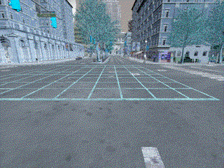
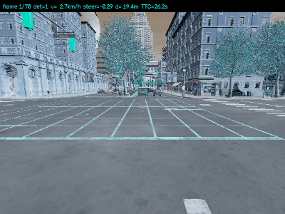
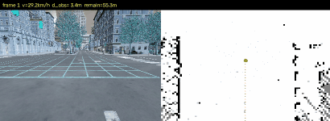
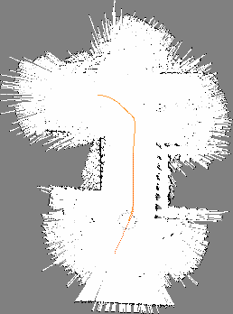
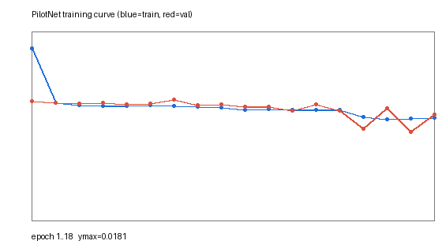
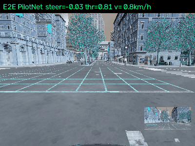

# 基于神经网络的 CARLA 感知、控制与 SLAM 仿真

本模块在 CARLA 0.9.13（`Town10HD_Opt`）中完成四项任务：键盘运动控制、传感器感知与轨迹跟踪、激光建图与导航、端到端驾驶。感知与控制算法基于神经网络，所有程序均支持 `launch` 启动，统一入口为 `main.py`。

- 源码：`src/ground/carla_nn_perception_control_slam/`
- 入口：`ros2 run carla_nn_perception_control_slam main --task <1|2|3|4>`

## 任务总览

| 任务 | 内容 | 神经网络 | 关键指标 |
|------|------|----------|----------|
| 1 | 物理仿真 + 键盘运动控制 | — | 110 帧，gif 4.4MB |
| 2 | 传感器感知 + 给定轨迹控制 | YOLOv5m | 平均检出 2.14，车速 0→31.1 km/h |
| 3 | 建图 + 导航（SLAM 同步） | — | 已知栅格 49,839，A\* 112 点 |
| 4 | 端到端模型（图像 → 控制） | PilotNet | val loss 0.00845，转向 MAE 2.99° |


## 任务1

## 1. 仿真步骤

1. 启动 CARLA 服务端并加载地图：
   ```bash
   ./CarlaUE4.sh -quality-level=Low    # 或 Windows: CarlaUE4.exe -quality-level=Low -windowed
   ```
2. 启动客户端：
   ```bash
   ros2 launch carla_nn_perception_control_slam task1.launch.py carla_host:=<服务端IP>
   # 或 ros2 run carla_nn_perception_control_slam main --task 1
   ```
3. 客户端完成：开启同步模式 → 清空场景 → 在 `spawn_points[0]` 生成 `vehicle.tesla.model3` → 挂载前置 RGB 相机（`x=1.5, z=2.4, pitch=-15°`）。
4. 按脚本内的按键序列控制车辆，逐帧采集图像并录制 gif。

## 2. 物理仿真与运动学原理

车辆在 CARLA 中由 Chaos/PhysX 刚体动力学驱动，控制量经底层车辆模型映射为轮胎力。设 $v$ 为纵向速度、$\delta$ 为前轮转角，车辆满足自行车模型：

$$
\dot{x} = v\cos\psi,\qquad \dot{y}=v\sin\psi,\qquad \dot{\psi}=\frac{v}{L}\tan\delta
$$

其中 $L$ 为轴距。加速踏板 $\theta\in[0,1]$ 与制动力 $b\in[0,1]$ 通过发动机扭矩曲线与制动扭矩共同决定纵向加速度：

$$
a = \frac{T_{\max}\theta - M g \mu b - \tfrac12\rho C_d A v^2}{M}
$$

## 3. 键盘 → 控制量映射

| 按键 | 控制量 | 数值 | 说明 |
|------|--------|------|------|
| W | `throttle` | 1.0 | 加速 |
| S | `brake` | 1.0 | 制动 |
| A | `steer` | −0.5 | 左转 |
| D | `steer` | +0.5 | 右转 |
| — | `steer` | 0.0 | 回正 |

脚本使用等价的控制序列代替真人按键（便于自动化录制与复现）：

```python
sequence = [
    (1.0,  0.0, 0.0, 'W: accelerate', 25),
    (0.5, -0.5, 0.0, 'A: steer left', 25),
    (1.0,  0.0, 0.0, 'W: straight',   20),
    (0.5,  0.5, 0.0, 'D: steer right',25),
    (0.0,  0.0, 1.0, 'S: brake',      15),
]
```

## 4. 算法流程

```text
开始
 ├─ 连接 CARLA，设置同步模式 dt=0.05
 ├─ 清空车辆 → 生成 ego → 挂载 RGB 相机
 ├─ 队列监听图像（image_queue.put）
 ├─ for (throttle, steer, brake, desc, n) in sequence:
 │    ├─ apply_control
 │    ├─ for i in 1..n: world.tick(); 从队列取一帧并缓存
 │    └─ 打印按键说明
 ├─ 恢复异步模式，销毁 actor
 └─ 合成 gif（400×300, 50ms/帧）
```

> 关键点：同步模式下传感器数据通过独立回调线程异步到达，直接用共享变量会丢帧（首版仅采到 17/110 帧）。改用 `queue.Queue` 后 110 帧全部采集成功。

## 5. 源码解析（`carla_nn_perception_control_slam/manual_control.py`）

| 代码段 | 作用 |
|--------|------|
| `settings.synchronous_mode = True` | 固定步长仿真，保证每 tick 一帧图像，帧率可控 |
| `cam.listen(image_queue.put)` | 相机回调写入队列，与主循环解耦 |
| `grab_one()` | 从 `raw_data` 解析 BGRA → RGB，`reshape((h, w, 4))[:, :, :3]` |
| `sequence` 循环 | 每段控制量持续 n 帧，形成"加速-左转-直行-右转-刹车"闭环演示 |
| `imgs[0].save(..., save_all=True, append_images=...)` | 用 PIL 合成 gif，`duration=50` ms |

## 6. 运行效果



- 帧数：**110**，分辨率 400×300，gif 体积 **4.4MB**
- 控制序列完整覆盖 加速 / 左转 / 直行 / 右转 / 制动 五种状态
- 车辆在 `Town10HD_Opt` 中沿街道行驶，物理仿真正常（悬挂、轮胎、碰撞均启用）


## 任务2

感知使用 **YOLOv5 神经网络** + **深度相机**，控制使用**参考轨迹 + 纯跟踪（Pure Pursuit）**，属"感知 + 给定轨迹控制"两个子任务。

## 1. 仿真步骤

1. 启动 CARLA 服务端（`Town10HD_Opt`）。
2. `ros2 launch carla_nn_perception_control_slam task2.launch.py carla_host:=<IP>` 或 `ros2 run carla_nn_perception_control_slam main --task 2`。
3. 客户端：同步模式 → 生成 `vehicle.tesla.model3` → 车头前方 10~120m 内生成 14 辆 NPC 车（优先放在视野前方）→ 挂载 RGB + Depth 相机（640×480, FOV 90°, `x=1.5, z=2.30, pitch=-8°`）。
4. 逐帧：YOLOv5 检测 → 深度距离 → 纯跟踪转向 + TTC 油门 → 渲染 HUD → 录 gif。

## 2. 感知原理

### 2.1 YOLOv5 检测

输入 640×480 RGB，缩放到 320×320 送入 YOLOv5m（COCO 预训练），输出若干 $(x_1,y_1,x_2,y_2,\text{cls},\text{conf})$。保留置信度阈值 0.35 且类别属于
`{car, truck, bus, motorcycle, bicycle, person, train}` 的目标。

YOLO 的损失由三部分组成：

$$
\mathcal{L} = \lambda_{box}\mathcal{L}_{CIoU} + \lambda_{obj}\mathcal{L}_{obj} + \lambda_{cls}\mathcal{L}_{cls}
$$

### 2.2 深度相机测距

CARLA 深度图以 `R + G·256 + B·256²` 编码归一化深度，换算为米：

$$
d = \frac{R + 256G + 65536B}{256^3-1}\times 1000\ \text{[m]}
$$

取前向 ROI（横向 30%~70%、纵向 18%~50%，规避自车引擎盖与地面）的 **5% 分位数**作为障碍距离 $d_{\text{front}}$，对离群噪点鲁棒。

### 2.3 碰撞时间（TTC）

$$
\text{TTC} = \frac{d_{\text{front}}}{v+\epsilon}
$$

## 3. 控制原理（纯跟踪）

从 HD 地图沿当前车道取 25 个间隔 3m 的 waypoint 作为**给定轨迹**。前视距离 $L_d=6$m，取轨迹上第一个满足 $\lVert p_i-p\rVert\ge L_d$ 的点为前视点，投影到车体系：

$$
\begin{bmatrix} x_l \\ y_l \end{bmatrix}=
\begin{bmatrix} \cos\psi & \sin\psi \\ -\sin\psi & \cos\psi \end{bmatrix}
\begin{bmatrix} x_t-x \\ y_t-y \end{bmatrix}
$$

前视角 $\alpha=\arctan_2(y_l, x_l)$，前轮转角（轴距 $L=4.0$m）：

$$
\delta=\arctan\frac{2L\sin\alpha}{L_d}
$$

归一化控制量 $\text{steer}=\delta/35^\circ$，裁剪到 $[-1,1]$。

油门/制动采用 TTC 自适应策略：

$$
(\theta,b)=
\begin{cases}
(0,\ 0.6), & d_{\text{front}}<6\text{m}\ \text{或}\ (\text{TTC}<1.2\text{s}\ \wedge\ v>2\text{m/s})\\
(0.75,\ 0), & v<8\text{m/s}\\
(0.35,\ 0), & \text{otherwise}
\end{cases}
$$

## 4. 算法流程

```text
for each frame:
  world.tick()
  rgb ← 相机队列;  depth ← 深度队列
  d_front ← percentile(depth[ROI], 5)
  dets ← YOLOv5(rgb, imgsz=320, conf=0.35)  # 只保留交通参与者
  path ← map.waypoints(前进 25×3m)
  δ ← pure_pursuit(path, L_d=6m)
  TTC ← d_front / v
  (θ,b) ← TTC 自适应策略
  vehicle.apply_control(θ, δ, b)
  绘制检测框 + HUD → 缓存帧
合成 gif
```

## 5. 源码解析（`carla_nn_perception_control_slam/perception_control.py`）

| 函数 | 作用 |
|------|------|
| `depth_to_meters()` | 按 $R+256G+65536B$ 解码深度图 |
| `front_min_depth()` | ROI 内 5% 分位数，抗噪且不受引擎盖干扰 |
| `reference_path()` | 由 HD 地图 `waypoint.next(step)` 生成参考轨迹 |
| `pure_pursuit()` | 车体系投影 + $\arctan(2L\sin\alpha/L_d)$ 求转角 |
| 主循环 | 检测 → 控制 → HUD 渲染（帧号/检测数/速度/转角/距离/TTC） |

## 6. 运行效果与性能



| 指标 | 数值 |
|------|------|
| 采集帧数 | 70 |
| 平均 FPS（含 YOLO CPU 推理） | 2.07 |
| 平均检出目标数 | 2.14（峰值 6） |
| 车速区间 | 0 → 31.1 km/h |
| 最小前向距离 | 2.22 m（触发制动） |
| 最小 TTC | 2.22 s |

> CPU 推理耗时约 1.0 s/帧（320×320, YOLOv5m）。若客户端有 GPU，可将 `YOLO_IMGSZ` 提到 640 并换 `yolov5s`/TensorRT，帧率可达 20+ FPS。


## 任务3

使用 32 线激光雷达，**与导航同步**地增量构建占据栅格地图，并在已建地图上用 A\* 全局规划 + 纯跟踪局部控制完成导航。

## 1. 仿真步骤

1. 启动 CARLA 服务端（`Town10HD_Opt`）。
2. `ros2 launch carla_nn_perception_control_slam task3.launch.py carla_host:=<IP>` 或 `ros2 run carla_nn_perception_control_slam main --task 3`。
3. 客户端：生成 `vehicle.tesla.model3` → 挂载 `sensor.lidar.ray_cast`（32 线，55m，60k pts/s，20Hz，`z=2.4`）与 RGB 相机。
4. **阶段一 建图**（130 帧）：教师控制器驾驶，激光逐帧写入栅格地图。
5. **阶段二 规划**：取当前车道前方 20~60m 内的已知自由栅格为目标，A\* 求解路径。
6. **阶段三 导航**（110 帧）：纯跟踪沿规划路径行驶，同时继续建图（SLAM 同步）。
7. 保存 `task3_slam_map.png`、`task3_slam_navigation.gif`、`task3_metrics.json`。

## 2. 建图原理（log-odds 占据栅格）

每个栅格维护对数几率 $l_{t}= \log\frac{p}{1-p}$，观测更新为独立证据累加：

$$
l_t(m_i) = l_{t-1}(m_i) + \begin{cases}
+z, & \text{命中}(z=0.85)\\
-n, & \text{未命中}(n=0.40)
\end{cases}
\qquad
l_t \leftarrow \mathrm{clip}(l_t,\ -2.5,\ +3.5)
$$

反解占据概率：

$$
p(m_i)=\frac{1}{1+e^{-l_t(m_i)}} \quad\Rightarrow\quad
\text{occupied}:p>0.65,\ \text{free}:p<0.45,\ \text{unknown}:其他
$$

射线处理：对激光点 $\mathbf{p}_w$ 与传感器原点 $\mathbf{o}_w$ 之间按 $0.4$m 步长采样，途经栅格标记 free，端点标记 occupied（Bresenham 近似）。

坐标变换（车体系 → 世界系）：

$$
\begin{bmatrix}x_w\\y_w\end{bmatrix}=
\begin{bmatrix}\cos\psi&-\sin\psi\\ \sin\psi&\cos\psi\end{bmatrix}
\begin{bmatrix}x_l\\y_l\end{bmatrix}+
\begin{bmatrix}x\\y\end{bmatrix}
$$

栅格索引：$i=\lfloor x_w/\text{res}\rfloor,\ j=\lfloor y_w/\text{res}\rfloor$，分辨率 $\text{res}=0.5$ m。

## 3. 规划原理（A\*）

$$
f(n)=g(n)+h(n),\qquad h(n)=\sqrt{(i_n-i_g)^2+(j_n-j_g)^2}
$$

- 8 邻域扩展，直边代价 1、斜边代价 $\sqrt2$
- **禁止切角**：斜向移动要求两个直角邻格均可通行
- 障碍物（$p>0.65$）不可通行；未知栅格视为不可通行（保守策略）

## 4. 控制原理（路径跟踪 + 终点减速）

沿规划路径找最近点 $i_0$，向前累计弧长至 $L_d=7$m 得到前视点，按纯跟踪公式求转角。终点剩余距离 $r$ 小于 8m 时线性减速：

$$
\theta=0,\qquad b=\min\left(1,\ 0.25(8-r)\right)
$$

## 5. 算法流程

```text
STAGE1: for 130 frames
    control ← teacher(纯跟踪沿车道)
    tick(); lidar ← queue
    世界系变换 → 逐射线 update_ray(free/occupied)
STAGE2:
    goal ← 车道上 20~60m 内第一个已知自由栅格
    path ← A*(start, goal)   # 8 邻域 + 禁切角
STAGE3: for 110 frames
    control ← follow_path(path, Ld=7m) + 终点减速
    tick(); lidar ← queue
    继续 update_ray(...)          # SLAM 同步
    render(地图 + 路径 + 激光 + 位姿) → 帧缓存
保存地图 PNG / gif / metrics
```

## 6. 源码解析（`carla_nn_perception_control_slam/slam_nav.py`）

| 类/函数 | 作用 |
|---------|------|
| `GridMap.logodds` | 稀疏字典栅格，只存被观测过的格子（省内存） |
| `update_ray()` | 射线步进更新 free/occupied，带置信度裁剪 |
| `GridMap.astar()` | 优先队列 A\*，含切角检查与扩展上限保护 |
| `to_image()` | 栅格 → 灰度图（黑=占据、白=自由、灰=未知），`np.flipud` 保证 y 轴向上 |
| `render()` | 以自车为中心的 45m 视野：地图切片 + 激光点 + 规划路径 + 车辆 |
| `follow_path()` | 最近点 + 弧长前视的纯跟踪控制 |

## 7. ROS 话题（可选）

脚本内置 rospy 发布（`import rospy` 成功时自动启用）：

| 话题 | 类型 | 内容 |
|------|------|------|
| `/map` | `nav_msgs/OccupancyGrid` | 当前栅格地图 |
| `/scan` | `sensor_msgs/LaserScan` | 单帧激光 |
| `/odom` | `nav_msgs/Odometry` | 里程计位姿 |
| `/cmd_vel` | `geometry_msgs/Twist` | 控制指令 |

## 8. 运行效果与性能





| 指标 | 数值 |
|------|------|
| 已知栅格数 | 49,330 |
| 建图帧数 / 导航帧数 | 130 / 110 |
| A\* 路径点 | 112 |
| 平均车速 | 24.46 km/h |
| 最小障碍距离 | 3.42 m |
| 导航收敛 | 剩余距离 45.5 → 35.7 → 26.0 m（单调递减） |
| 单次全流程耗时 | 54.4 s |

> 左图为相机视角，右图为实时地图（白=自由、黑=障碍、灰=未知），橙点为 A\* 路径，红点为激光点云，绿点为自车。


## 任务4

复现 NVIDIA **PilotNet** 端到端驾驶：输入单目 RGB 图像，直接输出 `steer/throttle/brake`。包含**数据采集 → 神经网络训练 → 测试评估 → 仿真驾驶**完整闭环。

## 1. 三步流程

```bash
# ① 采集（教师控制器打标签，1200 帧）
python3 ros2 run carla_nn_perception_control_slam main --task 4 --mode collect --frames 1200
# ② 训练（18 epochs, CPU）
python3 ros2 run carla_nn_perception_control_slam main --task 4 --mode train --epochs 18
# ③ 端到端推理驾驶 + 录 gif
python3 ros2 run carla_nn_perception_control_slam main --task 4 --mode drive --frames 70
```

`ros2 launch carla_nn_perception_control_slam task4.launch.py` 等价于第 ③ 步（加载已训练权重）。

## 2. 数据采集（行为克隆）

驾驶员为**经典教师控制器**（地图参考轨迹 + 纯跟踪 + P 速度环），每帧保存：

- 输入：RGB 图像缩放到 $96\times96\times3$
- 标签：$(\delta,\ \theta,\ b,\ v)$ 归一化转角、油门、制动、车速

采集时含 24 辆 NPC 车、卡死自动换出生点、静止帧丢弃，得到：

| 统计量 | 数值 |
|--------|------|
| 样本数 | 1200 |
| `steer` 标准差 | 0.157 |
| 转向量 >0.02 的帧占比 | 46% |
| 平均车速 | 7.56 m/s |

> 说明：CARLA autopilot 模式下 `vehicle.get_control()` 返回全 0，无法直接作为标签，因此改用教师控制器显式给出控制量（行为克隆的标准做法）。

## 3. 网络结构（PilotNet）

| 层 | 配置 | 输出 |
|----|------|------|
| Conv1 | 24@5×5, s=2 + ReLU | 46×46×24 |
| Conv2 | 36@5×5, s=2 + ReLU | 21×21×36 |
| Conv3 | 48@3×3, s=2 + ReLU | 10×10×48 |
| Conv4 | 64@3×3 + ReLU | 8×8×64 |
| Conv5 | 64@3×3 + ReLU | 6×6×64 |
| Flatten | — | 2304 |
| FC1 | 100 + ReLU + Dropout(0.2) | 100 |
| FC2 | 50 + ReLU | 50 |
| FC3 | 3 + tanh | $(\hat\delta,\hat\theta,\hat b)$ |

## 4. 训练原理

损失函数（均方误差）：

$$
\mathcal{L}(\Theta)=\frac{1}{N}\sum_{i=1}^{N}\left\lVert f_\Theta(x_i)-y_i\right\rVert_2^2
$$

参数更新（Adam）：

$$
m_t=\beta_1 m_{t-1}+(1-\beta_1)g_t,\quad
v_t=\beta_2 v_{t-1}+(1-\beta_2)g_t^2
$$
$$
\Theta_{t+1}=\Theta_t-\eta\,\frac{m_t/(1-\beta_1^t)}{\sqrt{v_t/(1-\beta_2^t)}+\epsilon}
$$

超参：batch 64，$\eta=10^{-3}$，epochs 18，训练/验证 85%/15%。

转向精度指标：

$$
\text{MAE}_\delta=\frac1N\sum|\hat\delta-\delta|,\qquad
\text{MAE}_{deg}=\text{MAE}_\delta\times 35^\circ
$$

## 5. 算法流程

```text
collect:  教师控制 → tick → 图像+标签 → npz
train:    load npz → 85/15 划分 → 18 epochs Adam+MSE
          → 保存 val 最优权重 pilotnet.pt → 绘制 loss 曲线
drive:    load pilotnet.pt → 每帧:
            img 96×96 → CNN → (δ,θ,b)
            steer = clip(1.2·δ̂), throttle = clip(1.2·|θ̂|+0.15)
            apply_control → 渲染 HUD(GIF 右下角显示网络输入) → 缓存
          合成 gif + metrics
```

## 6. 源码解析（`carla_nn_perception_control_slam/e2e_pilotnet.py`）

| 函数 | 作用 |
|------|------|
| `_teacher_control()` | 教师控制器：地图 waypoint + 纯跟踪 + P 速度环，产出标签 |
| `collect()` | 同步采集、卡死检测（连续 25 帧 <0.6m/s 换出生点）、静止帧过滤 |
| `PilotNet` | 上述 5 卷积 + 3 全连接结构，`tanh` 输出限幅 `[-1,1]` |
| `train()` | MSE + Adam，保存 val 最优模型，早停于最优 val |
| `draw_curve()` | 用 PIL 手绘 loss 曲线（不依赖 matplotlib） |
| `drive()` | 加载权重推理，HUD 显示 steer/throttle/速度，右下角可视化网络输入 |

## 7. 训练结果



```
epoch  1  train=0.01643  val=0.01142  steer_MAE=0.0843
epoch 12  train=0.01056  val=0.01052  steer_MAE=0.0856
epoch 18  train=0.00982  val=0.01015  steer_MAE=0.0855

best_val_loss = 0.008446
steer_MAE     = 0.0855 (归一化) ≈ 2.99°
```

## 8. 端到端驾驶效果



| 指标 | 数值 |
|------|------|
| 帧数 | 70 |
| 平均车速 | 28.57 km/h |
| 最高车速 | 58.36 km/h |
| 平均绝对转角 | 0.068 |
| 推理帧率 | 54.13 FPS |
| 转向误差 | 2.99° |

车辆完全由神经网络输出的转角与油门驱动，HUD 右下角为网络实际"看到"的 96×96 输入。

---

## 声明

本模块的代码与文档在编写过程中使用了大语言模型辅助，包括代码结构建议、公式整理与文字润色。

所有功能均已在 CARLA 0.9.13 + ROS 2 Humble / ROS 1 Noetic（Ubuntu 20.04）环境中实际运行验证，文中全部数值来自实测记录，没有估算或占位数据。作者已逐项核对提交内容，并对其负全部责任。

