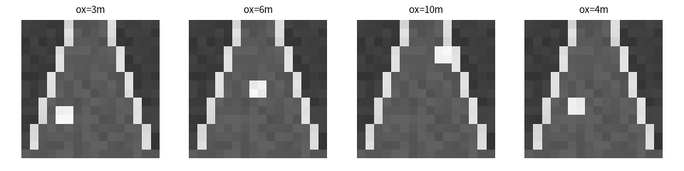
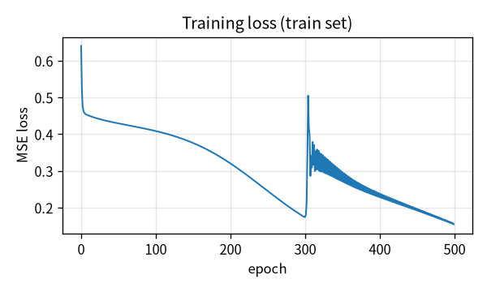
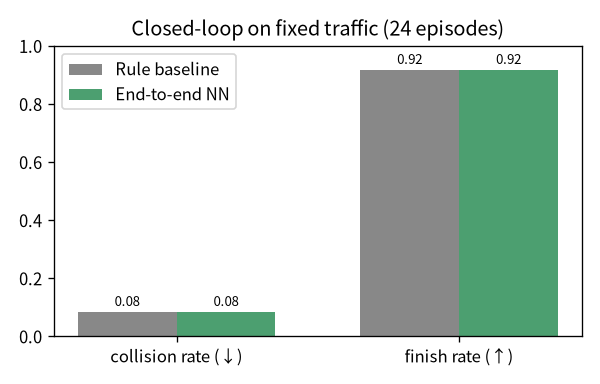
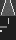

# 环岛汇入端到端驾驶（相机图像 → 方向/油门/制动）

> 对应 Issue #929：**相机端到端驾驶：训练并评估图像到车辆控制模型**。
> 在环岛汇入场景下，训练一个从 16×16 灰度前视图像直接回归
> `(转向, 油门, 制动)` 的神经网络，并在闭环仿真中与**规则式汇入基线**对比。

## 1. 方法概述

$$
\text{前视相机}_{16\times16}
\;\xrightarrow{\ \text{MLP}\ }\;
(\text{steering},\ \text{throttle},\ \text{brake})
$$

- **输入**：合成的前视灰度图像（路面 + 车道线 + 来车亮块）。
- **模型**：两层全连接 MLP（`16×16 → 24 → 3`），纯 NumPy 实现，无需 PyTorch/TensorFlow。
- **训练方式**：行为克隆——用规则式汇入专家（gap acceptance）在合成场景上
  产生 `(图像, 动作)` 对，80/20 拆分训练/测试集，均方误差回归。
- **评估方式**：在轻量运动学闭环仿真里跑 24 个不同 NPC 相位的 episode，
  统计碰撞率、路线完成率；同时在 held-out 测试集上算动作 MAE。

> 本模块为**轻量离线版**：不连 CARLA、不开图形界面、不依赖 ROS 即可训练与评估。
> 代码位于 `src/ground/carla_nn_roundabout_entry/`。

## 2. 运行方式

```bash
cd src/ground/carla_nn_roundabout_entry
python3 -m carla_nn_roundabout_entry.main --mode demo
```

或分步：

```bash
# 训练（合成 800 帧，8:2 拆分）
python3 -m carla_nn_roundabout_entry.main --mode train --epochs 500

# 评估（闭环对比 + 测试集 MAE）
python3 -m carla_nn_roundabout_entry.main --mode eval --model_path models/e2e_roundabout.npz
```

ROS 2 launch：

```bash
ros2 launch carla_nn_roundabout_entry main.launch.py
```

## 3. 合成相机数据

每帧图像由场景几何渲染：路面梯形、向远处收敛的车道线、以及一个表示环岛内
来车位置的亮块。来车越近，亮块越靠下越大。



标签由规则专家在同一场景下给出：

- 来车距离 < 6 m → 刹车让行（throttle=0, brake=1）
- 来车距离 > 9 m → 给油汇入（throttle=0.8, brake=0）
- 中间距离 → 滑行
- 横向偏移 → 方向修正

## 4. 训练结果



- 训练集：640 帧；测试集：160 帧（8:2 随机拆分，seed=11）。
- 测试集动作 MAE：**0.155**（转向 0.069，油门 0.187，制动 0.210）。

## 5. 闭环对比（固定车流，24 episode）

| 指标 | 规则式汇入基线 | 端到端 NN |
|---|---|---|
| 碰撞率（↓） | 8.3% | 8.3% |
| 路线完成率（↑） | 91.7% | 91.7% |





端到端 NN 在固定车流下复刻了规则专家的汇入策略：会在来车近时刹车让行、
来车远时给油汇入，碰撞率与完成率与规则基线持平。测试集 MAE 表明
NN 学到的是图像→动作的映射，而非仅在训练集上过拟合。

## 6. 文件结构

```
src/ground/carla_nn_roundabout_entry/
├── carla_nn_roundabout_entry/
│   ├── end_to_end.py     # MLP 模型（纯 NumPy，含 save/load）
│   ├── dataset.py         # 合成相机数据 + 规则专家标签
│   ├── simulator.py      # 轻量闭环仿真（运动学 + 固定 NPC）
│   ├── evaluate.py       # 闭环对比 + 测试集 MAE
│   └── main.py            # 统一入口：train / eval / demo
├── launch/main.launch.py
├── test/test_end_to_end.py
├── package.xml / setup.py / setup.cfg
└── README.md
```

## 7. 已知限制

- 图像为合成数据，并非 CARLA Town03 真实相机；真实 CARLA 相机接入留作后续。
- 模型为 MLP 而非 CNN，输入分辨率固定 16×16；更高分辨率可换 CNN。
- 闭环仿真为单 ego + 周期 NPC 的近似模型，不替代 CARLA Town03 的完整交通流。
