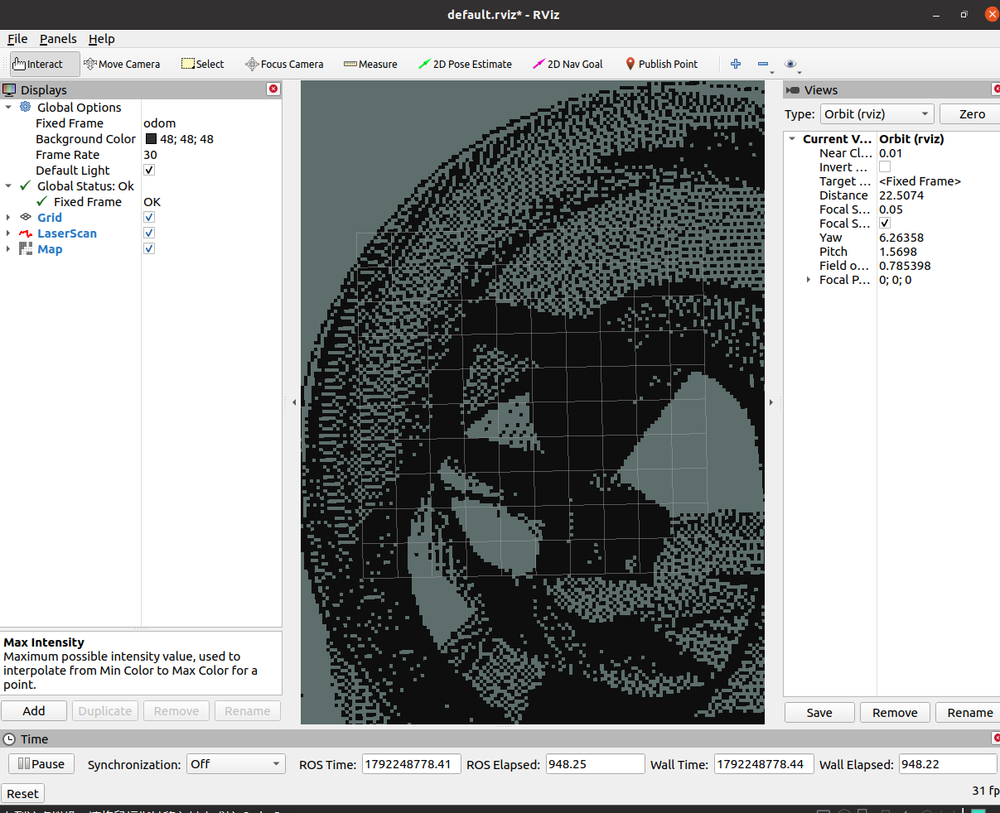

# 基于 1D CNN 神经网络的 2D 激光雷达 SLAM

`carla_nn_scan_matching` 是一个完全基于神经网络的 SLAM 前端模块。它使用 1D CNN 处理连续两帧 2D 激光雷达（LaserScan）数据，预测它们之间的相对位姿（Scan Matching），从而彻底摆脱对仿真器“上帝视角”真值坐标的依赖，实现真正的定位与建图。

> **差异化说明**：现有部分 Carla SLAM 方案直接读取仿真器的真实坐标来建图。本模块实现了真正的 **Neural Scan Matching**，神经网络仅通过雷达数据就能推算出小车的运动轨迹并完成建图。

## 功能模块

- **lidar_simulator.py**：生成虚拟的 2D 环境和 LiDAR 扫描数据（10Hz）。
- **nn_odometry.py**：加载 1D CNN 模型，订阅 `/scan`，输出相对位姿并发布 `/odom` 和 TF 变换。
- **mapper.py**：订阅 `/scan` 和 `/odom`，实时维护并发布二维占据栅格地图（`/map`）。
- **src/model.py**：1D CNN 模型定义。
- **src/train.py**：合成数据生成与模型训练脚本。

## 神经网络原理

网络输入为两帧连续的 360 维雷达极坐标数据，拼接成 `(2, 360)` 的矩阵。
网络结构：
- 1D 卷积层 × 2（提取局部特征）
- 最大池化层 × 2
- 全连接层 × 2
- **输出层**：3 维向量 `(dx, dy, dtheta)`，代表相对位移和旋转角。

损失函数：均方误差（MSE）。

## 编译与运行

### 1. 编译

    mkdir -p ~/carla_nn_slam_ws/src
    cd ~/carla_nn_slam_ws/src
    ln -sfn ~/ros2/src/ground/carla_nn_scan_matching carla_nn_scan_matching
    cd ~/carla_nn_slam_ws
    source /opt/ros/noetic/setup.bash
    catkin_make
    source devel/setup.bash

### 2. 运行 SLAM（自带预训练权重）

    conda activate carla38
    source /opt/ros/noetic/setup.bash
    source ~/carla_nn_slam_ws/devel/setup.bash
    roslaunch carla_nn_scan_matching main.launch

### 3. RViz 查看建图效果

新开终端运行 RViz：

    source /opt/ros/noetic/setup.bash
    source ~/carla_nn_slam_ws/devel/setup.bash
    rosrun rviz rviz

将 `Fixed Frame` 设置为 `odom`，添加 `Map` (话题: `/map`) 和 `LaserScan` (话题: `/scan`) 即可看到实时建图效果。

## 已知限制与改进方向

由于本模块仅实现了 SLAM 的前端（Scan Matching），未加入后端位姿图优化与回环检测（Loop Closure），因此长时间运行后会产生累积误差（漂移），导致建图出现重影或扭曲。这属于纯里程计的正常现象。后续可通过引入回环检测模块来消除累积误差。

## 环境依赖

- Ubuntu 20.04 + ROS Noetic
- Python 3.8 + PyTorch 2.0.1 + NumPy
