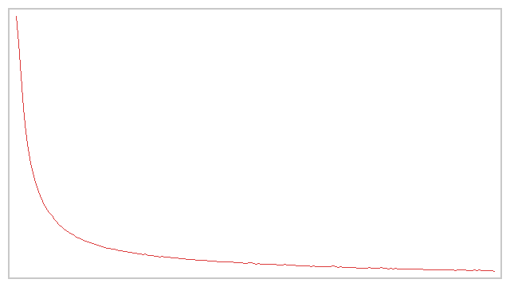
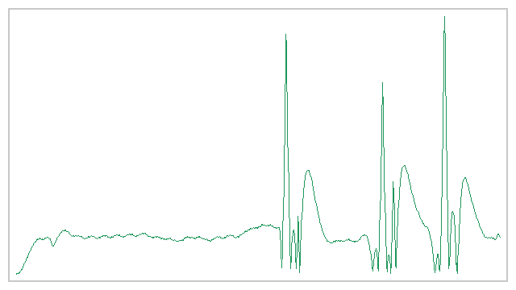

# CARLA 神经网络感知与给定轨迹跟踪 / CARLA Neural Perception and Path Tracking

## 概述 / Overview

本示例使用 CARLA 0.9.16 的 RGB 相机、深度相机和激光雷达进行障碍方向感知，并使用神经网络沿给定轨迹控制车辆。感知器与控制器采用纯 NumPy 多层感知机 (MLP)，训练和推理均可在 CPU 上运行。

This example uses CARLA 0.9.16 RGB, depth, and LiDAR sensors to estimate obstacle direction, then follows a supplied route with neural-network control. The perception and control models are NumPy multilayer perceptrons (MLPs) and run on CPU for both training and inference.

| 环节 / Stage | 输入 / Input | 模型 / Model | 输出 / Output |
| --- | --- | --- | --- |
| 感知 / Perception | RGB、深度、LiDAR / RGB, depth, LiDAR | MLP `4 → 12 → 3` | 障碍方向类别 / Obstacle-direction class |
| 控制 / Control | 航向差、前视距离 / Heading error, look-ahead distance | MLP `2 → 32 → 1` | 归一化转向量 / Normalized steering |

## 特征与网络 / Features and Models

三路传感器压缩为归一化特征向量：

The three sensors are reduced to a normalized feature vector:

$$
\mathbf{x} = \left[\frac{c_x-W/2}{W/2},\; \frac{\bar G}{255},\; \frac{N_{\mathrm{front}}}{60},\; \frac{D_{\min}}{20}\right]^\top
$$

其中 `c_x` 是 RGB 图像下半区亮色像素的横向重心，`Ḡ` 是深度区域均值，`N_front` 是前方 LiDAR 点数，`D_min` 是最近点距离。

Here, `c_x` is the horizontal centroid of bright pixels in the lower RGB region, `Ḡ` is the mean depth-region value, `N_front` counts forward LiDAR points, and `D_min` is the nearest-point distance.

感知 MLP 使用 ReLU 隐藏层和三类 softmax 输出（无目标、偏左、偏右）；控制 MLP 对航向差和前视距离标准化后，经 ReLU 隐藏层与 `tanh` 输出转向量。控制网络使用纯跟踪几何律产生监督标签：

The perception MLP uses a ReLU hidden layer and a three-class softmax output (clear, obstacle to the left, or obstacle to the right). The control MLP standardizes heading error and look-ahead distance, then uses a ReLU hidden layer and `tanh` output. Pure-pursuit geometry provides its training targets:

$$
\delta^* = \operatorname{clip}\!\left(\frac{\arctan(2L\sin e_\psi/d)}{g}, -1, 1\right)
$$

其中 `L` 为轴距，`e_ψ` 为航向误差，`d` 为前视距离，`g` 为 CARLA 转向比例系数。训练所得标准化参数与权重一起保存，推理时使用相同参数。

Here, `L` is the wheelbase, `e_ψ` is heading error, `d` is look-ahead distance, and `g` maps the geometric steering angle to CARLA's normalized steering command. Training stores the input-normalization parameters with the weights, and inference reuses the same values.

## 环境与构建 / Environment and Build

| 组件 / Component | 版本 / Version |
| --- | --- |
| CARLA | 0.9.16 |
| ROS 2 | Humble |
| Ubuntu | 22.04 |
| Python | 3.10+ |

CARLA 服务端运行在带图形加速的主机上；ROS 2 客户端连接服务端地址和 TCP 端口 `2000`。在工作空间根目录执行：

Run the CARLA server on a host with graphics acceleration. Connect the ROS 2 client to the server address and TCP port `2000`. From the workspace root:

```bash
source /opt/ros/humble/setup.bash
python3 -m pip install -r src/ground/carla_perception_control/requirements.txt
colcon build --packages-select carla_perception_control --symlink-install
source install/setup.bash
```

按 CARLA 0.9.16 Python API 安装步骤安装对应 Python 版本的客户端 wheel。CARLA 服务端与客户端必须使用兼容版本。

Install the CARLA 0.9.16 Python API wheel that matches the client Python version. The CARLA server and client must use compatible releases.

## 运行 / Run

离线训练不需要 CARLA 服务端：

Offline training does not require a CARLA server:

```bash
python3 src/ground/carla_perception_control/main.py \
  --mode train --epochs 300 --out models/nn_percept.json
```

无图形、无 CARLA 的离线回放用于检查训练与轨迹控制数据流：

Use headless replay to check the training and route-control pipeline without a display or CARLA server:

```bash
python3 src/ground/carla_perception_control/main.py \
  --headless --demo --epochs 300 --sim_time 90 --save_dir ~/shots
```

启动 CARLA 服务端后，可通过 Python 入口运行在线示例：

After starting the CARLA server, run the online example with the Python entry point:

```bash
python3 src/ground/carla_perception_control/main.py \
  --mode run --host <CARLA_HOST_IP> --sim_time 90 --follow
```

ROS 2 launch 入口会启动感知与控制节点：

The ROS 2 launch entry point starts the perception and control node:

```bash
ros2 launch carla_perception_control main.launch.py \
  host:=<CARLA_HOST_IP> port:=2000 town:=Town05
```

若使用自定义轨迹，航点应位于可行驶车道内，并在弯道附近适当加密；省略航点参数时使用包内置的 `DEMO_ROUTE`。

For custom routes, keep waypoints on drivable lanes and add points around turns. If no waypoint list is supplied, the package uses its built-in `DEMO_ROUTE`.

## 自动化检查与结果 / Automated Checks and Results

在功能包目录运行无需 CARLA 的单元测试：

Run the unit tests from the package directory; CARLA is not required:

```bash
python3 -m pytest test/test_perception_logic.py -q
```

在 Ubuntu 22.04 / ROS 2 Humble 容器中的构建成功，25 项单元测试全部通过。

The package builds successfully in an Ubuntu 22.04 / ROS 2 Humble container, and all 25 unit tests pass.

已有 Town05 示例记录的训练集感知准确率为 `0.995`、控制网络 MSE 为 `0.00303`。离线运动学回放的横向误差 RMSE 为 `0.249 m`；CARLA 在线运行记录的横向误差 RMSE 为 `1.012 m`，车辆到达终点并收到相机帧和 LiDAR 数据。这些数字属于各自记录的运行配置，不能替代新环境中的独立测量。

The recorded Town05 example reports perception training accuracy of `0.995` and control-network MSE of `0.00303`. The offline kinematic replay has a lateral-error RMSE of `0.249 m`; the recorded online CARLA run has an RMSE of `1.012 m`, reaches the route endpoint, and receives camera and LiDAR data. These values apply to their recorded configurations and do not replace independent measurements in a new environment.





更多参数、源代码说明和运行记录见[完整技术说明](./carla_perception_control.md)。

See the [full technical guide](./carla_perception_control.md) for parameter details, source walkthroughs, and run records.
