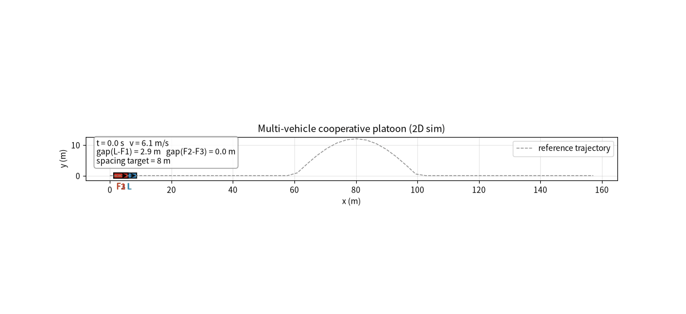

# 多车协同编队（Ground Vehicle Platoon）

地面载具多车协同编队仿真：Leader 沿参考轨迹匀速领航，3 辆 follower 沿同一条
轨迹保持恒定弧长间距跟进，形成一字纵队（platoon），连续转弯处队形不散。

代码位于 `src/ground/carla_platoon/`。同一套编队控制律被两个平台复用：

- **CARLA 渲染版**（`carla_platoon.py`）：车辆状态取自 CARLA 真实位姿，控制量
  经 `apply_control` 下发，需在本机装 CARLA 后运行。
- **2D 轻量版**（`sim_2d_platoon.py`）：matplotlib 渲染，可直接运行并生成
  效果动图，即本编队算法的真实运行效果演示。

## 编队原理

- 一条参数化参考轨迹 `path`，按累计弧长 `s` 采样成密集点列。
- Leader 沿轨迹推进；第 `i` 辆 follower 的期望进度
  `s_i = s_leader - i * spacing`（沿轨迹滞后 leader 若干个车距），
  期望参考点 = 轨迹上弧长 `s_i` 处的点。
- 横向：纯跟踪（pure pursuit）追各自参考点；纵向：进度误差 P 控制，
  使实际进度逼近期望进度，维持恒定间距。

## 文件结构

```
src/ground/carla_platoon/
├── platoon_core.py       # 共享编队核心（运动学 / 纯跟踪 / 编队控制律）
├── carla_platoon.py      # CARLA 渲染版主脚本
├── sim_2d_platoon.py     # 2D 轻量仿真版主脚本
├── platoon_demo.gif      # 2D 版真实运行效果动图
├── requirements.txt
└── README.md
```

## 运行

### 2D 轻量版（本工程直接可跑，生成动图）

```bash
pip install numpy matplotlib Pillow
python3 sim_2d_platoon.py                      # 生成 platoon_demo.gif
python3 sim_2d_platoon.py --show               # 弹出窗口实时查看
```

### CARLA 渲染版（需本机装 CARLA）

```bash
# 1) 启动 CARLA（如 /opt/carla/CarlaUE4.sh）
# 2) 让 Python 找到 carla API
export PYTHONPATH=/opt/carla/PythonAPI/carla/dist/carla-<ver>-py3.7-linux-x86_64.egg:$PYTHONPATH
pip install numpy
python3 carla_platoon.py --map Town03 --n 4 --spacing 8 --v 6
```

## 参数说明

| 参数 | 含义 | 默认 |
|------|------|------|
| `n` | 车辆总数（含 leader） | 4 |
| `spacing` | 期望车距（沿轨迹弧长，m） | 8.0 |
| `v` | 巡航车速（m/s） | 6.0 |
| `lookahead` | 纯跟踪前视距离（m） | 6.0 |
| `L` | 轴距（m） | 2.8 |

## 运行效果

`platoon_demo.gif` 为 2D 轻量版真实运行效果：Leader 沿 S 形参考轨迹匀速领航，
3 辆 follower 保持约 8 m 间距跟进，连续转弯处队形保持稳定（实测稳态车距
7.7~8.0 m，与目标 8 m 一致）。



## 合规说明

本项目为课程/学习用途的仿真代码，不含真实道路行驶与真车控制，遵循开源许可。
