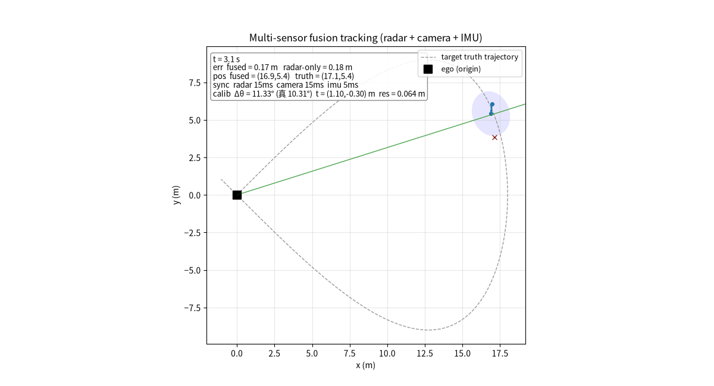

# 多传感器融合跟踪（Radar + Camera + IMU）

地面载具多传感器真融合：对单个移动目标做融合跟踪，覆盖 **外参标定 → 时间同步 → 载体运动补偿 → EKF 融合** 完整链路。

代码位于 `src/ground/carla_sensor_fusion/`，同一套融合核心被两个平台复用：

- **CARLA 渲染版**（`carla_sensor_fusion.py`）：在 ego 车挂载 相机(camera)、激光雷达(lidar)、毫米波雷达(radar)、IMU 四个真实传感器，listen 回调把原始数据入队缓冲，经语义分割/点云/雷达点检测得到目标观测后做标定、时间同步与 EKF 融合。
- **2D 轻量版**（`sim_2d_fusion.py`）：合成传感器仿真，可直接运行并生成效果动图 `fusion_demo.gif` 与指标 CSV——本融合算法真实运行效果演示。

## 融合链路

1. **外参标定**：最小二乘估计相机↔雷达相对旋转/平移，标定结果参与相机观测的坐标系对齐后再送 EKF。
2. **时间同步**：雷达 ~10Hz、相机 ~30Hz、IMU ~100Hz，按「最近时间戳」对齐到 20Hz 融合网格，超过容差视为失同步。
3. **载体运动补偿**：IMU 估计载体姿态角，把各传感器体坐标观测转到世界系。
4. **EKF 融合**：世界系 4 态 `[px,py,vx,vy]`，匀速预测，分别用雷达（距离+方位）与相机（方位）观测更新。

## 文件结构

```
src/ground/carla_sensor_fusion/
├── main.py                  # 统一入口（doctor / test / sim2d / carla）
├── sensor_fusion_core.py    # 共享核心（外参标定 / 时间同步 / EKF 融合）
├── fusion_perception.py     # 原始数据 → 目标级观测（纯 numpy，可单测）
├── carla_sensor_fusion.py   # CARLA 渲染版主脚本（真实传感器回调链路）
├── sim_2d_fusion.py         # 2D 轻量仿真版主脚本（生成动图 + 指标 CSV）
├── test_sensor_fusion.py    # 离线最小测试（无需 CARLA）
├── offline_replay.py        # 无 CARLA 离线端到端回放（同链路产出指标）
├── launch/main.launch       # ROS launch 统一启动入口
├── package.xml / CMakeLists.txt / setup.py  # catkin 包配置（catkin_install_python 注册入口）
├── fusion_demo.gif          # 运行后本地生成（不提交入库；文档动图见 docs/img/ground/）
├── requirements.txt
└── README.md
```

## 运行

### 2D 轻量版（本工程直接可跑，生成动图 + 指标 CSV）

```bash
pip install numpy matplotlib Pillow
python3 sim_2d_fusion.py                    # 生成 fusion_demo.gif + fusion_metrics.csv
python3 sim_2d_fusion.py --show             # 弹出窗口实时查看（自动切换交互后端）
python3 main.py sim2d                       # 等价统一入口
python3 main.py sim2d --warmup-frames 40    # RMSE 只统计前 40 帧之后的稳定段
python3 main.py replay --seconds 30         # 无 CARLA 离线端到端回放（同链路，产出指标 CSV）
```

### CARLA 渲染版（需本机装 CARLA）

```bash
export PYTHONPATH=/opt/carla/PythonAPI/carla/dist/carla-<ver>-py3.7-linux-x86_64.egg:$PYTHONPATH
pip install numpy
python3 main.py carla --map Town03 --seconds 30
```

### 离线测试与依赖体检

```bash
python3 main.py test        # 外参标定 / 时间同步 / EKF / 传感器回调 最小测试
python3 main.py doctor      # 依赖体检
```

## 参数说明

| 参数 | 含义 | 默认 |
|------|------|------|
| `sig_r` | 雷达测距噪声 (m) | 0.5 |
| `sig_th_r` | 雷达方位噪声 (rad) | 0.10 |
| `sig_th_c` | 相机方位噪声 (rad) | 0.04 |
| `sig_imu` | IMU 姿态估计噪声 (rad) | 0.012 |
| 融合频率 | EKF 更新周期 | 20 Hz |

## 实测指标（脚本结束打印并写入 CSV）

`sim_2d_fusion.py` 运行结束会打印并写入 `fusion_metrics.csv`。全程（240 帧 @ 30fps）实测：**融合 RMSE ≈ 0.73 m，仅雷达 ≈ 1.07 m，提升 ≈ 32%**。
相机 30Hz 高频方位补偿了雷达方位分辨率与采样率的不足，融合误差低于单雷达。



## 最小测试

`test_sensor_fusion.py` 覆盖 10 项（无需 CARLA / ROS）：外参标定恢复、时间同步最近/超时、EKF 收敛、CARLA 传感器回调入队、空/None 观测不崩溃、`SyncBuffer.get()` 正确解包 `(ts,(r,θ))`、相机观测经外参进 EKF、Fake CARLA 3 个融合周期（可捕获 `None` 解包 TypeError）、多车 ROI 关联锁定目标、LiDAR/Radar 杂波下按 pred 锁目标。

## 环境与限制声明（如实）

- **本沙箱无 GPU / CARLA / ROS**：`carla_sensor_fusion.py` 的 CARLA 链路按官方 API 完整实现（真实传感器 listen 回调、队列缓冲、语义分割/点云/雷达点检测），但未在沙箱实跑，需本机启动 CARLA 后执行 `python3 main.py carla` 验证。
- **2D 轻量版为合成传感器仿真**：传感器观测由真值加高斯噪声合成，用于算法演示与指标复现，不是真实物理传感器数据。文档/PR 已如实声明此定位，不夸大。
- **目标关联与单目标前提**：相机按语义分割 ROI（以 EKF 预测方位为中心 ±80 px）取目标像素质心；LiDAR 先体素降采样再欧式聚类，按预测距离门限选簇；Radar 按预测位置选反射点簇。首帧尚无预测时退回「最近簇 / 全图质心」作为 bootstrap，因此演示场景应只保留一个被跟踪车辆目标；同场多车时会以 EKF 预测锁定目标，不会被干扰车带偏。
- **传感器时间戳同步**：`SensorHub` 每项入队为 `(frame, timestamp, payload)`，写入 `SyncBuffer` 使用回调的传感器 timestamp（不再用主循环时刻），融合网格按最近时间戳对齐。
- **离线回放验证（本沙箱无 CARLA）**：`main.py replay --seconds 30` 用合成数据流驱动与 CARLA 版相同的感知→同步→标定→EKF 链路。实测 3000 ticks（camera 900 / lidar 300 / radar 600 / imu 3000 帧），融合 578 次，估计 RMSE 0.053 m，CSV 见 `offline_replay_metrics.csv`；此为链路验证，非真实 CARLA 物理传感器结果。
- **catkin 安装**：已补 `CMakeLists.txt`（`catkin_package()` + `catkin_install_python()` 安装入口与全部依赖模块 + 安装 launch）。沙箱无 ROS/catkin 无法执行编译，本机验证步骤：`catkin_make && source devel/setup.bash && roslaunch carla_sensor_fusion main.launch mode:=sim2d`。

## 合规说明

本项目为课程/学习用途的仿真代码，不含真实道路行驶与真车控制，遵循开源许可。
