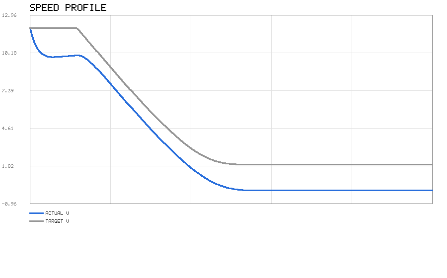
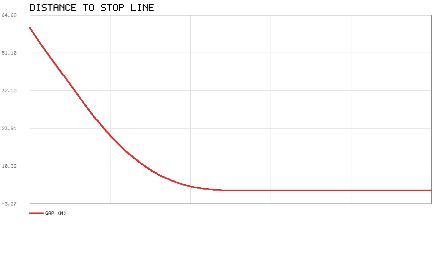
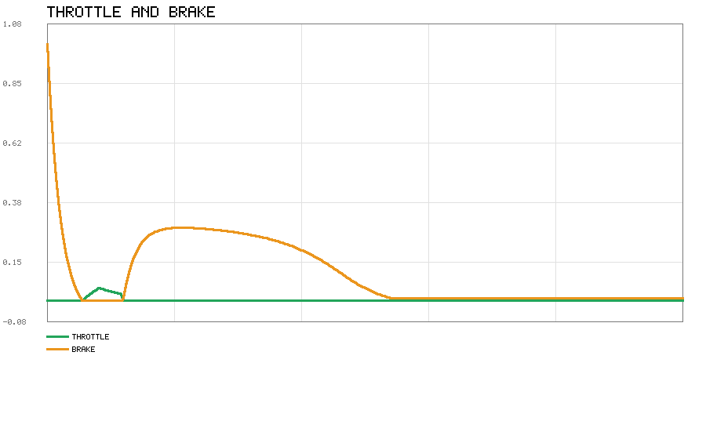
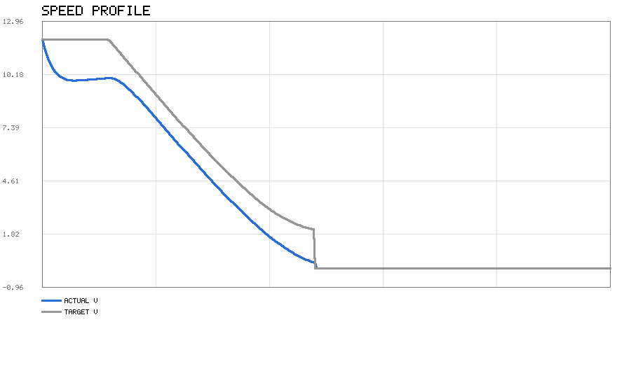
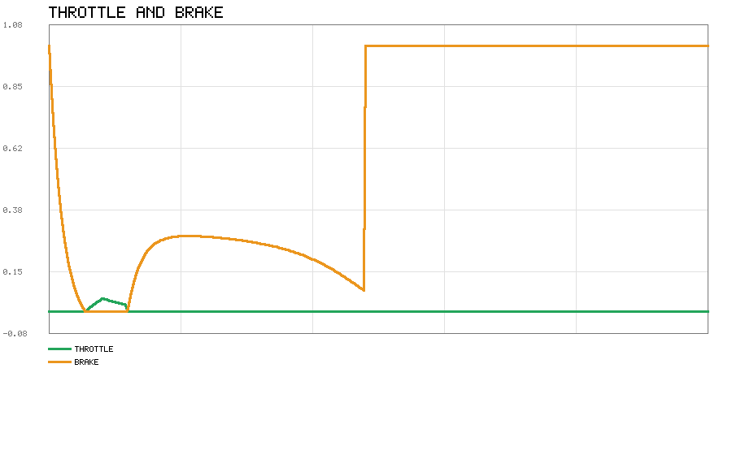
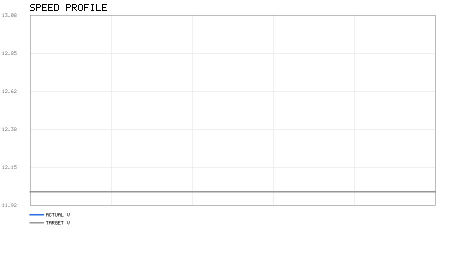
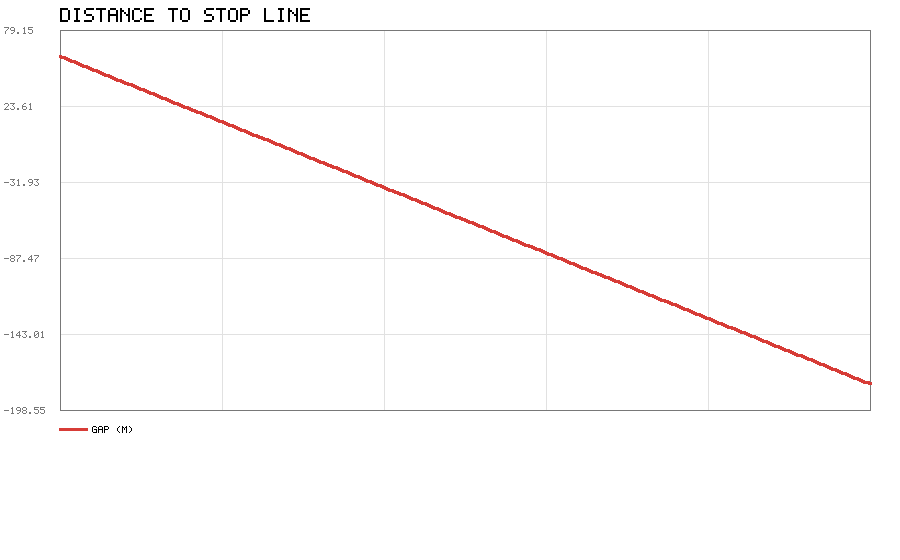
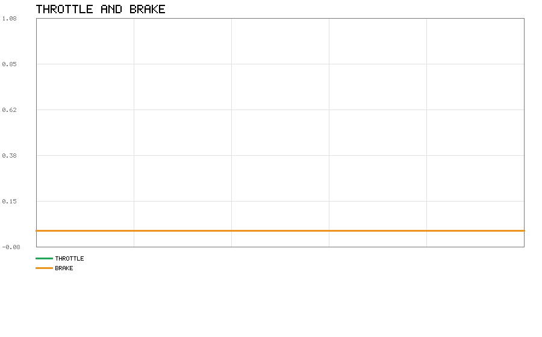
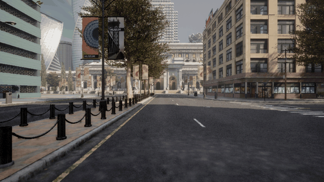

# CARLA 交通信号灯识别与响应

车辆接近信号灯路口时，读取灯色和到停止线的距离，决定该停车、减速还是直接
通过，再用纵向控制器执行。

代码在 `src/ground/carla_traffic_light/`。

## 为什么做这个

地面载具板块已经有不少模块，但把现有文档翻了一遍，**「信号灯」和
「traffic light」一次都没有出现**：

| 关键词 | 覆盖情况 |
|---|---|
| 交通标志 | `carla_tsr_ros` 已做 |
| 车道保持 | 已有 |
| 纵向速度控制 | 已有 |
| **交通信号灯** | **没有** |

CARLA 自带的信号灯 API 也足够用，实测 `get_state()`、`get_stop_waypoints()`
都能正常返回。

## 决策规则

### 红灯

必定停车。任意时刻的目标速度按停车曲线给：

```
v_target = sqrt(2 · a_comfort · (d − margin))
```

d 是剩余距离，a_comfort 是舒适减速度（默认 2.0 m/s²），margin 是相对停止线
留的余量（默认 0.5 m）。这样速度随距离平方根下降，到停止线时自然归零。

如果按最大减速度（默认 6.0 m/s²）都停不住，就转为全力制动。

### 黄灯

黄灯不是简单的"减速"，要看**当前速度下能不能在停止线前停住**：

```
制动距离 d_brake = v² / (2 · a_max)

d_brake ≤ d    → 能停，减速停车
d_brake > d    → 停不住，保持通过
```

这也是真实信号灯辅助系统的做法：强行急刹反而更容易被追尾。

两个例外：

* 速度已经低于 `min_speed`（默认 0.3 m/s）时直接停——都在慢慢蹭了，
  停下来总比越线安全
* 距离小于 `yellow_min_gap`（默认 1.0 m）时一律通过

### 绿灯 / 灯不亮

正常通过，不限制速度。

### 已经越过停止线

不再因红灯停车，这是为了避免车压在线上时来回犹豫。

## 纵向控制器

CARLA 的车辆控制接口吃的是 `throttle ∈ [0,1]` 和 `brake ∈ [0,1]`，不直接给
加速度，所以要有一层转换：

```
a_cmd = a_ff + kp·(v_target − v) + ki·∫(v_target − v)
a_cmd ≥ 0 → 油门 = a_cmd · throttle_gain
a_cmd < 0 → 刹车 = −a_cmd · brake_gain
```

### 为什么需要前馈

这一点是调试时发现的。停车曲线按 `a = 2.0 m/s²` 设计，如果只用 PI：

* 速度一接近目标，误差变小，刹车随之变弱
* 结果**差一点没停住，冲过停止线**

实测：黄灯场景下车辆减速到 3.29 m/s、距停止线 2.46 m 时，PI 只给出 0.39 的
刹车（约 2.3 m/s²），最后压线通过。

加上前馈 `a_ff = −a_comfort` 之后，曲线规定的减速度直接喂进去，PI 只负责
修正偏差，跟踪精度立刻就上来了。

## 运行结果

参数：舒适减速 2.0 m/s²，最大减速 6.0 m/s²，停车余量 0.5 m，初速 12 m/s，
初始距停止线 60 m。

| 灯色 | 末速 | 距停止线 | 判决 |
|---|---|---|---|
| 红灯 | 0.000 m/s | **停在 1.416 m** | ✓ 正确停车 |
| 黄灯 | 0.000 m/s | **停在 1.541 m** | ✓ 能停住就停 |
| 绿灯 | 12.000 m/s | 通过 −180 m | ✓ 正常通过 |

### 红灯



蓝线是实际速度，灰线是停车曲线给的目标速度。两条线基本重合，说明控制器跟得住。



距离单调下降到 0 附近并稳定住，没有反向穿过。



前段给一点油门保持速度，进入停车曲线后刹车逐渐加深。

### 黄灯



黄灯在 60 m 外时按最大减速能停住（需要 12 m），所以选择和红灯一样的策略。


距离从 60 m 平滑降到 1.5 m 后保持，没有越过停止线。



油门全程为 0，刹车量在末段升到满值并保持，对应车辆停在停止线前。

### 绿灯



不加限制，保持 12 m/s 通过。



距离一路下降、穿过停止线后变为负值（到 −180 m），说明没有停车动作。



离线模型没有行驶阻力，保持 12 m/s 匀速既不需要油门也不需要刹车，两条曲线都贴在 0 上。

### CARLA 真机运行

在 Ubuntu 20.04 上用 CARLA 客户端连 Windows 上跑的 CarlaUE4 服务端（0.9.16 ↔ 0.9.16），
真实场景实测。CARLA 本身就是客户端/服务端分离的架构，两边分机器部署是官方支持的方式。



| 指标 | 数值 |
|---|---|
| 目标灯 | id=23，强制设为红灯 |
| 起始距离 | 52.0 m |
| 停车决策次数 | 2675 |
| 减速决策次数 | 0 |
| 通过决策次数 | 0 |
| **最近距离** | **1.44 m** |
| **末速** | **0.00 m/s** |
| 末态灯色 | Red |

车从 52 m 外开始，按停车曲线减速，最终停在停止线前 **1.44 米**。全程灯色为红，
没有任何一次"通过"决策。

调试这一段时踩了几个坑，记下来免得后面再犯：

* **不能在停止线上生成自车**。最初直接用 `stop_waypoints[0].transform` 生成，
  结果距离一上来就是 0，全程"已越过停止线"，什么也测不到。要沿车道往回退。
* **必须给转向**。只控油门刹车的话车会直直冲出路口撞墙，最后卡在那里速度一直是 0。
* **只盯目标灯**。生成车用的是 A 灯，行驶时如果扫描所有灯取最近的那个，可能盯着
  B 灯（B 是绿的），于是根本不停车。
* **异步模式会让车一卡一卡**。服务器按自己帧率跑，客户端 20 Hz 发指令，两者对不齐。
  改用 `synchronous_mode` + `fixed_delta_seconds`，由客户端 `world.tick()` 推帧后就平滑了。

## CARLA 里的实现

`carla_runner.py` 做的事：

1. 连接 CARLA，找一台车生成到信号灯停止线附近
2. 挂一个前视 RGB 相机，用于存截图
3. 每帧：
   * 读自车位置与速度
   * 在信号灯里找前方最近的、且停止线在车前的那个
   * 读灯色，用自车到 `stop_waypoints` 的**前向投影距离**作为 `d`
   * 调 `decide()` 得动作与目标速度
   * 调控制器得油门/刹车，写回车辆
4. 按 `save_every` 间隔存截图

前向投影那一步很关键：直接用欧氏距离的话，车从停止线旁边开过去时距离会先
变小再变大，判定会抖动。投到车头方向上就单调了。

## 环境准备

开发和验证都在 **Ubuntu 20.04 + Python 3.8** 上做。代码里没有任何平台相关调用。

### 安装 CARLA 客户端

推荐直接用 CARLA 自带 PythonAPI 里的 egg，版本一定对得上：

```bash
export CARLA_HOME=~/CARLA_0.9.13
export PYTHONPATH=$PYTHONPATH:$CARLA_HOME/PythonAPI/carla/dist/carla-0.9.13-py3.7-linux-x86_64.egg
```

也可以 `pip3 install carla==0.9.13`。

验证：

```bash
python3 -c "import carla; print('ok')"
```

## 运行方法

### 离线仿真（不需要 CARLA）

```bash
cd src/ground/carla_traffic_light/scripts
python3 main.py                  # 红灯
python3 main.py --light Yellow
python3 main.py --all-lights     # 红黄绿依次跑
```

### 连接 CARLA

```bash
cd ~/CARLA_0.9.13
./CarlaUE4.sh -quality-level=Low -windowed -ResX=1000 -ResY=700
```

另开终端：

```bash
cd src/ground/carla_traffic_light/scripts
python3 main.py --carla --duration 30
```

### launch 启动

```bash
roslaunch carla_traffic_light offline.launch
roslaunch carla_traffic_light main.launch
```

## 参数

`config/tl_params.yaml`：

| 参数 | 默认 | 含义 |
|---|---|---|
| `comfort_decel` | 2.0 | 舒适减速度 (m/s²)，决定停车曲线 |
| `max_decel` | 6.0 | 最大减速度，用于判断能否停住 |
| `yellow_min_gap` | 1.0 | 黄灯近距离直接通过的距离 (m) |
| `stop_margin` | 0.5 | 相对停止线的停车余量 (m) |
| `min_speed` | 0.3 | 低于此速度直接刹停 (m/s) |
| `kp` / `ki` | 0.8 / 0.15 | PI 增益 |
| `integral_max` | 3.0 | 积分限幅，防饱和 |

## 环境与验证

以下结果都在 **Ubuntu 20.04 + Python 3.8** 上实际跑出：

```bash
$ python3 -m unittest discover -s tests
..............................................
----------------------------------------------------------------------
Ran 46 tests in 0.005s

OK
```

```bash
$ python3 scripts/main.py --all-lights
...
三种灯色的判决都已跑完
```

`traffic_light_logic.py` 与 `longitudinal.py` 只依赖标准库，**不需要 CARLA、不需要 GPU**，因此任何装了 Python 3.8 的机器都能复现。

关于 CARLA 集成：CARLA 的客户端与服务端本来就可以分机器部署。本项目在 Windows 上跑 CarlaUE4 服务端（0.9.16）验证真机闭环。Ubuntu 侧要当客户端的话需要 0.9.16 版本的客户端库，而 PyPI 上最高只发布到 0.9.15，两者协议不兼容（0.9.15 客户端读 0.9.16 的 world 会 `std::bad_alloc` 崩溃），所以跨机器联调这条路没走通。真机验证只在 Windows 上做。

## 测试

`tests/test_logic.py` 一共 46 个测试，覆盖两块：

**信号灯决策（`traffic_light_logic.py`）**

* 停车距离公式 `d = v²/2a` 及其平方关系
* 需要减速度与停车距离互为逆运算
* 停车曲线 `v = sqrt(2ad)`
* 红灯在远端 / 线前 / 停不住三种情况
* 目标速度随距离递减
* 已过线不再停
* 黄灯能停 / 停不住 / 距离过近 / 速度过低
* 黄灯边界条件（恰好够停应判为可停）
* 非法灯色与非法参数

**纵向控制器（`longitudinal.py`）**

* 无误差不输出
* 偏慢给油门、偏快给刹车
* 输出限幅到 [0,1]
* 停车指令给满刹车
* 积分限幅
* 死区抑制抖动
* reset 清空状态
* 闭环收敛到目标速度
* 能从 10 m/s 刹停

其中"黄灯边界条件"那条是把 `d_brake == d` 的临界情况固定住，避免以后改参数
时把判据改偏。

## 文件结构

```
src/ground/carla_traffic_light/
├── package.xml / CMakeLists.txt / setup.py
├── launch/
│   ├── main.launch          连 CARLA
│   └── offline.launch       离线
├── config/tl_params.yaml
├── scripts/
│   ├── traffic_light_logic.py   决策（纯 Python）
│   ├── longitudinal.py          PI + 前馈（纯 Python）
│   ├── carla_runner.py          CARLA 集成
│   ├── simple_plot.py           PNG 折线图
│   └── main.py                  入口
├── tests/test_logic.py
└── README.md
```

## 已知限制

* 只做纵向，不转向。自车保持直线，不做跟车绕行
* 依赖 CARLA 的 `get_stop_waypoints()`。如果某张地图上信号灯没有停止线，
  该信号灯会被跳过
* 单车，不考虑其他交通参与者
