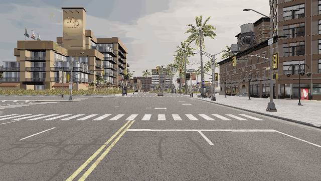
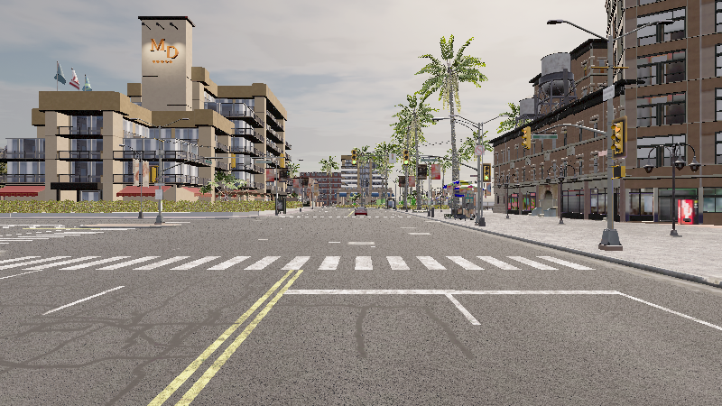
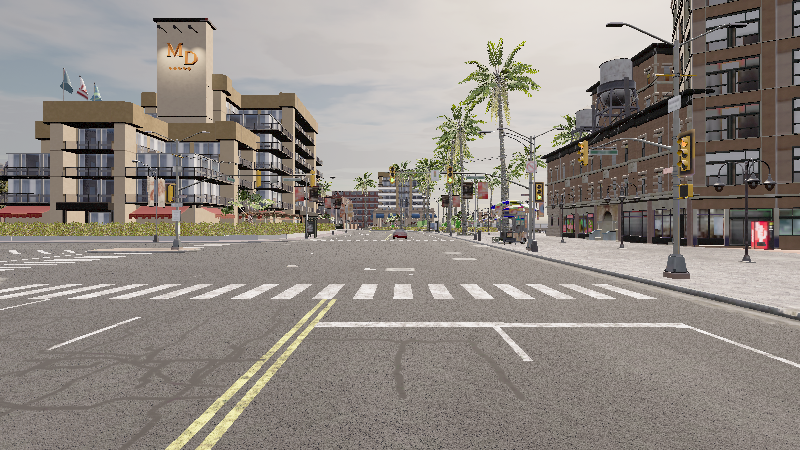

# 自动紧急制动（AEB）

> 模块路径：`src/ground/carla_ttc_emergency_braking` ｜ 载体：地面车 ｜ 地图：Town10HD_Opt

## 实验目的

验证「感知—决策—控制」闭环在 OpenHUTB 上的可用性：主车以约 50 km/h 逼近静止前车，
系统需在安全距离内自动制动并停住，且整个过程可量化、可复现、可取证。

## 方法

1. **场景搭建**：在所有出生点中筛选「前方 55 m 方向偏差 ≤ 15° 且弦长误差 ≤ 8 m」的直路段，
   前车放在出生点上，主车沿同一条车道回溯 55 m 放置，保证两车严格共线。
2. **感知（决策只吃这一路）**：`sensor.lidar.ray_cast_semantic` 语义激光雷达，
   按 `ObjIdx` 逐实例分组，只保留车辆语义标签（本环境用 probe 读 `lead.semantic_tags` 实测为 `14`），
   在车体前方 3~60 m、垂直 −1.75~1.6 m 内取每个实例的最近点作为该车距离；
   横向门限 2.2 m 按**实例质心**判断（相邻车道更近的车不能被当成同车道前车）。
   仿真器 actor 真值（`truth_front_target`）只写日志与摘要用于对账，**不参与制动**。
3. **决策**：`TTC = d / v`；`d ≤ 22 m` 或 `0 < TTC ≤ 1.6 s` 立即满制动（`brake = 1.0`、`throttle = 0`），
   触发后锁存到停稳；点云流超过 `sensor_timeout_s`（默认 1 s）没更新则按传感器故障失效安全制动。
4. **横向控制**：纯跟踪（pure pursuit），前瞻 8 m，保证直线段不跑偏。
5. **停稳判定**：速度 < 0.4 m/s 且已触发制动，记录停稳时的雷达测距与真值距离。

## 结果

| 指标 | 数值 |
|---|---|
| 巡航车速 | 约 50 km/h（13.9 m/s） |
| 首帧真值距离 | 56.0 m |
| 触发制动时刻 | t = 4.36 s |
| 触发时雷达测距 / 真值 | 17.83 m / 19.89 m（TTC 1.28 s，阈值 1.6 s） |
| 停稳时刻 | t = 6.11 s |
| 停稳距前车 | **4.49 m**（真值中心距；雷达最后一次有效测距 3.55 m） |
| 激光雷达有效检出 | 9 / 99 帧 |
| 全程最近距离（真值） | 4.49 m |
| 是否碰撞 | 否 |

曲线见 `src/ground/carla_ttc_emergency_braking/docs/result.png`，逐帧数据见 `docs/run_log.csv`，
关键帧见 `docs/frame_approach_*.png` / `docs/frame_brake_*.png` / `docs/frame_stopped_*.png`。

## 结论

- 制动在 d ≤ 22 m 的判据下触发并锁存，最终停在真值中心距 4.49 m，满足「不碰撞 + 留安全余量」。
- 雷达测距与真值中心距相差约 2 m，正好是车尾到车辆中心的距离，说明测到的是最近表面而不是车心。
- 决策链路上没有任何真值输入：日志里的 `decision_source` 只有 `lidar` / `latched` / `no_target` / `sensor_fault`。

## 局限与改进

1. 前车静止，未估计相对速度；跟驰场景需要扩展为相对速度 TTC。
2. 开关式满制动，缺少减速度限幅，乘坐舒适性未优化。
3. **语义雷达单帧实例点稀疏**：本次 99 帧里只有 9 帧把前车聚成有效实例（要求单实例 ≥ 4 点），
   51 m→18 m 出现漏检窗口，因此实际触发距离（17.8 m）小于配置的 22 m 门限；
   制动本身有锁存，停稳距离不受影响。改进方向是多帧点云累积或加一路前向雷达。
4. 车辆语义标签依赖平台：本环境实测 `14 = Car`，换平台要先用 probe 确认再改 `config/params.yaml`
   的 `sensor.vehicle_tags`（15/16/18 是桥/轨道/红绿灯，不能算车辆）。

## 运行效果（截图 / 动图）

> 三联曲线（车速 / 距离 / TTC）见 `src/ground/carla_ttc_emergency_braking/docs/result.png`，
> 由同目录 `run_log.csv` 绘出；逐帧关键帧为 `docs/frame_approach_*.png`、`frame_brake_*.png`、`frame_stopped_*.png`。
> 动图由本次实际运行产生的帧合成（GIF < 5 MB、PNG < 3 MB）。

## 评审整改（PR #955）

| 项 | 早期实现 | 现在 |
|---|---|---|
| 清理 | 遍历全世界的 `vehicle./sensor./walker.` 全部 destroy | 生成时给 actor 打 `role_name = aeb_*`，只清理本模块残留（`cleanup_leftovers` + `owned_by_module`），不碰别人的对象 |
| 制动输入 | 先读仿真器 actor 列表（真值），激光雷达只作回退 | **只用语义激光雷达观测**：按实例取正前方最近的车辆（`front_vehicle_distance`），真值只写日志/摘要用于对账 |
| 横向门限 | `abs(y) < 4.0`，相邻车道更近的车会被当成本车道前车 | `abs(y) < 2.2`，且按**实例质心**判断（与真值对账口径一致） |
| 车辆标签 | `(14, 15, 16, 18)` 当成 Car/Truck/Bus/Motorcycle | 只保留实测的 `14`，并做成配置项 `sensor.vehicle_tags` |
| 失效安全 | 无 | 点云流超过 `sensor_timeout_s`（默认 1 s）没更新 → 判定传感器故障并制动；**"走廊里没目标"不算故障** |
| 制动锁存 | 无（丢一帧目标就松刹车再加速） | 一旦触发即锁存到停稳 |
| 客户端识别 | 按「先安装的 distribution」判断 hutb / carla | 按实际 import 到的 `carla.Client` 是否有 `set_files_base_folder` 判断 |
| 单测 | 8 项 | **24 项**：含邻道更近车辆、质心门限、语义标签过滤、客户端识别、传感器失效、归属判断 |

停稳判定的两个距离：
- `激光雷达测距`：到前车**最近表面**的距离（决策口径）；
- `真值距离`：**中心距**，比前者大约半个车长，只用于评估。

实测（2026-11-12，最终代码）：制动 t=4.36 s，停稳 t=6.11 s，雷达最后一次有效测距 3.55 m（真值中心距 4.49 m），未碰撞 → PASS。
