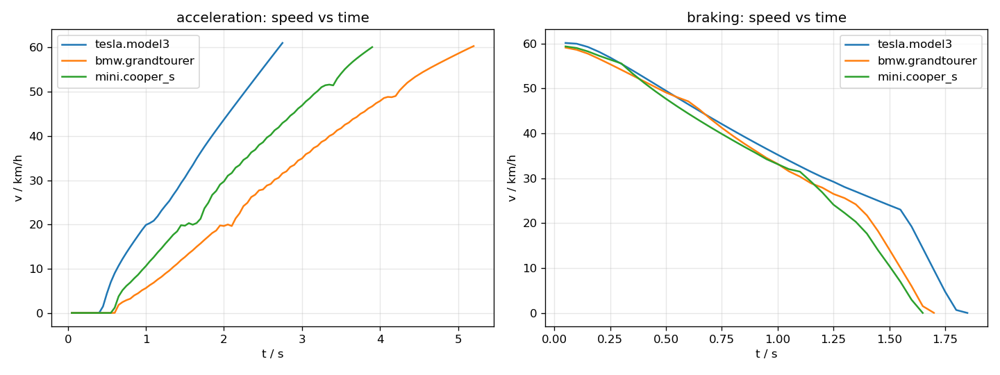
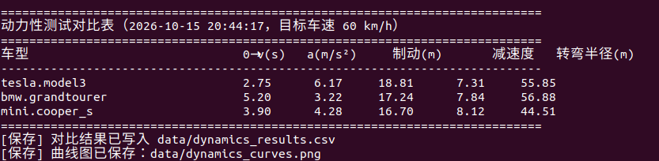
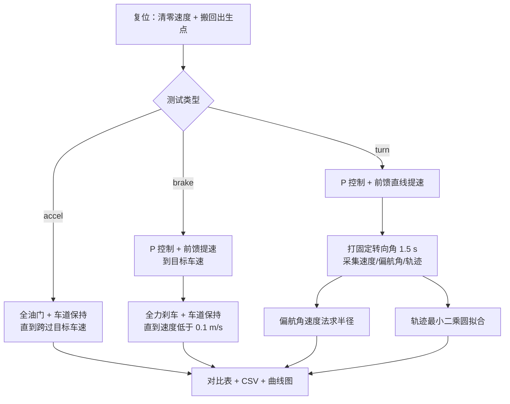

# 基于 CARLA 的地面载具动力性测试

本模块在 CARLA 中对地面载具做三项**动力性（纵向与转向性能）测试**，并支持多车型横向对比：
0→60 km/h 加速时间、60→0 制动距离、稳态转弯半径。三项指标都同时给出**实测值**与
**理论值**，便于判断结果是否合理。

!!! note "与仓库已有模块的区别"

    本模块**不做控制算法**，而是做**被控对象本身的性能测量**：

    * `carla_keyboard_control`、`ackermann_control` 等解决"怎么把车开起来"；
    * `aeb_collision_avoidance` 用"所需制动距离"作为**决策判据**来设计制动系统；
    * 本模块反过来——**测出车辆真实的加速能力、制动能力和转向能力**，并把多车型放在同一套
      流程下比较，为标定、选型和后续控制算法的参数设定提供依据。

## 1. 运行环境

| 项目 | 版本 / 说明 |
|---|---|
| 宿主机 | Windows 10/11，CARLA 0.9.16（Windows 发行版解压即用，双击其中的 `CarlaUE4.exe`） |
| 虚拟机 | Ubuntu 22.04 LTS（VMware），ROS 2 Humble，Python 3.10.12 |
| Python 依赖 | `carla==0.9.16`、`numpy`；`matplotlib` 可选（只用于画曲线图） |
| 硬件 | 能跑起 CARLA 服务端的独立显卡（本模块的测量不依赖渲染帧率） |

安装客户端（Ubuntu 22.04 + Python 3.10 对应 cp310 的 wheel，依赖清单见功能包内的 `requirements.txt`）：

```bash
cd src/ground/carla_vehicle_dynamics_test
python3 -m pip install --user -r requirements.txt -i https://pypi.tuna.tsinghua.edu.cn/simple
```

## 2. 目录结构

```
src/ground/carla_vehicle_dynamics_test/
├── main.py                     统一入口（仓库约定：入口为 main.*）
├── main.sh / main.bat          一键入口
├── carla_vehicle_dynamics_test/
│   ├── metrics.py              纯数学函数：加速度、制动距离、圆拟合、理论转弯半径
│   ├── carla_utils.py          CARLA 连接、同步步进、生成指定车型、车道保持、复位
│   ├── runner.py               三项测试的测量流程
│   ├── app.py                  命令行参数、对比表、CSV、曲线图
│   └── dynamics_node.py        ROS 2 节点：跑测试并把结果发布到 /dynamics/result
├── test/
│   ├── test_metrics.py         指标函数单元测试（30 项，不需要 CARLA）
│   └── test_physics_parse.py   车辆物理参数解析测试（18 项，假对象，不需要 CARLA）
├── launch/main.launch.py       ROS 2 启动入口
├── requirements.txt            依赖清单（carla==0.9.16、numpy，matplotlib 可选）
├── package.xml / setup.py / setup.cfg
└── README.md
```

## 3. 计算原理

### 3.1 平均加速度

车辆从速度 \(v_0\) 变到 \(v_1\) 用时 \(t\)，区间平均加速度为

$$
a = \frac{v_1 - v_0}{t}
$$

程序在起始时刻读一次速度、跨过目标车速那一帧再读一次，两者之差除以用时即为平均加速度。
采样间隔由同步模式的步长决定（默认 0.05 s，即 20 Hz）。

### 3.2 制动距离与平均减速度

匀减速假设下，制动距离与减速度的关系为

$$
s = \frac{v^2}{2a} \quad\Longleftrightarrow\quad a = \frac{v^2}{2s}
$$

程序沿轨迹逐帧累加位移得到实测制动距离 \(s\)，再由上式反推**平均减速度** \(a\)；
随后把 \(a\) 代回 \(s = v^2/(2a)\) 与实测值对照。二者恒等并非"验证成功"，
它只说明公式被正确使用；真正有信息量的是**不同车型之间的差异**（见第 6 节）。

### 3.3 转弯半径

转向测试采用**阶跃转向**：先在车道内直线加速到目标车速，再打一个固定方向盘并保持，
采集转向段的轨迹与偏航角。转弯半径用两种互相独立的方法计算：

**方法一：稳态偏航角速度法。** 定速圆周运动中，偏航角速度 \(\omega\) 与半径 \(R\) 满足

$$
v = \omega R \quad\Longrightarrow\quad R = \frac{v}{\omega}
$$

程序对末段（默认最后 0.6 s）的偏航角随时间做最小二乘直线拟合求 \(\omega\)，
再除以该段的平均车速。偏航角在 \(\pm\pi\) 处会跳变，拟合前先做 `unwrap` 处理。

**方法二：轨迹最小二乘圆拟合（Kasa 法）。** 设圆心为 \((x_0, y_0)\)、半径为 \(r\)，
最小化

$$
\sum_{i=1}^{n}\left[\left(x_i^2 + y_i^2\right) - \left(2x_0x_i + 2y_0y_i + c\right)\right]^2,
\qquad c = r^2 - x_0^2 - y_0^2
$$

这是一个关于 \((x_0, y_0, c)\) 的线性最小二乘问题，可用 `numpy.linalg.lstsq` 直接求解，
半径由 \(r = \sqrt{c + x_0^2 + y_0^2}\) 还原。

**理论对照：阿克曼几何。** 忽略轮胎侧偏时，自行车模型的稳态转弯半径为

$$
R_{\text{theory}} = \frac{L}{\tan\delta}
$$

其中 \(L\) 为轴距、\(\delta\) 为前轮转角。CARLA 的方向盘指令 `steer` 是归一化量（-1~1），
真实前轮转角为 \(\delta = \text{steer} \times \delta_{\max}\)，
\(\delta_{\max}\) 从车辆的物理参数中读取。

> 实测半径通常**略大于**理论值：轮胎存在侧偏角，车辆实际走出的轨迹比几何预测更"宽"，
> 即转向不足。第 6 节的偏差（8%~19%）与此一致。

### 3.4 为什么转向测试的参数这么温和

车道宽度只有 3.5 m。若转角取 14°（理论半径约 10 m），车辆在 1 s 内就会冲出路沿、
撞上路边障碍后骤停——实测速度会从 7 m/s 掉到 0.07 m/s，此时算出的"半径"没有任何意义。
因此默认取 **3.5°（理论半径约 41~49 m）**、转向段 **1.5 s**：侧向加速度只有约
1.0 m/s²，1.5 s 内横向偏出不到 0.3 m，车辆始终留在车道内，同时偏航角变化约 12°，
足够测出角速度。

### 3.5 三项测试的初始条件必须一致

车辆每次都在同一个出生点生成，但三项测试会依次进行——加速测试结束时车已经向前
开了几十米。因此每项测试开始前都要**复位**：清零线速度与角速度、把车辆搬回出生点、
持续刹车直到速度低于 0.05 m/s 再开始测量。

另外，CARLA 的出生点通常比地面高十几厘米，车辆生成后会下落并弹跳。因此速度只取
**水平分量**，否则竖直速度会污染读数（实测曾让"0→60 km/h"的起点凭空变成 5.3 km/h）。

## 4. 仿真搭建与运行步骤

### 4.1 启动 CARLA 服务端（Windows）

解压 CARLA 0.9.16 后双击 `CarlaUE4.exe`，等待场景加载完成（窗口出现城市画面）。

### 4.2 查询宿主机 IP（Windows）

```bat
ipconfig
```

在 `VMware Network Adapter VMnet8` 一节找到 IPv4 地址（形如 `192.168.x.1`）。
**下文命令中的地址要换成你自己查到的值。**


### 4.3 虚拟机连通性检查

```bash
nc -vz 192.168.148.1 2000
```

出现 `succeeded!` 说明虚拟机能访问 CARLA 的 RPC 端口。

### 4.4 编译功能包

```bash
mkdir -p ~/ros2_ws/src && cd ~/ros2_ws/src
git clone --depth 1 https://github.com/OpenHUTB/ros2.git
cp -r ~/ros2_ws/src/ros2/src/ground/carla_vehicle_dynamics_test ~/ros2_ws/src/
cd ~/ros2_ws
source /opt/ros/humble/setup.bash
colcon build --packages-select carla_vehicle_dynamics_test --symlink-install
source install/setup.bash
ros2 pkg executables carla_vehicle_dynamics_test
```

**预期输出**：`Summary: 1 package finished`，并列出 `carla_vehicle_dynamics_test dynamics_test_node`。

> **评审本 PR 时**：模块尚未合并进 `OpenHUTB/ros2` 的 master，请改为克隆 PR 所在分支
> （例如 `git clone -b feat/carla_vehicle_dynamics_test https://github.com/Aogusilakui/ros2.git`）。

### 4.5 离线单元测试（不需要 CARLA）

```bash
cd ~/ros2_ws/src/carla_vehicle_dynamics_test
python3 test/test_metrics.py          # 预期：[结果] 30 项全部通过
python3 test/test_physics_parse.py    # 预期：[结果] 18 项全部通过
```

这两组测试把"不需要 CARLA 就能验证的东西"全部覆盖掉：公式、边界条件、圆拟合、
偏航角速度法（含合成圆周数据）、车辆物理参数的字段兼容性。**先跑它们再连 CARLA**，
可以避免把代码错误误判成仿真问题。

### 4.6 单车型三项全测

```bash
python3 main.py --mode all --host 192.168.148.1
```

### 4.7 多车型对比

```bash
python3 main.py --mode all --host 192.168.148.1 --vehicles all
```

结果会打印成对比表，并写入：

* `data/dynamics_results.csv` —— 汇总表；
* `data/dynamics_curves.png` —— 加速/制动过程的速度曲线。



### 4.8 用 ROS 2 launch 启动

```bash
cd ~/ros2_ws && source install/setup.bash
ros2 launch carla_vehicle_dynamics_test main.launch.py host:=192.168.148.1 vehicles:=all
```

节点跑完测试后会把汇总结果（JSON 文本）发布到 `/dynamics/result`：

```bash
ros2 topic echo /dynamics/result --once
```

## 5. 参数说明

| 参数 | 默认值 | 说明 |
|---|---|---|
| `--mode` | `all` | `accel` / `brake` / `turn` / `all` |
| `--host` | `127.0.0.1` | Windows 宿主机 IP |
| `--port` | `2000` | CARLA RPC 端口 |
| `--town` | `Town03` | CARLA 地图 |
| `--dt` | `0.05` | 同步模式步长（秒） |
| `--vehicle` | `vehicle.tesla.model3` | 单个车型 blueprint |
| `--vehicles` | 无 | 写 `all` 则循环内置三种车型对比 |
| `--v-target-kmh` | `60` | 目标车速（km/h） |
| `--steer` | `0.05` | 阶跃转向的归一化指令（约 3.5° 前轮转角） |
| `--turn-speed` | `7.0` | 转向测试的目标车速（m/s） |
| `--turn-time` | `1.5` | 转向段持续时间（秒） |
| `--max-time` | `40` | 单项测试超时（秒） |
| `--out-dir` | `data` | CSV 与曲线图输出目录 |

## 6. 结果与性能

以下数据来自一次完整运行（CARLA 0.9.16，Town03，出生点 #0，步长 0.05 s，
目标车速 60 km/h）。原始文件可以直接下载核对：

* 终端完整输出：[run_all.log](../evidence/carla_vehicle_dynamics_test/run_all.log)
* 同批次导出的汇总表：[dynamics_results.csv](../evidence/carla_vehicle_dynamics_test/dynamics_results.csv)

> 重复运行的结果波动在 1% 以内（另一次运行的制动距离为 18.88 / 17.63 / 16.76 m），
> 表中数值取自 `dynamics_results.csv`，与上方终端输出截图对应。

| 车型 | 轴距 | 0→60 km/h | 平均加速度 | 制动距离 | 平均减速度 | 转弯半径（实测） | 阿克曼理论 | 偏差 |
|---|---|---|---|---|---|---|---|---|
| `vehicle.tesla.model3` | 3.00 m | **2.75 s** | 6.17 m/s² | 18.81 m | 7.31 m/s² | 55.85 m | 49.13 m | 13.7% |
| `vehicle.bmw.grandtourer` | 2.93 m | 5.20 s | 3.22 m/s² | 17.24 m | 7.84 m/s² | 56.88 m | 47.98 m | 18.5% |
| `vehicle.mini.cooper_s` | 2.51 m | 3.90 s | 4.28 m/s² | 16.70 m | 8.12 m/s² | 44.51 m | 41.06 m | 8.4% |



### 6.1 结果是否合理

**加速能力**：特斯拉 2.75 s 最快、宝马 SUV 5.20 s 最慢，Mini 居中（3.90 s），
与三车的动力/质量配置一致。

**制动能力**：三车制动距离 16.7~18.8 m，平均减速度 7.3~8.1 m/s²，即 **0.75~0.83 g**，
落在真实乘用车（约 0.8~1.0 g）的合理区间内。

**转向能力**：三车的实测半径都**大于**阿克曼理论值，偏差 8.4%~18.5%。方向是合理的——
理论公式忽略轮胎侧偏角，而真实车辆存在转向不足，实际轨迹更"宽"。
Mini 的偏差最小（8.4%，轴距最短、速度最低），宝马最大（18.5%，车身最重最长）。

### 6.2 已知限制

1. **依赖 CARLA 的车辆动力学**：测得的是 CARLA 物理引擎的行为，不能直接当作真车数据；
   本模块的价值在于**同一套流程下的横向对比**与**实测/理论一致性检查**。
2. **转向测试为短时阶跃**：受车道宽度限制，只测量 1.5 s 的响应，得到的是该时间窗口内的
   平均半径，不是完整稳态圆周；若要测完整圆周需要空旷场地或专用试验场地图。
3. **同步步长影响精度**：`dt = 0.05 s` 时，跨过目标车速的那一帧最多带来 0.05 s 的时间
   量化误差（例如特斯拉 2.75 s 对应约 1.8% 的相对误差）。减小 `--dt` 可以提高分辨率，
   代价是同样的仿真时长需要更多帧。
4. **单次运行受交通流影响**：出生点附近存在其他车辆，提速过程中若出现避让/轻微擦碰，
   速度会出现短暂波动（实测宝马第 10 s 附近出现过一次），但测试以**跨过目标车速的时刻**
   为准，制动测试也以**实际起始车速**计算，因此结论不受影响。

## 7. 源码解析

### 7.1 `metrics.py`：只做数学，可以被离线测试

| 函数 | 作用 |
|---|---|
| `mean_acceleration(v0, v1, dt)` | 区间平均加速度 |
| `braking_distance_theory(v, decel)` | \(s = v^2/(2a)\) |
| `stopping_deceleration(v, distance)` | \(a = v^2/(2s)\) |
| `turn_radius_theory(wheelbase, steer)` | \(R = L/\tan\delta\) |
| `steer_to_angle(steer, max_steer_rad)` | 归一化指令 → 真实前轮转角 |
| `radius_from_yaw_rate(times, yaws, speeds)` | 偏航角速度法求半径（含 `unwrap`） |
| `circle_fit_radius(points)` | Kasa 最小二乘圆拟合 |
| `path_length(points)` | 折线长度（制动距离累加） |
| `summarize_test(values, name)` | 一组值的 min/mean/max 汇总 |

### 7.2 `carla_utils.py`：连接与车辆操作

* `CarlaSession.ensure_town / enable_sync / tick / settle / close` —— 世界设置与生命周期。
  打开同步模式前会先检查是否存在**残留的同步状态**（上一次异常退出留下的），
  先恢复异步再记录"原始设置"，避免退出时无法还原；
* `spawn_vehicle(blueprint_filter, spawn_index)` —— 按车型生成，自动寻找空余出生点；
* `lane_steer(vehicle, carla_map)` —— 纯追踪横向控制，前视距离随车速增大；
* `reset_vehicle(...)` —— 复位并等待静止；
* `parse_physics(physics, transform)` —— 解析轴距/最大前轮转角/质量。

**关于 `parse_physics` 的一个坑**：CARLA 0.9.16 中
`WheelPhysicsControl.position` 返回的是**世界坐标（cm）**，不是车身系偏移。
若直接"前轴平均 x − 后轴平均 x"，在车辆航向角较大时会得到完全错误的结果
（实测某次算出轴距 0.11 m）。程序用"轮位到车辆的距离是否在 10 m 以内"判别这两种可能，
是则先减去车辆位置、再投影到车头方向求轴距。该逻辑有 18 项离线测试覆盖，
包括世界坐标、车身系偏移、缺字段与异常值。

### 7.3 `runner.py`：三项测量流程



提速环节使用 **P 控制 + 前馈油门**：只用纯 P 控制时，高速段算出的油门偏小，
车速会停在目标值下方（实测目标 16.67 m/s、车速卡在 15.7 m/s），
导致制动测试判定"未达到目标车速"而跳过。前馈项用来抵消滚动阻力与风阻。

## 8. 常见问题

**Q1：`RuntimeError: 未找到 carla 包`**
未安装 CARLA 客户端，或 Python 版本与 wheel 不匹配。CARLA 0.9.16 提供
cp310/cp311/cp312 的 wheel，因此需要 Python 3.10 及以上（Ubuntu 20.04 自带的
Python 3.8 无法安装）。

**Q2：连接超时 / `time-out of 20000ms`**
依次检查：CARLA 服务端是否已启动；`--host` 是否为 VMware NAT 下 VMnet8 的地址；
Windows 防火墙是否放行 2000 端口（`nc -vz <host> 2000` 验证）。

**Q3：程序结束后 CARLA 窗口卡住不动**
同步模式下客户端不推进就不会有画面。本模块在 `finally` 中恢复异步模式并销毁车辆；
若曾在异常中断后手动 Ctrl+C，重新运行时 `enable_sync()` 会检测并清除残留的同步状态。

**Q4：车辆生成失败**
出生点可能被占用（上一次运行遗留的车辆）。程序会自动尝试其他出生点；
若全部失败，请重启 CARLA 服务端。

**Q5：制动测试被跳过，提示"未能达到目标车速"**
说明提速环节没到目标车速。请确认没有其他版本的代码在跑、`bias` 前馈是否生效；
若地图限速极低或前方有障碍，可降低 `--v-target-kmh`。

**Q6：转向半径与理论值偏差较大**
先确认 `--steer` 是否过大（转角大 → 侧向加速度高 → 侧偏明显 → 实测半径偏大更多），
再确认转向段内速度是否稳定（速度波动会让 \(R = v/\omega\) 失真）。
默认参数下偏差应在 20% 以内。

## 9. 参考

1. CARLA Simulator 官方文档：<https://carla.readthedocs.io/>
2. 车辆动力学基础：自行车模型与阿克曼转向几何
3. Kasa I. *A circle fitting procedure and its error analysis*. IEEE Transactions on
   Instrumentation and Measurement, 1976.
4. 仓库既有模块：`carla_keyboard_control`（物理仿真与键盘控制）、
   `aeb_collision_avoidance`（前向碰撞预警与紧急制动）
