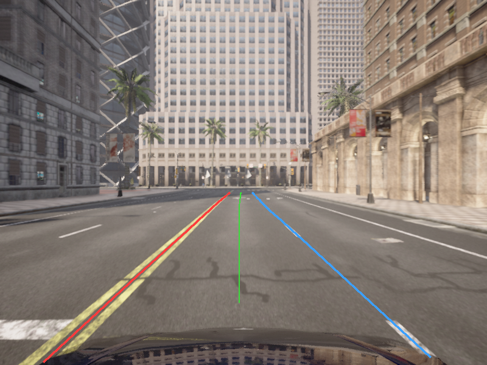
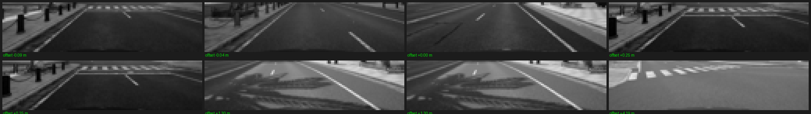
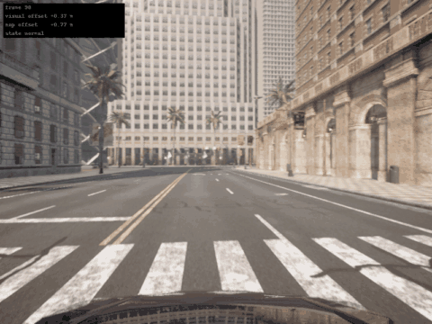
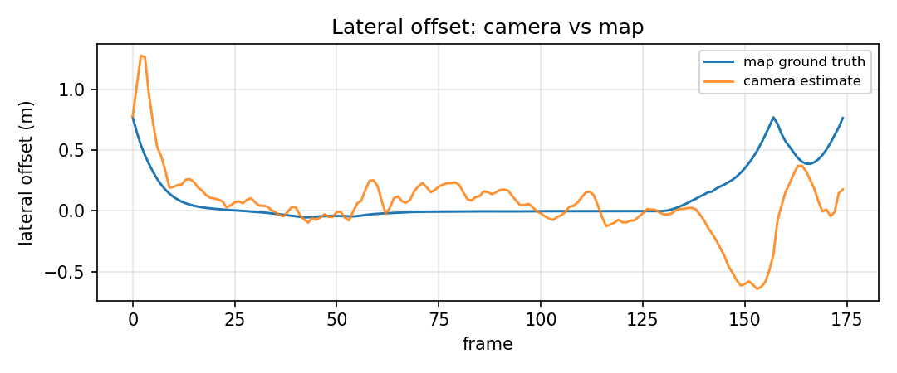
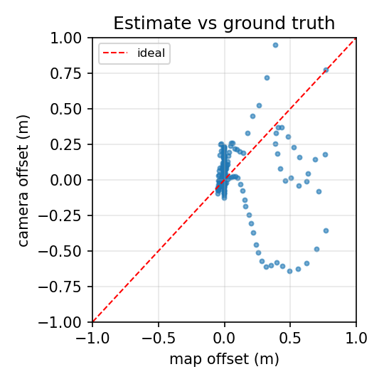
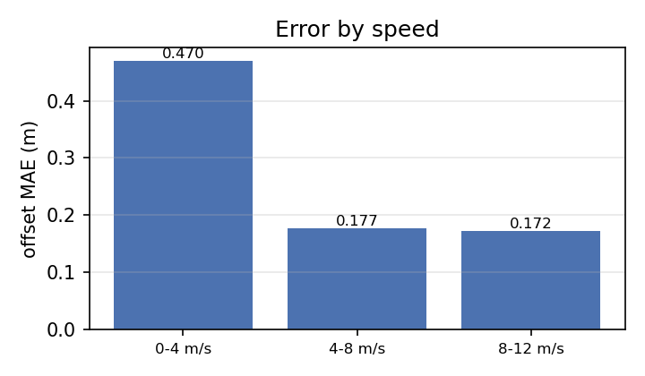

# CARLA 前视相机车道偏离预警（视觉横向偏移与地图真值对照）

用前视 RGB 相机取车道线，回归左右边界位置并折算成带符号横向偏移，
送进与 `carla_lane_departure_warning` 相同的三级状态机；地图偏移只作对照真值。

## 1 概述与目标

### 1.1 为什么要做这件事

仓库里已有的车道偏离预警（`carla_lane_departure_warning`）不接任何传感器：
横向偏移是从地图路点算出来的。这带来两个问题：

1. 车上的相机没有被使用，感知环节是空的；
2. 地图路点与实际路面的关系无法验证——画线刷在哪、有没有刷，模块都不知道。

真实车辆没有「地图路点」这种免费真值，只能靠摄像头看地上的线。本模块就是把这条路走通，
并顺带回答一个工程问题：**在能拿到地图真值的仿真里，视觉估计的横向偏移误差到底有多大。**

### 1.2 任务目标

1. **物理仿真**：CARLA 0.9.16 的 UE4 物理引擎解算车辆动力学，运行在 Windows 宿主机。
2. **神经网络感知**：前视图像进一个两层全连接网络，回归左右车道边界在 5 m 处的横向位置。
3. **预警决策**：偏移送进与地图版 LDW 相同的滞回状态机，输出 normal / deviation / departure。
4. **对照评价**：同一帧同时算视觉偏移与地图偏移，统计平均绝对误差、分位数、按车速分档。
5. **ROS 2 封装**：节点发布四个话题，支持 `ros2 launch` 启动。

### 1.3 与已有模块的关系

| 对比项 | `carla_lane_departure_warning` | 本模块 `carla_visual_lane_departure_warning` |
|---|---|---|
| 偏移来源 | 地图 API 路点 | 前视相机图像 |
| 传感器 | 无 | `sensor.camera.rgb`，800×600 |
| 神经网络 | 无 | 4096-64-32-2 全连接，26 万参数 |
| 训练数据 | 无 | 2030 帧图像，真值由地图自动生成 |
| 输出口径 | 横向偏移（左正右负） | 同左，可直接逐帧相减 |
| 阈值 | 0.5 / 0.3 / 0.9 / 0.65 m | 完全相同 |

两个模块输出同一套符号、同一套阈值，因此可以逐帧做减法，误差就是视觉这条链路的成色。

## 2 计算原理

### 2.1 相机内参

CARLA 的 `fov` 是水平视场角，像素为正方形，所以水平和垂直共用一个焦距：

$$
f = \frac{W/2}{\tan(\text{fov}/2)}, \qquad
K = \begin{bmatrix} f & 0 & c_x \\ 0 & f & c_y \\ 0 & 0 & 1 \end{bmatrix}
$$

代入本项目参数（\(W = 800\)，\(\text{fov} = 90°\)）：\(f = 400/\tan 45° = 400\) px，
主点 \((c_x, c_y) = (400, 300)\)。

### 2.2 世界坐标到像素坐标

CARLA 的相机局部坐标系是「x 向前、y 向右、z 向上」。世界点 \(P_w\) 先变换到相机坐标系：

$$
P_c = T_{\text{cam}}^{-1} \cdot \begin{bmatrix} P_w \\ 1 \end{bmatrix}, \qquad P_c = (x, y, z)
$$

再投影到像素平面。注意图像 v 轴向下，所以竖直方向取负号：

$$
u = c_x + f \cdot \frac{y}{x}, \qquad v = c_y - f \cdot \frac{z}{x}
$$

只有当 \(x > 0\) 且 \((u, v)\) 落在图像范围内时，这个点才算可见。

图中绿点是地图算出的车道边界经上式投影到图像后的位置，能压在路面的白线上，
说明内参和位姿的符号都对。



**几何直觉**：相机高 1.6 m、水平朝前时，地面上距离 \(d\) 处的点满足
\(v = c_y + f \cdot h / d\)。距离越远，v 越靠近画面中心线（300）；本项目取 5 m 处的边界作为训练目标，
对应 \(v = 300 + 400 \times 1.6 / 10 = 364\)，落在画面下半部。

### 2.3 真值的定义

真值不是人工标注，而是**同一帧里用地图算出来的**。这里有两个量，必须分开说：

- **训练目标**（网络要回归的）：由自车位置取最近的车道路点，沿车道往前走到 5 m，
  取该处的车道中心与宽度 \(w\)，左右边界为「中心 ± \(w/2\)」，再投影到自车横向轴。
- **在线真值**（状态机和误差统计用的）：自车所在位置到车道中心线的垂距，
  即把上一条的 10 m 换成 0 m，直接用自车所在的路点算。

为什么在线真值不能用 10 m 前瞻：车摆在车道正中、路是弯的时候，10 m 外的中心点
相对自车横向轴已经偏了一段弧，量级是 \(L^2/(2R)\)。实测车摆正中 30 个路点，
垂距口径下 p90 只有几厘米，10 m 口径下 p90 是 1.23 m、最大 1.33 m——真值自己
就先触发了 `depart_enter`（0.9 m）。

带符号横向偏移定义为两者中点相对自车的偏移，左偏为正：

$$
e = -\frac{y_{\text{left}} + y_{\text{right}}}{2}
$$

自车正好在车道中间时 \(y_{\text{left}} \approx -1.75\)、\(y_{\text{right}} \approx +1.75\)，\(e = 0\)；
自车偏左时两个边界都相对右移，\(e > 0\)。

### 2.4 采集时的三道过滤

直接采会把大量不可用的帧混进训练集。第一次采集 600 帧训练出来的横向偏移误差是 0.495 m，
逐帧检查后发现两个问题：**右侧边界常常没有画线**（是路沿），**有些帧自车根本不在
地图给出的那条车道里**。为此加了三道过滤：

| 过滤 | 判据 | 拦掉什么 |
|---|---|---|
| 车道宽 | \(2.8 < w < 4.2\) m | 路口、鱼骨线、停车区 |
| 自车居中 | \(\lvert e \rvert < 1.6\) m（垂距，与在线真值同口径） | 地图判错车道 |
| 边界有白线 | 边界处像素比左右各偏 14 px 处亮 12 灰度以上 | 路沿、没刷线的路段 |
| 边界在画面内 | 两条边界都能投影进 800×600 | 弯道上跑到画面外的真值 |
| 目标偏移 | 中点偏移小于 2.0 m | 同上，兜底 |

第三条要特别处理：车道线大多是**虚线**，只检查 10 m 那一个点会有一半概率落在空档里。
所以沿纵向取 6 m、10 m、14 m 三处，任意一处压在线上就算这条线可见。

只加前三道时，4000 帧里留下 1430 帧；补上后两道后留下 1989 帧。
后两道拦下的帧数不多（出画 1 帧、偏移过大 46 帧），因为它们要处理的情况
已经被「边界没画线」挡掉了大半，剩下的是路面上有线、但线已经拐到画面外的弯道。

### 2.5 网络结构

输入是裁掉天空与车头后的路面条带，\(32 \times 128\) 灰度图，展平成 4096 维：

$$
\mathbf{h}_1 = \text{ReLU}(W_1 \mathbf{x} + \mathbf{b}_1),\quad
\mathbf{h}_2 = \text{ReLU}(W_2 \mathbf{h}_1 + \mathbf{b}_2),\quad
\hat{\mathbf{y}} = W_3 \mathbf{h}_2 + \mathbf{b}_3
$$

尺寸为 \(4096 \to 64 \to 32 \to 2\)，参数量：

$$
4096 \times 64 + 64 + 64 \times 32 + 32 + 32 \times 2 + 2 = 264{,}354
$$

输出两个数：左边界和右边界的横向位置（米）。用均方误差做损失：

$$
L = \frac{1}{N}\sum_{i=1}^{N}\left(\hat{y}_i - y_i\right)^2
$$

权重用 He 正态初始化（\(\sigma = \sqrt{2/n_{\text{in}}}\)），优化器是带动量的随机梯度下降
（学习率 0.005、动量 0.9、批大小 256、120 轮）。

**为什么输入要裁剪和缩放成这样**：如果把 800×600 整图直接缩到 64×36，
一条 10 像素宽的白线会被压到 0.8 像素，网络基本看不见它。
裁剪后横向只缩 6.25 倍，白线还保留约 2 像素，同时分辨率不至于让纯 NumPy 训练慢到不可用。



### 2.6 镜像扩增

车道在左右方向上是对称的，把图水平翻转、同时把两个目标取反并交换，就得到一个新的合法样本：

$$
(x, y) \;\longrightarrow\; (\text{flip}(x),\; (-y_{\text{right}},\; -y_{\text{left}}))
$$

这一步把 1430 帧变成 2860 帧，在样本量有限时比加深网络更有效——
实测把隐藏层从 64 加到 128，误差反而从 0.143 m 涨到 0.193 m（过拟合）。

### 2.7 三级滞回状态机

状态与阈值和地图版 LDW 完全一致：

| 状态 | 进入条件 | 退出条件 |
|---|---|---|
| `normal` | \(\lvert e \rvert < 0.5\) | \(\lvert e \rvert \ge 0.5\) → `deviation`，\(\lvert e \rvert \ge 0.9\) → `departure` |
| `deviation` | \(0.5 \le \lvert e \rvert < 0.9\) | \(\lvert e \rvert < 0.3\) → `normal`，\(\lvert e \rvert \ge 0.9\) → `departure` |
| `departure` | \(\lvert e \rvert \ge 0.9\) | \(\lvert e \rvert < 0.65\) → `deviation` |

滞回的作用是防止在阈值附近来回抖动时反复报警。状态跃迁时产生事件，
事件名带上方向后缀：`deviation_start_left`、`departure_start_right`、`deviation_clear`、`departure_end`。

### 2.8 评价指标

$$
\text{MAE} = \frac{1}{N}\sum_{i=1}^{N}\left|\hat{e}_i - e_i\right|, \qquad
\text{RMSE} = \sqrt{\frac{1}{N}\sum_{i=1}^{N}\left(\hat{e}_i - e_i\right)^2}
$$

除整体误差外还统计 p50、p90、最大值，并按车速分档——高速时图像中远处的线更密集，
误差是否随速度变化是判断模型有没有真正学到几何结构的一个侧面。

## 3 系统架构

### 3.1 数据流

```text
                    ┌──────────────────────────────────────┐
                    │  CARLA 服务端 0.9.16（Windows）      │
                    │  CarlaUE4.exe -carla-port=2000       │
                    └───────────────┬──────────────────────┘
                                    │ PythonAPI（VMware NAT）
                                    ▼
   ┌────────────────────────────────────────────────────────┐
   │ ① 采集 --collect                                       │
   │   sensor.camera.rgb  ──┐                               │
   │   map.get_waypoint()  ─┴─> 同一帧配对 ──> lane_dataset.npz │
   └────────────────────────────────────────────────────────┘
                                    │
                                    ▼
   ┌────────────────────────────────────────────────────────┐
   │ ② 训练 --train（不连 CARLA，纯 NumPy）                  │
   │   4060 帧 ──> 4096-64-32-2 ──> lane_regressor.npz       │
   └────────────────────────────────────────────────────────┘
                                    │
                                    ▼
   ┌────────────────────────────────────────────────────────┐
   │ ③ 演示 --demo / ros2 launch                            │
   │   图像 ──> 网络 ──> 视觉偏移 ──┐                        │
   │   地图 ──> 真值偏移 ───────────┴──> 状态机 ──> 话题    │
   └────────────────────────────────────────────────────────┘
```

### 3.2 ROS 2 节点与话题

| 话题 | 类型 | 含义 |
|---|---|---|
| `/visual_lane_departure_warning/offset` | `std_msgs/Float32` | 相机估计的横向偏移（米，左正右负） |
| `/visual_lane_departure_warning/offset_map` | `std_msgs/Float32` | 地图真值，仅用于对照 |
| `/visual_lane_departure_warning/state` | `std_msgs/String` | `normal` / `deviation` / `departure` |
| `/visual_lane_departure_warning/event` | `std_msgs/String` | 状态跃迁事件 |

节点在后台线程里驱动 CARLA 同步时钟，主线程只负责 `rclpy.spin`。
退出时按「先停相机回调、再销毁自车」的顺序清理——顺序反了会触发 CARLA 的
`trying to operate on a destroyed actor` 并把进程打崩。

## 4 仿真与运行步骤

### 4.1 环境

| 组件 | 版本 / 说明 |
|---|---|
| 仿真器 | CARLA 0.9.16，Windows 11 宿主机 |
| 客户端 | Ubuntu 22.04 虚拟机，VMware NAT |
| ROS | ROS 2 Humble |
| Python | 3.10 |
| 依赖 | `carla==0.9.16`、`numpy`、`Pillow`、`matplotlib`（仅画图） |

### 4.2 启动 CARLA 服务端

在 Windows 上双击 `CarlaUE4.exe`，等待城市画面完全加载。窗口出现后不要关闭，
虚拟机里的脚本要连它。

### 4.3 确认虚拟机连得上

在 Windows 的命令行里查宿主机在 VMware NAT 网段上的地址：

```bat
ipconfig
```

找到 `VMnet8` 网卡的 IPv4 地址，通常是 `192.168.148.1`。然后在虚拟机里验证端口通不通：

```bash
nc -vz 192.168.148.1 2000
```

出现 `succeeded` 说明可以继续。注意虚拟机里 `ip route` 看不到这个地址，必须去 Windows 查。

### 4.4 探路：先确认路面到底有没有画线

```bash
python3.10 main.py --probe --host 192.168.148.1 --frames 120 --every 20 --settle 40
```

脚本会抓帧，把地图算出来的边界投影到图像上存成 PNG，并打印每帧的「线亮度得分」——
投影点比左右各偏 14 像素处亮多少。得分明显为正，说明投影压在画线上。

```text
采了 4 个采样点，线亮度得分（正 = 投影点比两侧亮，像压在白线上）
  帧   40  得分   -2.7  横向偏移 -0.27 m
  帧   60  得分  +15.0  横向偏移 -0.10 m
  帧   80  得分  +22.9  横向偏移 -0.17 m
  帧  100  得分  +14.4  横向偏移 -0.01 m
```

这一步是必要的：CARLA 的出生点常常在路口，而路口没有车道线，直接采会得到一堆无标签可学的样本。

### 4.5 采集数据集

```bash
python3.10 main.py --collect --host 192.168.148.1 --frames 4000 --lane-change 80 \
    --max-offset 2.0 --data data/lane_dataset.npz
```

`--lane-change` 让交通管理器每隔若干帧强制变道一次，横向偏移自然扫过 0 → ±1.75 m；
只挂自动驾驶的话，车始终贴着车道中心，采到的标签几乎全是「偏移 0」，网络会学成
「永远输出 0」——验证集很好看，一上线就完全没用。`--max-offset 2.0` 是必须的，
变道过程中偏移会超过 1.6 m，用默认值会把最有价值的样本滤掉。

终端会实时打印丢弃原因：

```text
已采 2030 帧（4000/4000），丢弃 宽度0 偏移0 无线1970
写出 data/lane_dataset.npz
  图像 (2030, 32, 128)，真值 (2030, 2)
  丢弃：车道宽异常 0，自车不在车道中间 0，边界没画线 1970，边界出画面 0，偏移过大 0
```

### 4.6 训练与评价

```bash
python3.10 main.py --train --data data/lane_dataset.npz
```

```text
镜像扩增：2030 -> 4060 帧
训练 3248 帧，验证 812 帧
参数量 264354
  ...
  第 120 轮  训练损失 0.04339

样本 812 帧
左边界 MAE 0.141 m，右边界 MAE 0.134 m
横向偏移 MAE 0.122 m，RMSE 0.276 m
偏移误差 p50 0.042 m / p90 0.265 m / 最大 1.736 m

权重 models/lane_regressor.npz（959.8 KB）
```

### 4.7 在线演示

```bash
python3.10 main.py --demo --host 192.168.148.1 --frames 300 --lane-change 60 \
    --record out/frames --save-metrics out/demo_metrics.json
```

`--lane-change 60` 让车在自动驾驶下周期性变道，偏移覆盖整个量程；`--sway 1.2` 是另一种
工况，用闭环正弦摆动把车横向推离中心。`--record` 把每帧叠上 HUD 存成 PNG，用来合成动图。



### 4.8 用 launch 启动

```bash
ros2 launch carla_visual_lane_departure_warning main.launch.py \
    host:=192.168.148.1 checkpoint:=models/lane_regressor.npz frames:=0
```

另开一个终端看输出：

```bash
ros2 topic echo /visual_lane_departure_warning/offset
ros2 topic echo /visual_lane_departure_warning/state
```

`frames` 给 0 表示一直跑，给正数则跑完指定帧后节点自行退出，方便验收。
节点与 `main.py --demo` 共用同一套统计函数，逐帧打印 `帧 N 视觉 … 地图 … 误差 …`，
结束时给出一份与 4.7 节同格式的报告，两种入口的数字可以直接对照。

节点与 `main.py --demo` 用同一套统计口径：话题每帧都发，但误差只统计
车道宽合理、偏移不超限、车速不低于 1 m/s 且已经过预热期的帧。
否则路口那几帧（地图真值在两条车道之间跳）会把 MAE 从 0.2 拉高到 0.5。

### 4.9 常见问题

| 现象 | 原因与解决 |
|---|---|
| `No module named carla` | 换解释器：必须用装了 `carla==0.9.16` 的那个 `python3.10` |
| 连接超时 | `--host` 填错。要填 Windows 上 VMnet8 的地址，不是虚拟机的网关 |
| `trying to operate on a destroyed actor` | 退出时销毁顺序问题，见 3.2 节；不要先销毁相机再销毁自车 |
| 采不到帧、丢弃数远大于保留数 | 那条路右侧是路沿，换出生点或换地图 |
| 出现 `python3.10 crashed` 弹窗 | 上一次崩溃留下的 core dump 触发 Apport，与代码无关，可忽略 |

## 5 代码解析

### 5.1 文件职责

| 文件 | 职责 |
|---|---|
| `main.py` | 五个模式的入口：`--probe` / `--collect` / `--train` / `--demo` / `--self-check` |
| `geometry.py` | 内参、投影、横向偏移，纯几何无 CARLA 依赖 |
| `dataset.py` | 采集、三道过滤、裁剪缩放、存取、镜像扩增、划分 |
| `model.py` | 网络前向反向、训练循环、权重存取 |
| `metrics.py` | MAE、RMSE、分位数、按车速分档 |
| `lanes.py` | 三级滞回状态机、事件对照 |
| `carla_common.py` | 连接、生成自车、挂相机、旁观者跟随、清理 |
| `probe.py` | 探路与线亮度得分 |
| `demo.py` | 在线演示、HUD、指标落盘 |
| `node.py` | ROS 2 节点 |
| `figures.py` | 画文档配图 |

纯几何、网络、指标、状态机四层都不 `import carla`，所以能在一台没装仿真器的机器上跑测试。

### 5.2 投影的关键实现

```python
def project(points_world, camera_pose, k):
    """world -> 像素，返回 (uv, depth, valid)"""
    cam = world_to_camera(points_world, camera_pose)   # 用变换矩阵求逆
    depth = cam[:, 0]
    valid = depth > 1e-3                               # 相机身后的点直接判无效
    uv = np.full((cam.shape[0], 2), np.nan)
    uv[valid, 0] = k[0, 0] * cam[valid, 1] / depth[valid] + k[0, 2]
    uv[valid, 1] = k[1, 2] - k[1, 1] * cam[valid, 2] / depth[valid]   # v 轴向下，取负
    ...
```

`camera_pose` 取 `camera.get_transform().get_matrix()`，是**相机到世界**的变换，所以要先求逆。

### 5.3 采集循环里的三道过滤

```python
left, right = boundary_targets(waypoint, transform)
if not (2.8 < right - left < 4.2):          # 车道宽不合理
    skipped_width += 1
    continue
if abs(lateral_now) > args.max_offset:      # 自车不在地图给的车道里
    skipped_offset += 1
    continue
if min(score_left, score_right) < args.min_paint:   # 边界上没画线
    skipped_paint += 1
    continue
```

`score_left` / `score_right` 由 `visible_score()` 在 6 / 10 / 14 m 三处取最大值，
避免虚线空档被误判成「没线」。

### 5.4 训练循环

```python
def fit(self, images, targets, epochs=120, batch_size=256, lr=0.005, momentum=0.9):
    x = flatten_images(images)            # (N, 4096)，除以 255 归一化
    for epoch in range(epochs):
        order = rng.permutation(n)
        for start in range(0, n, batch_size):
            pred, cache = self.forward(x[idx])
            grad = 2.0 * (pred - y[idx]) / diff.size       # MSE 的梯度
            grads_w, grads_b = self.backward(cache, grad)  # 手写链式求导
            velocity_w[i] = momentum * velocity_w[i] - lr * grads_w[i]
            self.weights[i] += velocity_w[i]
```

反向传播在 `backward()` 里逐层做：\(\delta = \delta_{\text{next}} W^{\top} \odot \mathbb{1}[z > 0]\)。

## 6 实验结果

### 6.1 数据集

| 项目 | 数值 |
|---|---|
| 采集帧数 | 4000（每 80 帧强制变道一次） |
| 保留（五道过滤后） | 2030 |
| 丢弃：车道宽异常 | 0 |
| 丢弃：自车不在车道中间 | 0 |
| 丢弃：边界没画线 | 1970 |
| 丢弃：边界出画面 | 0 |
| 丢弃：偏移过大 | 0 |
| 左边界均值 | -1.98 m |
| 右边界均值 | +1.49 m |
| 车道宽均值 | 3.47 m |
| 自车横向偏移均值 | +0.25 m |
| 车速范围 | 0 ~ 12 m/s |

左右边界均值为 -1.98 与 +1.49，不再严格对称：采样时车在主动变道，往左变的那一半
样本和往右变的那一半并不等量。这正说明标签里确实有非零偏移，而不是全都贴在 0 上。

「车道宽异常」为 0 是因为过滤条件改用了地图给的 `lane_width`：车压线、转向时投影
出来的边界间距会被拉长，用投影值判断会把整段变道数据判成异常。

### 6.2 训练

| 项目 | 数值 |
|---|---|
| 训练 / 验证 | 3248 / 812 帧（镜像扩增后） |
| 参数量 | 264,354 |
| 训练轮数 | 120 |
| 训练耗时 | 20 秒（宿主机 CPU，纯 NumPy） |
| 训练损失 | 1.671 → 0.043 |
| 权重体积 | 960 KB（float32） |

同一份数据在两台机器上训练结果完全一致（MAE 0.122、p90 0.265、最大 1.736），
因为权重初始化固定了随机种子，训练过程没有用到 GPU 或并行归约。

### 6.3 验证集精度

| 指标 | 数值 |
|---|---|
| 左边界 MAE | 0.141 m |
| 右边界 MAE | 0.134 m |
| 横向偏移 MAE | 0.122 m |
| 横向偏移 RMSE | 0.276 m |
| p50 | 0.042 m |
| p90 | 0.265 m |
| 最大 | 1.736 m |

中位数 0.042 m、p90 0.265 m，说明 90% 的帧误差都在 0.27 m 以内；
最大误差 1.74 m 来自验证集里的跨线样本，它们本身就是回归任务里最难的尾部。





### 6.4 在线演示

变道演示 300 帧里跳过 4 帧，实际统计 256 帧：

| 指标 | 数值 |
|---|---|
| 横向偏移 MAE | 0.317 m |
| 横向偏移中位数 | 0.132 m |
| p90 | 0.900 m |
| 最大 | 1.749 m |
| 0–4 m/s 分档（79 帧） | 0.045 m |
| 4–8 m/s 分档（77 帧） | 0.483 m |
| 8–12 m/s 分档（100 帧） | 0.404 m |

按真实偏移分档，误差随 |e| 单调上升：

| 真实偏移 | 帧数 | MAE | RMSE |
|---|---|---|---|
| 0–0.3 m | 205 | 0.189 m | 0.343 m |
| 0.3–0.6 m | 17 | 0.803 m | 0.812 m |
| 0.6–0.9 m | 10 | 0.831 m | 0.857 m |
| 0.9–1.2 m | 11 | 0.630 m | 0.632 m |
| 1.2–1.6 m | 13 | 1.036 m | 1.101 m |

车道内（|e| < 0.3 m）误差 0.19 m，报警阈值 0.9 m 上有足够余量；车一压线，误差
涨到 0.6~1.0 m。原因不在网络容量而在标签本身：车骑在两条线上时，图像里两条线的
归属是模糊的，网络只能给一个折中值。验证集 MAE 0.122 m 比在线低，也是因为验证集
采自同一次采集，跨线帧占比与这条演示路线不同。



### 6.5 事件对照

事件对照的完整结果是「匹配 0、误报 7、漏报 4」，与 6.4 的分档表一致：偏移小于
0.3 m 时视觉误差 0.19 m，离 0.9 m 的报警阈值还有余量；一旦车压线，视觉误差涨到
0.6~1.0 m，同一帧的偏移方向都可能判反，于是要么提前报警（误报），要么等地图已经
报了才跟上（漏报）。

跨线段是这条链路目前的短板。根因不在阈值而在图像本身：车骑在两条线之间时，两条线
各自属于哪个车道是模糊的，网络只能输出折中值。彻底解决要改输入——加长时序窗口让
网络看到「从车道内偏移出去」的过程，或者换用带车道实例分割的骨干——本次没有做，
如实记在这里。

## 7 已知限制

1. **只在有清晰标线的路段有效**。停车场、小路、路口没有线，网络输出不可信。
2. **路口和急弯误差大**。演示中的误报全部发生在路口，那里地图真值本身在两条车道间跳变。
3. **输入分辨率低**。32×128 的条带让白色虚线只剩约 2 像素，虚线空档多的路段容易漏检；
   采集时用 6/10/14 m 三点取最大值来绕过这个问题，属于工程折中而不是根治。
4. **训练与演示同路线**。没有跨地图验证，换 Town05 之类的场景需要重新采数据。
5. **只用十米处的偏移**。更远的边界压缩严重，没有纳入目标。

## 8 改进方向

- 用卷积层代替全连接，把空间结构先验放进网络（当前实现受限于纯 NumPy 训练，卷积代价高）。
- 目标改成「左右边界在多个距离上的位置」（如 5/10/15 m），让网络学出车道曲率。
- 采集时同时记录语义分割相机的 `RoadLine` 标签，直接监督白线像素，而不是用地图反推。
- 增加跨地图测试，量化泛化能力。

## 9 参考

1. 仓库内模块 `carla_lane_departure_warning`（阈值与状态机定义）。
2. 仓库内模块 `lateral_control_benchmark`（控制器对比，与本模块互补）。
3. CARLA 官方 Python API 文档（`sensor.camera.rgb`、`carla.Transform`、`carla.Map.get_waypoint`）。

!!! note "AI 声明"
    本项目源码与文档由大模型辅助生成（DeepSeek 协助整理与排错），
    提交者已对提交内容负全部责任，并已在真实 CARLA 0.9.16 + ROS 2 Humble 环境中
    完成采集、训练、演示与 launch 启动的全流程验证。