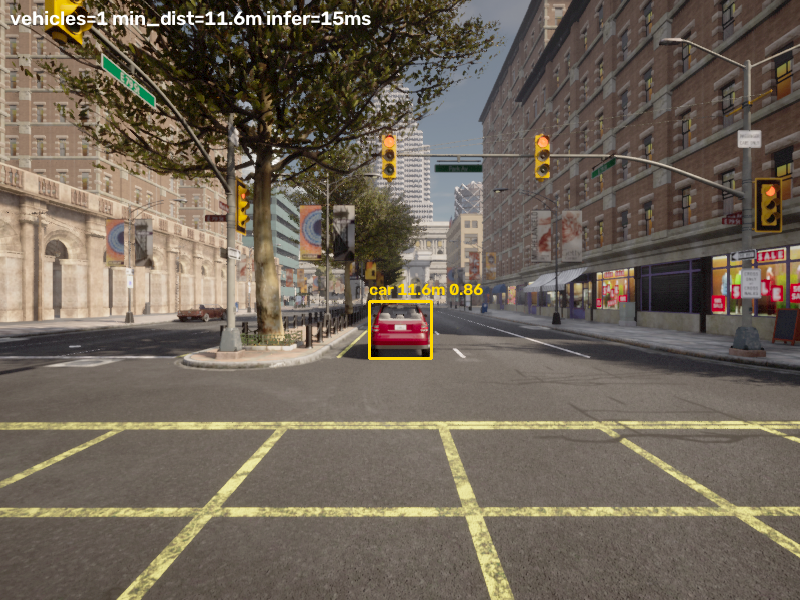
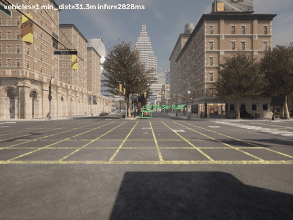
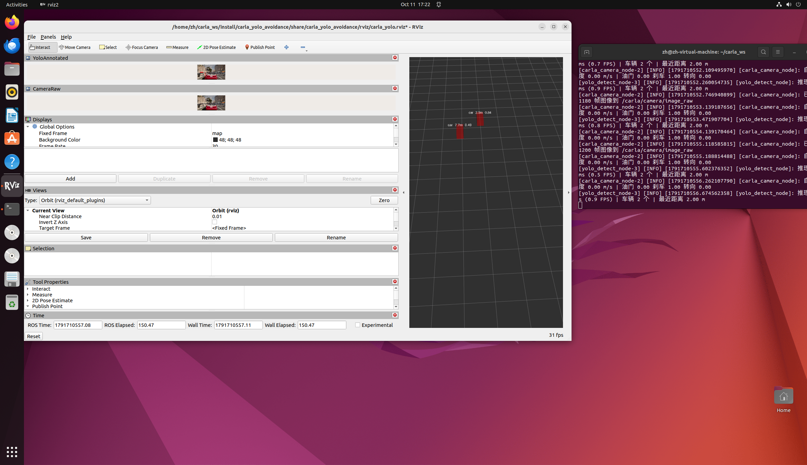

# CARLA + YOLOv8 目标检测感知与车辆减速避障（ROS 2 Humble 封装）

> 对应课程任务：*对地面载具进行物理仿真，通过神经网络感知完成避障决策*。本模块面向**地面载具（车辆）**，
> 在 CARLA 0.9.16 中串起一条完整的 **感知 → 决策 → 控制** 闭环：
> 相机看路（CARLA 前视相机）→ 神经网络认车（YOLOv8 官方预训练权重，仅推理）→ 检测框测距（单目针孔模型）
> → 距离小于安全阈值即刹车（只控油门刹车，不做转向）。

## 1. 概述与目标

### 核心任务目标

1. **车辆物理仿真**：由 CARLA 0.9.16 的 UE4 物理引擎解算车辆纵向动力学，仿真环境由宿主机运行。
2. **神经网络感知**：`yolov8n.pt` 官方预训练权重（COCO 80 类），**只推理不训练**，不包含数据集与训练代码。
3. **单目测距**：用 YOLO 检测框宽度 + 针孔相机模型估算前方车辆距离，不依赖雷达/深度相机。
4. **避障决策**：距离小于安全阈值即刹车、安全距离正常前进，**只做油门刹车纵向控制，不做转向控制**。
5. **ROS 2 多节点**：三个独立节点（相机采集 / YOLO 检测 / 决策控制），支持 RViz 可视化原图与检测框。

### 与已有模块的区别

| 对比项 | 已有 `carla_keyboard_control` | 本模块 `carla_yolo_avoidance` |
|---|---|---|
| 控制方式 | 键盘人工控制（`W/S/A/D`） | **自主避障**：YOLO 感知 + 距离决策 |
| 感知环节 | 无（仅 HUD 回显） | **YOLOv8 神经网络目标检测** + 单目测距 |
| 决策逻辑 | 由人工操作决定 | 距离状态机（前进 / 减速 / 急刹） |
| CARLA 接入 | Python API 直连 | Python API 直连，**不依赖 ros-bridge** |
| 转向控制 | 人工控制 | **强制置零**，只控油门刹车 |

> 与 `src/water/rov_mujoco`、`src/air/*` 等模块的关系：同为「物理仿真 + 控制」作业，本模块面向**地面载具**并引入**神经网络感知**环节。

!!! note "参数不写死（提交规范）"
    CARLA 服务端的 `carla_host`（IP）与 `carla_port`（端口）、YOLO 权重路径**全部配置在**
    `src/ground/carla_yolo_avoidance/config/params.yaml`，由 ROS 参数服务器下发；
    Python 源码不出现硬编码 IP / 端口 / 绝对路径。换机器运行只需修改该 yaml 文件。

---

## 2. 计算原理

### 2.1 YOLOv8 目标检测（仅推理）

- 权重：`yolov8n.pt`（官方预训练，首次运行 ultralytics 自动下载，或放入包内 `weights/`）。
- 推理参数（`config.py`）：

| 参数 | 值 | 说明 |
|---|---|---|
| `YOLO_CONF_THRESHOLD` | 0.35 | 置信度阈值 |
| `YOLO_IOU_THRESHOLD` | 0.45 | NMS 的 IoU 阈值 |
| `YOLO_IMG_SIZE` | 640 | 推理输入尺寸 |
| `YOLO_MAX_DETECTIONS` | 20 | 单帧最多保留目标数 |
| `YOLO_DEVICE` | `''` | 空 = 自动（有 CUDA 用 GPU，否则 CPU） |

- 类别过滤：只保留车辆类 COCO id `2=car`、`3=motorcycle`、`5=bus`、`7=truck`，并用类别名关键词兜底。

### 2.2 单目测距（针孔模型）

由视场角求等效焦距（像素），再用相似三角形反解距离：

$$
f_{px} = \frac{W_{img}/2}{\tan(fov/2)}, \qquad
d = \frac{f_{px} \cdot W_{real}}{w_{px}}
$$

代入本项目参数（`W_img = 800`，`fov = 90°`）：\(f_{px} = 400/\tan45° = 400\) px。

例：真实宽度 1.8 m 的车辆在图像中占 100 px → `400 × 1.8 / 100 = 7.2 m`。

**核心直觉：同一个物体，框越大 → 离得越近。**

各类目标假设真实宽度：

| COCO id | 类别 | 假设真实宽度 |
|---|---|---|
| 2 | car | 1.80 m |
| 3 | motorcycle | 0.80 m |
| 5 / 7 | bus / truck | 2.50 m |
| 其它 | 默认 | 1.80 m |

### 2.3 横向偏移（本车道判定）

$$
lateral = \frac{(bbox_{center\_x} - W_{img}/2) \cdot d}{f_{px}}
$$

正值在右侧、负值在左侧。只有 \(|lateral| < 3.5\,\text{m}\) 的目标参与本车避障，避免旁车道车辆误触发刹车。

### 2.4 避障决策状态机

`decision_control_node` 以 20 Hz 决策（`config.py` 中阈值可调）：

| 条件 | 油门 | 刹车 | 状态 | 含义 |
|---|---|---|---|---|
| 检测超时 > `DETECTION_STALE_TIMEOUT_S`（默认 5.0 s，CPU 推理慢环境） | 0.00 | 1.00 | `STALE_BRAKE` | 感知失效 → 安全刹停 |
| 视野内无车辆 | 0.45 | 0.00 | `CRUISE` | 正常前进 |
| \(d < 8\,\text{m}\) | 0.00 | 1.00 | `FULL_BRAKE` | 急刹 |
| \(8 \le d < 20\,\text{m}\) | 0.00 | 0.35 | `SLOW_DOWN` | 小于安全阈值 → 刹车 |
| \(d \ge 20\,\text{m}\) | 0.45 | 0.00 | `CRUISE` | 安全距离 → 正常前进 |

```text
感知超时 ──► STALE_BRAKE ── 刹车 1.0
d >= 20 m ─► CRUISE      ── 油门 0.45 / 刹车 0
8 <= d < 20─► SLOW_DOWN   ── 油门 0 / 刹车 0.35
d < 8 m ───► FULL_BRAKE   ── 油门 0 / 刹车 1.0
```

**只控油门刹车，不做转向**：控制量第三元素（转向）在任何状态下均为 `0.0`，节点①收到非零转向也会强制置零。

---

## 3. 系统架构

### 3.1 数据流

```text
                    ┌─────────────────────────────────┐
                    │  CARLA 服务端 0.9.16            │
                    │  CarlaUE4.exe -carla-port=<端口> │
                    └───────────┬─────────────────────┘
                                │ PythonAPI (<carla_host>:<carla_port>)
                                │ 来自 config/params.yaml（ROS 参数）
                                ▼
  ┌──────────────────────────────────────────────┐
  │ ① carla_camera_node                          │
  │   生成自车 / 障碍车 / sensor.camera.rgb       │
  │   订阅 /carla/vehicle/control_cmd -> apply_control │
  └───────┬──────────────────────────▲───────────┘
          │ /carla/camera/image_raw  │ /carla/vehicle/control_cmd
          │ sensor_msgs/Image        │ [油门, 刹车, 转向]
          ▼                          │
  ┌──────────────────────────┐       │
  │ ② yolo_detect_node       │       │
  │  YOLOv8 推理 + 单目测距   │       │
  └───┬──────────────┬───────┘       │
      │ /carla/yolo/detections       │
      ▼              ▼               │
  ┌──────────────────────────┐       │
  │ ③ decision_control_node  │───────┘
  │  距离 < 阈值 ? 刹车 : 前进 │
  └──────────────────────────┘
                  │
                  ▼  RViz2：原图 + 检测框
```

### 3.2 话题一览

| 话题 | 消息类型 | 发布者 | 订阅者 | 说明 |
|---|---|---|---|---|
| `/carla/camera/image_raw` | `sensor_msgs/Image`（bgr8） | 节点① | 节点②、RViz | 前视相机原图 800×600 |
| `/carla/yolo/detections` | `std_msgs/String`（JSON） | 节点② | 节点③ | 检测框 + 估算距离 |
| `/carla/yolo/markers` | `visualization_msgs/MarkerArray` | 节点② | RViz | 检测框三维可视化 |
| `/carla/yolo/image_annotated` | `sensor_msgs/Image`（bgr8） | 节点② | RViz | 画框后的图像 |
| `/carla/vehicle/control_cmd` | `std_msgs/Float32MultiArray` | 节点③ | 节点① | `[油门, 刹车, 转向]` |
| `/carla/decision/status` | `std_msgs/String` | 节点③ | 调试 | 决策状态文本 |
| `/tf_static` | `tf2_msgs/TFMessage` | `static_transform_publisher` | RViz | `map → carla_camera_link` |

> 检测框用 JSON 字符串承载，避免额外编译 `vision_msgs` 接口包，复现时少一个失败点。

### 3.3 模块划分

| 文件 | 类型 | 说明 |
|---|---|---|
| `config.py` | 配置 | 话题名、阈值、相机参数、参数文件读取 |
| `carla_env.py` | 工具 | `import carla` / `import ultralytics` 校验与友好报错、连接 CARLA |
| `image_utils.py` | 工具 | `sensor_msgs/Image` ↔ numpy（不依赖 cv_bridge） |
| `distance_estimator.py` | 纯逻辑 | 单目测距数学，可单元测试 |
| `detector.py` | 纯逻辑 | YOLO 输出 → 统一检测结果，可单元测试 |
| `decision_logic.py` | 纯逻辑 | 距离 → 油门/刹车决策，可单元测试 |
| `carla_camera_node.py` | 节点① | CARLA 交互与图像发布 |
| `yolo_detect_node.py` | 节点② | 推理与检测结果发布 |
| `decision_control_node.py` | 节点③ | 决策与控制指令发布 |
| `main.py` | 入口 | 统一入口，按角色启动对应节点 |

**设计要点**：测距、检测后处理、决策三块写成**不导入 rclpy 的纯函数**，既能在 ROS 节点中使用，
也能被单元测试与离线自检工具（`src/ground/carla_yolo_avoidance/tools/carla_yolo_smoke_test.py`）直接调用——**测过的就是跑着的**。

---

## 4. 源码解析

### 4.1 `carla_camera_node.py` — 相机采集节点（节点①）

- 从 ROS 参数读取 `carla_host` / `carla_port`（`params.yaml`），连接 CARLA；
- 生成自车与前方障碍车（**不启用 autopilot**，完全由控制话题驱动），挂载前视 RGB 相机（800×600, fov=90°）；
- 在 CARLA 图像回调中按配置上限 `CAMERA_PUBLISH_FPS=20.0`（节流上限，非实际帧率）发布 `/carla/camera/image_raw`；受仿真帧率与回调速度限制，实测该话题约 **6.6 Hz**（YOLO 推理结果 `/carla/yolo/detections` 约 0.83 Hz）。同时订阅 `/carla/vehicle/control_cmd` 将油门/刹车写入 CARLA（该话题由决策节点以 20 Hz 定时器发布，实测约 20 Hz）；
- 初始控制量为「刹车 1.0」安全兜底，收到决策指令后才前进；退出时销毁自车/障碍车/相机，不残留车辆。

### 4.2 `yolo_detect_node.py` — YOLO 检测节点（节点②）

- 订阅图像，Best Effort + depth=1 QoS（推理慢时丢旧帧、永远处理最新画面）；
- `model.predict()` 推理 → 类别过滤 → 单目测距 + 横向偏移判定；
- 发布检测结果 JSON、检测框 MarkerArray、画框后图像（供 RViz 显示）。

### 4.3 `decision_control_node.py` — 决策控制节点（节点③）

- 订阅检测结果，按 2.4 节状态机以 20 Hz 发布 `[油门, 刹车, 转向]`；
- 即使没有新检测也持续发布，保证行为连续；转向恒为 0。

### 4.4 单元测试

```bash
python3 src/ground/carla_yolo_avoidance/test/test_decision_logic.py
python3 -m pytest src/ground/carla_yolo_avoidance/test -v
```

覆盖测距公式、检测后处理、决策状态机、参数解析；**无需 CARLA 服务端即可运行**。

---

## 5. 仿真运行步骤

### 5.1 支持与测试环境

| 组件 | 版本 / 说明 |
|---|---|
| 仿真器 | CARLA 0.9.16（服务端运行于有 GPU 的宿主机 Windows） |
| 客户端系统 | Ubuntu 22.04（虚拟机） |
| ROS | ROS 2 Humble（Python 3.10） |
| Python 依赖 | `ultralytics`、`numpy<2`、`opencv-python`、`carla==0.9.16`（cp310 匹配） |

!!! warning "numpy 版本"
    本模块验证使用的组合为 **torch 2.2.2 + torchvision 0.17.2 + numpy 1.26.x**。
    numpy 必须 < 2，否则 torch 2.2.2 导入时报 `_ARRAY_API not found`。

### 5.2 步骤 0：启动 CARLA 服务端

在运行 CARLA 服务端的机器（宿主机）上，进入 CARLA 0.9.16 解压目录，执行：

```bash
CarlaUE4.exe -carla-port=2000
```

端口参数 `-carla-port` 必须与 `config/params.yaml` 中的 `carla_port` 一致（本模块按仓库约定使用 **2000**）。
服务端窗口出现 `Waiting for external commands...` 后，再继续后续步骤。

### 5.3 步骤 1：安装依赖

```bash
# 0) 先升级 pip（Ubuntu 22.04 自带 pip 22.0.2 不支持 --break-system-packages，
#    不升级会直接报 usage 错误）
python3 -m pip install --user --upgrade pip

# 1) torch/torchvision 版本对（必须先装：ultralytics 默认会拉最新 torch，
#    与 torchvision 不匹配，运行时报 "operator torchvision::nn does not exist"）
python3 -m pip install --user --break-system-packages torch==2.2.2 torchvision==0.17.2 --index-url https://mirror.sjtu.edu.cn/pytorch-wheels/cpu

# 2) Python 依赖（numpy<2 与 torch 2.2.2 兼容）
python3 -m pip install --user --break-system-packages ultralytics "numpy<2"

# 3) CARLA 0.9.16 客户端（PyPI 官方提供 cp310 wheel，与 Python 3.10 匹配）
python3 -m pip install --user --break-system-packages carla==0.9.16
```

### 5.4 步骤 2：编译本功能包（ROS 2）

本仓库 `src/ground/carla_yolo_avoidance/` 即 ROS 2 功能包。先把仓库克隆到工作空间的 `src/` 下：

```bash
mkdir -p ~/ros2_ws/src && cd ~/ros2_ws/src
git clone https://github.com/OpenHUTB/ros2.git      # 换成你自己的 fork 亦可
```

目录关系如下，`colcon build` 必须在**工作空间根目录**执行：

```
~/ros2_ws/                                   <- 工作空间根目录，colcon 在这里运行
└── src/
    └── ros2/                                <- 本仓库（git clone 得到）
        └── src/ground/
            └── carla_yolo_avoidance/        <- 本模块源代码
```

因此后文写的 `src/ground/carla_yolo_avoidance/...`，实际路径是
`~/ros2_ws/src/ros2/src/ground/carla_yolo_avoidance/...`。编译并激活环境：

```bash
cd ~/ros2_ws
colcon build --packages-select carla_yolo_avoidance --symlink-install
source install/setup.bash
```

### 5.5 步骤 3：配置 CARLA 连接（唯一需要改的地方）

修改 `src/ground/carla_yolo_avoidance/config/params.yaml`：

```yaml
/carla_camera_node:
  ros__parameters:
    carla_host: "<宿主机IP>"    # 客户端与 CARLA 不在同一台机器时，填运行 CARLA 那台机器的 IP（宿主机执行 ipconfig 查看）
    carla_port: 2000            # 与启动 CARLA 的 -carla-port 一致
```

改完**无需修改任何 Python 源码、无需重新编译**。

### 5.6 步骤 4：验证连接

```bash
python3 -c "import carla; c=carla.Client('<宿主机IP>',2000); c.set_timeout(10); print('CONNECT OK:', c.get_world().get_map().name)"
```

输出 `CONNECT OK: Carla/Maps/Town10HD_Opt` 即连接成功。

### 5.7 步骤 5：运行

```bash
ros2 launch carla_yolo_avoidance carla_yolo_avoidance.launch.py
# 虚拟机无 3D 加速、RViz 打不开时，可关闭 RViz（不影响感知-避障逻辑）：
ros2 launch carla_yolo_avoidance carla_yolo_avoidance.launch.py use_rviz:=false
# 需要单独看 RViz 时：
rviz2 -d src/ground/carla_yolo_avoidance/rviz/carla_yolo.rviz
```

### 5.8 运行效果

下图为运行时的检测画面、避障过程与最终测试画面，截图存放于 `../img/ground/`：

#### YOLO 检测画面（带车实跑）



*CARLA 前视相机中 YOLOv8 检测出前方车辆 `car 11.6m 0.86`（黄色框表示处于减速区）*

#### 减速避障过程（动图）



*自车从 35 m 外接近 → 距离 < 20 m 触发刹车 → 停在障碍车后方*

#### RViz 最终测试画面



*RViz 同时识别 2 辆车（`car 7.7m 0.49` / `car 2.0m 0.84`），近距触发刹车（油门 0.00 / 刹车 1.00），无报错*

```text
[yolo_detect_node] 车辆 2 个 | 最近距离 1.99 m     ← YOLO 检测 + 测距
[decision_control_node] 决策=SLOW_DOWN 油门 0.00 刹车 0.35 转向 0.00   ← 避障生效
```

### 5.9 常见问题

| 现象 | 解决 |
|---|---|
| `ModuleNotFoundError: No module named 'carla'` | 确认 `pip3 install carla==0.9.16` 与运行节点用**同一解释器** |
| `operator torchvision::nn does not exist` | torch/torchvision 版本不匹配，按 5.3 步骤 1 重装版本对 |
| `Failed to initialize NumPy: _ARRAY_API not found` | numpy ≥ 2 与 torch 2.2.2 冲突，装 `numpy<2` |
| 连接超时（`time-out`） | `params.yaml` 中 `carla_host` 填错：应填**运行 CARLA 的宿主机**的 IP，而不是客户端机器的网关 IP；宿主机上执行 `ipconfig` 查看其 IP |
| 一直刹停、日志报「检测数据超时」 | CPU 推理较慢导致超时时，适当调大 `config.py` 中 `DETECTION_STALE_TIMEOUT_S`（当前 5.0 s）后重新 `colcon build` |

---

## 6. 性能评价

- **感知能力**：`yolov8n` 在 CPU 虚拟机约 0.5~1 FPS（宿主机 GPU 下 10~30 FPS），多目标检测与测距正确。
- **决策正确性**：距离状态机行为符合预期——近车刹车（`SLOW_DOWN`/`FULL_BRAKE`）、无车前进（`CRUISE`）。
- **架构解耦**：纯逻辑模块与 ROS 解耦，单元测试即验证实际运行逻辑。
- **可复现性**：IP/端口/阈值全部外部配置，换机器仅改 `params.yaml` 与 `config.py` 阈值，不修改业务代码。

---

!!! note "AI 声明"
    本项目源码与本文档由大模型辅助生成（DeepSeek、豆包协助整理与排错），
    提交者已对提交内容负全部责任，并已在真实 CARLA 0.9.16 环境中完成端到端运行验证。
