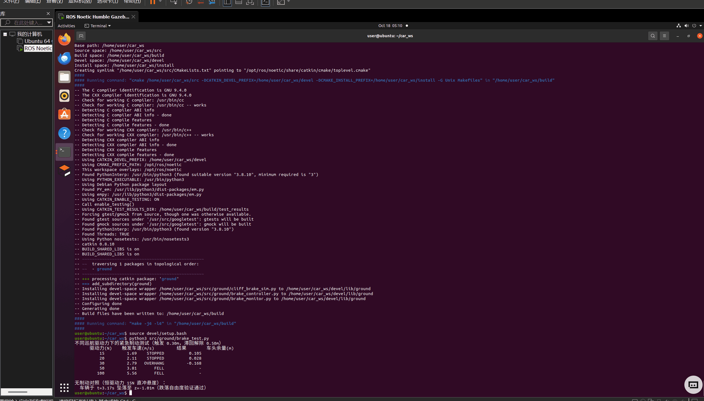
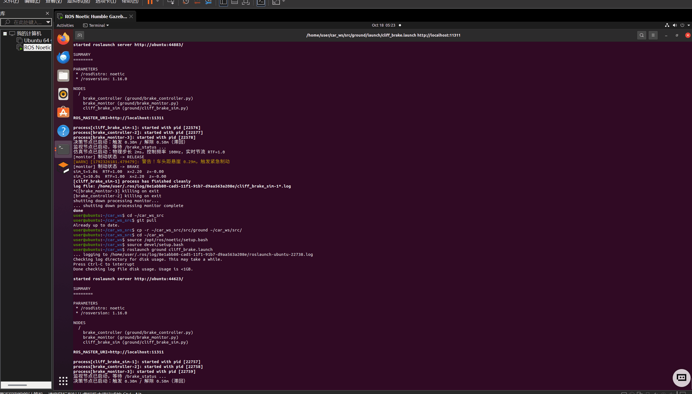

# 基于 ROS 与 MuJoCo 的悬崖边缘紧急制动仿真

## 一、项目简介

本项目基于 **MuJoCo** 物理引擎与 **ROS Noetic** 框架，实现了一个地面无人车在行驶过程中的悬崖检测与紧急制动安全系统。

系统采用**三节点分布式架构**：物理仿真与传感/执行节点、滞回决策节点、状态监视节点通过 ROS 话题构成完整闭环。无人车底盘具有竖直方向的跌落自由度——越过悬崖边缘会**真实坠落**，紧急制动系统必须在车头到达边缘前将车停住。

## 二、项目目录结构

```text
 catkin_ws/
    ├── src/ground/cliff_brake/
    │   ├── CMakeLists.txt            # 编译配置
    │   ├── package.xml               # 依赖声明
    │   ├── requirements.txt          # Python 依赖
    │   ├── main.sh                   # 一键入口：安装依赖并启动
    │   ├── README.md                 # 模块说明
    │   ├── launch/
    │   │   └── main.launch           # 一键启动三节点
    │   ├── cliff_brake_sim.py        # 物理仿真 + 传感 + 执行节点
    │   ├── brake_controller.py       # 滞回决策节点
    │   ├── brake_monitor.py          # 状态监视节点
    │   └── brake_test.py             # 定量制动测试
    └── docs/
        └── ground/cliff_brake.md     # 本文档
```

## 三、环境依赖

- Ubuntu 20.04 + **ROS Noetic**（注：Melodic 基于 Python 2，无法运行本项目的 Python 3 脚本，请勿使用 18.04）
- Python 3.8+
- MuJoCo Python bindings：由模块内 `requirements.txt` 声明并固定到已验证版本（`mujoco==3.1.6`、`numpy==1.24.4`），安装命令 `pip3 install -r src/ground/cliff_brake/requirements.txt`；本文定量测试数据由该版本组合实测生成，其他版本下物理结果可能有微小差异
- rospy、std_msgs

## 四、编译与启动步骤

1. 安装 Python 依赖：

   ```bash
   pip3 install -r src/ground/cliff_brake/requirements.txt
   ```

2. 编译工作空间并加载环境：

   ```bash
   cd ~/catkin_ws
   catkin_make
   source devel/setup.bash
   ```

3. 给脚本添加可执行权限：

   ```bash
   chmod +x src/ground/cliff_brake/*.py src/ground/cliff_brake/main.sh
   ```

4. 一键启动三节点：

   ```bash
   roslaunch cliff_brake main.launch
   ```

   也可直接用模块入口脚本：`./src/ground/cliff_brake/main.sh`

   或分步启动（需要三个终端，每个都先 `source devel/setup.bash`）：

   ```bash
   roscore
   rosrun cliff_brake cliff_brake_sim.py
   rosrun cliff_brake brake_controller.py
   rosrun cliff_brake brake_monitor.py
   ```

5. 运行成功的终端输出见第九节。

> 提示：`cliff_brake_sim.py` 需要图形界面。在无显示环境或虚拟机软件渲染下，`mujoco.viewer` 可能卡顿或无法打开，此时请只运行无需界面的 `brake_test.py` 获取定量数据。

## 五、系统架构

| 节点 | 订阅 | 发布 | 职责 |
|---|---|---|---|
| `cliff_brake_sim` | `/brake_cmd` | `/ultrasonic_distance` | MuJoCo 物理推进；读取车头传感器距离并发布；按制动指令施加制动力 |
| `brake_controller` | `/ultrasonic_distance` | `/brake_cmd`、`/brake_status` | 滞回阈值决策：触发/解除制动 |
| `brake_monitor` | `/brake_status` | — | 状态监视，演示真实订阅者 |

话题一览：

| 话题 | 类型 | 频率 | 说明 |
|---|---|---|---|
| `/ultrasonic_distance` | `std_msgs/Float32` | 100 Hz（仿真时间） | 车头 sensor_site 到悬崖边缘的距离 |
| `/brake_cmd` | `std_msgs/Bool` | 100 Hz（仿真时间） | 制动执行指令 |
| `/brake_status` | `std_msgs/Bool` | 100 Hz（仿真时间） | 制动状态（持续发布，订阅者任意时刻加入均可获得当前状态） |

## 六、核心逻辑与安全策略

1. **物理模型**：MuJoCo 构建带悬崖的双层地形。底盘为平移滑动关节（x 驱动方向 + z 竖直方向）——**z 自由度使跌落在物理上可能发生**；若取消制动让车直冲悬崖，车辆会坠落下层平台（见第七节对照测试）。注意：平移滑动关节是对轮胎的极大简化（见第八节 TODO），并非 Holonomic 完整约束意义上的建模。
2. **传感模拟**：距离基于车头 `sensor_site`（x 方向偏移 0.2m）计算，而非车身中心。悬崖边缘坐标 `CLIFF_X=2.5` 与地形几何严格对应（floor：`pos=-1.25`，`size=3.75`）。
3. **安全策略（滞回控制）**：
   - 车头距离 < `BRAKE_DIST=0.3m` → **触发**制动
   - 车头距离 > `RELEASE_DIST=0.5m` → **解除**制动
   - 滞回带（0.3~0.5m）防止车辆在阈值边界反复抖振
4. **制动执行（纯力控）**：制动力与车速成比例、方向恒与运动相反，经饱和限幅后通过执行器施加：

   ```
   F_brake = clip(-KV_BRAKE · vx, -FMAX_BRAKE, 0)
   ```

   不直接改写速度状态（qvel）；车速降为零后制动力自然归零，不会倒推车辆。这是**基于力的简化动力学制动**（制动力经 MuJoCo actuator 施加、参与动力学积分），轮胎级制动模型见 TODO。
5. **控制节拍与实时节流**：控制按仿真时间 100 Hz 定频。仿真整体按墙钟节流到 **RTF≈1.0**（目标实时率 `TARGET_RTF=1.0`）——这一点至关重要：若放任 RTF 高达 ~28（本模型的裸算速度），车辆穿过 0.3m 触发区的过程只占几毫秒真实时间，与 ROS 话题毫秒级传输延迟同量级，制动指令会迟到、车辆在指令到达前冲出边缘；节流到 1x 后，ROS 延迟折算回仿真时间仅数毫秒，制动可靠。软件渲染过慢时节流自动失效，RTF 自然低于 1，行为安全但画面变慢。实时率由程序实测打印（`sim_t / wall_t`），不预设"高实时"。

参数表（位于 `cliff_brake_sim.py` 顶部，调整后请同步 `brake_test.py`）：

| 参数 | 默认值 | 说明 |
|---|---|---|
| `CLIFF_X` | 2.5 m | 悬崖边缘 x 坐标（与 floor 几何对应） |
| `CTRL_DT` | 0.01 s | 控制/发布周期（100 Hz） |
| `DRIVE_FORCE` | 15 N | 巡航驱动力 |
| `KV_BRAKE` | 150 N/(m/s) | 制动力速度增益 |
| `FMAX_BRAKE` | 100 N | 制动力饱和上限 |
| `TARGET_RTF` | 1.0 | 目标实时率（墙钟节流，见第六节第 5 条） |
| `BRAKE_DIST` | 0.3 m | 制动触发阈值（车头） |
| `RELEASE_DIST` | 0.5 m | 制动解除阈值（滞回） |

## 七、定量测试

无需 ROS 与图形界面，直接运行：

```bash
python3 src/ground/cliff_brake/brake_test.py
```

实测结果（mujoco 3.1.6，触发阈值 0.3m，滞回解除 0.5m）：

| 巡航驱动力 (N) | 触发车速 (m/s) | 结果 | 车头余量 (m) |
|---:|---:|---|---:|
| 15 | 1.69 | STOPPED（安全停住） | 0.105 |
| 20 | 2.11 | STOPPED（安全停住） | 0.028 |
| 30 | 2.79 | OVERHANG（车头越界，重心仍在台上） | -0.168 |
| 50 | 3.81 | FELL（坠落） | — |
| 100 | 5.56 | FELL（坠落） | — |

无制动对照：恒定 15N 驱动力直冲悬崖，车辆于 t=3.17s 坠落至 z=-1.01m——**跌落自由度验证通过**。

**安全包络结论**：当前制动力参数（KV=150、FMAX=100）下，触发车速不超过约 **2.1 m/s** 可安全停住。若需更高巡航速度，应增大 `KV_BRAKE`/`FMAX_BRAKE`，或提前触发阈值 `BRAKE_DIST`。测试数据请以本机实际运行 `brake_test.py` 的输出为准。

## 八、局限与后续展望

1. **已验证**：滞回阈值触发的紧急停障策略在安全包络内可靠工作（见第七节定量数据）。
2. **已验证**：三节点 ROS 通信闭环，传感/决策/执行/监视职责分离，话题状态持续发布。
3. **TODO**：底盘目前为平移滑动关节（对轮胎的极大简化）。后续将接入真实轮胎的旋转关节与打滑（Slip）物理模型，验证雨雪天气下的制动距离补偿。
4. **TODO**：当前传感器为基于地标的数学计算模拟，后续可接入 MuJoCo 内部 raycast 射线检测接口，模拟真实激光雷达/超声波的物理反射。
5. **待联调**：第七节安全包络基于当前简化模型；接入轮胎模型后制动距离将变长，包络需重新标定。

## 九、运行效果

- 图 1：编译成功截图：

  

- 图 2：运行效果演示：

  
