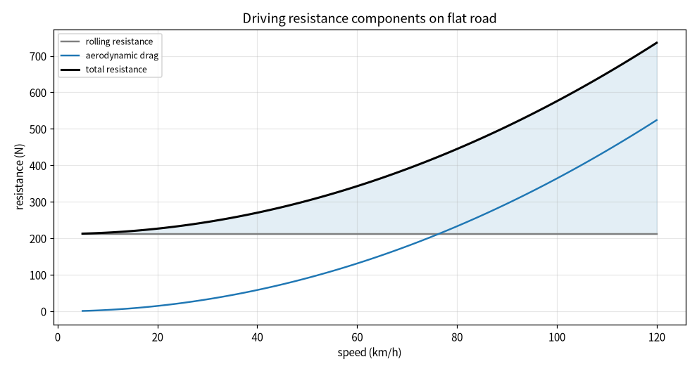
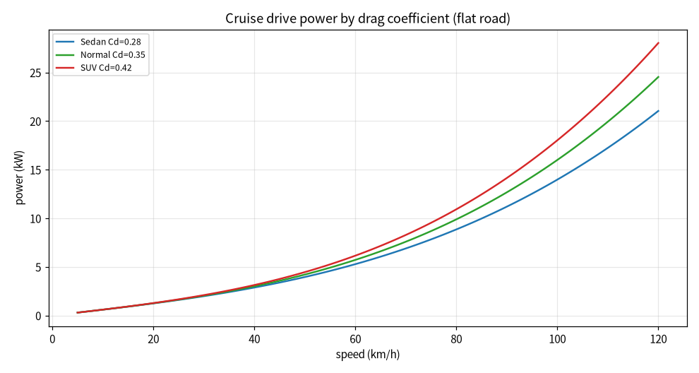
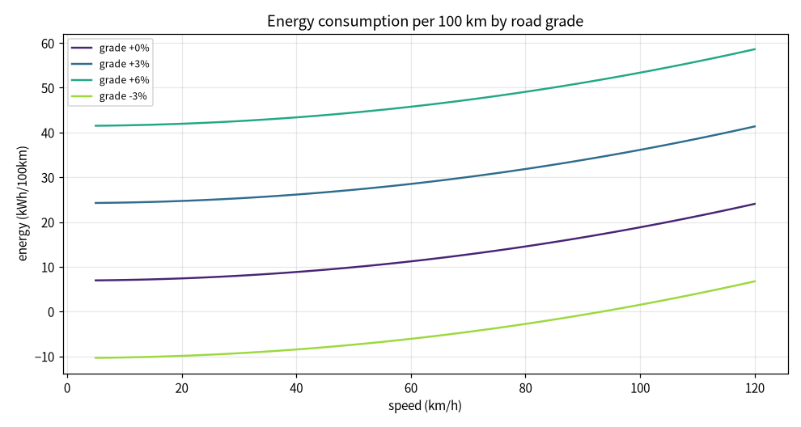
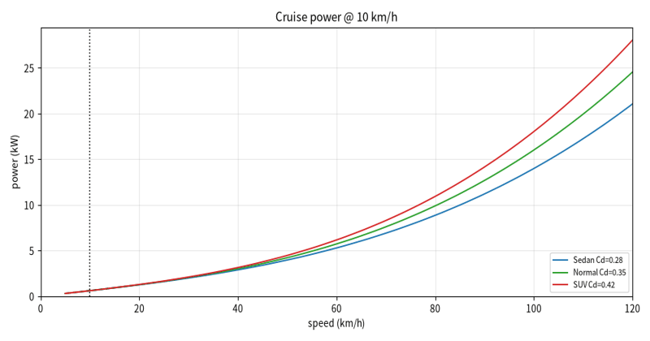

# 巡航风阻与能耗敏感性分析

本文介绍一个纯 Python（numpy + matplotlib + Pillow）实现的车辆巡航阻力与能耗分析模块。模块把行驶阻力分解为滚动阻力、坡度阻力与空气阻力，在不同车速、风阻系数（车型）与道路坡度下计算总阻力、驱动功率与百公里能耗，量化车速、空气动力学外形和坡度对巡航能耗的影响。

## 1. 运行环境

| 项目 | 版本 / 说明 |
| --- | --- |
| 操作系统 | Windows 10 / 11（Linux 亦可，脚本后台出图，无需图形界面） |
| 仿真平台 | 纯 Python 数值仿真，不依赖 ROS / Gazebo / CARLA |
| Python | 3.10 ~ 3.12 |
| 依赖 | `numpy`、`matplotlib`、`Pillow`；`mujoco` 为可选，仅用于车型场景静态图离屏渲染 |

### 1.1 安装依赖

1. 创建并激活虚拟环境：

   ```bash
   python -m venv cruise_env
   # Windows: cruise_env\Scripts\activate
   # Linux:  source cruise_env/bin/activate
   ```

2. 安装依赖：

   ```bash
   pip install numpy matplotlib Pillow   # mujoco>=3.0 可选，用于车型场景静态图
   ```

### 1.2 验证环境

```bash
python -c "import numpy, matplotlib, PIL; print('dependencies ok')"
```

输出 `dependencies ok` 即表示依赖安装完成。

## 2. 实验原理

### 2.1 阻力分解

匀速巡航时车辆受到三类阻力：

```
F_rr = μ_rr · m · g · cosθ        # 滚动阻力
F_gr = m · g · sinθ               # 坡度阻力
F_ad = ½ · ρ · Cd · A · v²        # 空气阻力
F_tot = F_rr + F_gr + F_ad
```

| 参数 | 取值 | 说明 |
| --- | --- | --- |
| 满载质量 m | 1800 kg | — |
| 滚动阻力系数 μ_rr | 0.012 | 沥青 / 水泥路面典型值 |
| 空气密度 ρ | 1.225 kg/m³ | 标准大气 |
| 迎风面积 A | 2.2 m² | — |
| 驱动 / 传动综合效率 η | 0.85 | 能耗折算用 |

### 2.2 功率与能耗

```
P = F_tot · v                    # 驱动功率 (W)
E(百公里) = F_tot · 100000 / η / 3.6×10⁶   # kWh/100km
```

### 2.3 对比工况

- **车型（风阻系数）**：轿车 Cd=0.28、普通车型 Cd=0.35、SUV Cd=0.42，平路对比功率；
- **道路坡度**：0%、+3%、+6%、−3%，普通车型对比百公里能耗；
- **车速扫描**：5 ~ 120 km/h，并在 60 / 90 / 120 km/h 统计指标。

## 3. 代码结构

完整源码位于：[`src/ground/cruise_drag_energy_eval/main.py`](https://github.com/OpenHUTB/ros2/tree/master/src/ground/cruise_drag_energy_eval)

| 代码段 | 作用 |
| --- | --- |
| 车辆参数 | 质量、滚动阻力系数、空气密度、迎风面积、驱动效率 |
| 阻力分解 | `resistance()` 计算滚动、坡度、空气与总阻力 |
| 功率 / 能耗 | `power_kw()`、`energy_kwh_per_100km()` 折算功率与百公里能耗 |
| 批量汇总 | `summarize()` 统计各车速、坡度指标写入 `metrics.csv` |
| 绘图 | 阻力分量图、车型功率对比图、坡度能耗图、演示动图逐帧渲染、MuJoCo 场景静态帧离屏渲染 |

关键阻力计算：

```python
f_rr = MU_RR * mass * G * cos_th
f_gr = mass * G * sin_th
f_ad = 0.5 * RHO * cd * FRONT_AREA * v_ms * v_ms
f_tot = f_rr + f_gr + f_ad
```

## 4. 运行步骤

1. 安装依赖（见 1.1）。
2. 在源码目录运行：

   ```bash
   python main.py
   ```

3. 控制台打印各坡度、车速下的阻力、功率与能耗；`results/` 目录生成全部图片与数据表。

## 5. 实验结果

### 5.1 阻力分量



低速时滚动阻力近似水平直线、占主导；空气阻力随车速平方增长，约在 70~80 km/h 之后反超滚动阻力，成为高速巡航的主要阻力来源。

### 5.2 车型风阻对功率的影响



三种车型低速功率接近，车速越高风阻系数带来的功率差距越大；120 km/h 时 SUV（Cd=0.42）所需功率明显高于轿车（Cd=0.28）。

### 5.3 坡度对能耗的影响



上坡能耗随坡度显著升高，+6% 坡度在 120 km/h 时百公里能耗接近 59 kWh；下坡（−3%）低速时坡度助力超过滚动与空气阻力，能耗为负，表示车辆处于制动或能量回收状态。

### 5.4 指标数据（普通车型 Cd=0.35）

| 坡度 | 车速 (km/h) | 总阻力 (N) | 驱动功率 (kW) | 能耗 (kWh/100km) |
| --- | --- | --- | --- | --- |
| 0% | 60 | 342.9 | 5.72 | 11.21 |
| 0% | 90 | 506.7 | 12.67 | 16.56 |
| 0% | 120 | 735.9 | 24.53 | 24.05 |
| +3% | 60 | 872.3 | 14.54 | 28.51 |
| +3% | 90 | 1036.1 | 25.90 | 33.86 |
| +3% | 120 | 1265.3 | 42.18 | 41.35 |
| +6% | 60 | 1400.1 | 23.34 | 45.75 |
| +6% | 90 | 1563.9 | 39.10 | 51.11 |
| +6% | 120 | 1793.1 | 59.77 | 58.60 |
| −3% | 60 | −186.7 | −3.11 | −6.10 |
| −3% | 90 | −22.9 | −0.57 | −0.75 |
| −3% | 120 | 206.3 | 6.88 | 6.74 |

### 5.5 演示动图



### 5.6 车型场景静态图


三辆车分别对应轿车（蓝，低扁）、普通车型（绿）、SUV（红，偏高），斜俯视网格地面上的场景画面；车体体型仅用于可视化风阻外形差异，配色与车型功率对比图一致。该画面为离屏渲染的可视化示意，不代表实车或高保真仿真结果。

## 6. 结论

- **车速是能耗的强非线性因素**：空气阻力与车速平方成正比，驱动功率与车速三次方相关，从 60 提到 120 km/h，平路百公里能耗约从 11.2 升到 24.1 kWh，提高一倍以上。
- **风阻外形在高速段收益明显**：降低 Cd 主要减小高速空气阻力，市区低速巡航收益有限；SUV 等高风阻车型高速能耗代价更大。
- **坡度对能耗的影响高于风阻**：+6% 坡即使在 60 km/h，百公里能耗也达到 45.75 kWh，接近平路 120 km/h 水平；长上坡需要预留足够功率与续航余量。

需要注意：本实验为稳态匀速阻力 / 能耗估算，未计入加减速惯性、弯道阻力、轮胎温升、空调与附件功耗；实际整车能耗应结合行驶循环工况与实测数据标定。

## 声明

本作业使用豆包（Doubao）大模型辅助编写代码与文档，作者已复核阻力分解、功率与能耗折算公式及工况对比，对提交内容负全部责任。
